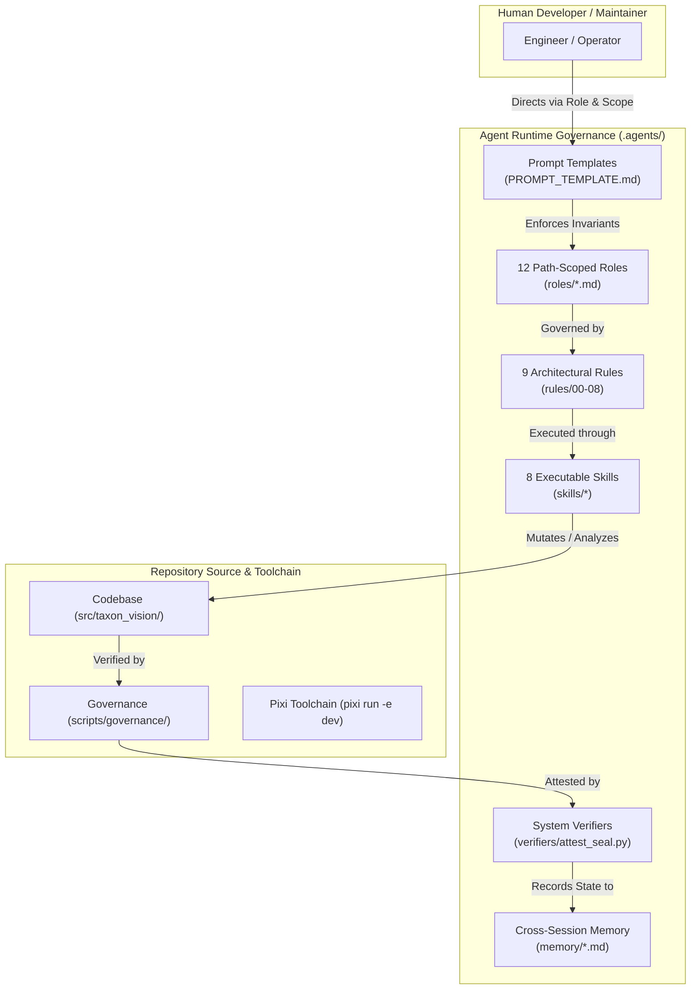

# TaxonVision Multi-Agent System: Human Operator Guide

This guide explains the architecture, operational protocols, and best practices for human engineers working alongside autonomous AI coding agents (specifically Google Antigravity) within the TaxonVision-MLOps repository.

---

## 1. Dual-Audience Architecture

The repository enforces a strict separation between machine-consumed context and human-facing documentation:

* **`AGENTS.md` (Machine Ingest):** A token-compact ($< 1{,}000$ tokens) master routing matrix located at the repository root ([root AGENTS.md](AGENTS.md)). It is ingested into the AI agent's active system prompt, establishing path-to-test mappings, toolchain commands, and hard negative constraints.
* **[.agents/README.md](README.md) (Human Guide):** This document. It provides human maintainers and developers with the theoretical foundation, operational procedures, and step-by-step workflows necessary to govern, direct, and audit agent behavior.
* **[.agents/index.md](index.md) (Decision Matrix):** The primary indexing and decision tree linking source paths to specialized roles and pre-commit verification requirements.

---

## 2. Directory Layout & Ecosystem Anatomy

The `.agents/` directory is structured as a deterministic governance engine:



* **[roles/](roles/):** 12 path-scoped agent personas. Each role file defines explicit file ownership boundaries, permitted actions, and forbidden operations.
* **[rules/](rules/):** 9 immutable engineering mandates covering Python modernization, MLOps determinism, latency budgets, Git signing, markdown syntax, licensing, conformal prediction, hardware invariants, and clean code AST standards.
* **[skills/](skills/):** Self-contained, executable agent workflows formatted under Google's Open Knowledge Format (OKF v0.2).
* **[memory/](memory/):** Persistent cross-session knowledge banks recording architecture maps, complexity baselines, and Pareto trade-off frontiers.
* **[verifiers/](verifiers/):** Standalone gate runners, including [attest_seal.py](verifiers/attest_seal.py), that execute all 8 pre-commit verification checks.
* **[toolchain.yaml](toolchain.yaml):** Machine-readable configuration defining resolved execution commands (`pixi run -e dev`), fast test sweeps, and task runners (`just`).
* **[PROMPT_TEMPLATE.md](PROMPT_TEMPLATE.md):** Reusable prompt wrappers enforcing token-optimal read scopes and step-by-step verification protocols.

---

## 3. How to Pair-Program with Autonomous Agents

To achieve reliable, regression-free results when directing an AI assistant like Antigravity, follow the five-step Token-Optimal Execution Protocol:

### Step 1: Identify Domain & Trigger Role

Never prompt an agent with a generic request. Assign a concrete role from the [Role Registry](#4-role-registry--ownership-matrix) matching your task domain. For example:
> "Act as @04-model-engineer to implement class-balanced loss weighting in `src/taxon_vision/models/loss.py`."

### Step 2: Set Strict Read Scopes

AI agents can experience context pollution when scanning large file trees. Explicitly bound the agent's read scope to 2 to 4 relevant source files, and explicitly forbid scanning heavy generated artifacts:
> "Allowed Read Scope: ONLY read `src/taxon_vision/models/loss.py` and `tests/unit/test_models_components.py`. Do NOT scan `openwiki/.claims/`, `pixi.lock`, `dvc.lock`, or `docs/latex/*.pdf`."

### Step 3: Require Plan Before Modification

Instruct the agent to produce a concise plan (under 15 lines) outlining exact lines, functions, or mathematical formulas to change before editing any code.

### Step 4: Fast Targeted Iteration

During active coding, tell the agent to run only the targeted test suite without global coverage overhead:

```bash
pixi run -e ci-dev pytest tests/unit/test_models_components.py -q -o "addopts="
```

### Step 5: Full Attestation Seal

Once targeted changes pass, require the agent to execute the full pre-commit gate suite:

```bash
pixi run -e dev python .agents/verifiers/attest_seal.py
```

---

## 4. Role Registry & Ownership Matrix

The 12 path-scoped roles partition responsibilities to avoid cross-domain regressions:

| Role ID & File | Title | Primary Path Scope | Mandatory Pre-Commit Gate |
| :--- | :--- | :--- | :--- |
| **[@01](roles/01-orchestrator.md)** | Orchestrator | `AGENTS.md`, `.agents/`, root configs | `validate_okf.py`, `attest_seal.py` |
| **[@02](roles/02-taxonomic-architect.md)** | Taxonomic Architect | `src/taxon_vision/domain/`, catalog YAMLs | `pytest tests/unit/test_config.py` |
| **[@03](roles/03-mlops-data-engineer.md)** | MLOps Data Engineer | `src/taxon_vision/data/`, DVC stages | `python -m taxon_vision.pipelines.audit_license` |
| **[@04](roles/04-model-engineer.md)** | Model Engineer | `src/taxon_vision/models/`, training loops | `pytest tests/unit/test_models_components.py` |
| **[@05](roles/05-inference-optimizer.md)** | Inference Optimizer | `src/taxon_vision/inference/`, ONNX graphs | `pytest tests/unit/test_onnx_exporter.py` |
| **[@06](roles/06-uncertainty-safety-engineer.md)** | Uncertainty Safety Engineer | `src/taxon_vision/uncertainty/` | `pytest tests/unit/test_conformal_bounds.py` |
| **[@07](roles/07-active-learning-engineer.md)** | Active Learning Engineer | `src/taxon_vision/active_learning/` | `pytest tests/unit/test_active_learning.py` |
| **[@08](roles/08-observability-engineer.md)** | Observability Engineer | `src/taxon_vision/monitoring/`, telemetry | `pytest tests/unit/test_monitoring.py` |
| **[@09](roles/09-api-and-ui-developer.md)** | API & UI Developer | `src/taxon_vision/service/`, templates | `pytest tests/integration/test_api_endpoints.py` |
| **[@10](roles/10-qa-automator.md)** | QA Automator | `tests/`, fixtures, Hypothesis suites | Full pytest suite with coverage |
| **[@11](roles/11-docs-librarian.md)** | Docs Librarian | `docs/`, `openwiki/`, `.agents/memory/` | `validate_okf.py`, `verify_hardware_invariants.py` |
| **[@12](roles/12-git-operator.md)** | Git Operator | `.github/`, `Justfile`, release tags | Signed commit checks (`git commit -S`) |

---

## 5. Architectural Rules & Invariant Enforcement

Rules in [rules/](rules/) represent non-negotiable architectural contracts. Agents must satisfy all rules:

* **[Rule 00 (Python Modernization)](rules/00-python-modernization.md):** Pixi exclusivity (`pixi run -e dev`), zero `hasattr`/`getattr` dynamic reflection, zero magic numbers, zero eager submodule imports in `__init__.py`, and strict cognitive complexity ceiling $< 15$ (`complexipy`).
* **[Rule 01 (MLOps Reproducibility)](rules/01-mlops-reproducibility.md):** Deterministic PRNG seeding from `params.yaml:seed` (42), 7-stage pure-function DVC DAG, immutable tensor split hashes, and non-overlapping Epistemic Diamond splits (70/10/10/10).
* **[Rule 02 (Inference Latency Invariants)](rules/02-inference-latency-invariants.md):** Zero memory allocation on hot execution paths (`predict_logits`), pre-allocated contiguous C-order buffers, p95 latency $\le 15\,\text{ms}$ on i7-14700K (CPU INT8) and $\le 10\,\text{ms}$ on RTX 5070 Ti (GPU FP16).
* **[Rule 03 (Git Security & Signing)](rules/03-git-security-and-signing.md):** Mandatory cryptographic commit signing (`git commit -S`), hard escalation on signature failure, and zero `--no-gpg-sign` overrides.
* **[Rule 04 (Markdown Formatting & Editorial Idiom)](rules/04-markdown-formatting.md):** Standard hyphens (`-`), `*` unordered lists indented 4 spaces, exact 1 blank line padding, zero trailing whitespace, British English orthography (`optimise`, `analyse`, `behaviour`, `modelling`, `artefact`), and an analytical German-native idiom (pragmatic ballast pruning, structured causal transitions, and hyphenated scope qualifications).
* **[Rule 05 (Open License Compliance)](rules/05-open-license-compliance.md):** CC0, CC-BY, and CC-BY-NC license whitelist, mandatory retention of photographer attribution metadata, and domain filtering.
* **[Rule 06 (Conformal Coverage Invariants)](rules/06-conformal-coverage-invariants.md):** Finite-sample quantile computation guaranteeing $1 - \alpha$ coverage, mandatory human triage referral for empty or ambiguous prediction sets, and energy-based OOD gating.
* **[Rule 07 (Hardware Invariants)](rules/07-hardware-invariants.md):** Strict specification grounding (Intel i7-14700K, RTX 5070 Ti 16GB, 128GB DDR5, 2TB NVMe non-CoW), Functional Necessity Principle, and total ban on cloud superstition or ungrounded hardware claims.
* **[Rule 08 (Clean Code & Invariants)](rules/08-clean-code-and-antipatterns.md):** Mandatory 4-part architectural Google docstrings (Summary, Why, How, Standard Fields), parameter models (positional arity $\le 4$), non-blocking asyncio event loop protection via `anyio.to_thread.run_sync`, and structural sibling module topology.

---

## 6. Deterministic Skills Catalog

Skills in [skills/](skills/) encapsulate multi-step operational tasks that can be triggered directly or via chat slash commands:

| Command / Skill | Directory | Purpose | Required Roles |
| :--- | :--- | :--- | :--- |
| `/validate-full-stack` | [full-pipeline-validation](skills/full-pipeline-validation/SKILL.md) | Coordinated validation executing lint, types, tests, and the 7-stage DVC pipeline. | `@01`, `@10` |
| `/benchmark-pareto` | [run-pareto-benchmarks](skills/run-pareto-benchmarks/SKILL.md) | Evaluates vision candidate backbones (accuracy vs. latency vs. VRAM). | `@04`, `@05`, `@08` |
| `/audit-conformal` | [conformal-uncertainty-audit](skills/conformal-uncertainty-audit/SKILL.md) | Audits statistical coverage ($1 - \alpha$), calibration quantiles, and triage routing. | `@06`, `@10` |
| `/active-learning-step` | [active-learning-cycle](skills/active-learning-cycle/SKILL.md) | Runs BADGE/CoreSet sample ranking, reviews triage queue, and triggers retraining. | `@03`, `@06`, `@07` |
| `/doc-synchronization-pipeline` | [doc-synchronization-pipeline](skills/doc-synchronization-pipeline/SKILL.md) | Synchronizes Zensical docs, KaTeX equations, and OKF graph against source changes. | `@01`, `@11` |
| `/audit-license` | [audit-license-compliance](skills/audit-license-compliance/SKILL.md) | Verifies open licenses and photographer attribution metadata retention. | `@03`, `@10` |
| `/validate-okf` | [validate-okf](skills/validate-okf/SKILL.md) | Validates OKF v0.2 frontmatter, link graph integrity, and claims consistency. | `@01`, `@11` |
| `/visualize-okf` | [visualize-okf](skills/visualize-okf/SKILL.md) | Generates the interactive Cytoscape.js knowledge graph visualizer. | `@11` |

---

## 7. Quality Gates & System Attestation

Before submitting or signing any commit, human operators and agents must run the repository quality gates:

### Automated Pre-Commit Seal (`attest_seal.py`)

Run the unified attestation script to execute all 8 gates in sequence:

```bash
pixi run -e dev python .agents/verifiers/attest_seal.py
```

This runner executes:

1. **Ruff Linter:** `pixi run -e dev ruff check .`
2. **MyPy Type Checking:** `pixi run -e dev mypy src scripts`
3. **Complexipy Complexity Ratchet:** `pixi run -e dev complexipy src scripts --max-complexity-allowed 15 --check-script --no-ignore`
4. **OKF Knowledge Graph Validation:** `pixi run -e dev python scripts/governance/validate_okf.py`
5. **Hardware Invariant Verification:** `pixi run -e dev python scripts/governance/verify_hardware_invariants.py`
6. **Open License Audit:** `pixi run -e dev python -m taxon_vision.pipelines.audit_license`
7. **AST Code Invariants Engine:** `pixi run -e dev python scripts/governance/verify_code_invariants.py`
8. **Fast Targeted Test Suite:** `pixi run -e ci-dev pytest tests/unit/ -q -o "addopts="`

When all gates pass, an OKF computation receipt is written to `.agents/receipts/` and attested in [memory/canon.md](memory/canon.md).

### Quick Checks via Justfile

For rapid local feedback during development:

```bash
just lint              # Run ruff check and formatting
just typecheck         # Run mypy on src and scripts
just test              # Run unit tests
just check-invariants  # Run AST code invariants verification
```

---

## 8. Extending the Agentic Setup

Maintainers adding new capabilities should follow these architectural standards:

* **Adding a Role:** Create `.agents/roles/<id>-<name>.md` with OKF frontmatter (`type: Role`), defining specific file ownership masks, permitted actions, and forbidden scopes. Register the role in root `AGENTS.md` and [.agents/index.md](index.md).
* **Adding a Rule:** Create `.agents/rules/<number>-<title>.md` following the mandatory 4-part architectural docstring pattern: Summary, Why, How, and Standard Fields.
* **Adding a Skill:** Create a subdirectory `.agents/skills/<skill-name>/` containing a `SKILL.md` file with `type: Agent Skill` frontmatter. Include detailed operational steps, error recovery protocols, and verification commands.
* **Updating Persistent Memory:** When modifying core architectural parameters (e.g. model backbone, hardware affinity, baseline latency), update the corresponding document in [memory/](memory/) to ensure future agent sessions stay aligned with project history.
