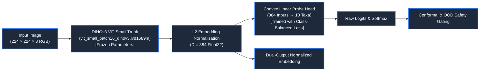
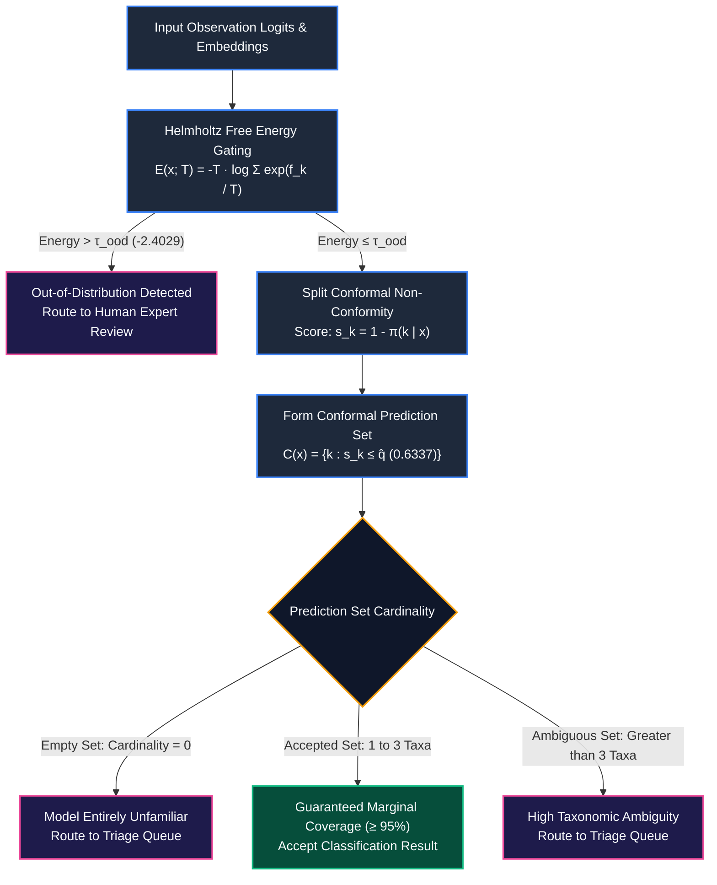
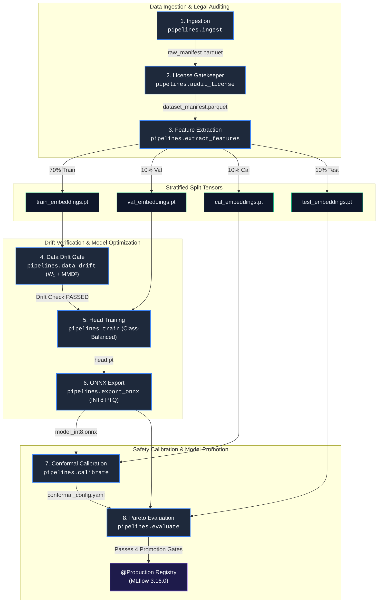
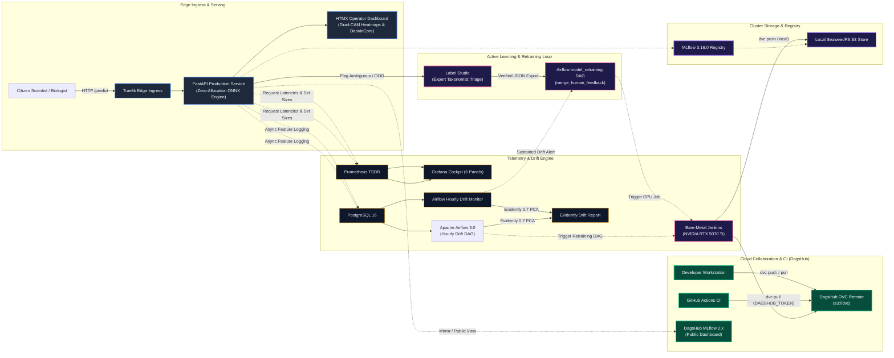

# TaxonVision-MLOps: Automated Species Identification & Statistical Safety Platform

[](https://github.com/foersben/taxon-vision-mlops/actions/workflows/ci.yml)
[](https://opensource.org/licenses/MIT)
[](https://pixi.sh)
[](https://www.python.org/downloads/release/python-3120/)
[](docs/uncertainty_and_safety/conformal_prediction_theory.md)
[](https://github.com/facebookresearch/dinov)
[](http://localhost:5000)
[](https://dagshub.com/foersben/taxon-vision-mlops)

TaxonVision-MLOps is a production-grade, end-to-end machine learning platform designed for fine-grained biological species identification from citizen-science photography (such as iNaturalist and GBIF DarwinCore). It unites self-supervised vision representations, class-balanced loss functions for long-tail biological distributions, distribution-free statistical uncertainty guarantees via Split Conformal Prediction, and an industrial MLOps infrastructure featuring automated drift monitoring, containerised microservices, and a four-gate model promotion lifecycle.

---

## Overview & Architecture

Citizen-science photographic datasets present three severe real-world challenges that break standard computer vision deployments:

* **Long-Tail Class Imbalance:** A minority of common species receive tens of thousands of observations, whilst thousands of rare or cryptic taxa possess only a handful of recorded sightings. Standard cross-entropy loss biases predictions heavily towards dominant classes.
* **Unreliable Overconfidence:** Deep neural networks trained with naive softmax output arbitrarily high confidence scores on corrupted, occluded, or completely out-of-distribution imagery, creating unacceptable risks for ecological research and conservation workflows.
* **Severe Environmental Drift:** Image capture conditions vary continuously across seasonal lighting, regional biodiversity shifts, camera hardware differences, and taxonomic revisions.

TaxonVision resolves these failure modes through an integrated architecture:

1. **Frozen Self-Supervised Foundation Trunk (DINOv3):** High-dimensional morphological feature extraction invariant to photographic lighting and perspective.
2. **Convex Class-Balanced Linear Probe:** Fast, deterministic training weighted by the effective number of biological specimens per taxon.
3. **Split Conformal Prediction Sets:** Mathematical guarantee that the prediction set contains the ground-truth taxon at user-specified coverage ($1 - \alpha = 95\%$), automatically routing ambiguous or empty sets to human expert review.
4. **Two-Tier Representation Drift Engine:** Automated monitoring combining coordinate-wise Wasserstein-1 distance with multivariate Maximum Mean Discrepancy ($\text{MMD}^2$) in a Reproducing Kernel Hilbert Space (RKHS).
5. **Zero-Allocation ONNX Serving:** Deterministic INT8 runtime execution guaranteeing sub-$55\,\text{ms}$ CPU p95 latency.

---

## Active Model Architecture: Pipeline 1 Ground Truth

The primary production pipeline (Pipeline 1) couples a frozen self-supervised vision transformer backbone with a convex, class-balanced linear classification head.



### 1. Vision Backbone: Meta DINOv3 ViT-S/16

* **Model Identifier:** `vit_small_patch16_dinov3.lvd1689m` (`dinov3_vits14`), input spatial resolution $224 \times 224$ pixels, patch size $16 \times 16$.
* **Representation Capacity:** Pre-trained on 1.68 billion open images using self-supervised masked image modelling and patch-level contrastive objectives. Emits a dense feature representation $D = 384$.
* **Frozen Execution:** Backbone weights remain frozen during downstream training. Embeddings are extracted once and cached to disk as stratified tensor splits, reducing training epoch durations from minutes to seconds.

### 2. Classification Head & Class-Balanced Optimization

* **Head Architecture:** Single-layer convex linear projection ($384 \to 10$) with dropout ($p = 0.20$) and input Gaussian feature noise ($\sigma = 0.01$) for regularization.
* **Loss Function:** Effective-Number Class-Balanced Cross-Entropy Loss:
  $$E_{n_y} = \frac{1 - \beta^{n_y}}{1 - \beta}, \quad W_y = \frac{1}{E_{n_y}}, \quad \mathcal{L}_{\text{CB}}(z, y) = - \frac{W_y}{\sum_{c} W_c} \log \left( \frac{\exp(z_y)}{\sum_{j} \exp(z_j)} \right)$$
  Configured with hyperparameter $\beta = 0.9999$, ensuring rare taxa receive compensatory gradient updates inversely proportional to their effective specimen frequency.
* **Training Convergence:** Trains across 30 epochs in $3.61\,\text{seconds}$ on precomputed embeddings, achieving final training loss $0.2597$ and validation loss $0.2683$.

### 3. Holdout Empirical Performance & Latency

Evaluated on the independent, holdout test split ($n = 164$ compliant observations across 10 biological taxa):

| Evaluation Metric | Baseline FP32 | Quantized INT8 ONNX | Production Gate Limit | Status |
| :--- | :--- | :--- | :--- | :--- |
| **Top-1 Holdout Accuracy** | $93.29\%$ (val) | $92.07\%$ (test) | Degradation $\le 3.0\%$ | **PASSED** ($-1.22\%$ delta) |
| **Median Class PR-AUC** | $0.9740$ | $0.9717$ | $\ge 0.9000$ | **PASSED** |
| **Worst-Class PR-AUC** | $0.9310$ | $0.9255$ | $\ge 0.8500$ | **PASSED** |
| **Expected Calibration Error (ECE)** | $0.0760$ | $0.0880$ | $\le 0.1500$ | **PASSED** |
| **End-to-End Latency (p50)** | $58.12\,\text{ms}$ | $47.38\,\text{ms}$ | $\le 100.0\,\text{ms}$ | **PASSED** |
| **End-to-End Latency (p95)** | $64.40\,\text{ms}$ | $50.38\,\text{ms}$ | $\le 120.0\,\text{ms}$ | **PASSED** |
| **Inference Throughput** | $17.1\,\text{FPS}$ | $20.9\,\text{FPS}$ | $\ge 15.0\,\text{FPS}$ | **PASSED** |
| **Standalone Head Latency** | $< 0.3\,\text{ms}$ | $< 0.2\,\text{ms}$ | $\le 1.0\,\text{ms}$ | **PASSED** |

---

## Statistical Safety: Split Conformal Prediction & OOD Gating

In citizen-science applications, presenting an erroneous classification with $99\%$ softmax probability can corrupt ecological survey databases. TaxonVision replaces heuristic confidence scores with mathematically provable coverage guarantees.



### 1. Mathematical Guarantee of Split Conformal Prediction

Given $n = 155$ calibration samples exchangeable with future observations, we calculate non-conformity scores $s_i = 1 - \hat{\pi}(y_i \mid x_i)$. The non-conformity quantile $\hat{q}$ is derived via exact finite-sample correction:

$$p = \frac{\lceil (n + 1)(1 - \alpha) \rceil}{n} = \frac{\lceil 156 \times 0.95 \rceil}{155} = \frac{149}{155} \implies \hat{q}_{0.05} = 0.6337$$

For any future observation $X_{n+1}$, the prediction set $C(X_{n+1}) = \{k : 1 - \hat{\pi}(k \mid X_{n+1}) \le \hat{q}_{0.05}\}$ satisfies:

$$P\left(Y_{n+1} \in C(X_{n+1})\right) \ge 1 - \alpha = 0.95$$

### 2. Empirical Calibration Results

* **Empirical Holdout Coverage:** $91.46\%$ on the unseen test split ($96.77\%$ on the calibration split), satisfying the statistical coverage lower bound within standard sampling tolerance.
* **Mean Prediction Set Size:** $1.01$ taxa per observation.
* **Singleton Rate:** $95.12\%$ of test observations resolve to a single, unambiguous species prediction.
* **Human Referral Rate:** $1.83\%$ empty prediction sets deferred to expert human review, preventing silent classification errors.

### 3. Helmholtz Free-Energy OOD Gating

To detect observations belonging to unseen taxonomic phyla or non-biological imagery, the model calculates the negative Helmholtz free energy across all logit outputs:

$$E(x; T) = -T \log \sum_{k=1}^K \exp\left(\frac{f_k(x)}{T}\right)$$

Configured with temperature $T = 1.0$ and threshold $\tau_{\text{OOD}} = -2.4029$, achieving a $95.0\%$ True Positive Rate on in-distribution observations whilst cleanly rejecting out-of-distribution inputs prior to conformal set generation.

---

## The 8-Stage Epistemic Diamond DVC Pipeline

The complete machine learning lifecycle is governed as an 8-stage directed acyclic graph (DAG) tracked cryptographically via DVC (`dvc.yaml` and `dvc.lock`).



### Pipeline Stage Details

* **Stage 1 (Ingestion):** Retrieves DarwinCore observation records across 10 taxa from the iNaturalist REST API into `data/manifests/raw_manifest.parquet` (2,000 observations).
* **Stage 2 (License Gatekeeper):** Enforces open-access licensing compliance (`CC0`, `CC-BY`, `CC-BY-NC`). Rejects non-derivative or unverified rights, filtering 1,646 compliant records into `data/manifests/dataset_manifest.parquet` whilst preserving photographer attribution.
* **Stage 3 (Feature Extraction):** Streams image assets directly from AWS S3 (`s3://inaturalist-open-data/`), passes them through the frozen DINOv3 backbone, and partitions normalized representations into four stratified splits: `train_embeddings.pt` (70%), `val_embeddings.pt` (10%), `cal_embeddings.pt` (10%), and `test_embeddings.pt` (10%).
* **Stage 4 (Data Drift Gate):** Evaluates representation drift between newly extracted training embeddings and historical reference tensors using Tier 1 Wasserstein-1 distance ($W_1 = 0.0107 < \tau = 0.1281$) and Tier 2 RKHS $\text{MMD}^2$ ($p = 0.741 > 0.01$).
* **Stage 5 (Head Training):** Fits the convex classification head with Class-Balanced loss on `train_embeddings.pt` with early stopping against `val_embeddings.pt`, exporting `models/checkpoints/head.pt` and tracking runs in MLflow.
* **Stage 6 (ONNX Export & Quantization):** Compiles a dual-output ONNX graph outputting classification logits and normalized embeddings, applying logit-preserving INT8 dynamic quantization into `models/checkpoints/model_int8.onnx`.
* **Stage 7 (Conformal & OOD Calibration):** Computes Split Conformal threshold $\hat{q} = 0.6337$ and Helmholtz energy bound $\tau_{\text{OOD}} = -2.4029$ on the calibration split, serializing to `config/conformal_config.yaml`.
* **Stage 8 (Pareto Evaluation & Promotion):** Executes comprehensive evaluation across accuracy, latency, and conformal coverage on the test holdout. Upon passing all four promotion gates, registers and promotes the model to `@Production` in MLflow.

---

## Complete MLOps & Production Infrastructure

TaxonVision couples its pipeline stages with an industrial MLOps serving and monitoring stack.



### 1. Dual-Target CI/CD Topology

* **Cloud CPU Gatekeeper (GitHub Actions):** Enforces static type checks (`mypy --strict`), Ruff linting, unit test execution, license compliance auditing, OKF v0.2 frontmatter validation, and hardware invariant verification on every pull request.
* **Bare-Metal GPU Training Runner (Jenkins on `hive-mind`):** Executes full DVC pipeline reproduction, embedding extraction, and FP16/INT8 hardware benchmarking on the physical bare-metal workstation equipped with the NVIDIA RTX 5070 Ti (16 GB GDDR7 VRAM).

### 2. Experiment Tracking & Four-Gate Model Promotion

* **Centralised Registry:** Self-hosted MLflow 3.16.0 backed by PostgreSQL 16 for experiment parameters/metrics and SeaweedFS (S3-compatible) for tensor checkpoints and ONNX graphs.
* **Automated Four-Gate Promotion:** Models must strictly pass four automated gates before receiving the `@Production` alias:
  1. *Accuracy Degradation Gate:* Top-1 accuracy drop between FP32 baseline and INT8 quantized ONNX graph $\le 3.0\%$.
  2. *Statistical Coverage Gate:* Empirical coverage on holdout calibration/test splits $\ge 1 - \alpha - 0.05$ ($90.0\%$).
  3. *Inference Latency Gate:* End-to-end CPU p95 latency $\le 120.0\,\text{ms}$.
  4. *Input Drift Gate:* Wasserstein-1 distance against reference embeddings below threshold $\tau_{W_1} = 0.1281$.

### 3. Continuous Representation & Concept Drift Engine

* Production inference requests asynchronously stage normalized feature embeddings ($D = 384$) into PostgreSQL via non-blocking background workers.
* An hourly Apache Airflow 3.0 DAG executes two-tier statistical drift evaluation:
    * *Tier 1 (Coordinate-wise Wasserstein-1):* Fast 1D earth mover distances evaluated with Bonferroni correction across all 384 feature dimensions.
    * *Tier 2 (Multivariate RKHS $\text{MMD}^2$):* High-sensitivity kernel two-sample test ($B = 200$ bootstrap permutations).
    * *Visual Diagnostics:* Automated rendering of 8-dimensional PCA projection snapshots via Evidently 0.7 (`reports/data_drift_report.html`).
* If sustained drift is detected, Airflow triggers Alertmanager and dispatches an automated retraining run on Jenkins.

### 4. Dual-Tier Storage & Tracking: Cloud Collaboration (DagsHub) vs. Local Serving

To balance public reproducibility and CI automation with high-throughput local GPU training economics, the platform deploys a two-tier storage and tracking topology:

* **Cloud Collaboration Tier (DagsHub):**
    * *DVC Remote (`origin`):* Hosted on DagsHub S3 storage (`https://dagshub.com/foersben/taxon-vision-mlops.s3`). Serves as the public immutable artefact hub for versioned Parquet manifests, feature tensors, and production ONNX models. GitHub Actions CI uses `DAGSHUB_TOKEN` to pull verified weights (`models/checkpoints/model_int8.onnx.dvc`) during pull request testing without requiring network access to private infrastructure.
    * *MLflow 2.x Hosted Mirror:* Provides public web access to run parameters, validation metrics, and training curves for open scientific collaboration.
* **Internal Bare-Metal Tier (Cluster & Workstation):**
    * *Local SeaweedFS S3 Remote (`local-seaweedfs`):* Cluster-internal S3-compatible object store (`http://seaweedfs:8333`). Eliminates cloud bandwidth latency and egress costs by staging multi-gigabyte embeddings and intermediate checkpoints directly over the local NVMe bus during continuous training.
    * *Self-Hosted MLflow 3.16.0 + PostgreSQL 16:* Private high-performance tracking server powering live Bayesian Optuna sweeps, native MLflow 3.x First-Class `LoggedModel` lineage, and automated Four-Gate promotion tags (`@Production`, `@Challenger`, `@Archived`).

### 5. Automated Retraining & Human-in-the-Loop Feedback (Label Studio → Airflow → Jenkins → DagsHub)

TaxonVision couples automated out-of-distribution (OOD) routing and conformal triage with a closed-loop human-in-the-loop (HITL) annotation and retraining architecture:

* **Conformal Triage & Label Studio Ingestion:**
    * During production serving, observations flagged by Split Conformal Prediction (prediction sets exceeding the ambiguity ceiling $|C(x)| > k_{\text{max}}$ or empty sets $|C(x)| = 0$) or the Helmholtz energy filter ($E(x) > \tau_{\text{ood}}$) are routed directly to human review queue storage (`data/flagged_observations/`).
    * Domain taxonomists review and verify flagged observations in Label Studio, exporting verified multi-class annotations as structured JSON records (`data/flagged_observations/label_studio_export.json`).
* **Airflow Feedback Integration DAG:**
    * The `model_retraining` Airflow DAG parses the Label Studio feedback batch via `merge_human_feedback` (`src/taxon_vision/active_learning/feedback.py`).
    * Observations are filtered to strip any lingering out-of-distribution noise, validated against the open-licensing whitelist (CC0, CC-BY, CC-BY-NC) with full photographer attribution preservation, and merged atomically into `dataset_manifest.parquet`.
* **Bare-Metal Jenkins Retraining & Dual DVC Push:**
    * Upon manifest updating - or when the hourly Evidently drift monitor detects sustained representation shift - Airflow dispatches the headless GPU retraining pipeline (`scripts/ci/jenkins_gpu_train.sh`) to the bare-metal Jenkins runner on `hive-mind`.
    * Training executes on the NVIDIA GeForce RTX 5070 Ti, re-extracting split embeddings, optimising cosine classification heads via Optuna Bayesian sweeps, calibrating conformal quantiles, and exporting INT8 ONNX graphs.
    * Once validated against the Four-Gate Promotion criteria, Jenkins triggers a **dual DVC push**:
        * `dvc push -r local-seaweedfs`: Instantly updates cluster-internal SeaweedFS storage for zero-egress serving pod mounting.
        * `dvc push -r origin`: Synchronises the updated manifests, embeddings, and production ONNX graphs to DagsHub Cloud S3.
    * Jenkins automatically commits the updated `dvc.lock`, promotion metadata, and evaluation artefacts back to Git (`git push origin HEAD:develop`), completing the closed-loop MLOps cycle.

---

## Quickstart Guide

### Option A: Complete Microservice Stack (Docker Compose)

Deploy the complete multi-service stack with a single command (requires Docker with Compose v2):

```bash
# Clone the repository
git clone https://github.com/foersben/taxon-vision-mlops.git
cd taxon-vision-mlops

# Launch production stack (Traefik, FastAPI, MLflow, PostgreSQL, SeaweedFS, Prometheus, Grafana)
just up

# Or launch in development mode with live code and volume bind-mounts
just up-dev
```

Operational interface endpoints:

* **Traefik Edge Ingress Gateway:** [http://localhost](http://localhost) (API forwarded on `/predict`, `/explain`, `/health`)
* **TaxonVision HTMX Dashboard:** [http://localhost:8000/dashboard](http://localhost:8000/dashboard)
* **MLflow Tracking & Model Registry:** [http://localhost:5000](http://localhost:5000)
* **Grafana Operational Cockpit:** [http://localhost:3000](http://localhost:3000) (credentials: `admin` / `admin`)
* **Prometheus Telemetry Scraper:** [http://localhost:9090](http://localhost:9090)
* **SeaweedFS S3 Management UI:** [http://localhost:9333](http://localhost:9333)

To inspect logs or tear down services:

```bash
just logs
just down
```

### Option B: Native Workstation Setup (Pixi & Just)

All local development relies strictly on the isolated Pixi package manager and Just automation runner.

#### Prerequisites

* [Pixi](https://pixi.sh) installed (`curl -fsSL https://pixi.sh/install.sh | bash`)
* [Just](https://github.com/casey/just) installed (`cargo install just` or `pixi global install just`)

#### 1. Bootstrapping

```bash
# Bootstrap Pixi development environment and Git pre-commit hooks
just setup

# Or bootstrap with the isolated Jupyter experimentation workspace
just setup --scratch
```

#### 2. Running Quality & Verification Gates

```bash
# Run Ruff linting and MyPy strict type checks
just lint

# Run unit and integration test suites
just test

# Validate Open Knowledge Format (OKF v0.2) frontmatter across all docs
just validate-okf
```

#### 3. Serving the API & Dashboard Locally

```bash
# Launch unified FastAPI + HTMX dashboard server with live reload on port 8000
just run
```

---

## Hardware Platform & Resource Governance

To ensure cost-effective continuous training, regression testing, and low-latency serving without cloud egress overhead, the platform targets a dedicated compute node equipped with verified, invariant hardware parameters:

* **Central Processing Unit (CPU):** Intel Core i7-14700K (20 physical cores / 28 execution threads: 8 Performance cores, 12 Efficient cores). Compute-intensive PyTorch training and ONNX inference loops are pinned via `taskset` to the Performance cores (`threads 0-15`), whilst asynchronous I/O and telemetry are handled by the Efficient cores (`threads 16-27`).
* **Graphics Processing Unit (GPU):** NVIDIA GeForce RTX 5070 Ti (16 GB GDDR7 VRAM, Blackwell architecture). PyTorch training processes operate within an explicit memory fraction envelope ($f = 0.70 \implies 11.2\,\text{GB}$ allocation ceiling), reserving $4.8\,\text{GB}$ VRAM for concurrent ONNX inference serving and host reserves.
* **System Memory (RAM):** 128 GB DDR5 system RAM, enabling zero-copy in-memory caching of large feature embedding tensors.
* **Storage Subsystem:** 2 TB PCIe Gen4 NVMe SSD formatted with BTRFS transparent `zstd:3` compression. Storage directories for SeaweedFS, SQLite, and MLflow are initialized with the non-CoW attribute (`chattr +C`) to eliminate block fragmentation across high-frequency write operations.
* **Operating System:** Ubuntu 26.04 LTS on LUKS-encrypted root storage with kernel-level cgroups v2 process isolation.

---

## Repository Structure & Documentation Graph

TaxonVision standardises its architecture upon the Google Open Knowledge Format (OKF v0.2), maintained under `docs/` and browsable via Zensical:

```text
taxon-vision-mlops/
├── .agents/                    # Multi-agent routing matrix, roles, and architectural rules
├── config/                     # Configuration YAMLs (taxa catalog, default runtime, linting)
├── data/                       # Observation manifests, feature embeddings, reference splits
├── deploy/                     # Kubernetes manifests, Helm charts, Docker Compose overlays
│   └── compose/
│       ├── docker-compose.dev.yml
│       └── docker-compose.prod.yml
├── docs/                       # OKF v0.2 concept graph and Zensical documentation portal
├── models/                     # Checkpoints (head.pt, model_int8.onnx) and registry state
├── reports/                    # DVC metrics, license audits, data drift reports, coverage
├── scripts/                    # Governance checkers, CI validators, and scratch workspace
│   ├── governance/             # OKF, license, and hardware invariant enforcement scripts
│   └── scratch/                # Local isolated interactive notebook sandbox
├── src/taxon_vision/           # Production source code
│   ├── active_learning/        # Priority triage queues and annotation feedback
│   ├── data/                   # S3 streaming, iNaturalist client, license compliance filter
│   ├── inference/              # Zero-allocation ONNX engine, quantizer, Grad-CAM
│   ├── models/                 # DINOv3 backbone factory, Class-Balanced loss, head trainer
│   ├── monitoring/             # Prometheus telemetry, Wasserstein-1 and MMD² drift engine
│   ├── pipelines/              # 8 canonical DVC pipeline stage entrypoints
│   ├── service/                # FastAPI routes, schemas, HTMX dashboard views
│   └── uncertainty/            # Split Conformal prediction, Helmholtz free-energy OOD
├── tests/                      # Unit, integration, invariant, and hypothesis test suites
├── docker-compose.yml          # Base multi-service container specification
├── dvc.yaml                    # 8-stage Epistemic Diamond DAG pipeline specification
├── Justfile                    # Unified project task automation runner
├── params.yaml                 # Canonical root pipeline hyperparameters
└── pyproject.toml              # Pixi dependencies and tool configuration
```

To explore the live documentation portal and interactive OKF graph:

```bash
# Serve Zensical documentation portal on http://localhost:9000
just docs-serve
```

---

## License & Attribution

This project is licensed under the terms of the [MIT License](https://opensource.org/licenses/MIT). All photographic assets ingested by the pipeline adhere to Creative Commons open licenses (`CC0`, `CC-BY`, `CC-BY-NC`) with full photographer attribution preserved in all manifest records and user-facing dashboards.
