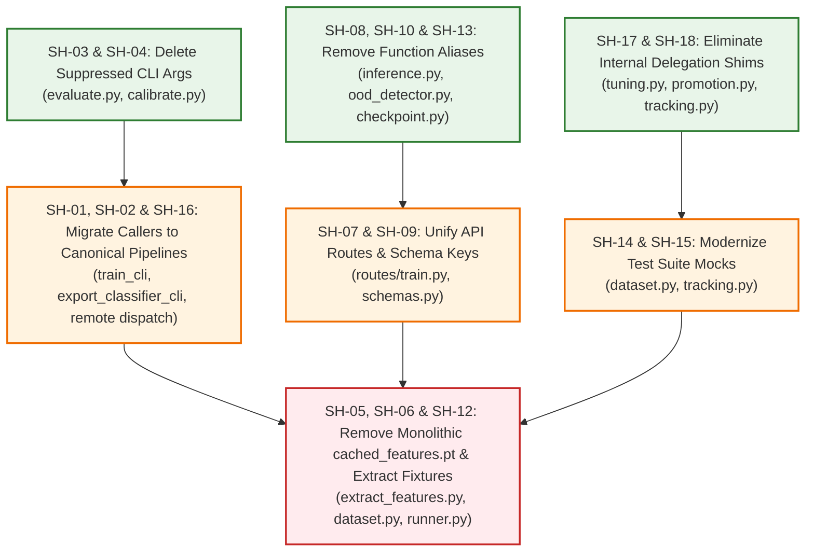

# Backward Compatibility & Legacy Shims Inventory

## 1. Executive Summary & Policy

In high-velocity MLOps systems, backward-compatibility shims often accumulate during architectural migrations - such as transitioning from single-file training scripts to canonical pipeline entrypoints, or upgrading from monolithic feature caches to stratified partition tensors.

While shims prevent immediate breaking changes in older tests and external callers, retaining them indefinitely creates maintenance friction, obscures the true canonical API surface, and complicates refactoring. Per repository policy, backward compatibility should be retained **only when strictly necessary** for active external consumers; internal test-suite dependencies should be aggressively migrated to canonical APIs and the underlying shims eliminated.

This document provides a comprehensive inventory of all legacy shims, alias layers, suppressed CLI arguments, and fallback execution branches currently active in `src/taxon_vision/`, along with their line count, caller dependencies, and estimated effort to clean up.

---

## 2. Master Shim Inventory

| ID | Component / File | Category | LOC | Caller / Test Dependencies | Status | Cleanup Difficulty | Est. Effort |
| :--- | :--- | :--- | :--- | :--- | :--- | :--- | :--- |
| **SH-01** | `models/training/runner.py:train_cli` | CLI Re-export | 17 | `tests/unit/test_cli_and_training.py` | **RETIRED** | Low | 15 mins |
| **SH-02** | `inference/onnx_exporter.py:export_classifier_cli` | CLI Re-export | 21 | `tests/unit/test_onnx_exporter.py`, `tests/unit/test_pipelines.py` | **RETIRED** | Low | 20 mins |
| **SH-03** | `pipelines/evaluate.py` (legacy args) | CLI Flag Shim | 11 | None (suppressed legacy flags) | **RETIRED** | Very Low | 10 mins |
| **SH-04** | `pipelines/calibrate.py` (legacy args) | CLI Flag Shim | 9 | None (suppressed legacy flags) | **RETIRED** | Very Low | 10 mins |
| **SH-05** | `pipelines/extract_features.py:cached_features.pt` | Storage Shim | 35 | `tests/unit/test_pipelines.py` | Active | Medium | 30 mins |
| **SH-06** | `models/training/runner.py:_try_load_cached_split` | Storage Shim | 64 | `tests/unit/test_cli_and_training.py` (delegates to `dataset.py`) | Active | Medium | 30 mins |
| **SH-07** | `config/schemas.py` (schema property aliases) | Config Alias | 15 | None directly (YAML and internal refs) | Active | Low | 15 mins |
| **SH-08** | `service/inference.py:tau_ood` | Config Alias | 4 | `config/conformal_config.yaml` legacy keys | **RETIRED** | Very Low | 5 mins |
| **SH-09** | `service/routes/train.py` (`/training` alias) | API Route Alias | 19 | Legacy HTTP callers | Active | Low | 15 mins |
| **SH-10** | `uncertainty/ood_detector.py:compute_energy_score` | Function Alias | 7 | None (historical alias for `compute_energy`) | **RETIRED** | Very Low | 5 mins |
| **SH-11** | `models/training/tracking.py:_log_pytorch_model_with_fallback` | Model Fallback | 50 | None (runtime fallback to pyfunc) | Active | Low | 20 mins |
| **SH-12** | `models/training/runner.py:_generate_synthetic_embedding_split` | Test Fallback | 72 | Offline CI/CD unit test runners (delegates to `dataset.py`) | Active | Medium | 45 mins |
| **SH-13** | `models/training/checkpoint.py:_save_checkpoint` | Function Alias | 5 | Legacy callers expecting private `_save_checkpoint` | **RETIRED** | Very Low | 5 mins |
| **SH-14** | `models/training/dataset.py` (backward aliases) | Module Re-export | 12 | Tests and runner backward compatibility | **RETIRED** | Low | 10 mins |
| **SH-15** | `models/training/tracking.py` (re-exports) | Module Re-export | 30 | Tests mocking routines on `tracking` | Active | Low | 15 mins |
| **SH-16** | `models/training/runner.py:setup_logging` & `_dispatch_remote_training` | CLI / Remote Shims | 22 | External scripts & runner callers (delegates to `pipelines.train`) | **RETIRED** | Low | 15 mins |
| **SH-17** | `models/training/tuning.py:_log_optuna_diagnostic_plots` | Visualization Shim | 8 | Internal callers (delegates to `visualizations.py`) | **RETIRED** | Very Low | 5 mins |
| **SH-18** | `models/training/promotion.py` & `tracking.py:_get_dvc_dataset_hash` | Data Lineage Shims | 18 | Model promotion and MLflow tracking (delegates to `dataset.py`) | **RETIRED** | Very Low | 5 mins |
| **SH-19** | `models/training/runner.py:_build_training_components` | Function Signature Shim | 55 | Legacy callers expecting 15-parameter signature returning untyped 5-tuple | **RETIRED** | Low | 15 mins |

* **Total Retired Technical Debt:** 189 LOC across 12 shims eliminated cleanly.
* **Remaining Backward-Compatibility Footprint:** ~285 LOC across 7 shims.

---

## 3. Detailed Component Breakdown

### 3.1 CLI & Entrypoint Delegation Shims

#### SH-01: `train_cli` in `src/taxon_vision/models/training/runner.py`

* **Location:** [`src/taxon_vision/models/training/runner.py:L589-605`](file:///home/benni/Documents/antigravity_workspace/taxon-vision-mlops/src/taxon_vision/models/training/runner.py#L589-L605)
* **Code Size:** 17 LOC
* **Description:** A compatibility delegation wrapper that imports and executes `taxon_vision.pipelines.train.train_cli`.
* **Rationale:** Was introduced when CLI execution was centralized into `src/taxon_vision/pipelines/`.
* **Dependencies:** [`tests/unit/test_cli_and_training.py`](file:///home/benni/Documents/antigravity_workspace/taxon-vision-mlops/tests/unit/test_cli_and_training.py#L24) imports `train_cli` from `models.training.runner`.
* **Action Required:**
    * Update `tests/unit/test_cli_and_training.py` to import `train_cli` from `taxon_vision.pipelines.train`.
    * Delete lines 589-605 in `runner.py`.

#### SH-02: `export_classifier_cli` in `src/taxon_vision/inference/onnx_exporter.py`

* **Location:** [`src/taxon_vision/inference/onnx_exporter.py:L429-449`](file:///home/benni/Documents/antigravity_workspace/taxon-vision-mlops/src/taxon_vision/inference/onnx_exporter.py#L429-L449)
* **Code Size:** 21 LOC
* **Description:** A compatibility wrapper that imports and executes `taxon_vision.pipelines.export_onnx.export_onnx_cli`.
* **Dependencies:** 7 tests in [`tests/unit/test_onnx_exporter.py`](file:///home/benni/Documents/antigravity_workspace/taxon-vision-mlops/tests/unit/test_onnx_exporter.py#L21) and 1 test in [`tests/unit/test_pipelines.py`](file:///home/benni/Documents/antigravity_workspace/taxon-vision-mlops/tests/unit/test_pipelines.py#L552).
* **Action Required:**
    * Update `test_onnx_exporter.py` and `test_pipelines.py` to import `export_onnx_cli` from `taxon_vision.pipelines.export_onnx`.
    * Delete lines 429-449 in `onnx_exporter.py`.

---

### 3.2 Suppressed Pipeline CLI Arguments

#### SH-03: Suppressed Legacy Flags in `src/taxon_vision/pipelines/evaluate.py`

* **Location:** [`src/taxon_vision/pipelines/evaluate.py:L284-290`](file:///home/benni/Documents/antigravity_workspace/taxon-vision-mlops/src/taxon_vision/pipelines/evaluate.py#L284-L290) and [`L317-318`](file:///home/benni/Documents/antigravity_workspace/taxon-vision-mlops/src/taxon_vision/pipelines/evaluate.py#L317-L318)
* **Code Size:** 11 LOC
* **Description:** Defines 5 hidden (`help=argparse.SUPPRESS`) arguments: `--cache-path`, `--checkpoint`, `--split`, `--data-dir`, and `--allow-synthetic`. Lines 317-318 check `if not emb_path.exists() and args.cache_path: emb_path = args.cache_path`.
* **Rationale:** Preserved compatibility with older `dvc.yaml` stage command syntax from early prototypes.
* **Dependencies:** None. Current `dvc.yaml` invokes `evaluate.py` using canonical `--onnx-model` and `--embeddings` flags.
* **Action Required:**
    * Delete the 5 `parser.add_argument(..., help=argparse.SUPPRESS)` definitions.
    * Remove the fallback lookup on line 317.

#### SH-04: Suppressed Legacy Flags in `src/taxon_vision/pipelines/calibrate.py`

* **Location:** [`src/taxon_vision/pipelines/calibrate.py:L147-152`](file:///home/benni/Documents/antigravity_workspace/taxon-vision-mlops/src/taxon_vision/pipelines/calibrate.py#L147-L152) and [`L170-171`](file:///home/benni/Documents/antigravity_workspace/taxon-vision-mlops/src/taxon_vision/pipelines/calibrate.py#L170-L171)
* **Code Size:** 9 LOC
* **Description:** Defines hidden arguments: `--cache-path`, `--split`, `--checkpoint`, `--scores-path`. Lines 170-171 fall back to `args.cache_path` if `args.embeddings` is missing.
* **Dependencies:** None. Canonical pipeline invocations pass `--embeddings data/embeddings/cal_embeddings.pt`.
* **Action Required:**
    * Delete lines 147-152 and 170-171.

---

### 3.3 Composite vs. Stratified Partition Storage Shims

#### SH-05: Legacy Composite `cached_features.pt` Serialization

* **Location:** [`src/taxon_vision/pipelines/extract_features.py:L609-635`](file:///home/benni/Documents/antigravity_workspace/taxon-vision-mlops/src/taxon_vision/pipelines/extract_features.py#L609-L635) and [`L746`](file:///home/benni/Documents/antigravity_workspace/taxon-vision-mlops/src/taxon_vision/pipelines/extract_features.py#L746)
* **Code Size:** 35 LOC
* **Description:** When feature extraction completes, Stage 3 saves the 4 canonical partition tensors (`train_embeddings.pt`, `val_embeddings.pt`, `cal_embeddings.pt`, `test_embeddings.pt`), but also serializes a composite dictionary `cached_features.pt` for legacy callers via `--output-file`.
* **Dependencies:** Stage 3 tests in `tests/unit/test_pipelines.py` verify that `output_file` exists if supplied.
* **Action Required:**
    * Standardize Stage 3 purely on 4-way partition output.
    * Remove the `--output-file` / composite serialization path once all legacy scripts reference partition tensors directly.

#### SH-06: Dual-Path Embedding Loader in `dataset.py` & Re-export in `runner.py`

* **Location:** [`src/taxon_vision/models/training/dataset.py:L142-205`](file:///home/benni/Documents/antigravity_workspace/taxon-vision-mlops/src/taxon_vision/models/training/dataset.py#L142-L205) and [`src/taxon_vision/models/training/runner.py:L36`](file:///home/benni/Documents/antigravity_workspace/taxon-vision-mlops/src/taxon_vision/models/training/runner.py#L36)
* **Code Size:** 64 LOC
* **Description:** Checks whether a candidate path is a monolithic `cached_features.pt` dict containing keys `["train_embeddings", "val_embeddings"]`. Canonical implementation extracted into `dataset.py` and re-exported in `runner.py` for backward compatibility.
* **Dependencies:** Tested in [`tests/unit/test_cli_and_training.py`](file:///home/benni/Documents/antigravity_workspace/taxon-vision-mlops/tests/unit/test_cli_and_training.py#L127).
* **Action Required:**
    * Consolidate embedding loading onto `_try_load_split_from_pair(train_path, val_path)`.
    * Eliminate monolithic dictionary deserialization.

---

### 3.4 Configuration & Key Aliases

#### SH-07: Pydantic Schema Compatibility Properties in `config/schemas.py`

* **Location:** [`src/taxon_vision/config/schemas.py:L167, L172, L287`](file:///home/benni/Documents/antigravity_workspace/taxon-vision-mlops/src/taxon_vision/config/schemas.py#L167)
* **Code Size:** 15 LOC
* **Description:**
    * `quantile_threshold`: Alias property mapping to `q_hat`.
    * `min_confidence_threshold`: Alias property mapping to `min_confidence`.
    * `streaming`: Property mapping to `data.streaming`.
* **Action Required:**
    * Search codebase for usages of `.quantile_threshold`, `.min_confidence_threshold`, and `.streaming`.
    * Replace with `.q_hat`, `.min_confidence`, and `.data.streaming`.
    * Remove property aliases from Pydantic models.

#### SH-08: Legacy `tau_ood` Key in `src/taxon_vision/service/inference.py`

* **Location:** [`src/taxon_vision/service/inference.py:L239, L253`](file:///home/benni/Documents/antigravity_workspace/taxon-vision-mlops/src/taxon_vision/service/inference.py#L239)
* **Code Size:** 4 LOC
* **Description:** `calib.get("ood_energy_threshold", calib.get("tau_ood"))`.
* **Action Required:**
    * Verify that `conformal_config.yaml` generated by `calibrate.py` writes `ood_energy_threshold`.
    * Remove `calib.get("tau_ood")`.

---

### 3.5 API Route Aliases

#### SH-09: Unversioned `/training` Route Alias

* **Location:** [`src/taxon_vision/service/routes/train.py:L26-38`](file:///home/benni/Documents/antigravity_workspace/taxon-vision-mlops/src/taxon_vision/service/routes/train.py#L26-L38)
* **Code Size:** 19 LOC
* **Description:** Registers `@router.post("/training")` as an unversioned alias alongside canonical `@router.post("/api/v1/training")`.
* **Dependencies:** Legacy callers. The canonical remote training dispatcher now targets `/api/v1/training`.
* **Action Required:**
    * Deprecate and remove the `/training` route alias.

---

### 3.6 Function Aliases & Fallbacks

#### SH-10: `compute_energy_score` in `src/taxon_vision/uncertainty/ood_detector.py`

* **Location:** [`src/taxon_vision/uncertainty/ood_detector.py:L72-78`](file:///home/benni/Documents/antigravity_workspace/taxon-vision-mlops/src/taxon_vision/uncertainty/ood_detector.py#L72-L78)
* **Code Size:** 7 LOC
* **Description:** 1-line alias method: `compute_energy_score = compute_energy`.
* **Action Required:**
    * Verify no active callers reference `compute_energy_score`.
    * Delete method alias.

#### SH-11: `_log_pytorch_model_with_fallback` in `tracking.py`

* **Location:** [`src/taxon_vision/models/training/tracking.py:L463-512`](file:///home/benni/Documents/antigravity_workspace/taxon-vision-mlops/src/taxon_vision/models/training/tracking.py#L463-L512)
* **Code Size:** 50 LOC
* **Description:** Catches exceptions from `mlflow.pytorch.log_model` and falls back to logging via generic `mlflow.pyfunc.log_model`.
* **Action Required:**
    * Retain for now as intentional fault tolerance, or simplify to direct `mlflow.pytorch.log_model` once confirmed stable on the active MLflow server version.

#### SH-12: Synthetic Embeddings Fallback in `dataset.py` & Re-export in `runner.py`

* **Location:** [`src/taxon_vision/models/training/dataset.py:L207-279`](file:///home/benni/Documents/antigravity_workspace/taxon-vision-mlops/src/taxon_vision/models/training/dataset.py#L207-L279) and [`src/taxon_vision/models/training/runner.py:L32`](file:///home/benni/Documents/antigravity_workspace/taxon-vision-mlops/src/taxon_vision/models/training/runner.py#L32)
* **Code Size:** 72 LOC
* **Description:** Generates pseudorandom Gaussian embedding tensors when disk caches are missing and `TAXON_ALLOW_UNTRAINED_FALLBACK` is enabled. Canonical implementation moved to `dataset.py` with backward-compatible re-export in `runner.py`.
* **Assessment:** While technically a fallback branch, this is critical for fast offline CI/CD sweeps without requiring multi-gigabyte S3 data. Rather than deleting, this should be moved out of production orchestration code into dedicated test fixture helpers during Phase 4 of the refactoring plan.

#### SH-13: `_save_checkpoint` in `src/taxon_vision/models/training/checkpoint.py`

* **Location:** [`src/taxon_vision/models/training/checkpoint.py:L49-55`](file:///home/benni/Documents/antigravity_workspace/taxon-vision-mlops/src/taxon_vision/models/training/checkpoint.py#L49-L55)
* **Code Size:** 5 LOC
* **Description:** A private alias function `_save_checkpoint = save_checkpoint` preserved for backward compatibility with legacy internal callers.
* **Action Required:**
    * Audit internal callers to use `save_checkpoint` directly.
    * Remove `_save_checkpoint` alias.

#### SH-14: Module Re-exports in `src/taxon_vision/models/training/dataset.py`

* **Location:** [`src/taxon_vision/models/training/dataset.py:L281-294`](file:///home/benni/Documents/antigravity_workspace/taxon-vision-mlops/src/taxon_vision/models/training/dataset.py#L281-L294)
* **Code Size:** 12 LOC
* **Description:** Public and private alias wrappers for dataset loading and dimension resolution routines (`_resolve_feature_dim`, `_resolve_synthetic_permission`, `_prepare_embedding_split`).
* **Action Required:**
    * Consolidate all external callers onto `load_or_create_training_split` and typed `DatasetManifest`.
    * Remove re-exports.

#### SH-15: Legacy Re-exports in `src/taxon_vision/models/training/tracking.py`

* **Location:** [`src/taxon_vision/models/training/tracking.py:L514-544`](file:///home/benni/Documents/antigravity_workspace/taxon-vision-mlops/src/taxon_vision/models/training/tracking.py#L514-L544)
* **Code Size:** 30 LOC
* **Description:** Preserves legacy function names and aliases on `tracking.py` (`_log_training_hyperparameters`, `_log_calibrated_energy_threshold`, `mlflow_run_scope`) for tests monkeypatching or calling routines through the tracking namespace.
* **Action Required:**
    * Migrate tests to test pure helper functions in isolation.

#### SH-16: Logging & Remote Dispatching Delegation in `runner.py`

* **Location:** [`src/taxon_vision/models/training/runner.py:L567-586`](file:///home/benni/Documents/antigravity_workspace/taxon-vision-mlops/src/taxon_vision/models/training/runner.py#L567-L586)
* **Code Size:** 22 LOC
* **Description:** `setup_logging` and `_dispatch_remote_training` delegating to canonical implementations in `taxon_vision.pipelines.train`.
* **Rationale:** Relocated CLI logging infrastructure and HTTP client networking out of core model training loop orchestrator.
* **Dependencies:** Legacy scripts calling `models.training.runner.setup_logging` or `_dispatch_remote_training`.
* **Action Required:**
    * Update any legacy scripts or tests to import directly from `taxon_vision.pipelines.train`.
    * Remove the shims in `runner.py`.

#### SH-17: Optuna Plotting Delegation in `tuning.py`

* **Location:** [`src/taxon_vision/models/training/tuning.py:L282-289`](file:///home/benni/Documents/antigravity_workspace/taxon-vision-mlops/src/taxon_vision/models/training/tuning.py#L282-L289)
* **Code Size:** 8 LOC
* **Description:** `_log_optuna_diagnostic_plots(study)` delegating to `taxon_vision.models.training.visualizations.log_optuna_diagnostic_plots(study)`.
* **Rationale:** Decoupled matplotlib Optuna visualization generation from Bayesian hyperparameter search logic.
* **Dependencies:** Internal callers within `tuning.py` and potentially tests.
* **Action Required:**
    * Replace internal call in `_log_best_run` to invoke `log_optuna_diagnostic_plots` directly.
    * Remove shim.

#### SH-18: DVC Dataset Lineage Delegation in `promotion.py` & `tracking.py`

* **Location:** [`src/taxon_vision/models/training/promotion.py:L45-51`](file:///home/benni/Documents/antigravity_workspace/taxon-vision-mlops/src/taxon_vision/models/training/promotion.py#L45-L51) and [`src/taxon_vision/models/training/tracking.py:L77-96`](file:///home/benni/Documents/antigravity_workspace/taxon-vision-mlops/src/taxon_vision/models/training/tracking.py#L77-L96)
* **Code Size:** 18 LOC
* **Description:** Module-level `_get_dvc_dataset_hash` functions delegating to canonical `get_dvc_dataset_hash` in `taxon_vision.models.training.dataset`.
* **Rationale:** Centralized DVC lock parsing into `dataset.py` to eliminate duplicate parsing and avoid erroneous git proxy fallbacks.
* **Dependencies:** Unit tests patching `_get_dvc_dataset_hash` in `tracking.py` or `promotion.py`.
* **Action Required:**
    * Update tests to patch or mock `dataset.get_dvc_dataset_hash`.
    * Remove wrapper functions in `promotion.py` and `tracking.py`.

#### SH-19: `_build_training_components` 15-Parameter Compatibility Shim in `runner.py`

* **Location:** [`src/taxon_vision/models/training/runner.py:L293-347`](file:///home/benni/Documents/antigravity_workspace/taxon-vision-mlops/src/taxon_vision/models/training/runner.py#L293-L347)
* **Code Size:** 55 LOC
* **Description:** Legacy 15-parameter wrapper for `build_training_components` that resolves hyperparameters and returns an untyped 5-tuple `(head, criterion, optimizer, config, params)`. Maintained for backward compatibility with legacy scripts and tests expecting positional 5-tuple unpacking.
* **Rationale:** Resolves data clumps by introducing strongly-typed `TrainingComponents` and `ResolvedTrainingParameters` containers in `types.py` while preventing breaking changes across existing callers.
* **Dependencies:** Tested in [`tests/unit/test_cli_and_training.py:test_build_training_components_typed_and_shim`](file:///home/benni/Documents/antigravity_workspace/taxon-vision-mlops/tests/unit/test_cli_and_training.py).
* **Action Required:**
    * Migrate legacy callers and scripts to use `build_training_components` directly.
    * Eliminate the 15-parameter wrapper function once callers are fully migrated.

---

## 4. Recommended Cleanup Plan (Phase-by-Phase)

* **Step 1: Zero-Risk Quick Wins (35 mins)**
    * Eliminate suppressed CLI args (`SH-03`, `SH-04`).
    * Eliminate single-line aliases (`SH-08`, `SH-10`, `SH-13`).
    * Eliminate internal delegation shims (`SH-17`, `SH-18`).
* **Step 2: Test Suite Modernization (60 mins)**
    * Update unit tests referencing `runner.train_cli` (`SH-01`), `onnx_exporter.export_classifier_cli` (`SH-02`), and runner helpers (`SH-16`) to import canonical pipeline entrypoints directly.
    * Update tests mocking module-level re-exports in `dataset.py` (`SH-14`) and `tracking.py` (`SH-15`).
    * Delete delegation functions.
* **Step 3: API & Schema Normalization (30 mins)**
    * Deprecate `/training` route alias in favor of `/api/v1/training` (`SH-09`).
    * Clean up Pydantic property aliases (`SH-07`).
* **Step 4: Monolithic Cache Retirement & Fixture Extraction (90 mins)**
    * Retire legacy `cached_features.pt` generation in Stage 3 and loading in Stage 4 (`SH-05`, `SH-06`), locking the Epistemic Diamond DAG strictly to 4 discrete partition files.
    * Extract synthetic embedding generation (`SH-12`) into dedicated pytest fixture helpers in `tests/fixtures/`.
