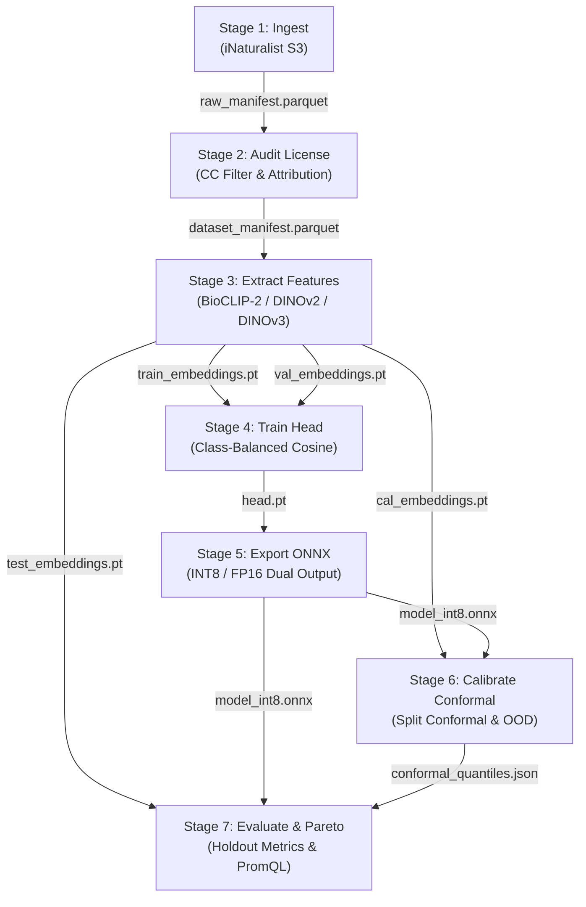

# Epistemic Diamond DAG Data-Flow Matrix

## 1. Architectural Overview

The core data processing pipeline of TaxonVision-MLOps implements a deterministic **7-stage Epistemic Diamond DAG** governed by `dvc.yaml` and parameterized via `params.yaml`. Observations flow from raw remote S3 citizen-science imagery into validated manifests, normalized multi-split tensor embeddings, trained classifier weights, and zero-allocation ONNX artifacts.

---

## 2. Formal Stage Specification Matrix

| Stage | Python Entrypoint | Primary Input Artefacts & Schemas | Output Artefacts & Schemas | Invariant & SLO Guarantee |
| :--- | :--- | :--- | :--- | :--- |
| **Stage 1: Ingest** | `taxon_vision.pipelines.ingest` | S3 Open Data bucket (`s3://inaturalist-open-data/photos/`), `params.yaml:ingest` | `data/raw/raw_manifest.parquet` (Apache Arrow / Polars DataFrame) | Rate-limited chunk streaming (`aiolimiter`), transient retry with exponential backoff. |
| **Stage 2: Audit License** | `taxon_vision.pipelines.audit_license` | `data/raw/raw_manifest.parquet` | `data/processed/dataset_manifest.parquet` (Strict schema: `photo_id`, `taxon_id`, `license_code`, `attribution`) | Rejects non-compliant static domains; allows CC0, CC-BY, CC-BY-NC only (Rule 05). |
| **Stage 3: Extract Features** | `taxon_vision.pipelines.extract_features` | `data/processed/dataset_manifest.parquet`, Pretrained vision backbone | `data/embeddings/{train,val,cal,test}_embeddings.pt` (PyTorch Tensors: `[N, D]` normalized float32) | Deterministic split assignment ($70/10/10/10$), $L_2$ feature normalization $\|\mathbf{z}\|_2 = 1.0$. |
| **Stage 4: Train Head** | `taxon_vision.pipelines.train` | `train_embeddings.pt`, `val_embeddings.pt`, `params.yaml:train` | `models/head.pt`, MLflow tracking run (`sqlite:///mlflow.db`) | Class-Balanced Cross-Entropy Loss, Optuna pruning, deterministic PRNG seed (Rule 01). |
| **Stage 5: Export ONNX** | `taxon_vision.pipelines.export_onnx` | `models/head.pt`, Backbone architecture spec | `models/model_int8.onnx`, `models/model_fp16.onnx` (Dual-head: logits + embeddings) | Zero-allocation inference graph, p95 latency $< 15\,\text{ms}$ on CPU, $< 10\,\text{ms}$ on RTX 5070 Ti (Rule 02). |
| **Stage 6: Calibrate** | `taxon_vision.pipelines.calibrate` | `cal_embeddings.pt`, `models/model_int8.onnx`, `params.yaml:conformal` | `reports/conformal_calibration.json`, `reports/ood_thresholds.json` | Empirical coverage $\ge 1 - \alpha$ via finite-sample correction quantile $\lceil (n+1)(1-\alpha) \rceil / n$ (Rule 06). |
| **Stage 7: Evaluate** | `taxon_vision.pipelines.evaluate` | `test_embeddings.pt`, `model_int8.onnx`, `conformal_calibration.json` | `reports/eval_metrics.json`, Prometheus export counters | Unbiased holdout assertion; empty sets $\|C(X)\| = 0$ routed to human review gauge. |

---

## 3. Schema Data Dictionaries

### A. Dataset Manifest Schema (`dataset_manifest.parquet`)

* `photo_id` (`int64`): Unique photographic identifier from iNaturalist Open Data.
* `observation_uuid` (`string`): Globally unique observation UUID.
* `taxon_id` (`int32`): DarwinCore taxonomic identifier.
* `scientific_name` (`string`): Binomial nomenclature string.
* `license_code` (`string`): Open license identifier (`CC0-1.0`, `CC-BY-4.0`, `CC-BY-NC-4.0`).
* `photographer_name` (`string`): Retained attribution string for licensing compliance.
* `image_url` (`string`): S3 canonical object URL.

### B. Normalized Embeddings (`*.pt`)

* `embeddings` (`torch.FloatTensor` of shape `[N, 768]` or `[N, 384]`): Unit-norm feature vectors.
* `labels` (`torch.LongTensor` of shape `[N]`): Dense class indices in range $[0, K-1]$.
* `ids` (`torch.LongTensor` of shape `[N]`): Corresponding `photo_id` records.

### C. Conformal Quantile Schema (`conformal_calibration.json`)

* `alpha` (`float`): Nominal error rate (e.g., $0.05$).
* `q_hat` (`float`): Non-conformity score quantile cutoff threshold.
* `n_cal` (`int`): Calibration set cardinality $n$.
* `finite_sample_correction_factor` (`float`): Multiplier $\frac{\lceil (n+1)(1-\alpha) \rceil}{n}$.
* `timestamp_utc` (`string`): ISO 8601 UTC calibration timestamp.
