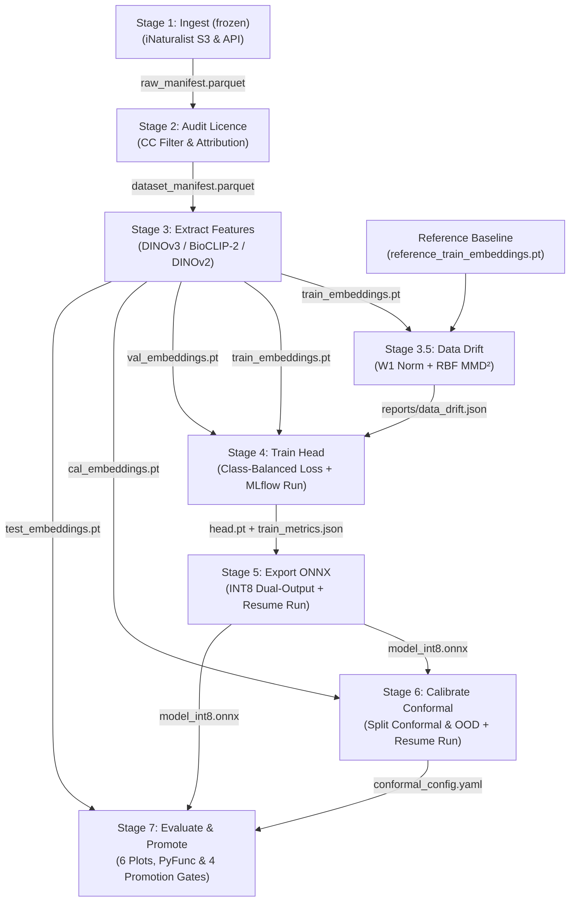

# Epistemic Diamond DAG Data-Flow Matrix

## 1. Architectural Overview

The core data processing pipeline of TaxonVision-MLOps implements a deterministic **8-stage Epistemic Diamond DAG** governed by [`dvc.yaml`](file:///home/benni/Documents/antigravity_workspace/taxon-vision-mlops/dvc.yaml) and parameterised via [`params.yaml`](file:///home/benni/Documents/antigravity_workspace/taxon-vision-mlops/params.yaml). Observations flow from raw remote S3 citizen-science imagery (and verified human feedback annotations) into licence-audited Parquet manifests, 4-way stratified tensor embeddings, pre-training representation drift verification (`data_drift`), Class-Balanced head training (`train`), dual-output INT8 ONNX quantisation (`export`), Split Conformal calibration (`calibrate`), and finally the Four-Gate Promotion holdout audit (`eval`).

Crucially, whilst DVC executes Stages 4 (`train`), 5 (`export`), 6 (`calibrate`), and 7 (`eval`) as separate OS subprocesses, [`reports/train_metrics.json`](file:///home/benni/Documents/antigravity_workspace/taxon-vision-mlops/src/taxon_vision/models/training/tracking.py) propagates the parent `mlflow_run_id` and `mlflow_model_id` (`m-...`) forward so that all downstream stages attach their metrics, plots, and `TaxonVisionPyFuncModel` artefacts to a single unified MLflow 3.x run.

---

## 2. Formal 8-Stage Specification Matrix

| Stage | Python Entrypoint | Primary Input Artefacts & Schemas | Output Artefacts & Schemas | Invariant & SLO Guarantee |
| :--- | :--- | :--- | :--- | :--- |
| **Stage 1: Ingest** (`ingestion`) | `taxon_vision.pipelines.ingest` | S3 Open Data bucket (`s3://inaturalist-open-data/`), `params.yaml:ingestion`, `config/taxa_catalog.yaml` | `data/manifests/raw_manifest.parquet` (Polars/Arrow Parquet table; marked `frozen: true` in `dvc.yaml`) | Rate-limited chunk streaming (`aiolimiter`), transient retry with exponential backoff. |
| **Stage 2: Audit Licence** (`audit_license`) | `taxon_vision.pipelines.audit_license` | `data/manifests/raw_manifest.parquet` | `data/manifests/dataset_manifest.parquet`, `reports/license_audit.json` | Rejects non-compliant static domains; admits `CC0`, `CC-BY`, and `CC-BY-NC` only with mandatory `photographer_name` attribution retention. |
| **Stage 3: Extract Features** (`extract_features`) | `taxon_vision.pipelines.extract_features` | `data/manifests/dataset_manifest.parquet`, Pretrained vision backbone | `data/embeddings/{train,val,cal,test}_embeddings.pt` (PyTorch dicts with `[N, D]` float32 tensors) | Deterministic stratified split assignment ($70/10/10/10$) with seed `42`; minimum extraction success ratio $\ge 95\%$. |
| **Stage 3.5: Data Drift** (`data_drift`) | `taxon_vision.pipelines.data_drift` | `data/reference/reference_train_embeddings.pt`, `data/embeddings/train_embeddings.pt`, `config/drift_config.yaml` | `reports/data_drift.json`, `reports/data_drift_report.html` (logged to MLflow with `drift_scope="training"`) | Audits training representation shift via Tier 1 $W_1$ norm distance ($\tau_{W_1}=0.12812$) and Tier 2 RBF MMD² permutation testing ($\alpha=0.01$) prior to head training. |
| **Stage 4: Train Head** (`train`) | `taxon_vision.pipelines.train` | `train_embeddings.pt`, `val_embeddings.pt`, `reports/data_drift.json`, `params.yaml:training` | `models/checkpoints/head.pt`, `reports/train_metrics.json` (containing `mlflow_run_id` and `mlflow_model_id`) | Class-Balanced Loss, optional Optuna TPE/ASHA pruning, 5-dataset `mlflow.data` lineage logging, and `LoggedModel` creation. |
| **Stage 5: Export ONNX** (`export`) | `taxon_vision.pipelines.export_onnx` | `models/checkpoints/head.pt`, `reports/train_metrics.json` | `models/checkpoints/model_int8.onnx` (Dual-output graph: `logits` + `embeddings`) | Resumes parent MLflow run; exports opset 17 graph and applies INT8 dynamic quantisation with accuracy drop validation. |
| **Stage 6: Calibrate** (`calibrate`) | `taxon_vision.pipelines.calibrate` | `data/embeddings/cal_embeddings.pt`, `models/checkpoints/model_int8.onnx`, `params.yaml:conformal` | `config/conformal_config.yaml`, `reports/conformal_metrics.json` | Resumes parent MLflow run; guarantees marginal coverage $\ge 1 - \alpha$ via finite-sample quantile $\lceil (n+1)(1-\alpha) \rceil / n$ and calibrates OOD energy $\tau_{\text{OOD}}$ at $95\%$ TPR. |
| **Stage 7: Evaluate & Promote** (`eval`) | `taxon_vision.pipelines.evaluate` | `data/embeddings/test_embeddings.pt`, `models/checkpoints/model_int8.onnx`, `config/conformal_config.yaml` | `docs/assets/pareto_results.json`, `reports/pareto_evaluation.json`, `reports/per_taxon_holdout_audit.json`, 6 plots, `pyfunc_model` | Resumes parent MLflow run; executes `mlflow.models.evaluate()`, runs the Four-Gate Promotion check (`promotion.py`), and assigns `@Production` or `@Challenger` registry aliases. |

---

## 3. Schema Data Dictionaries

### A. Dataset Manifest Schema (`dataset_manifest.parquet`)

* `photo_id` (`int64`): Unique photographic identifier from iNaturalist Open Data.
* `observation_uuid` (`string`): Globally unique observation UUID used for deduplication during active learning merges.
* `taxon_id` (`int32`): DarwinCore / iNaturalist taxonomic identifier.
* `scientific_name` (`string`): Binomial nomenclature string.
* `license_code` (`string`): Verified open licence identifier (`CC0`, `CC-BY`, `CC-BY-NC`).
* `photographer_name` (`string`): Retained attribution string mandatory for legal compliance.
* `image_url` (`string`): Canonical S3 or open-data object URL.

### B. Split Embedding Tensor Schema (`{train,val,cal,test}_embeddings.pt`)

* `embeddings` (`torch.FloatTensor` of shape `[N, 384]` or `[N, 768]`): Pre-extracted penultimate backbone feature vectors.
* `labels` (`torch.LongTensor` of shape `[N]`): Contiguous class indices in range $[0, K-1]$.
* `taxon_ids` (`list[int]`): Canonical biological `taxon_id` mapping corresponding to each class index.

### C. Training Data Drift Report Schema (`reports/data_drift.json`)

* `w1_distance` (`float`): Observed 1D Wasserstein-1 distance on pre-normalised embedding $L_2$ norms.
* `tau_w1` (`float`): Calibrated Wasserstein-1 alert threshold (`0.12812` from `config/drift_config.yaml`).
* `mmd2` (`float`): Unbiased sample estimate of squared Maximum Mean Discrepancy in the RBF kernel Hilbert space.
* `mmd2_p_value` (`float`): Monte Carlo permutation p-value ($B=200$ shuffles).
* `drift_detected` (`bool`): True if `w1_distance > tau_w1` or `mmd2_p_value < alpha`.
* `n_reference` / `n_current` / `feature_dim` (`int`): Sample counts and vector dimensionality ($D=384$).
* `mlflow_run_id` (`string | null`): Identifier of the `training_data_drift` run in MLflow.

### D. Conformal Calibration Schema (`config/conformal_config.yaml`)

* `alpha` (`float`): Nominal error rate ($\alpha = 0.05 \implies 95\%$ target marginal coverage).
* `q_hat` (`float`): Calibrated non-conformity score quantile threshold ($\hat{q}_\alpha = 0.8405$).
* `tau_ood` / `ood_energy_threshold` (`float`): Negative Helmholtz free energy cutoff ($-2.2792$) calibrated at $95\%$ in-distribution TPR.
* `max_set_size_for_auto_accept` (`int`): Maximum conformal set cardinality ($k_{\text{max}} = 3$) before routing to human expert triage.
* `num_calibration_samples` (`int`): Calibration split cardinality ($n = 169$).
