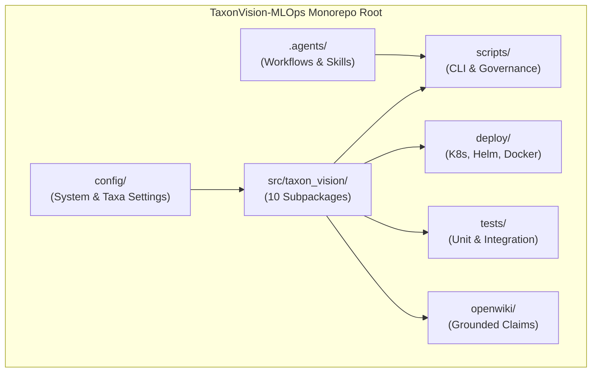

# Software & Config Architecture

Welcome to the Software & Config Architecture portal for the TaxonVision-MLOps platform. This chapter establishes the structural topology of the monorepo, the 3-tier configuration hierarchy, the 4-tier layered Python package structure, and the interactive codebase navigation index.

---

## Overview

The repository is structured as an enterprise-grade MLOps monorepo engineered to support dual development modes: offline deterministic batch processing via DVC and online real-time serving via FastAPI and ONNX Runtime.

### Monorepo Boundary Definitions

* **`src/taxon_vision/`:** Core Python library package containing 10 modular, high-cohesion subpackages spanning data ingestion, vision model backbones, ONNX inference, conformal calibration, active learning triage, telemetry, and web presentation.
* **`config/`:** Centralized configuration repository containing base runtime defaults (`default_config.yaml`), empirical conformal calibration parameters (`conformal_config.yaml`), taxonomic catalog definitions (`taxa_catalog.yaml`), and Prometheus scraper definitions (`prometheus.yaml`).
* **`deploy/`:** Production infrastructure deployment artifacts, including Kubernetes bare-metal manifests (`deploy/k8s/`), Dockerfiles for CPU and CUDA execution targets, and root multi-service Docker Compose files (`docker-compose.yml`).
* **`scripts/`:** Operational automation utilities, CLI execution wrappers, governance verifiers (`validate_okf.py`, `verify_markdown_rules.py`, `visualize_okf.py`), benchmark runners, and database migration helpers.
* **`tests/`:** Test harnesses partitioned into fast isolated unit tests (`tests/unit/`), realistic multi-component integration tests (`tests/integration/`), and shared synthetic fixtures.
* **`.agents/`:** AI pair-programming infrastructure, defining specialized engineering roles, behavioral rules, automated skills, and multi-step execution workflows.
* **`openwiki/`:** Weekly automated repository evidence index, maintaining grounded architectural claims and traceability proofs.

---

## Thematic Architecture Guides

Navigate through the core architectural pillars using the detailed guides below:

* **[Repository & Config Encyclopedia](repository_and_config_encyclopedia.md):** Deep dive into the 3-Tier Configuration Precedence Pyramid (`default_config.yaml` -> `params.yaml` -> `TAXON__*` environment variables), complete `params.yaml` parameter encyclopedia, and live configuration snippets.
* **[Package & Call Graph](package_and_call_graph.md):** Comprehensive reference for the 4-tier layered architecture, acyclic call graphs, Rule 00 Python invariants, and detailed class signatures across all 10 subpackages.
* **[Codebase Explorer](codebase_explorer.md):** Interactive client-side explorer widget allowing engineers and AI agents to filter, search, and inspect module responsibilities, complexity bounds, and targeted test suites.

---

## References

* Repository Root Manifest: `params.yaml`
* Runtime Base Defaults: `config/default_config.yaml`
* Conformal Calibration Settings: `config/conformal_config.yaml`
* Taxonomic Perimeter Catalog: `config/taxa_catalog.yaml`
* Core Python Namespace: `src/taxon_vision/`
* Open Knowledge Format Governance: `scripts/governance/validate_okf.py`
