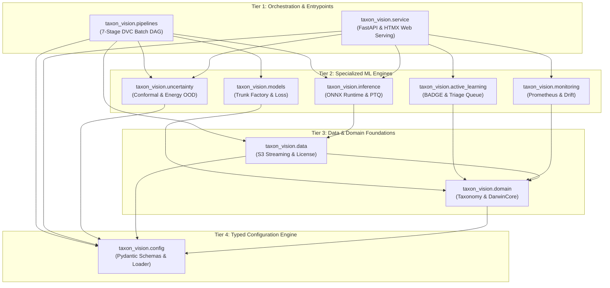

# Package Hierarchy & Master Call Graph

The `src/taxon_vision/` codebase is structured as a strict **4-tier layered architecture** across 10 specialized subpackages. This architecture prevents circular imports, isolates offline pipeline batch execution from online serving boundaries, and enforces static type checking throughout the stack.

---

## 1. Architectural Tier Breakdown

### Tier 1: Orchestration & Ingress

* **`taxon_vision.pipelines`:** Orchestrates the 7 offline DVC batch processing stages (`ingest` -> `audit_license` -> `extract_features` -> `train` -> `export_onnx` -> `calibrate` -> `evaluate`). Governs artifact creation and reproducible tensor generation.
* **`taxon_vision.service`:** Hosts the online serving layer, providing an asynchronous REST API (`/predict`, `/health`, `/metrics`, `/feedback`) and a server-rendered Jinja2/HTMX operator dashboard for human-in-the-loop review.

### Tier 2: Specialized ML Engines

* **`taxon_vision.models`:** Manages foundation model trunk instantiation via Hugging Face and timm, linear probe heads, Class-Balanced Loss computation, and Optuna HPO tuning.
* **`taxon_vision.inference`:** Implements zero-allocation ONNX Runtime inference sessions, static INT8 post-training quantization (PTQ), and EigenCAM visual attribution generation.
* **`taxon_vision.uncertainty`:** Implements split conformal prediction algorithms guaranteeing distribution-free $1 - \alpha$ coverage sets and Helmholtz Free Energy out-of-distribution (OOD) screening.
* **`taxon_vision.active_learning`:** Selects high-diversity, high-uncertainty observations via BADGE query strategies and maintains the triage queue for human verification.
* **`taxon_vision.monitoring`:** Ingests streaming latencies into Prometheus histograms and calculates online Wasserstein-1 Earth Mover's Distance data drift.

### Tier 3: Data & Domain Foundations

* **`taxon_vision.data`:** Queries the iNaturalist REST API, verifies Creative Commons license compliance, and streams raw image bytes from AWS S3.
* **`taxon_vision.domain`:** Encapsulates DarwinCore taxonomic schemas, immutable observation entities, and legal StrEnums.

### Tier 4: Configuration Engine

* **`taxon_vision.config`:** Loads, merges, and validates the 3-tier configuration hierarchy into typed Pydantic models.

---

## 2. Subpackage Module & Class Reference

### Subpackage 1: Pipelines (`taxon_vision.pipelines`)

Orchestrates batch workflows invoked via `dvc repro`.

| Module File | Key Classes / Functions | Primary Method Signatures | Description |
| :--- | :--- | :--- | :--- |
| `ingest.py` | `run_ingest` | `run_ingest(config_path: Path \| None = None) -> None` | Fetches observations for target taxa from iNaturalist into `data/raw_manifest.parquet`. |
| `audit_license.py` | `run_audit_license` | `run_audit_license(config_path: Path \| None = None) -> None` | Enforces open license compliance, generating `data/dataset_manifest.parquet`. |
| `extract_features.py` | `run_feature_extraction` | `run_feature_extraction(config_path: Path \| None = None) -> None` | Passes images through frozen backbone, saving split embedding tensors (`.pt`). |
| `train.py` | `run_training` | `run_training(config_path: Path \| None = None) -> None` | Trains linear probe classifier head using Class-Balanced Loss. |
| `export_onnx.py` | `run_export` | `run_export(config_path: Path \| None = None) -> None` | Exports classifier to ONNX format and executes static INT8 quantization. |
| `calibrate.py` | `run_calibration` | `run_calibration(config_path: Path \| None = None) -> None` | Calculates conformal quantile $\hat{q}$ and energy threshold $\tau_{\text{ood}}$. |
| `evaluate.py` | `run_evaluation` | `run_evaluation(config_path: Path \| None = None) -> None` | Validates empirical test coverage ($1 - \alpha$) and p95 latency SLA. |

### Subpackage 2: Service (`taxon_vision.service`)

Powers online HTTP inference, Class Activation Mapping, and HTMX triage UI.

| Module File | Key Classes / Functions | Primary Method Signatures | Description |
| :--- | :--- | :--- | :--- |
| `api.py` | `app`, `lifespan` | `lifespan(_app: FastAPI) -> AsyncIterator[None]` | ASGI composition root pre-warming models and managing clean shutdown. |
| `inference.py` | `predict_species`, `load_taxa_catalog` | `predict_species(image_bytes: bytes, ...) -> PredictionResult` | Zero-allocation inference pipeline coordinating ONNX session, conformal sets, and CAM. |
| `storage.py` | `ImageCacheProtocol`, `RedisImageCache`, `MemoryImageCache`, `persist_flagged_observation` | `store(image_bytes: bytes) -> str`, `get(image_hash: str) -> bytes \| None` | Distributed Redis ephemeral upload cache (with memory fallback) and disk triage persistence. |
| `presentation.py` | `build_prediction_view_model`, `render_prediction_card` | `build_prediction_view_model(prediction, image_hash, ...) -> dict` | Formats conformal prediction sets and telemetry for server-rendered Jinja2/HTMX templates. |
| `routes/predict.py` | `router` | `POST /api/v1/predict(file: UploadFile) -> JSONResponse` | Machine REST API returning classification logits, conformal set members, and OOD scores. |
| `routes/explain.py` | `router` | `POST /api/v1/explain(image_hash: str, ...) -> ExplainResponse \| HTMLResponse` | On-demand Class Activation Mapping supporting JSON attribution or server-rendered drawer fragments. |
| `routes/views.py` | `router` | `GET /`, `POST /ui/predict-htmx` | Interactive operator dashboard view and HTMX partial upload drawer handler. |
| `routes/train.py` | `router` | `POST /api/v1/train(background_tasks: BackgroundTasks) -> JSONResponse` | Asynchronous training trigger endpoint dispatching background training runs. |
| `routes/health.py` | `router` | `GET /health`, `GET /health/ready`, `GET /metrics` | Kubernetes liveness probe, model readiness probe, and Prometheus exposition scraper. |

### Subpackage 3: Models (`taxon_vision.models`)

Neural network architectures, probe heads, loss functions, and modular training coordinators.

| Module File | Key Classes / Functions | Primary Method Signatures | Description |
| :--- | :--- | :--- | :--- |
| `factory.py` | `create_backbone`, `create_feature_extractor` | `create_backbone(model_name: str, pretrained: bool = True) -> tuple[nn.Module, int]` | Foundation trunk factory initializing DINOv3, BioCLIP-2, MobileNetV4, or DINOv2. |
| `head.py` | `TaxonClassifier` | `forward(x: torch.Tensor) -> torch.Tensor` | PyTorch linear probe classification head with dropout regularization. |
| `loss.py` | `ClassBalancedLoss` | `forward(logits: torch.Tensor, targets: torch.Tensor) -> torch.Tensor` | Effective-number class-balanced cross-entropy and focal loss. |
| `training/runner.py` | `run_training_pipeline` | `run_training_pipeline(extractor: str, epochs: int, tune: bool, ...) -> dict` | Top-level training orchestrator coordinating tensor hydration, Optuna, and promotion. |
| `training/dataset.py` | `load_or_create_training_split`, `get_dvc_dataset_hash` | `load_or_create_training_split(train_path: Path, val_path: Path, ...) -> EmbeddingSplit` | Loads stratified embedding tensors and extracts DVC lock hashes without git dependencies. |
| `training/loops.py` | `train_head_epoch`, `evaluate_head` | `train_head_epoch(model, loader, optimizer, criterion) -> float` | Isolated single-epoch mini-batch SGD passes returning typed `HeadEvaluationResult`. |
| `training/embeddings.py` | `train_head_on_cached_embeddings` | `train_head_on_cached_embeddings(head, data, optimizer, criterion, config) -> tuple` | Multi-epoch training loop coordinating early stopping and learning rate scheduling. |
| `training/promotion.py` | `_promote_model_if_better`, `_determine_promotion_alias` | `_promote_model_if_better(head, val_pr_auc, metrics, ...) -> None` | Evaluates Macro PR-AUC against incumbent models and tags MLflow aliases (`Production`/`Challenger`). |
| `training/tracking.py` | `mlflow_run_scope`, `MLflowTracker` | `mlflow_run_scope(run_name: str, params: dict) -> Generator` | RAII context manager guaranteeing deterministic MLflow session lifecycle and fail-fast logging. |
| `training/tuning.py` | `tune_hyperparameters`, `HyperparameterObjective` | `tune_hyperparameters(data: EmbeddingSplit, ...) -> TuningResult` | Bayesian hyperparameter optimization study orchestration with TPE sampling and ASHA pruning. |
| `training/visualizations.py` | `log_training_visualizations` | `log_training_visualizations(tracker, history, ...) -> None` | Diagnostic plot rendering (confusion matrices, PR curves, and energy distributions). |
| `training/checkpoint.py` | `save_checkpoint` | `save_checkpoint(model: nn.Module, path: Path) -> Path` | Checkpoint serialization and PyTorch state dictionary export. |
| `training/types.py` | `ResolvedTrainingParameters`, `EmbeddingSplit` | Pydantic Models & Frozen Dataclasses | Parameter containers enforcing Rule 08 parameter encapsulation and zero tuple blindness. |

### Subpackage 4: Inference (`taxon_vision.inference`)

ONNX Runtime execution, static quantization, and explainability.

| Module File | Key Classes / Functions | Primary Method Signatures | Description |
| :--- | :--- | :--- | :--- |
| `onnx_engine.py` | `ONNXInferenceEngine` | `predict(image_tensor: np.ndarray) -> np.ndarray` | High-throughput zero-allocation ONNX Runtime inference session. |
| `cam.py` | `generate_heatmap`, `generate_cam_overlay` | `generate_heatmap(model, image_tensor, target_class) -> np.ndarray` | Class Activation Mapping projecting ViT patch tokens and CNN activations. |
| `calibration.py` | `TaxonCalibrationDataReader` | `get_next() -> dict[str, np.ndarray] \| None` | ONNX Runtime calibration reader streaming unlabelled representative images. |
| `onnx_exporter.py` | `export_to_onnx` | `export_to_onnx(model: nn.Module, dummy_input: torch.Tensor, path: Path) -> Path` | Exports PyTorch model graphs to ONNX Opset 17 with dynamic batch axes. |
| `quantizer.py` | `quantize_onnx_model`, `quantize_onnx_static` | `quantize_onnx_model(input_path: Path, output_path: Path, ...) -> Path` | Performs static/dynamic INT8 post-training quantization via ONNX Runtime quantization API. |

### Subpackage 5: Uncertainty & Safety (`taxon_vision.uncertainty`)

Statistical guarantees and distribution-free risk control.

| Module File | Key Classes / Functions | Primary Method Signatures | Description |
| :--- | :--- | :--- | :--- |
| `conformal.py` | `SplitConformalPredictor` | `calibrate(probs: np.ndarray, labels: np.ndarray, alpha: float) -> float` | Computes non-conformity scores and empirical quantile $\hat{q}$. |
| `conformal.py` | `SplitConformalPredictor` | `predict_set(probs: np.ndarray) -> list[list[int]]` | Generates candidate prediction sets satisfying $P(Y \in C(X)) \ge 1 - \alpha$. |
| `ood_detector.py` | `EnergyOODDetector` | `compute_energy(logits: np.ndarray, temp: float = 1.0) -> np.ndarray` | Calculates Helmholtz Free Energy $E(x) = -T \cdot \log \sum_i e^{f_i(x) / T}$. |
| `ood_detector.py` | `EnergyOODDetector` | `calibrate_threshold(logits: np.ndarray, tpr: float = 0.95) -> float` | Establishes decision threshold $\tau_{\text{ood}}$ at target In-Distribution TPR. |

### Subpackage 6: Active Learning (`taxon_vision.active_learning`)

Human-in-the-loop sample acquisition and triage prioritization.

| Module File | Key Classes / Functions | Primary Method Signatures | Description |
| :--- | :--- | :--- | :--- |
| `query.py` | `BADGEQueryStrategy` | `select_samples(embeddings: np.ndarray, logits: np.ndarray, budget: int) -> list[int]` | Batch Active Learning by Diverse Gradient Embeddings ($k$-means++). |
| `query.py` | `CoreSetQueryStrategy` | `select_samples(embeddings: np.ndarray, budget: int) -> list[int]` | Minimax facility location distance sampling over representation space. |
| `triage_queue.py` | `TriageQueue` | `enqueue(observation: dict[str, Any]) -> str` | Ingests ambiguous observations into human operator triage queue. |
| `triage_queue.py` | `TriageQueue` | `resolve(triage_id: str, verified_taxon_id: int) -> None` | Records expert ground-truth annotations for incremental retraining. |

### Subpackage 7: Monitoring & Observability (`taxon_vision.monitoring`)

Streaming telemetry, latency profiling, and data drift detection.

| Module File | Key Classes / Functions | Primary Method Signatures | Description |
| :--- | :--- | :--- | :--- |
| `telemetry.py` | `PrometheusTelemetry` | `record_inference(latency_sec: float, set_size: int, is_ood: bool) -> None` | Emits request counts, latency histograms, and conformal set sizes. |
| `drift.py` | `DriftDetector` | `compute_wasserstein_drift(ref: np.ndarray, curr: np.ndarray) -> float` | Computes Earth Mover's Distance between baseline and production embeddings. |

### Subpackage 8: Data Ingestion & S3 (`taxon_vision.data`)

Citizen science API client, license audit, and S3 streaming.

| Module File | Key Classes / Functions | Primary Method Signatures | Description |
| :--- | :--- | :--- | :--- |
| `inat_client.py` | `INatAPIClient` | `fetch_observations(taxon_id: int, per_page: int) -> list[dict]` | Queries iNaturalist v1 REST API for research-grade biological records. |
| `license_filter.py` | `LicenseFilter` | `filter_compliant_records(records: list[dict]) -> tuple[list[dict], dict]` | Audits Creative Commons licenses (rejecting un-licensed media). |
| `s3_streamer.py` | `S3ImageStreamer` | `fetch_image_bytes(photo_id: int \| str) -> bytes` | Streams raw JPEG bytes from AWS Open Data iNaturalist S3 buckets. |

### Subpackage 9: Domain Models (`taxon_vision.domain`)

DarwinCore entities, taxonomy nodes, and licensing rules.

| Module File | Key Classes / Functions | Primary Method Signatures | Description |
| :--- | :--- | :--- | :--- |
| `taxonomy.py` | `TaxonNode` | `taxon_id: int, scientific_name: str, common_name: str, rank: str` | Typed DarwinCore biological taxon tree entity. |
| `taxonomy.py` | `TaxonomyCatalog` | `get_by_id(taxon_id: int) -> TaxonNode \| None` | Immutable collection of perimeter taxa supporting constant-time lookups. |
| `license.py` | `OpenLicense` | `CC0, CC_BY, CC_BY_NC, CC_BY_SA, ...` | Constrained StrEnum of recognized Creative Commons open licenses. |
| `observation.py` | `ObservationRecord` | `observation_id: str, taxon: TaxonNode, attribution: AttributionRecord` | DarwinCore observation model ensuring photographer attribution retention. |

### Subpackage 10: Configuration Engine (`taxon_vision.config`)

Hierarchical configuration loader and typed Pydantic models.

| Module File | Key Classes / Functions | Primary Method Signatures | Description |
| :--- | :--- | :--- | :--- |
| `schemas.py` | `Settings` | `service: ServiceSettings, model: ModelSettings, training: TrainingSettings` | Root validated Pydantic model encapsulating system configuration. |
| `loader.py` | `get_settings` | `get_settings(config_path: Path \| None = None) -> Settings` | LRU-cached configuration loader implementing the 3-Tier Precedence Pyramid. |
| `loader.py` | `reset_settings` | `reset_settings() -> None` | Invalidates settings cache to force re-reading configuration files. |

---

## 3. Rule 00 Python Modernization Mandates

To preserve long-term maintainability, all subpackages adhere to three strict architectural invariants:

* **Zero Dynamic Reflection:** `hasattr` and `getattr` are strictly banned. All attribute accesses must be statically declared through explicit types, protocols, or Pydantic fields.
* **Zero Eager Submodule Imports:** Subpackage `__init__.py` files never eagerly import operational modules, preventing namespace pollution and CLI import side-effects.
* **Cognitive Complexity $< 15$:** Every method is bounded to a cognitive complexity score strictly below 15, validated by `complexipy` in automated CI gates.
