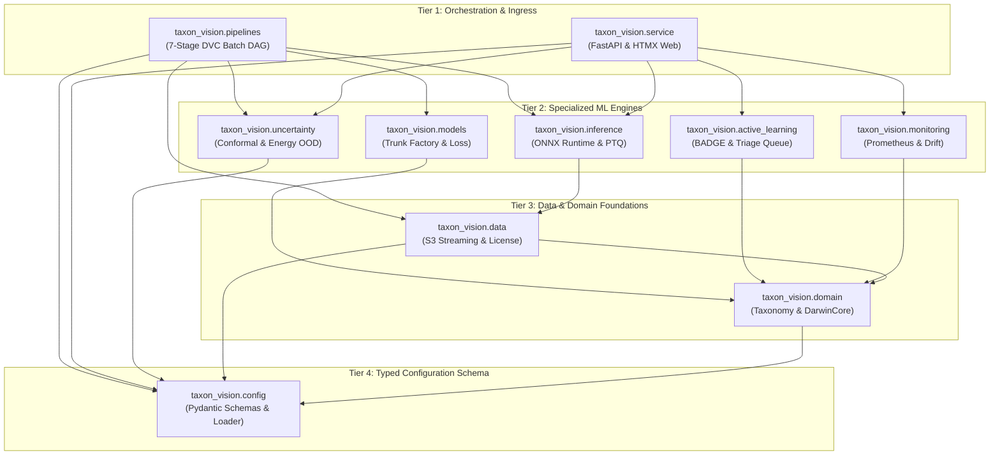

# Package Hierarchy & Master Call Graph

The `taxon_vision` codebase is organized into ten high-cohesion, low-coupling subpackages structured across a strict **4-tier layered architecture**. Upward dependencies and cross-tier cycles are strictly forbidden by static analysis.

---

## 1. Architectural Tier Breakdown

### Tier 1: Orchestration & Entrypoints

* **`taxon_vision.pipelines`:** Executes the offline batch stages invoked by `dvc repro`. Enforces deterministic random seeds, loads datasets, and writes versioned artifacts.
* **`taxon_vision.service`:** Powers the online serving boundary. Hosts the asynchronous FastAPI prediction endpoints and server-rendered HTMX operator views.

### Tier 2: Specialized ML Engines

* **`taxon_vision.models`:** Manages foundation trunk instantiation via timm/Hugging Face factories, Class-Balanced Loss computation, and linear probe heads.
* **`taxon_vision.inference`:** Executes zero-allocation ONNX Runtime inference sessions, applies INT8 Post-Training Quantization, and generates EigenCAM attribution maps.
* **`taxon_vision.uncertainty`:** Mathematical safety engine computing distribution-free conformal prediction sets and Helmholtz Free Energy OOD cutoffs.
* **`taxon_vision.active_learning`:** Selects high-diversity, high-ambiguity observations via BADGE sampling for human expert review in Label Studio.
* **`taxon_vision.monitoring`:** Ingests streaming inference latencies into Prometheus TSDB histograms and calculates online Wasserstein-1 Earth Mover's Distance drift.

### Tier 3: Data & Domain Foundations

* **`taxon_vision.data`:** Queries the iNaturalist REST API, verifies Creative Commons open licenses, and streams raw image bytes from AWS S3 buckets.
* **`taxon_vision.domain`:** Encapsulates business logic, DarwinCore taxonomic hierarchies, legal StrEnums, and immutable Pydantic entities.

### Tier 4: Configuration Engine

* **`taxon_vision.config`:** Validates YAML files and environment variable overrides against typed Pydantic models.

---

## 2. Rule 00 Python Modernization Mandates

To guarantee maintainability, the entire codebase enforces three structural invariants:

* **Zero Dynamic Reflection:** Strictly bans `hasattr` and `getattr`. All object properties are accessed via static types, protocols, or typed Pydantic models.
* **Zero Eager Submodule Imports:** Root and subpackage `__init__.py` files remain completely empty or export only explicit, typed symbols, preventing namespace pollution and `RuntimeWarning` issues during `python -m` execution.
* **Cognitive Complexity $< 15$:** All functions and methods must maintain a complexity score strictly below 15, verified by `complexipy` in CI gates.
