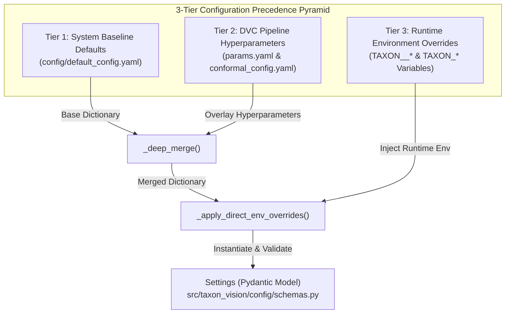

# Repository & Configuration Encyclopedia

TaxonVision-MLOps implements a deterministic, multi-layered configuration management system designed to guarantee reproducibility across offline DVC experiments while offering runtime flexibility in containerized production deployments.



---

## 1. The 3-Tier Configuration Precedence Pyramid

The configuration subsystem in `src/taxon_vision/config/loader.py` enforces a hierarchical layering order. When two layers specify the same key, the higher tier cleanly overwrites the lower tier:

### Tier 1: System Baseline Defaults (`config/default_config.yaml`)

* Serves as the foundational baseline for all system settings, timeouts, service port bindings, default backbones, and pre-processing statistics.
* Defines static operational thresholds (e.g., maximum file upload size of 15 MB, standard ImageNet normalization vectors, and the backbone registry mapping friendly aliases to Hugging Face or timm weights).
* Read first on initialization by `get_settings()` to populate default values across all sub-models.

### Tier 2: DVC Pipeline Hyperparameters (`params.yaml`)

* The repository root `params.yaml` acts as the single source of truth for all DVC-tracked pipeline stages.
* Contains hyperparameters that directly alter dataset splits, neural network weights, quantization strategies, or statistical conformal coverage guarantees.
* Automatically overlaid on top of Tier 1 via recursive dictionary merging (`_deep_merge`), ensuring that executing `dvc repro` deterministically influences pipeline steps without modifying base system code.
* `config/conformal_config.yaml` is also layered at this tier to update empirical conformal quantiles ($\hat{q}$) and energy thresholds ($\tau_{\text{ood}}$) computed during the calibration stage.

### Tier 3: Runtime Environment Overrides (`TAXON__*`)

* Highest precedence layer, designed for containerized Kubernetes workloads, Docker Compose local testing, and CI sandboxes.
* Supports nested Pydantic environment variables using double underscores (e.g., `TAXON__SERVICE__PORT=8080` overrides `service.port`).
* Supports direct operational overrides, such as:
    * `TAXON_CONFIG_PATH`: Custom path to an external YAML configuration file.
    * `TAXON_ALLOW_UNTRAINED_FALLBACK`: Bypasses trained checkpoint requirements during smoke tests.
    * `TAXON_FLAGGED_STORAGE_DIR`: Target directory for storing out-of-distribution or ambiguous observation images.
    * `TAXON_OPTUNA_STORAGE_URI`: PostgreSQL or SQLite connection string for Optuna HPO trial persistence.

---

## 2. Comprehensive `params.yaml` Parameter Encyclopedia

Every parameter declared in `params.yaml` is mapped to its consuming DVC pipeline stage and mathematical purpose:

| Section & Parameter Key | Data Type & Default | Consuming DVC Stage | Mathematical & Engineering Purpose |
| :--- | :--- | :--- | :--- |
| `ingestion.taxa_to_fetch` | `list[int]` (10 Taxa IDs) | `ingest` | Array of iNaturalist taxon identifiers defining the Level 1 perimeter across 10 biological species. |
| `ingestion.per_page` | `int: 200` | `ingest` | Page size for paginated HTTP requests to the iNaturalist REST API (`v1/observations`). |
| `model.extractor` | `str: "dinov3"` | `extract_features` | Name of the frozen foundation backbone used for embedding extraction (`dinov3`, `bioclip-2`, `mobilenetv4_conv_small`). |
| `model.image_size` | `int: 224` | `extract_features` | Pixel resolution for bicubic interpolation and square center cropping ($224 \times 224$). |
| `feature_extraction.batch_size` | `int: 32` | `extract_features` | Mini-batch size passed through the PyTorch backbone during inference feature extraction. |
| `feature_extraction.val_split` | `float: 0.10` | `extract_features` | Holdout ratio allocated to validation embeddings for monitoring loss during probe training ($10\%$). |
| `feature_extraction.cal_split` | `float: 0.10` | `extract_features` | Holdout ratio allocated exclusively to the split conformal prediction calibration set ($10\%$). |
| `feature_extraction.test_split` | `float: 0.10` | `extract_features` | Holdout ratio allocated to the final evaluation test split for empirical coverage verification ($10\%$). |
| `training.epochs` | `int: 5` | `train` | Total optimization epochs over the pre-extracted training embeddings tensor. |
| `training.batch_size` | `int: 32` | `train` | Batch size fed to the linear probe classifier head during gradient descent. |
| `training.learning_rate` | `float: 0.001` | `train` | Initial learning rate for the AdamW optimizer ($10^{-3}$). |
| `training.weight_decay` | `float: 0.0001` | `train` | $L_2$ weight regularization factor ($10^{-4}$) to prevent overfitting on extracted embeddings. |
| `training.cb_beta` | `float: 0.9999` | `train` | Hyperparameter $\beta$ for Class-Balanced Loss weight factor $E_n = \frac{1 - \beta}{1 - \beta^n}$. |
| `training.tune` | `bool: false` | `train` | Flag indicating whether to trigger an Optuna Bayesian hyperparameter search prior to final training. |
| `export.quantize_int8` | `bool: true` | `export_onnx` | When enabled, runs ONNX Runtime Static Post-Training Quantization (PTQ) to produce `model_int8.onnx`. |
| `conformal.alpha` | `float: 0.05` | `calibrate` | Significance level $\alpha$ bounding error rate to at most $5\%$ (mathematical coverage $1 - \alpha = 95\%$). |
| `conformal.min_confidence` | `float: 0.60` | `calibrate` | Minimum probability score required to bypass human review if the conformal set contains multiple candidates. |
| `conformal.ood_tpr` | `float: 0.95` | `calibrate` | True Positive Rate ($95\%$) anchor used to compute the Helmholtz Free Energy threshold $\tau_{\text{ood}}$. |
| `evaluation.latency_sla_ms` | `float: 25.0` | `evaluate` | Maximum permissible p95 inference latency in milliseconds; exceeding this SLA fails evaluation. |

---

## 3. Live Configuration Structure Showcase

### Root Pipeline Hyperparameters (`params.yaml`)

```yaml
ingestion:
  taxa_to_fetch:
    - 48662  # Danaus plexippus (Monarch Butterfly)
    - 47219  # Apis mellifera (Western Honey Bee)
    - 12727  # Turdus migratorius (American Robin)
    - 8229   # Cyanocitta cristata (Blue Jay)
    - 47602  # Taraxacum officinale (Common Dandelion)
    - 57983  # Helianthus annuus (Common Sunflower)
    - 47144  # Canis lupus (Gray Wolf)
    - 42069  # Vulpes vulpes (Red Fox)
    - 48715  # Amanita muscaria (Fly Agaric)
    - 48701  # Boletus edulis (King Bolete)
  per_page: 200

model:
  extractor: "dinov3"
  image_size: 224

feature_extraction:
  batch_size: 32
  val_split: 0.10
  cal_split: 0.10
  test_split: 0.10

training:
  epochs: 5
  batch_size: 32
  learning_rate: 0.001
  weight_decay: 0.0001
  cb_beta: 0.9999
  tune: false

export:
  quantize_int8: true

conformal:
  alpha: 0.05
  min_confidence: 0.60
  ood_tpr: 0.95

evaluation:
  latency_sla_ms: 25.0
```

### Empirical Conformal Calibration Output (`config/conformal_config.yaml`)

```yaml
calibration:
  method: split-conformal
  nominal_coverage: 0.95
  alpha: 0.05
  q_hat: 0.8405
  tau_ood: -2.2792
  ood_energy_threshold: -2.2792
  max_set_size_for_auto_accept: 3
  empty_set_action: route_to_human_triage
  min_confidence_threshold: 0.6
  num_calibration_samples: 169
```

### Taxonomic Perimeter Definition (`config/taxa_catalog.yaml`)

```yaml
taxa:
  - id: 1
    scientific_name: "Danaus plexippus"
    common_name: "Monarch Butterfly"
    kingdom: "Animalia"
    class: "Insecta"
    inat_taxon_id: 48662
  - id: 2
    scientific_name: "Apis mellifera"
    common_name: "Western Honey Bee"
    kingdom: "Animalia"
    class: "Insecta"
    inat_taxon_id: 47219
    inat_aliases:
      - 47120  # Apis (Honey bees - genus)
      - 47119  # Bombus (Bumble bees)
      - 47114  # Vespidae (Yellowjackets & Hornets)
  - id: 3
    scientific_name: "Turdus migratorius"
    common_name: "American Robin"
    kingdom: "Animalia"
    class: "Aves"
    inat_taxon_id: 12727
    inat_aliases:
      - 14704  # Turdus (genus)
```

### Prometheus Service Monitor (`config/prometheus.yaml`)

```yaml
global:
  scrape_interval: 5s

scrape_configs:
  - job_name: 'fastapi-app'
    metrics_path: '/metrics'
    static_configs:
      - targets: ['host.docker.internal:8000']
```
