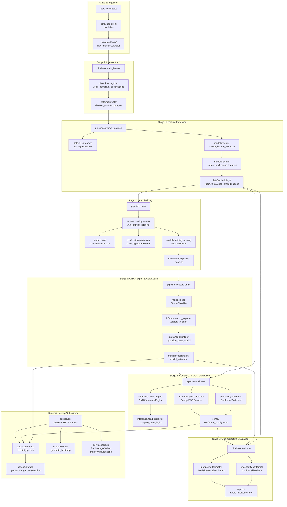

# Architecture, Database & Parameter Reference

This document provides a single, unified reference covering the 7-stage Epistemic Diamond DAG pipeline topology, the storage and database technologies across all pipeline tiers, and an exhaustive configuration parameter dictionary.

## 1. Pipeline Call & Subsystem Dependency Topology

The following diagram maps the execution flow of all 7 stages in `src/taxon_vision/pipelines/` to their underlying classes and submodules across `data`, `models`, `inference`, `uncertainty`, `monitoring`, and `service`:

## 2. Database & Storage Technology Matrix

The TaxonVision platform relies on specialized, purpose-built storage technologies across every tier of the MLOps lifecycle:

| Technology | Storage Target & Location | Data Format | Rationale & Selection Criteria |
| :--- | :--- | :--- | :--- |
| **Apache Parquet / Polars** | `data/manifests/*.parquet` | Snappy Columnar Parquet | High-performance columnar scan and predicate pushdown for metadata filtering without reading image payload bytes. |
| **PyTorch Tensors** | `data/embeddings/*.pt` | Serialized FP32 Tensors | Decoupled 4-way embedding splits (`train`, `val`, `cal`, `test`) allowing linear classification head training in seconds on cached representations. |
| **SQLite (PVC)** | `/workspace/optuna/optuna_studies.db` | Relational SQL DB | Persistent RDB backend for Optuna Bayesian hyperparameter studies, ensuring search trials resume seamlessly across pod restarts. |
| **SeaweedFS S3** | `s3://taxon-dvc-cache` (`local-seaweedfs`) | S3 Object Store API | Fast in-cluster object store deployed on host NVMe storage inside Kubernetes (`strategy.type: Recreate`), acting as an accelerated local NVMe cache ($< 2\text{ ms}$). |
| **Redis Ephemeral Cache** | In-Cluster Pod (`redis-ephemeral:6379`) | Raw specimen image uploads for CAM | In-memory key-value cache with 15-minute rolling TTL (`SETEX 900`) and 64 MB LRU ceiling, eliminating multi-pod serving split-brain. |
| **DagsHub DVC S3** | `s3://dvc` (`origin`) | Content-Addressed Hash | Cryptographically hashed DVC remote repository storing canonical cloud mirror for all 8 pipeline artifacts (~25 MB total). |
| **MLflow Model Registry** | Remote DagsHub Registry | Artifacts + Schema Metadata | Centralized experiment tracking server storing training loss curves, Macro PR-AUC scores, and model versions with input/output `TensorSpec` contracts. |
| **Prometheus / Evidently** | `/metrics` endpoint | Time-Series Metrics & JSON | Real-time monitoring of p95 latency SLOs, HTTP status distributions, prediction set cardinality, and feature representation drift. |

## 3. Exhaustive System Parameter Reference

### 3.1 DVC Pipeline Parameters (`/params.yaml`)

Root `/params.yaml` serves as the authoritative single source of truth for all pipeline hyperparameters tracked by DVC:

| Section | Parameter Key | Type | Default Value | Description |
| :--- | :--- | :--- | :--- | :--- |
| `ingestion` | `taxa_to_fetch` | `list[int]` | 10 Taxon IDs | Authoritative iNaturalist species IDs to ingest. |
| `ingestion` | `per_page` | `int` | `200` | Observation records requested per API page. |
| `model` | `extractor` | `str` | `"dinov3"` | Primary vision foundation backbone identifier. |
| `model` | `image_size` | `int` | `224` | Input image spatial resolution in pixels. |
| `feature_extraction` | `batch_size` | `int` | `32` | Mini-batch size for streaming image embedding passes. |
| `feature_extraction` | `val_split` | `float` | `0.10` | Fraction of data allocated to validation split. |
| `feature_extraction` | `cal_split` | `float` | `0.10` | Fraction of data allocated to calibration split. |
| `feature_extraction` | `test_split` | `float` | `0.10` | Fraction of data allocated to held-out test split. |
| `training` | `epochs` | `int` | `5` | Training epochs for linear head probing. |
| `training` | `batch_size` | `int` | `32` | Mini-batch size during head optimization. |
| `training` | `learning_rate` | `float` | `0.001` | Initial learning rate for AdamW optimizer. |
| `training` | `weight_decay` | `float` | `0.0001` | L2 weight regularization penalty factor. |
| `training` | `cb_beta` | `float` | `0.9999` | Class-Balanced Loss effective sample weighting parameter. |
| `training` | `tune` | `bool` | `false` | Whether to execute Optuna Bayesian tuning before training. |
| `export` | `quantize_int8` | `bool` | `true` | Whether to apply static INT8 quantization on exported ONNX. |
| `conformal` | `alpha` | `float` | `0.05` | Maximum allowable marginal error rate ($1 - \alpha = 0.95$). |
| `conformal` | `min_confidence` | `float` | `0.60` | Minimum top-1 probability to bypass human triage. |
| `conformal` | `ood_tpr` | `float` | `0.95` | True positive rate on calibration data for OOD energy threshold. |
| `evaluation` | `latency_sla_ms` | `float` | `25.0` | Production p95 latency SLO threshold in milliseconds. |

### 3.2 System Runtime Defaults (`config/default_config.yaml`)

Defines default service infrastructure, model registry mappings, and connection pool bounds:

| Section | Parameter Key | Type | Default Value | Description |
| :--- | :--- | :--- | :--- | :--- |
| `service` | `name` | `str` | `"TaxonVision Service"` | Display name for the web service. |
| `service` | `version` | `str` | `"0.1.0"` | Semantic version identifier. |
| `service` | `port` | `int` | `8000` | TCP port for HTTP server binding. |
| `service` | `host` | `str` | `"0.0.0.0"` | Network interface to listen on. |
| `service` | `max_image_upload_bytes` | `int` | `15728640` | Maximum upload file payload size (15 MB). |
| `service` | `allowed_mime_types` | `list[str]` | `["image/jpeg", "image/png", "image/webp"]` | Permitted image upload formats. |
| `model` | `default_extractor` | `str` | `"dinov3"` | Default foundation backbone. |
| `model` | `fallback_extractor` | `str` | `"mobilenetv4_conv_small..."` | Fallback lightweight architecture for offline test runs. |
| `model` | `available_extractors` | `list[str]` | 6 backbones | Catalog of supported vision backbones. |
| `model` | `image_size` | `int` | `224` | Default input image resolution. |
| `model` | `channels` | `int` | `3` | Color channel count (RGB). |
| `model` | `mean` | `list[float]` | `[0.485, 0.456, 0.406]` | ImageNet channel normalization means. |
| `model` | `std` | `list[float]` | `[0.229, 0.224, 0.225]` | ImageNet channel normalization standard deviations. |
| `model` | `onnx_model_path` | `str` | `"models/checkpoints/...onnx"` | Target path for production quantized ONNX graph. |
| `model` | `head_checkpoint_path` | `str` | `"models/checkpoints/head.pt"` | Checkpoint destination for trained classification head. |
| `model` | `taxa_catalog_path` | `str` | `"config/taxa_catalog.yaml"` | Path to authoritative taxa catalog metadata. |
| `model` | `eval_resize_ratio` | `float` | `1.142857` | Aspect-ratio preserving resize factor ($256 / 224$). |
| `model` | `calibration_dir` | `str` | `"data/sample"` | Representative image directory for static PTQ. |
| `model` | `calibration_samples` | `int` | `128` | Number of calibration images passed to PTQ. |
| `model` | `inference_backend` | `str` | `"auto"` | Backend selector: `'onnx'`, `'torch'`, or `'auto'`. |
| `model` | `quantization_mode` | `str` | `"auto"` | PTQ quantization mode: `'static'`, `'dynamic'`, or `'auto'`. |
| `model` | `temperature` | `float` | `1.0` | Softmax logit temperature scaling factor. |
| `model` | `allow_untrained_fallback` | `bool` | `false` | Disallows uninitialized weights in production. |
| `model` | `prefer_onnx_runtime` | `bool` | `true` | Prioritizes ONNX Runtime over PyTorch for inference. |
| `model` | `onnx_opset_version` | `int` | `17` | Target ONNX operator set version. |
| `model` | `cam_numerical_epsilon` | `float` | `1.0e-8` | Small float to prevent division by zero in Grad-CAM. |
| `model` | `ood_temperature` | `float` | `1.0` | Softmax temperature for Helmholtz free energy. |
| `model` | `ood_energy_threshold` | `float` | `-2.40` | Default energy threshold before calibration. |
| `model` | `flagged_storage_dir` | `str` | `"data/flagged_observations"` | Directory for human triage observation queue. |
| `mlflow` | `tracking_uri` | `str` | Remote DagsHub URI | DagsHub MLflow tracking endpoint. |
| `mlflow` | `experiment_name` | `str` | `"taxon-vision-head-tuning"` | Experiment grouping name. |
| `streaming` | `http_max_retries` | `int` | `5` | Maximum retry attempts on transient network failures. |
| `streaming` | `http_backoff_factor` | `float` | `0.5` | Exponential retry backoff multiplier. |
| `streaming` | `http_max_connections` | `int` | `16` | Maximum concurrent HTTP connection pool sockets. |
| `streaming` | `http_keepalive_connections` | `int` | `8` | Idle HTTP keep-alive connections retained. |
| `streaming` | `http_timeout_seconds` | `float` | `15.0` | Connection and read timeout duration. |
| `streaming` | `min_extraction_success_ratio` | `float` | `0.95` | Threshold ratio of successful downloads required. |
| `optuna` | `optuna_storage_uri` | `str` | SQLite URI | SQLAlchemy URI for Optuna study database. |
| `optuna` | `optuna_study_prefix` | `str` | `"taxon_vision"` | Prefix for generated study names. |
| `service` | `name` | `str` | `"TaxonVision Service"` | Service title exposed via OpenAPI documentation. |
| `service` | `version` | `str` | `"0.1.0"` | Semantic API release version. |
| `service` | `port` | `int` | `8000` | Default TCP bind port. |
| `service` | `host` | `str` | `"0.0.0.0"` | Network interface listener address. |
| `service` | `max_image_upload_bytes` | `int` | `15728640` | Maximum allowed multipart image upload size (15 MB). |
| `service` | `allowed_mime_types` | `list[str]` | `['image/jpeg', 'image/png', 'image/webp']` | Accepted MIME image types for classification. |
| `service` | `image_cache_max_items` | `int` | `100` | In-memory cache capacity before LRU eviction. |
| `service` | `image_cache_ttl_seconds` | `float` | `900.0` | Monotonic time-to-live for ephemeral uploads (15 minutes). |
| `service` | `ui_top_k_candidates` | `int` | `5` | Maximum prediction candidate drawers rendered on UI. |
| `service` | `redis_url` | `str \| None` | `None` | Optional Redis connection URL (`redis://redis-ephemeral:6379/0`). |

### 3.3 Calibrated Conformal Parameters (`config/conformal_config.yaml`)

Dynamically updated by Stage 6 (`pipelines.calibrate`) after testing against holdout calibration tensors:

| Parameter Key | Type | Description |
| :--- | :--- | :--- |
| `method` | `str` | Conformal inference method (`"split-conformal"`). |
| `nominal_coverage` | `float` | Target marginal coverage guarantee ($1 - \alpha = 0.95$). |
| `alpha` | `float` | Statistical significance / error rate bound ($0.05$). |
| `q_hat` | `float` | Calibrated non-conformity scalar quantile threshold $\hat{q}$. |
| `tau_ood` | `float` | Calibrated Helmholtz free energy OOD detection threshold $\tau_{\text{ood}}$. |
| `ood_energy_threshold` | `float` | Active runtime energy threshold boundary. |
| `max_set_size_for_auto_accept` | `int` | Maximum prediction set cardinality before routing to human triage ($k_{\max}=3$). |
| `empty_set_action` | `str` | Routing action when conformal set is empty (`"route_to_human_triage"`). |
| `min_confidence_threshold` | `float` | Minimum top-1 probability threshold to bypass review ($0.60$). |
| `num_calibration_samples` | `int` | Number of empirical observations evaluated during calibration. |

### 3.4 Biological Taxa Catalog (`config/taxa_catalog.yaml`)

Maps numeric model logits to scientific classifications and DarwinCore taxonomic hierarchy:

| Field Key | Type | Description |
| :--- | :--- | :--- |
| `id` | `int` | Zero-indexed internal model class label index ($0 \dots K-1$). |
| `scientific_name` | `str` | Binomial Latin taxonomic name (e.g. *"Danaus plexippus"*). |
| `common_name` | `str` | Standard vernacular English species name (e.g. "Monarch Butterfly"). |
| `kingdom` | `str` | Taxonomic kingdom classification (*Animalia*, *Plantae*, *Fungi*). |
| `class` | `str` | Taxonomic class (*Insecta*, *Aves*, *Magnoliopsida*, *Mammalia*). |
| `inat_taxon_id` | `int` | Canonical iNaturalist / GBIF taxon identifier. |
| `inat_aliases` | `list[int]` | Related genus or family taxon IDs mapped to this species index. |

### 3.5 Prometheus Scrape Daemon (`config/prometheus.yaml`)

Controls metrics scraping intervals for real-time latency and drift telemetry:

| Field Key | Type | Default Value | Description |
| :--- | :--- | :--- | :--- |
| `global.scrape_interval` | `str` | `"5s"` | Sampling frequency for pulling metrics from targets. |
| `scrape_configs.job_name` | `str` | `'fastapi-app'` | Job identifier for TaxonVision API metrics collection. |
| `scrape_configs.metrics_path` | `str` | `'/metrics'` | HTTP endpoint exposing Prometheus formatted metrics. |
| `scrape_configs.static_configs.targets` | `list[str]` | `['host.docker.internal:8000']` | Target service hostnames and TCP ports. |

### 3.6 REST API & HTMX Service Endpoints (`src/taxon_vision/service/`)

Exposes synchronous inference, visual explainability, and operator UI views:

| Route | Method | Module & Function | Description |
| :--- | :--- | :--- | :--- |
| `/` | `GET` | `views.py:index` | Server-rendered operator dashboard with responsive dropzone and instant image preview. |
| `/ui/predict-htmx` | `POST` | `views.py:predict_htmx` | HTMX partial endpoint returning server-rendered prediction card with conformal sets and CAM inspector. |
| `/api/v1/predict` | `POST` | `predict.py:predict_species` | Primary visual inference endpoint with conformal sets, OOD detection, human triage staging, and optional `explain=true` CAM overlay. |
| `/api/v1/explain` | `POST` | `explain.py:explain_prediction` | Forward-only Class Activation Mapping endpoint returning JSON attribution metrics or server-rendered HTML fragments (`HX-Request: true`). |
| `/health` | `GET` | `health.py:health` | Basic Kubernetes liveness probe endpoint. |
| `/health/ready` | `GET` | `health.py:health_ready` | Kubernetes readiness probe verifying model checkpoint availability. |
| `/metrics` | `GET` | `health.py:metrics` | Prometheus exposition endpoint for real-time latency and prediction counters. |
