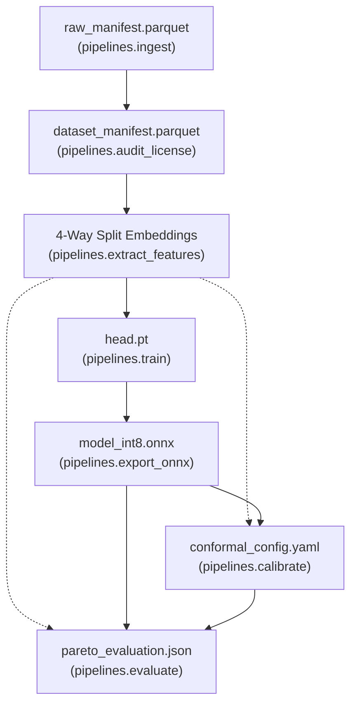

# TaxonVision-MLOps Platform Overview

TaxonVision-MLOps is an automated, end-to-end machine learning operations pipeline and production service designed for species identification from citizen-science photographs.

## System Tenets

* **Epistemic Diamond DAG Topology:** A 7-stage DVC pipeline under `src/taxon_vision/pipelines/` governed by root `params.yaml`, enforcing strict license compliance before S3 streaming, zero-leakage 4-way embedding splits (`train_embeddings.pt`, `val_embeddings.pt`, `cal_embeddings.pt`, `test_embeddings.pt`), and post-quantization calibration on `model_int8.onnx`.
* **Modern Foundation Backbones:** Seamlessly supports state-of-the-art vision extractors including **DINOv3**, BioCLIP-2, DINOv2, and edge-optimized MobileNetV4 architectures.
* **Production Chain Over Notebook Glory:** A versioned, audited, and automated DVC pipeline where code, parameters, and tensor hashes guarantee end-to-end reproducibility.
* **Mathematical Safety Invariants:** Predictions are accompanied by distribution-free **Split Conformal Prediction** sets guaranteeing a user-specified coverage bound ($1 - \alpha = 0.95$) alongside Helmholtz OOD energy gating.
* **Open Licensing & Attribution:** Adheres to DarwinCore and Creative Commons standards, strictly filtering open licenses (CC0, CC-BY, CC-BY-NC) and preserving photographer attribution.

## System Reference

For detailed subsystem architecture diagrams, storage technology selections, and complete parameter matrices, consult the [Architecture, Storage & Parameter Reference](foundations/system_reference.md).
