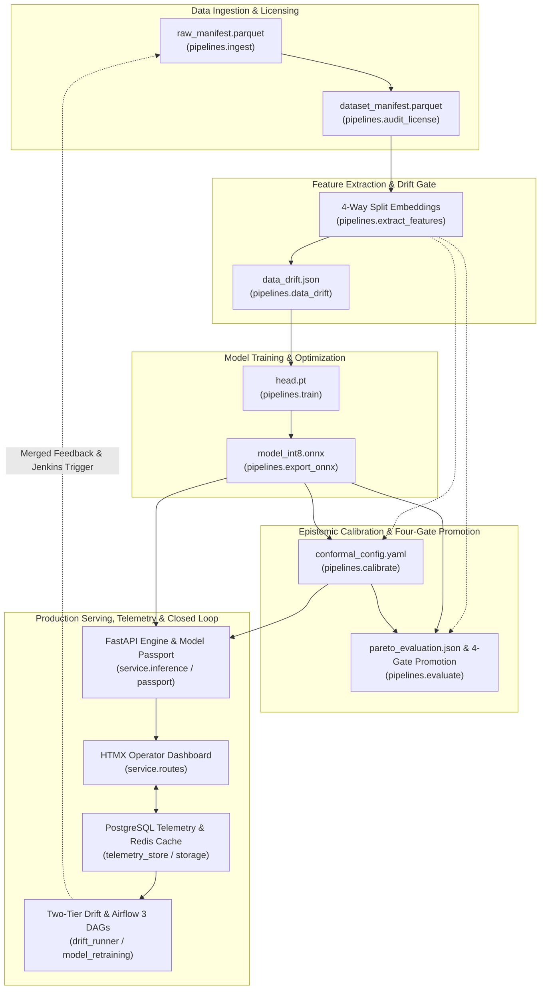

# TaxonVision-MLOps Platform Overview

TaxonVision-MLOps is an automated, end-to-end machine learning operations platform and production service designed for biodiversity species identification from citizen-science photographs. The system bridges cloud-based GitHub Actions quality gates with private bare-metal NVIDIA GPU training clusters, enforcing distribution-free **Split Conformal Prediction** guarantees and verified multi-tier inference latency budgets ($50.38\text{ ms}$ p95 empirical full-graph CPU INT8 execution against a $\le 120.0\text{ ms}$ pipeline promotion SLA ceiling, with $\le 15.0\text{ ms}$ p95 targeted on bare-metal GPU FP16/CUDA and $< 0.2\text{ ms}$ for standalone linear-probe head projection).

    

        
Inference Latency

        
50.4 ms

        
Empirical p95 CPU INT8 latency (47.38 ms p50, 20.9 FPS) for full fused ViT-S/16 + head graph against &le; 120.0 ms pipeline SLA gate (&le; 15.0 ms GPU target; &lt; 0.2 ms standalone head).

    

    

        
Conformal Coverage

        
96.8%

        
Empirical calibration coverage (91.5% unseen holdout test coverage, 92.1% top-1 INT8 accuracy) satisfying finite-sample bound ($1 - \alpha = 0.95$).

    

    

        
Feature Extraction

        
384-D

        
Dense, L2-normalised DINOv3 ViT-S/16 representations (384-D across 1,645 cached observations), with multi-backbone support spanning 384-D to 1280-D.

    

    

        
License Compliance

        
100%

        
Strict open licensing (1,646 / 2,000 verified CC0, CC-BY, CC-BY-NC records; 354 violations purged) with full photographer attribution provenance.

    

---

## Interactive Architecture Hub & Visualizers

Explore the complete system architecture, DVC data lineages, and mathematical safety boundaries through our dedicated interactive explorers:

* **[Interactive Architecture & Knowledge Graph Hub](interactive_hub.md):** Full-screen physics-based Cytoscape.js network visualizer embedding the complete production runtime and OKF v0.2 knowledge graph.
* **[Interactive Conformal & OOD Simulator](uncertainty_and_safety/interactive_simulator.md):** Real-time simulator to adjust significance levels $\alpha$, explore finite-sample quantile inflation, and simulate human referral depth.
* **[Software & Config Architecture Explorer](architecture/codebase_explorer.md):** Structural guide to the 10 high-cohesion subpackages in `src/taxon_vision/`.

---

## Clickable System Architecture Map

The diagram below maps the end-to-end lifecycle from raw citizen-science image ingestion to zero-downtime Kubernetes serving. Click any stage node to jump directly to its technical specification:

---

## Core System Invariants

* **8-Stage Epistemic Diamond DAG Topology:** An 8-stage DVC pipeline under `src/taxon_vision/pipelines/` governed by root `params.yaml` (`ingestion` -> `audit_license` -> `extract_features` -> `data_drift` -> `train` -> `export_onnx` -> `calibrate` -> `evaluate`), enforcing strict licence compliance before S3 streaming, zero-leakage 4-way embedding splits (`train_embeddings.pt`, `val_embeddings.pt`, `cal_embeddings.pt`, `test_embeddings.pt`), pre-training representation drift verification (`reports/data_drift.json`), and post-quantisation calibration on `model_int8.onnx`.
* **Closed-Loop MLOps Lifecycle:** Unifies online FastAPI telemetry (`PostgresTelemetryStore`), two-tier representation drift detection (1D Wasserstein-1 on $L_2$ norms + multivariate RKHS $\text{MMD}_u^2$), Grafana Alertmanager webhook relays, Apache Airflow 3 DAG orchestration (`prediction_drift_monitor` and `model_retraining`), MLflow 3.x cross-stage lineage, and Four-Gate Model Registry promotion (`@Production` / `@Challenger` / `@Archived`). See the **[End-to-End Closed-Loop MLOps Overview](mlops_pipeline/closed_loop_overview.md)**.
* **Modern Foundation Backbones:** Seamlessly supports state-of-the-art vision extractors including **DINOv3**, BioCLIP-2, DINOv2, and edge-optimized MobileNetV4 architectures with frozen trunks ($\nabla_\theta = 0$).
* **Dual-Pipeline Paradigm:** Decouples weight-centric linear classification probes from data-centric Multimodal Knowledge Graph (MMKG) and Vision-RAG retrieval to prevent massive retraining cascades. **[Phase 2.5 Specification]** The MMKG and Vision-RAG retrieval path is a design specification and is not yet implemented in `src/taxon_vision/` (see [Implementation Status](operations/implementation_status.md)).
* **Mathematical Safety Invariants:** Predictions are accompanied by distribution-free **Split Conformal Prediction** sets guaranteeing a user-specified coverage bound ($1 - \alpha = 0.95$) alongside Helmholtz OOD energy gating.
* **Open Licensing & Attribution:** Adheres to DarwinCore and Creative Commons standards, strictly filtering open licenses (CC0, CC-BY, CC-BY-NC) and preserving photographer attribution.
* **Persistent ONNX Session Fast Path:** `ONNXInferenceEngine` executes a single persistent `ORT_ENABLE_ALL` session reused across requests. Pre-allocated `IOBinding` buffers for strictly zero heap allocations on the scoring path are a planned Phase 2.5 latency optimization.
