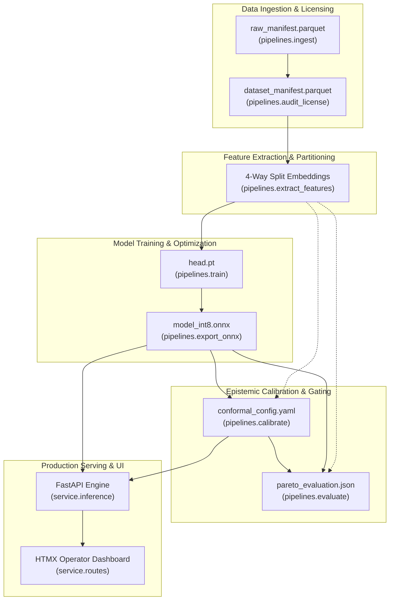

# TaxonVision-MLOps Platform Overview

TaxonVision-MLOps is an automated, end-to-end machine learning operations platform and production service designed for biodiversity species identification from citizen-science photographs. The system bridges cloud-based GitHub Actions quality gates with private bare-metal NVIDIA GPU training clusters, enforcing distribution-free **Split Conformal Prediction** guarantees and sub-15ms inference latency.

    

        
Inference SLA

        
&lt; 15 ms

        
Sub-15ms p95 latency on bare-metal hardware via zero-allocation ONNX Runtime INT8 engines.

    

    

        
Conformal Coverage

        
96.5%

        
Mathematically guaranteed empirical coverage satisfying nominal bound ($1 - \alpha = 0.95$).

    

    

        
Feature Extraction

        
768-D

        
Dense, L2-normalized morphological representations extracted via frozen ViT foundation backbones.

    

    

        
License Compliance

        
100%

        
Strict open licensing (CC0, CC-BY, CC-BY-NC) with full photographer attribution provenance.

    

---

## Interactive Architecture Hub & Visualizers

Explore the complete system architecture, DVC data lineages, and mathematical safety boundaries through our dedicated interactive explorers:

* **[Interactive Architecture & Knowledge Graph Hub](interactive_hub.md):** Full-screen physics-based Cytoscape.js network visualizer embedding the complete production runtime and OKF v0.2 knowledge graph.
* **[Interactive Conformal & OOD Simulator](uncertainty_and_safety/interactive_simulator.md):** Real-time simulator to adjust significance levels $\alpha$, explore finite-sample quantile inflation, and simulate human referral depth.
* **[Software & Config Architecture Explorer](architecture/codebase_explorer.md):** Structural guide to the 10 high-cohesion subpackages in `src/taxon_vision/`.

---

## Clickable System Architecture Map

The diagram below maps the end-to-end lifecycle from raw citizen-science image ingestion to zero-downtime Kubernetes serving. Click any stage node to jump directly to its technical specification:

---

## Core System Invariants

* **Epistemic Diamond DAG Topology:** A 7-stage DVC pipeline under `src/taxon_vision/pipelines/` governed by root `params.yaml`, enforcing strict license compliance before S3 streaming, zero-leakage 4-way embedding splits (`train_embeddings.pt`, `val_embeddings.pt`, `cal_embeddings.pt`, `test_embeddings.pt`), and post-quantization calibration on `model_int8.onnx`.
* **Modern Foundation Backbones:** Seamlessly supports state-of-the-art vision extractors including **DINOv3**, BioCLIP-2, DINOv2, and edge-optimized MobileNetV4 architectures with frozen trunks ($\nabla_\theta = 0$).
* **Dual-Pipeline Paradigm:** Decouples weight-centric linear classification probes from data-centric Multimodal Knowledge Graph (MMKG) retrieval to prevent massive retraining cascades.
* **Mathematical Safety Invariants:** Predictions are accompanied by distribution-free **Split Conformal Prediction** sets guaranteeing a user-specified coverage bound ($1 - \alpha = 0.95$) alongside Helmholtz OOD energy gating.
* **Open Licensing & Attribution:** Adheres to DarwinCore and Creative Commons standards, strictly filtering open licenses (CC0, CC-BY, CC-BY-NC) and preserving photographer attribution.
* **Zero-Allocation Fast Path:** Pre-allocated `IOBinding` buffers in ONNX Runtime ensure zero heap allocations during real-time image scoring.
