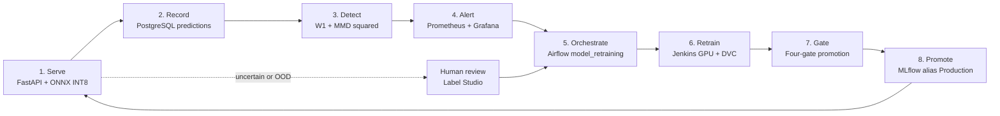

# The Closed MLOps Loop - From Prediction to Promotion

A trained model is a photograph of the world at the moment its data was collected. The world, however, keeps moving: seasons change, cameras are replaced, new regions contribute observations. This chapter explains in general terms why a deployed model therefore needs a **feedback loop**, and subsequently shows how TaxonVision implements that loop end to end. Readers who are new to MLOps should read the first three sections; experienced engineers can proceed directly to the component walk-through in section 4.

---

## 1. The Problem: Models Decay Silently

Classical software fails loudly - an exception is raised, a request returns an error, an alert fires. A machine learning model fails **silently**: it keeps returning confident-looking answers whilst the quality of those answers erodes. Three mechanisms cause this in a biodiversity setting:

* **Covariate shift:** the statistical properties of the input images change (a different smartphone sensor, winter light instead of summer light, motion blur). The species are the same, the pixels are not.
* **Concept shift:** the relationship between image and label changes (a taxon is reclassified, a look-alike species spreads into a new region).
* **Population shift:** the relative frequency of species changes (a migration season floods the service with one bird species).

A model evaluated once on a static test set cannot notice any of this. **MLOps** (machine learning operations) is the engineering discipline that makes the noticing, the reacting and the re-validating routine, automated and auditable - in much the same way DevOps made releasing software routine.

### Why this matters for a conformal system in particular

TaxonVision does not merely output a species name. It outputs a **conformal prediction set** with a statistical promise: the true species is contained in the set with probability at least $1 - \alpha$ (95 % for $\alpha = 0.05$). That promise holds only if the data the model sees in production is *exchangeable* with the calibration data used to construct the sets. If live traffic drifts away from the calibration distribution, the promise silently becomes void. Drift monitoring is consequently not a luxury here - it is the precondition for the guarantee that the product sells.

---

## 2. The Idea in One Picture

The platform closes the loop in eight stations. Each station has exactly one owner component, and every hand-over is an explicit, logged artefact.

| Station | Question it answers | Owner | Persistent evidence |
| :--- | :--- | :--- | :--- |
| 1. Serve | What is this animal, and how sure are we? | FastAPI service with ONNX Runtime | Prometheus counters and latency histogram |
| 2. Record | What exactly did the model see and say? | `telemetry_store.py` on PostgreSQL | Table `predictions` including the raw embedding |
| 3. Detect | Does today's traffic still look like the calibration data? | `drift_runner.py` and `drift.py` | Table `drift_runs`, MLflow run in `taxon-vision-drift` |
| 4. Alert | Who needs to know, and is retraining the right remedy? | Prometheus and Grafana | Alert rule state history |
| 5. Orchestrate | In which order must the retraining steps happen? | Airflow 3 DAG `model_retraining` | DAG run with task logs |
| 6. Retrain | Produce a new candidate on GPU, reproducibly | Jenkins pod plus the DVC pipeline | `dvc.lock`, MLflow parent run |
| 7. Gate | Is the candidate demonstrably better and still safe? | `promotion.py` | Registry tags such as `gate=promoted_all_4_gates` |
| 8. Promote | Which model does production serve? | MLflow Model Registry aliases | Alias `Production` on a model version |

---

## 3. Glossary for Newcomers

| Term | Plain-language meaning | Where it appears |
| :--- | :--- | :--- |
| **Telemetry** | Measurements the running system records about itself and its traffic | Stations 1 - 3 |
| **Embedding** | A list of numbers (384 for the ViT-S backbone) that summarises an image; similar images yield similar lists | Stations 2, 3, 6 |
| **Drift** | A measurable change in the distribution of incoming data compared with a reference | Station 3 |
| **Exchangeability** | The statistical assumption that calibration data and live data are drawn from the same distribution | Stations 3, 7 |
| **Conformal prediction set** | A set of candidate species that contains the truth with a user-chosen probability | Station 1 |
| **Orchestration** | Declaring tasks and their order so that a scheduler runs, retries and logs them | Station 5 |
| **Experiment tracking** | Recording parameters, metrics, data hashes and files for every training run | Stations 6, 7 |
| **Model registry** | A catalogue of model versions with human-readable aliases such as `Production` | Station 8 |
| **Gate** | An automatic pass or fail check that a candidate must clear before it may be promoted | Station 7 |
| **Human-in-the-loop** | Routing uncertain cases to an expert whose label becomes new training data | Section 6 |

---

## 4. Component Walk-Through

### 4.1 Serve and Record (Stations 1 and 2)

The route `POST /api/v1/predict` runs the quantised ONNX model, builds the conformal set and returns the answer. Persisting the observation must never slow down the answer, which is why the route hands the write to FastAPI's `BackgroundTasks` (`background_tasks.add_task(get_telemetry_store().record, rec)`): the HTTP response leaves first, the database insert follows.

The stored record contains the top-1 taxon, the conformal set, the out-of-distribution energy, the latency and - decisively - the **raw, pre-normalised embedding**. The latter matters because the first drift test measures vector *lengths*; if embeddings were unit-normalised before storage, every length would be exactly 1.0 and that test would be blind (see [Drift Detection](../operations/drift_detection_and_telemetry.md)).

If PostgreSQL is unreachable the service fails fast by default. Only when `telemetry.allow_in_memory_fallback` is explicitly enabled does it switch to a bounded in-memory ring buffer - a deliberate choice so that an outage can never be masked by silently discarding data.

### 4.2 Detect (Station 3)

Drift is judged by two complementary statistics computed on the most recent window of stored embeddings against the calibration reference:

* **Tier 1 - Wasserstein-1 distance on embedding norms:** cheap, one scalar per image, sensitive to magnitude shifts such as darker or blurrier photographs.
* **Tier 2 - Maximum Mean Discrepancy (MMD²) with a permutation test:** works on the full 384-dimensional geometry and yields a p-value without distributional assumptions.

The composite verdict is `drift_detected = (W1 > tau_w1) or (p_value < alpha)`. Either tier alone can raise the alarm. Each evaluation is written to the `drift_runs` table, logged to MLflow with an Evidently report attached, and exposed as Prometheus gauges.

### 4.3 Alert (Station 4)

Two routes lead from a drift verdict to retraining, and both are intentional:

1. **Scheduled path:** the hourly Airflow DAG `prediction_drift_monitor` calls `POST /api/v1/drift/evaluate`; if the verdict reports drift, it triggers `model_retraining` directly.
2. **Alerting path:** Grafana evaluates the rule `EmbeddingDriftDetected` on the exported gauge `taxon_drift_detected`; the rule carries the label `action=retrain` and posts to the authenticated relay `POST /api/v1/retrain/webhook`.

Only drift alerts reach the relay. Latency and error-ratio alerts are routed to administrators, because retraining a vision model does not cure a saturated CPU.

### 4.4 Orchestrate (Station 5)

Airflow 3 with the `LocalExecutor` runs the DAG `model_retraining` (`schedule=None`, i.e. trigger-only). Its four tasks are `merge_human_feedback`, `trigger_jenkins_build`, `wait_for_jenkins_build` and `report_promotion_outcome`. Airflow performs HTTP calls only; it carries no machine learning dependencies, because the heavy statistics live in the application and the GPU work belongs to Jenkins.

### 4.5 Retrain (Station 6)

Jenkins starts an ephemeral GPU pod that runs the DVC pipeline. DVC re-executes only those stages whose inputs changed, and the lockfile `dvc.lock` records cryptographic hashes of every input and output - the basis of reproducibility. A training-side `data_drift` stage compares the new training embeddings with a historical reference before the head is trained, so that a data problem is caught before compute is spent on it.

### 4.6 Gate and Promote (Stations 7 and 8)

The evaluation stage logs a candidate to MLflow 3 as a `LoggedModel`, and `promotion.py` then applies four sequential gates (predictive quality and INT8 fidelity, conformal coverage, latency budget, exchangeability with live traffic). A candidate that fails a hard gate is tagged `Archived`; a candidate that is good but cannot be trusted against live traffic yet becomes `Challenger`; only a candidate clearing all gates receives the alias `Production`. Details are given in [Model Promotion Gates](../model_engineering/model_promotion_gates.md).

---

## 5. Why These Components - and Not Others

| Decision | Reasoning | Trade-off accepted |
| :--- | :--- | :--- |
| Airflow orchestrates, Jenkins computes | Airflow is excellent at ordering, retrying and observing tasks; Jenkins already owns the GPU pod lifecycle and credentials | Two schedulers must be understood; hand-over happens through the Jenkins HTTP API |
| DVC for the training pipeline | Content-addressed stages make every artefact reproducible and cacheable | Stage definitions must be kept deterministic |
| MLflow as memory | One place for parameters, metrics, data hashes, plots and registry aliases | Requires its own database and artefact store (see [MLflow Tracking and Registry](../model_engineering/mlflow_tracking_and_registry.md)) |
| Drift tests on embeddings, not on raw pixels | Embeddings are low-dimensional, semantic and already computed during serving | Drift in features the backbone ignores remains invisible |
| Gates instead of "best score wins" | A higher accuracy number alone can hide quantisation damage, broken coverage or violated latency | More configuration; some good candidates wait as `Challenger` |

---

## 6. Safety Rails Built into the Loop

* **Cooldown on retraining:** the relay allows at most one retraining trigger per `TAXON_RETRAIN_COOLDOWN_SECONDS` (default 21,600 s, six hours), so a prolonged shift does not start a storm of GPU jobs.
* **Constant-time authentication:** both internal endpoints compare bearer tokens with `hmac.compare_digest`.
* **Open-licence gate:** human-labelled feedback enters the training manifest only if it carries `CC0`, `CC-BY` or `CC-BY-NC` and a photographer attribution (see [Active Learning and Human Review](../uncertainty_and_safety/active_learning_and_hitl.md)).
* **Epistemic split discipline:** the calibration split is never used for training or tuning; leakage would invalidate the coverage guarantee.
* **Human fallback:** empty or oversized conformal sets and out-of-distribution inputs are routed to review instead of being forced into a single label.

---

## 7. Known Limitations (Stated Openly)

* The relay cooldown is held in process memory. It is lost on restart and not shared between replicas; this is acceptable for the current single-replica deployment.
* The live drift runner reads its Tier 1 threshold from `settings.drift.tau_w1` (`config/default_config.yaml`, 0.15), whereas the training-side `data_drift` stage reads the calibrated value from `config/drift_config.yaml`. Both mechanisms are documented in [Drift Detection](../operations/drift_detection_and_telemetry.md#6-training-side-vs-serving-side-drift-comparison).
* Gate 4 needs a minimum of live traffic (50 stored predictions by default); until then good candidates remain `Challenger`.

---

## 8. Where to Read Next

* Statistics and calibration: [Drift Detection and Telemetry](../operations/drift_detection_and_telemetry.md)
* Orchestration: [Airflow Orchestration](../operations/airflow_orchestration.md)
* Metrics, dashboards and the relay: [Prometheus and Observability](../operations/prometheus_and_observability.md)
* Experiment memory and registry: [MLflow Tracking and Registry](../model_engineering/mlflow_tracking_and_registry.md)
* Promotion rules: [Model Promotion Gates](../model_engineering/model_promotion_gates.md)
* Storage layout: [Polyglot Storage and Databases](storage_and_databases.md)
