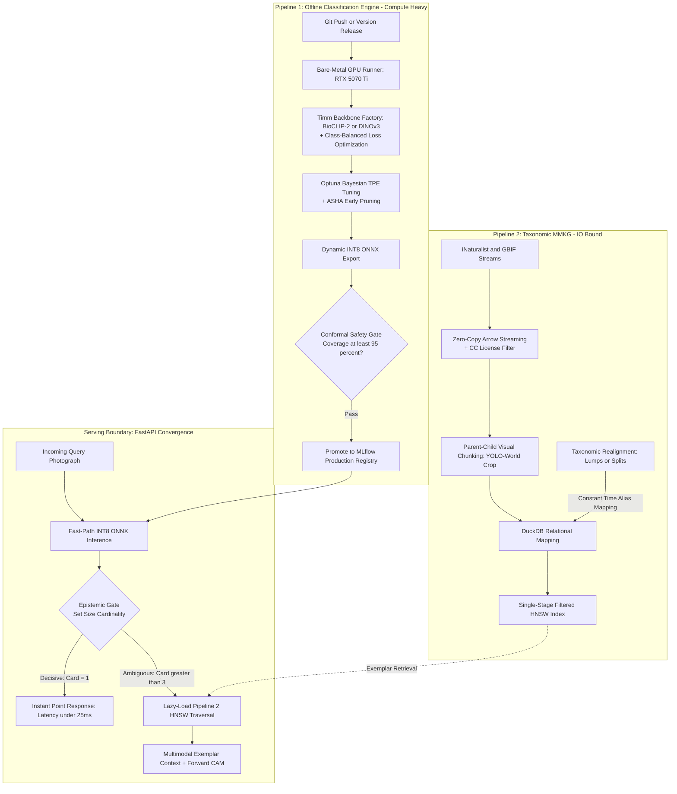
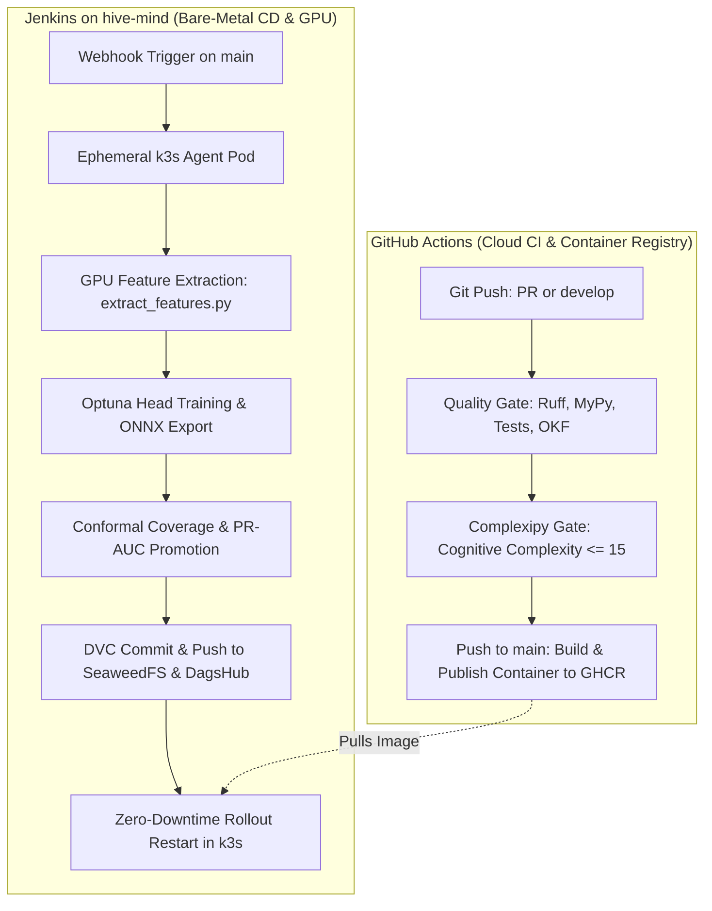

# Asymmetric Dual-Pipeline Architecture

A common failure mode in machine learning engineering is the monolithic pipeline, where neural network training sequences and data indexing tasks are tightly coupled into a single execution graph. TaxonVision-MLOps explicitly rejects this monolithic model. Instead, it establishes an **asymmetric dual-pipeline topology** that decouples the weight-centric classification engine from the data-centric taxonomic Multimodal Knowledge Graph (MMKG).



---

## 1. Asymmetric Execution Decoupling

The necessity for architectural decoupling stems directly from the fundamentally asymmetric cadence of biological modeling operations:

* **Pipeline 1 (The Classification Engine):** The Training Pipeline runs asynchronous batch GPU training. The neural backbone (e.g., BioCLIP-2 or DINOv3 transformer) is computationally expensive to train but relatively static once deployed. Optimizing its weights via Class-Balanced Loss requires intensive GPU Tensor Core utilization, distributed gradient synchronization, and static ONNX Post-Training Quantization (PTQ) calibration. Once a verified checkpoint is produced, this model may remain stable in production for weeks or months.
* **Pipeline 2 (The Taxonomic MMKG):** The Inference Serving Pipeline provides sub-50ms CPU/GPU edge serving. In contrast, the underlying citizen-science stream is highly volatile. Biological taxonomies undergo frequent scientific realignments where species are split into novel branches or lumped under unified nomenclature. Pipeline 2 is an I/O-bound vector-indexing workflow responsible for parsing DarwinCore Parquet manifests, extracting zero-shot organism crops, filtering open licenses, and maintaining the Hierarchical Navigable Small World (HNSW) graph.

Forcing Pipeline 1 to re-execute a heavy neural network training sweep merely because an upstream provider updated an exemplar image or revised a taxonomic name wastes substantial GPU compute. Decoupling these domains guarantees **failure isolation**: if a malformed DarwinCore archive introduces a schema violation, Pipeline 2 halts safely while Pipeline 1 continues serving classifications.

### 1.1 Epistemic Data Partitioning and Conformal Holdouts

In biological taxa classification under long-tailed observation distributions, proper data stratification is mathematically essential. The system structures observation datasets into an immutable four-way stratified partition $\mathcal{D} = \mathcal{D}_{\text{train}} \cup \mathcal{D}_{\text{val}} \cup \mathcal{D}_{\text{cal}} \cup \mathcal{D}_{\text{test}}$ with fixed ratios:

* **$\mathcal{D}_{\text{train}}$ ($70\%$):** Parametric optimization of the classification head weights $\mathbf{W} \in \mathbb{R}^{K \times d}$ and bias $\mathbf{b} \in \mathbb{R}^K$ via Class-Balanced Loss.
* **$\mathcal{D}_{\text{val}}$ ($10\%$):** Hyperparameter optimization via Optuna (TPE sampling of learning rate, weight decay, batch size, and Gaussian embedding jitter) and early stopping evaluation on Macro PR-AUC.
* **$\mathcal{D}_{\text{cal}}$ ($10\%$):** Non-parametric Split Conformal Prediction calibration and Helmholtz Out-of-Distribution (OOD) energy threshold computation on the INT8 ONNX compiled graph. Crucially, $\mathcal{D}_{\text{cal}}$ must be strictly exchangeable with runtime query distributions yet completely unexposed to head weight gradient updates or hyperparameter selection, preventing optimistic calibration bias.
* **$\mathcal{D}_{\text{test}}$ ($10\%$):** Independent verification of the statistical coverage guarantee $\mathbb{P}(y \in \hat{C}(x)) \ge 1 - \alpha$ during the automated Pareto benchmark stage.

### 1.2 Mathematical Formulation of the Cardinality Guard

Biological datasets sampled from sparse citizen-science records may occasionally yield subsets exhibiting degenerate class cardinality ($K < 2$). Under single-class observation scenarios, categorical cross-entropy and Class-Balanced loss equations collapse:

$$\mathcal{L}_{\text{CB}}(p, y) = - \frac{1 - \beta}{1 - \beta^{n_y}} \log p_y$$

When $K=1$, $p_y = 1.0$ unconditionally, yielding identically zero gradients $\nabla_{\mathbf{W}} \mathcal{L} = \mathbf{0}$ and inducing numerical instabilities in softmax normalisation layers. To guarantee operational determinism, the feature extraction and training runners enforce an explicit cardinality guard:

$$K = |\text{Unique}(\mathbf{y})| \ge 2$$

If this condition is violated during dataset ingestion or embedding caching, the pipeline halts with an explicit `UncertaintyCalibrationError` rather than proceeding to degenerate weight optimization.

### 1.3 The 7-Stage Unified DVC Execution Graph

While conceptually decoupled, the execution lineage of Pipeline 1 and Pipeline 2 is unified through an unbroken seven-stage DVC Directed Acyclic Graph (`dvc.yaml`):

* `ingestion`: Parses DarwinCore archives and synthesizes streaming manifests.
* `audit_license`: Validates permissive licensing (CC0, CC-BY, CC-BY-NC) and extracts attribution metadata.
* `extract_features`: Streams images from S3 and projects them through frozen vision transformers (DINOv3/BioCLIP-2) into high-dimensional embeddings.
* `train`: Optimizes the linear head with Class-Balanced Loss and Optuna Bayesian sweeps.
* `export`: Compiles PyTorch weights into dynamic INT8 ONNX graphs with static calibration.
* `calibrate`: Computes conformal quantile thresholds $\hat{q}_\alpha$ and Helmholtz energy boundaries $\tau_{\text{OOD}}$.
* `eval`: Executes Pareto benchmarking, verifying marginal coverage and latency budgets.

High-throughput intermediate embeddings (`data/embeddings/*.pt`) and local model checkpoints are persisted to the in-cluster SeaweedFS object store (`s3://taxon-dvc-cache/`), whilst final production release artifacts are mirrored to DagsHub S3 (`s3://dvc`).

---

## 2. Automated CI/CD Orchestration and Model Promotion

The lifecycle of Pipeline 1 is strictly governed by Continuous Integration and Continuous Deployment (CI/CD) interlocks across two decoupled systems:



* **GitHub Actions Plane:** Operates cloud-based quality gates on pull requests and pushes to `develop` and `main`. It enforces static typing, unit testing with 80% coverage minimums, open-license compliance, OKF frontmatter validation, and cognitive complexity analysis via `complexipy`. When code merges to `main`, GitHub Actions automatically builds the production container, pulls latest DVC model checkpoints from DagsHub, and publishes multi-tagged images to GitHub Container Registry (`ghcr.io/foersben/taxon-vision-mlops:latest` and `:sha-...`).
* **Jenkins Bare-Metal Plane:** Receives authenticated webhooks on `hive-mind`, dispatching ephemeral Kubernetes pods into `k3s`. On `main`, the GPU agent claims 1 of 4 NVIDIA time-slicing slots, extracts ViT embeddings from S3 image observations via `taxon_vision.pipelines.extract_features`, executes Optuna hyperparameter sweeps, evaluates Split Conformal Prediction coverage, commits checkpoints to DVC storage, and issues zero-downtime rolling restarts to the live deployment.

### Cryptographic Provenance Binding

As training initializes, the pipeline binds the active MLflow run directly to the Git commit SHA that triggered execution:

```python
mlflow.set_tag("git.commit", os.environ.get("GITHUB_SHA"))
```

This guarantees absolute cryptographic lineage connecting source code, DVC data hashes, and compiled ONNX model weights.

### The Conformal Safety Gate and Pareto Test Verification

Before any candidate model enters the production registry, an automated evaluation pipeline executes two sequential epistemic verification gates:

* **Post-Quantization Calibration (`src/taxon_vision/pipelines/calibrate.py`):** Calibrates the exact non-conformity threshold $\hat{q}_\alpha$ and Helmholtz OOD energy threshold $\tau_{\text{OOD}}$ on the holdout calibration partition $\mathcal{D}_{\text{cal}}$ ($10\%$ split via `data/embeddings/cal_embeddings.pt`) using the exported INT8 ONNX model (`models/checkpoints/model_int8.onnx`), serializing parameters to `config/conformal_config.yaml`.
* **Holdout Coverage Verification (`src/taxon_vision/pipelines/evaluate.py`):** Formally asserts that the empirical marginal coverage on the holdout test partition $\mathcal{D}_{\text{test}}$ ($10\%$ split via `data/embeddings/test_embeddings.pt`) mathematically satisfies the nominal guarantee:

$$\text{Coverage}_{\text{empirical}} = \frac{1}{n_{\text{test}}} \sum_{i=1}^{n_{\text{test}}} \mathbb{I}\left(y_i \in \hat{C}(x_i)\right) \ge 1 - \alpha$$

If empirical test coverage falls below $1 - \alpha$ (e.g., $95\%$ when $\alpha = 0.05$), the assertion fails, terminating the runner and preventing the uncalibrated model from reaching production.

---

## 3. Convergence at the Serving Boundary

The two independent pipelines converge exclusively at the serving boundary managed by FastAPI:

* **Fast-Path Inference:** When a query photograph arrives, it is processed through the pre-loaded INT8 ONNX backbone from Pipeline 1.
* **Decisive Predictions ($|C| = 1$):** If the conformal prediction set contains exactly one candidate, the identification is returned immediately. The vector database is bypassed, achieving sub-25 ms latency.
* **Conformal-Driven Lazy Execution ($|C| > 3$):** If the model detects severe ambiguity, the serving engine lazy-loads the HNSW index from Pipeline 2, executes a single-stage filtered traversal, and retrieves top-$k$ reference exemplar crops to synthesize comparative context.

---

## 4. Forward-Hooked Class Activation Mapping (CAM)

Providing diagnostic transparency to human reviewers requires visual interpretability without violating strict latency SLAs. While modern extensions like Grad-CAM are popular, they require a backward pass (gradient backpropagation), which destroys low-latency serving and is incompatible with forward-only INT8 ONNX runtimes. We instead utilize standard Class Activation Mapping (CAM).

TaxonVision bypasses backpropagation by intercepting the spatial feature maps $A^k$ emitted by the final convolutional or attention layer before global average pooling. Because the classification head is a linear layer, the importance weight $w_k^c$ of feature channel $k$ for class $c$ is directly extracted from the static weight matrix:

$$L_{\text{CAM}}^c = \text{ReLU}\left(\sum_{k} w_k^c A^k\right)$$

Where:

* $L_{\text{CAM}}^c$ is the resulting two-dimensional activation heatmap for class $c$, bilinearly upsampled to the original image dimensions.
* $A^k$ is the $k$-th channel of the spatial feature map tensor extracted during the standard forward pass.
* $w_k^c$ is the static linear layer weight connecting feature channel $k$ to the class logit.
* $\text{ReLU}$ discards negative spatial influences, highlighting only the pixels that positively contributed to class $c$.

This forward-only calculation executes in **under 2 milliseconds**, generating high-fidelity morphological heatmaps without GPU backpropagation.
