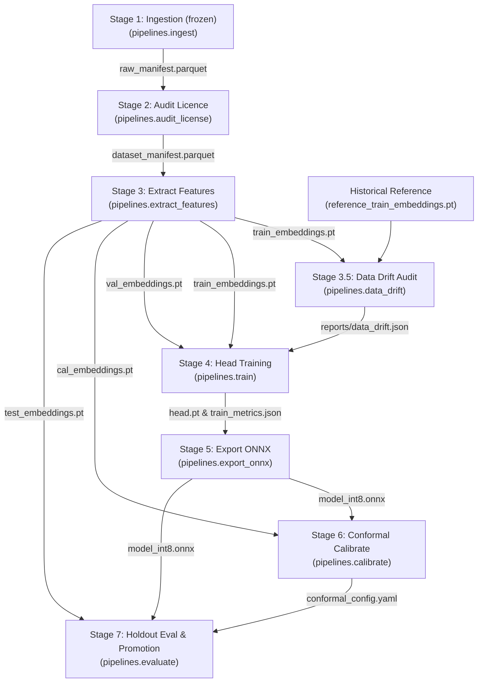

# DVC DAG & Epistemic Diamond Explorer

## 1. Conceptual Overview: Why the Pipeline Forms an "Epistemic Diamond"

In conventional machine learning scripts, training, quantisation, probability calibration, and evaluation are often executed sequentially over a simple two-way train/test split. That linear pattern fails in safety-critical computer vision for two mathematical reasons:

1. **Calibration Leakage Invalidates Conformal Coverage:** Split Conformal Prediction (`calibrate`) and Out-of-Distribution Helmholtz energy thresholding require an independent, exchangeable holdout split (`cal_embeddings.pt`) that was neither seen during gradient descent (`train_embeddings.pt`) nor used to select hyperparameters during early stopping (`val_embeddings.pt`). Evaluating empirical coverage on the same split used to calibrate $\hat{q}_\alpha$ would produce circular, optimistic coverage estimates; hence a fourth, completely untouched holdout split (`test_embeddings.pt`) is mandatory for Stage 7 (`eval`).
2. **Post-Quantisation Calibration Necessity:** Calibrating uncertainty thresholds on the FP32 PyTorch head before INT8 quantisation ignores quantisation-induced logit shifts. Therefore, Stage 5 (`export`) must produce the quantised `model_int8.onnx` graph *before* Stage 6 (`calibrate`) computes non-conformity scores over `cal_embeddings.pt`.

Consequently, the Directed Acyclic Graph (DAG) declared in root [`dvc.yaml`](file:///home/benni/Documents/antigravity_workspace/taxon-vision-mlops/dvc.yaml) forms an **8-stage Epistemic Diamond**: a single validated manifest diverges at Stage 3 (`extract_features`) into four disjoint tensor partitions, passes through the Stage 3.5 representation drift audit (`data_drift`), and converges at Stage 7 (`eval`) where the quantised ONNX graph, calibrated conformal quantiles, and holdout test embeddings meet for the Four-Gate Promotion verdict.



---

## 2. Interactive DVC Stage & Live Metrics Inspector

Click any of the pipeline stages below to inspect its exact execution command, inputs, outputs, tracked hyperparameters, execution algorithm, and invalidation blast radius:

<div id="taxon-dvc-explorer">
    <div style="padding: 2rem; text-align: center; opacity: 0.7;">
        Initialising DVC Stage & Live Metrics Inspector...
    </div>
</div>

---

## 3. Complete DVC Artefact & Dependency Registry

The pipeline tracks 11 core data, reference, report, and model artefacts across local workspace storage and S3 remotes:

| Artefact Identifier | Canonical Filesystem Path | Producing DVC Stage | Storage Target & Remote | Cryptographic & Statistical Invariant |
| :--- | :--- | :--- | :--- | :--- |
| **Raw Manifest** | `data/manifests/raw_manifest.parquet` | `ingestion` (`frozen: true`) | Local Git/DVC Workspace | Content hash of initial iNaturalist observation metadata and photo URLs. |
| **Dataset Manifest** | `data/manifests/dataset_manifest.parquet` | `audit_license` | Local Git/DVC Workspace | 100% CC0, CC-BY, or CC-BY-NC validated citizen-science records with attribution. |
| **Train Embeddings** | `data/embeddings/train_embeddings.pt` | `extract_features` | DagsHub S3 (`origin`) & SeaweedFS (`local-seaweedfs`) | 70% stratified training split ($1{,}182 \times 384$ tensor). |
| **Val Embeddings** | `data/embeddings/val_embeddings.pt` | `extract_features` | DagsHub S3 (`origin`) & SeaweedFS (`local-seaweedfs`) | 10% stratified validation split ($169 \times 384$ tensor). |
| **Cal Embeddings** | `data/embeddings/cal_embeddings.pt` | `extract_features` | DagsHub S3 (`origin`) & SeaweedFS (`local-seaweedfs`) | 10% stratified conformal calibration & serving drift reference ($169 \times 384$ tensor). |
| **Test Embeddings** | `data/embeddings/test_embeddings.pt` | `extract_features` | DagsHub S3 (`origin`) & SeaweedFS (`local-seaweedfs`) | 10% stratified holdout evaluation split ($169 \times 384$ tensor). |
| **Reference Train Baseline** | `data/reference/reference_train_embeddings.pt` | Reference Baseline | Local Git/DVC Workspace | Historical training representation baseline for Stage 3.5 drift comparison. |
| **Training Drift Report** | `reports/data_drift.json` | `data_drift` | Uncached DVC Metric | Tier 1 $W_1$ norm distance and Tier 2 RBF MMD² p-value gating Stage 4 (`train`). |
| **Taxa Perimeter** | `config/taxa_catalog.yaml` | Git Tracked | Local Repository Root | 10 biological taxa definitions forming the Level 1 classification boundary. |
| **Head Checkpoint** | `models/checkpoints/head.pt` | `train` | Cloud Remote (`s3://dvc` at DagsHub) | Cosine classification head weights $\mathbf{W}$ optimised via Class-Balanced Loss. |
| **INT8 ONNX Bundle** | `models/checkpoints/model_int8.onnx` | `export` | Cloud Remote (`s3://dvc` at DagsHub) | Dual-output (logits + embeddings) fused backbone + head quantised to INT8. |

---

## 4. Live Pipeline Manifest Definition (`dvc.yaml`)

The complete 8-stage DAG configuration transcluded directly from the repository's root `dvc.yaml`:

```yaml
--8<-- "dvc.yaml"
```

---

## 5. Live Hyperparameter Manifest Definition (`params.yaml`)

The DVC-tracked pipeline parameters transcluded directly from root `params.yaml`:

```yaml
--8<-- "params.yaml"
```

---

## 6. Pipeline Execution Runbook

```bash
# Reproduce entire 8-stage DAG from scratch or resume from last cached stage
pixi run -e dev dvc repro

# Inspect stage cache status and modified dependencies
pixi run -e dev dvc status

# Execute only the training-side representation drift audit (Stage 3.5)
pixi run -e dev dvc repro data_drift

# Force re-execution of calibration and holdout evaluation / 4-gate promotion stages
pixi run -e dev dvc repro -f calibrate eval

# Push verified tensors and model checkpoints to remotes
just dvc-push
```
