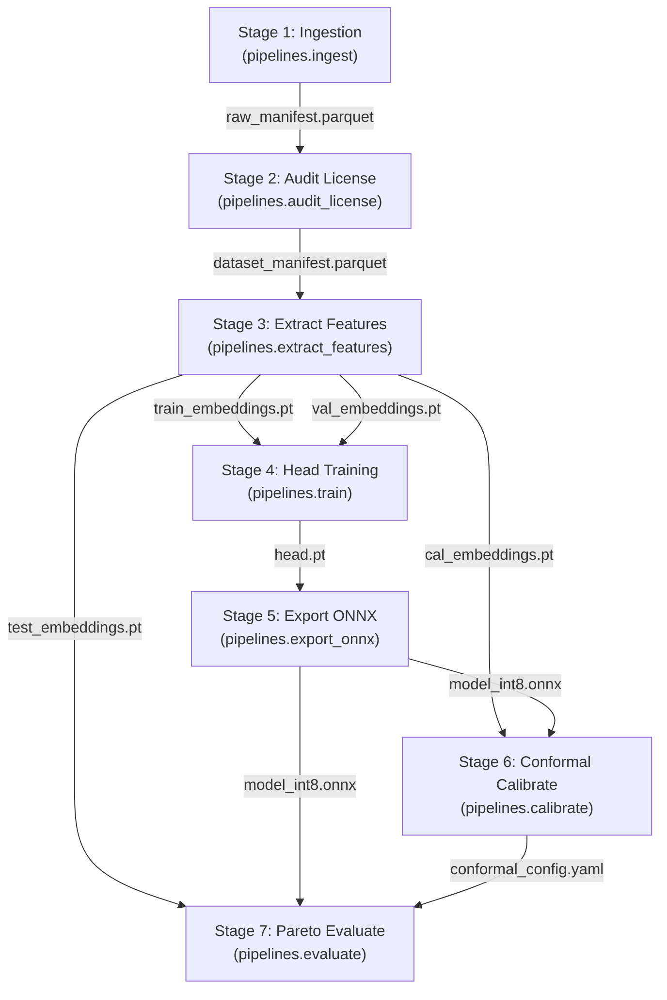

# DVC DAG & Epistemic Diamond Explorer

The training, quantization, calibration, and evaluation lifecycle of TaxonVision-MLOps is governed by an immutable Directed Acyclic Graph (DAG) declared in root `dvc.yaml`. Known as the **Epistemic Diamond**, this pipeline expands a single validated observation manifest into four strictly partitioned embedding tensors, and then converges into a calibrated, quantized ONNX runtime bundle without cross-split data leakage.



---

## 1. Interactive DVC Stage & Live Metrics Inspector

Click any of the 7 pipeline stages below to inspect its exact execution command, inputs, outputs, tracked hyperparameters, execution algorithm, and invalidation blast radius:

<div id="taxon-dvc-explorer">
    <div style="padding: 2rem; text-align: center; opacity: 0.7;">
        Initializing DVC Stage & Live Metrics Inspector...
    </div>
</div>

---

## 2. Complete DVC Artifact & Dependency Registry

The pipeline tracks 9 core data and model artifacts across local storage and remote S3 targets:

| Artifact Identifier | Canonical Filesystem Path | Producing DVC Stage | Storage Target & Remote | Cryptographic Invariant |
| :--- | :--- | :--- | :--- | :--- |
| **Raw Manifest** | `data/manifests/raw_manifest.parquet` | `ingestion` | Local Git/DVC Workspace | Content hash of initial observation metadata and photo URLs. |
| **Dataset Manifest** | `data/manifests/dataset_manifest.parquet` | `audit_license` | Local Git/DVC Workspace | 100% CC0, CC-BY, or CC-BY-NC validated citizen-science records. |
| **Train Embeddings** | `data/embeddings/train_embeddings.pt` | `extract_features` | In-Cluster SeaweedFS S3 (`local-seaweedfs`) | 70% stratified training split ($1,182 \times 384$ tensor). |
| **Val Embeddings** | `data/embeddings/val_embeddings.pt` | `extract_features` | In-Cluster SeaweedFS S3 (`local-seaweedfs`) | 10% stratified validation split ($169 \times 384$ tensor). |
| **Cal Embeddings** | `data/embeddings/cal_embeddings.pt` | `extract_features` | In-Cluster SeaweedFS S3 (`local-seaweedfs`) | 10% stratified conformal calibration split ($169 \times 384$ tensor). |
| **Test Embeddings** | `data/embeddings/test_embeddings.pt` | `extract_features` | In-Cluster SeaweedFS S3 (`local-seaweedfs`) | 10% stratified evaluation test split ($169 \times 384$ tensor). |
| **Taxa Perimeter** | `config/taxa_catalog.yaml` | Git Tracked | Local Repository Root | 10 biological taxa definitions forming Level 1 classification boundary. |
| **Head Checkpoint** | `models/checkpoints/head.pt` | `train` | Cloud Remote (`s3://dvc` at DagsHub) | Linear probe weights $\mathbf{W}$ optimized via Class-Balanced Loss. |
| **INT8 ONNX Bundle** | `models/checkpoints/model_int8.onnx` | `export` | Cloud Remote (`s3://dvc` at DagsHub) | Fused backbone + linear head quantized via MinMax static PTQ. |

---

## 3. Live Pipeline Manifest Definition (`dvc.yaml`)

The complete DAG configuration transcluded directly from the repository's root `dvc.yaml`:

```yaml
--8<-- "dvc.yaml"
```

---

## 4. Live Hyperparameter Manifest Definition (`params.yaml`)

The DVC-tracked pipeline parameters transcluded directly from root `params.yaml`:

```yaml
--8<-- "params.yaml"
```

---

## 5. Pipeline Execution Runbook

```bash
# Reproduce entire DAG from scratch or resume from last cached stage
pixi run -e dev dvc repro

# Inspect stage cache status and modified dependencies
pixi run -e dev dvc status

# Force re-execution of calibration and evaluation stages
pixi run -e dev dvc repro -f calibrate eval

# Push verified tensors and model checkpoints to remotes
pixi run -e dev dvc push -r local-seaweedfs
pixi run -e dev dvc push -r origin
```
