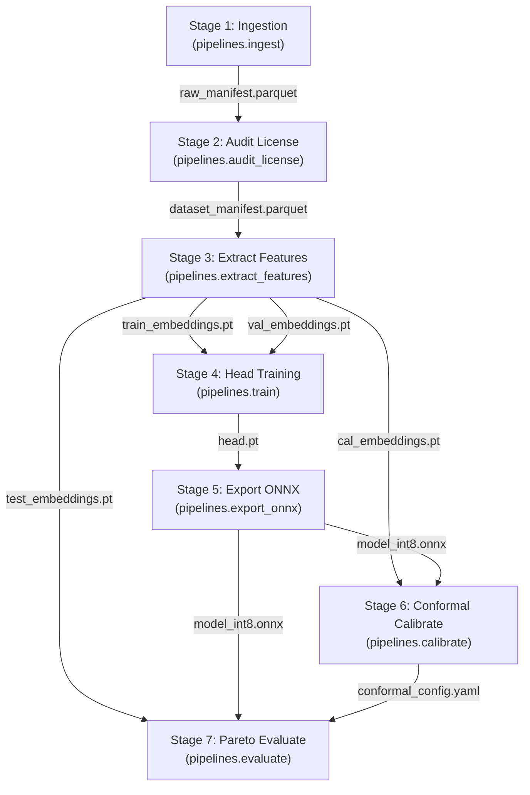

# DVC DAG & Epistemic Diamond Explorer

The TaxonVision-MLOps training and evaluation lifecycle is governed by an immutable Directed Acyclic Graph (DAG) declared in `dvc.yaml`. Dubbed the **Epistemic Diamond**, this pipeline expands a single validated dataset manifest into four strictly partitioned embedding tensors, and then converges into a calibrated, quantized ONNX runtime bundle without cross-split data leakage.



---

## 1. The Seven Canonical Stages

### Stage 1: `ingestion` (Citizen-Science Data Sourcing)

* **Command:** `python -m taxon_vision.pipelines.ingest`
* **Dependencies:** `config/taxa_catalog.yaml`, `src/taxon_vision/data/inat_client.py`
* **Tracked Parameters:** `ingestion.per_page`, `ingestion.taxa_to_fetch`
* **Primary Output:** `data/manifests/raw_manifest.parquet`
* **Safety Invariant:** Stores image URLs and observation metadata without downloading raw JPEGs, keeping manifest size under 500 KB.

### Stage 2: `audit_license` (Legal Compliance Gate)

* **Command:** `python -m taxon_vision.pipelines.audit_license`
* **Dependencies:** `data/manifests/raw_manifest.parquet`, `src/taxon_vision/data/license_filter.py`
* **Primary Output:** `data/manifests/dataset_manifest.parquet`
* **Generated Metric:** `reports/license_audit.json` (`cache: false`)
* **Safety Invariant:** Enforces 100% adherence to Creative Commons open licenses (CC0, CC-BY, CC-BY-NC) and preserves photographer attribution.

### Stage 3: `extract_features` (Foundation Feature Caching)

* **Command:** `python -m taxon_vision.pipelines.extract_features`
* **Dependencies:** `data/manifests/dataset_manifest.parquet`, `src/taxon_vision/data/s3_streamer.py`, `src/taxon_vision/models/factory.py`
* **Tracked Parameters:** `model.extractor`, `model.image_size`, `training.val_split`, `training.cal_split`, `training.test_split`
* **Primary Outputs:** 4 stratified PyTorch tensors (`train_embeddings.pt`, `val_embeddings.pt`, `cal_embeddings.pt`, `test_embeddings.pt`) pushed to SeaweedFS S3.
* **Safety Invariant:** Strict 4-way stratified splitting prevents test and calibration leakage into training sets.

### Stage 4: `train` (Class-Balanced Convex Optimization)

* **Command:** `python -m taxon_vision.pipelines.train`
* **Dependencies:** `train_embeddings.pt`, `val_embeddings.pt`, `src/taxon_vision/models/loss.py`
* **Tracked Parameters:** `training.epochs`, `training.lr`, `training.cb_beta`, `training.tune`
* **Primary Output:** `models/checkpoints/head.pt`
* **Generated Metric:** `reports/train_metrics.json`
* **Safety Invariant:** Trains linear probe head with Class-Balanced Loss directly on cached embeddings in under 2 seconds on GPU.

### Stage 5: `export_onnx` (Graph Fusion & INT8 PTQ)

* **Command:** `python -m taxon_vision.pipelines.export_onnx`
* **Dependencies:** `models/checkpoints/head.pt`, `src/taxon_vision/inference/onnx_exporter.py`
* **Tracked Parameters:** `model.image_size`
* **Primary Output:** `models/checkpoints/model_int8.onnx` pushed to DagsHub S3.
* **Safety Invariant:** Fuses backbone and linear head into unified opset 17 computational graph with dynamic batch axes.

### Stage 6: `calibrate` (Conformal Quantile & Energy Thresholding)

* **Command:** `python -m taxon_vision.pipelines.calibrate`
* **Dependencies:** `cal_embeddings.pt`, `models/checkpoints/model_int8.onnx`, `src/taxon_vision/uncertainty/conformal.py`
* **Tracked Parameters:** `calibration.alpha`, `calibration.ood_tpr`
* **Primary Output:** `config/conformal_config.yaml` (committed to Git)
* **Generated Metric:** `reports/conformal_metrics.json`
* **Safety Invariant:** Computes true-class residual non-conformity scores and derives finite-sample inflated quantile $\hat{q}_\alpha$ on unseen calibration observations.

### Stage 7: `evaluate` (Pareto Evaluation & Latency SLA Gate)

* **Command:** `python -m taxon_vision.pipelines.evaluate`
* **Dependencies:** `test_embeddings.pt`, `models/checkpoints/model_int8.onnx`, `config/conformal_config.yaml`
* **Tracked Parameters:** `evaluation.latency_sla_ms`
* **Primary Outputs:** `reports/pareto_evaluation.json`, `docs/assets/pareto_results.json`
* **Safety Invariant:** Asserts empirical coverage $\ge 1 - \alpha$ on the holdout test set and verifies sub-50ms CPU latency SLA. Exits with code 1 upon violation.

---

## 2. Pipeline Execution Commands

```bash
# Execute entire pipeline from beginning to end
pixi run -e dev dvc repro

# Check status of modified dependencies
pixi run -e dev dvc status

# Force re-execution of a specific downstream stage
pixi run -e dev dvc repro -f calibrate
```
