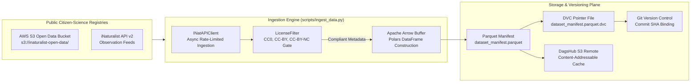

# Ingestion Engine & Cryptographic Versioning

Processing planetary-scale citizen-science data streams requires strict cryptographic reproducibility, legal compliance safeguards, and resource-bounded storage strategies right at the network boundary.



---

## 1. Data Topography & Open-Access Mandates

Global biodiversity portals aggregate continuous streams of species observations:

* **Ecosystem Scale:** Combined registries (iNaturalist and GBIF) host over 270 million raw observations, with approximately 170 million having achieved research-grade consensus status.
* **API Ingestion Caps:** Direct API consumption is throttled to 60 requests per minute, with a download cap of 5 GB per hour and 24 GB per day.
* **Strict Open Licensing:** Only observations explicitly released under open licenses are admitted into the pipeline. Assets on static domains without verified licenses are rejected.

### Programmatic License Filtering

Incoming observation records pass through [`LicenseFilter`](file:///home/benni/Documents/antigravity_workspace/taxon-vision-mlops/src/taxon_vision/data/license_filter.py#L19), evaluating metadata against permitted Creative Commons licenses:

* **Permitted:** `CC0` (Public Domain Dedication), `CC-BY` (Attribution), and `CC-BY-NC` (Attribution-NonCommercial).
* **Rejected:** Commercial or restrictive variants (`CC-BY-ND`, `CC-BY-SA`, all-rights-reserved copyright) are discarded at the edge.
* **Attribution Retention:** Every ingested observation retains its photographer credit, license code, and observation GUID, serialized directly into downstream Parquet tables to ensure scientific traceability.

---

## 2. Circumventing the 50-Terabyte Storage Trap

The raw citizen-science image dataset hosted on AWS Open Data exceeds 50 Terabytes. Downloading and duplicating this volume locally would cause immediate storage exhaustion.

TaxonVision circumvents this trap via **zero-duplication streaming**:

* **Zero-Copy Arrow Buffers:** [`S3ImageStreamer`](file:///home/benni/Documents/antigravity_workspace/taxon-vision-mlops/src/taxon_vision/data/s3_streamer.py#L16) streams image objects directly from the public AWS S3 bucket into memory during training via Ray Data or WebDataset without local disk buffering.
* **Lightweight Parquet Manifests:** The local repository stores only cryptographically validated Parquet index files containing observation IDs, taxon IDs, source URLs, and attribution headers.
* **Storage Footprint:** An index representing 10 million biological observations occupies less than 300 MB of disk space.

### Downstream Feature Extraction & Embedding Cache

The lightweight Parquet manifests feed directly into the feature extraction pipeline ([`src/taxon_vision/pipelines/extract_features.py`](file:///home/benni/Documents/antigravity_workspace/taxon-vision-mlops/src/taxon_vision/pipelines/extract_features.py)):

* **Contiguous Taxonomic Mapping:** [`build_taxon_index_map`](file:///home/benni/Documents/antigravity_workspace/taxon-vision-mlops/src/taxon_vision/pipelines/extract_features.py#L67) scans the manifest and constructs an integer mapping from sparse biological `taxon_id` keys to contiguous target indices $[0, K-1]$.
* **Zero-Disk S3 Batch Streaming:** [`S3ImageStreamer`](file:///home/benni/Documents/antigravity_workspace/taxon-vision-mlops/src/taxon_vision/data/s3_streamer.py#L16) fetches raw image objects from `s3://inaturalist-open-data/` in batches. Images are transformed into standardized evaluation tensors ($224 \times 224$ bicubic resize, ImageNet normalization) via torchvision transforms without writing intermediate image files to local storage.
* **Stratified 4-Way Cache Serialization:** [`create_stratified_embedding_split`](file:///home/benni/Documents/antigravity_workspace/taxon-vision-mlops/src/taxon_vision/pipelines/extract_features.py) performs stratified 4-way partitioning (70% train, 10% validation, 10% conformal calibration, 10% holdout test) while enforcing a strict multi-class cardinality gate (>= 2 classes) and guaranteeing minimum exemplar representation across long-tail taxa. The split is serialized into four discrete physical files (`train_embeddings.pt`, `val_embeddings.pt`, `cal_embeddings.pt`, `test_embeddings.pt`) under `data/embeddings/`, enabling millisecond-speed classification head training, zero-leakage Bayesian optimization, and rigorous statistical coverage calibration.

---

## 3. Bounded Exemplar Storage Mathematics

For visual retrieval in the taxonomic MMKG, the system maintains a curated **Reference Exemplar Catalogue**, strictly capped at 50 validated environmental crops per taxon:

$$N_{\text{total}} = 2{,}000 \text{ baseline taxa} \times 50 \text{ crops} = 100{,}000 \text{ exemplar crops}$$

Assuming compressed WebP images averaging 45 KB per crop (with an upper bound of 60 KB), the storage footprint evaluates to:

$$\text{Storage}_{\text{Exemplars}} = 100{,}000 \times 45 \text{ KB} = 4{,}500{,}000 \text{ KB} \approx 4.5 \text{ GB}$$

Accounting for manifests, statically calibrated INT8 ONNX checkpoints, and DVC churn:

$$\text{Storage}_{\text{Total}} = 0.3 \text{ GB (Manifests)} + 4.5 \text{ GB (Exemplars)} + 2.0 \text{ GB (ONNX)} + 1.5 \text{ GB (DVC Churn)} \approx 8.3 \text{ GB}$$

This 8.3 GB allocation consumes less than **$50\%$ of DagsHub's 20 GB free-tier storage quota**, entirely eliminating cloud storage egress costs.

---

## 4. DVC Pipeline Topology & DagsHub Remote Storage

Data Version Control (DVC) and DagsHub establish the data management control plane for TaxonVision, combining cloud-backed content-addressable storage with deterministic pipeline DAG execution.

### 4.1 Remote Architecture & DagsHub S3 Integration

DagsHub provisions a unified cloud control plane that mirrors the primary GitHub repository and hosts an S3-compatible content-addressable storage bucket:

* **Remote Endpoint Configuration:** The repository connects to DagsHub via `.dvc/config` targeting `s3://dvc` at `https://dagshub.com/foersben/taxon-vision-mlops.s3` (`remote = origin`), complemented by the in-cluster SeaweedFS cache at `http://seaweedfs.taxon-vision.svc.cluster.local:8333/taxon-dvc-cache` (`remote = local-seaweedfs`). Storage is partitioned into high-throughput cluster-internal caching and offsite cloud archival.
* **Zero-Egress Data Archival:** Binary Parquet manifests, exemplar crops, and quantized model artifacts are pushed directly to this remote endpoint (`dvc push`), preventing Git LFS size bottlenecks and repository bloat. Data artifacts are immutable and tracked via SHA256 hashes.
* **Zero-Leak Secret Management via Secret Service:** Rather than persisting sensitive cloud tokens to disk in `.dvc/config.local` or unencrypted `.env` files, local developers query authentication tokens directly from KeePassXC using `secret-tool`. The `just dvc-push` and `just dvc-pull` recipes retrieve the token in-memory and inject it ephemerally as `AWS_ACCESS_KEY_ID` and `AWS_SECRET_ACCESS_KEY` for the duration of the child process only.
* **Unified Management Plane:** Alongside DVC remote caching, DagsHub hosts the centralized MLflow Tracking Server and experiment dashboard, linking Git commit SHAs, DVC dataset versions, and training run metrics within a single interface.

### 4.2 Pipeline DAG Specification (`dvc.yaml` & `dvc.lock`)

Rather than relying on isolated shell scripts or fragmented workflows, TaxonVision coordinates its end-to-end training and calibration lifecycle as an unbroken, 7-stage Directed Acyclic Graph (DAG) declared in [dvc.yaml](file:///home/benni/Documents/antigravity_workspace/taxon-vision-mlops/dvc.yaml):

```yaml
stages:
  ingestion:
    cmd: >-
      pixi run -e dev python -m taxon_vision.pipelines.ingest
      --out data/manifests/raw_manifest.parquet
    deps:
      - config/taxa_catalog.yaml
      - src/taxon_vision/data/inat_client.py
      - src/taxon_vision/pipelines/ingest.py
    params:
      - ingestion.per_page
      - ingestion.taxa_to_fetch
    outs:
      - data/manifests/raw_manifest.parquet

  audit_license:
    cmd: >-
      pixi run -e dev python -m taxon_vision.pipelines.audit_license
      --manifest data/manifests/raw_manifest.parquet
      --out-manifest data/manifests/dataset_manifest.parquet
      --out reports/license_audit.json
    deps:
      - data/manifests/raw_manifest.parquet
      - src/taxon_vision/data/license_filter.py
      - src/taxon_vision/pipelines/audit_license.py
    outs:
      - data/manifests/dataset_manifest.parquet
    metrics:
      - reports/license_audit.json:
          cache: false

  extract_features:
    cmd: >-
      pixi run -e dev python -m taxon_vision.pipelines.extract_features
      --extractor ${model.extractor}
      --image-size ${model.image_size}
      --batch-size ${feature_extraction.batch_size}
      --val-split ${feature_extraction.val_split}
      --cal-split ${feature_extraction.cal_split}
      --test-split ${feature_extraction.test_split}
      --manifest data/manifests/dataset_manifest.parquet
      --out-dir data/embeddings
    deps:
      - config/taxa_catalog.yaml
      - data/manifests/dataset_manifest.parquet
      - src/taxon_vision/models/factory.py
      - src/taxon_vision/pipelines/extract_features.py
    params:
      - feature_extraction.batch_size
      - feature_extraction.cal_split
      - feature_extraction.test_split
      - feature_extraction.val_split
      - model.extractor
      - model.image_size
    outs:
      - data/embeddings/train_embeddings.pt:
          remote: local-seaweedfs
          push: true
      - data/embeddings/val_embeddings.pt:
          remote: local-seaweedfs
          push: true
      - data/embeddings/cal_embeddings.pt:
          remote: local-seaweedfs
          push: true
      - data/embeddings/test_embeddings.pt:
          remote: local-seaweedfs
          push: true

  train:
    cmd: >-
      pixi run -e dev python -m taxon_vision.pipelines.train
      --extractor ${model.extractor}
      --epochs ${training.epochs}
      --batch-size ${training.batch_size}
      --lr ${training.learning_rate}
      --train-embeddings data/embeddings/train_embeddings.pt
      --val-embeddings data/embeddings/val_embeddings.pt
      --checkpoint-path models/checkpoints/head.pt
      --metrics-out reports/train_metrics.json
    deps:
      - data/embeddings/train_embeddings.pt
      - data/embeddings/val_embeddings.pt
      - src/taxon_vision/models/loss.py
      - src/taxon_vision/models/training/
      - src/taxon_vision/pipelines/train.py
    params:
      - model.extractor
      - training.batch_size
      - training.cb_beta
      - training.epochs
      - training.learning_rate
      - training.tune
      - training.weight_decay
    outs:
      - models/checkpoints/head.pt:
          remote: origin
    metrics:
      - reports/train_metrics.json:
          cache: false

  export:
    cmd: >-
      pixi run -e dev python -m taxon_vision.pipelines.export_onnx
      --extractor ${model.extractor}
      --image-size ${model.image_size}
      --checkpoint models/checkpoints/head.pt
      --quantize-int8
      --quantize-mode dynamic
      --quantized-output models/checkpoints/model_int8.onnx
      --allow-untrained
    deps:
      - models/checkpoints/head.pt
      - src/taxon_vision/inference/onnx_exporter.py
      - src/taxon_vision/inference/quantizer.py
      - src/taxon_vision/pipelines/export_onnx.py
    params:
      - export.quantize_int8
      - model.extractor
      - model.image_size
    outs:
      - models/checkpoints/model_int8.onnx:
          remote: origin

  calibrate:
    cmd: >-
      pixi run -e dev python -m taxon_vision.pipelines.calibrate
      --onnx-model models/checkpoints/model_int8.onnx
      --embeddings data/embeddings/cal_embeddings.pt
      --out config/conformal_config.yaml
      --metrics-out reports/conformal_metrics.json
      --alpha ${conformal.alpha}
      --ood-tpr ${conformal.ood_tpr}
    deps:
      - data/embeddings/cal_embeddings.pt
      - models/checkpoints/model_int8.onnx
      - src/taxon_vision/pipelines/calibrate.py
    params:
      - conformal.alpha
      - conformal.min_confidence
      - conformal.ood_tpr
    outs:
      - config/conformal_config.yaml:
          cache: false
    metrics:
      - reports/conformal_metrics.json:
          cache: false

  eval:
    cmd: >-
      pixi run -e dev python -m taxon_vision.pipelines.evaluate
      --onnx-model models/checkpoints/model_int8.onnx
      --embeddings data/embeddings/test_embeddings.pt
      --conformal-config config/conformal_config.yaml
      --out docs/assets/pareto_results.json
      --metrics-out reports/pareto_evaluation.json
      --latency-sla-ms ${evaluation.latency_sla_ms}
    deps:
      - config/conformal_config.yaml
      - data/embeddings/test_embeddings.pt
      - models/checkpoints/model_int8.onnx
      - src/taxon_vision/pipelines/evaluate.py
    params:
      - conformal.alpha
      - evaluation.latency_sla_ms
    outs:
      - docs/assets/pareto_results.json:
          cache: false
    metrics:
      - reports/pareto_evaluation.json:
          cache: false
```

### 4.3 Multi-Remote Routing & Lineage Guarantees

The unified pipeline topology establishes a strict dual-remote distribution strategy:

* **Ephemeral High-Throughput Cache (`local-seaweedfs`):** Intermediate representations (`data/embeddings/*.pt`) are routed to the in-cluster S3 cache pod deployed in `namespace: taxon-vision` on the bare-metal `hive-mind` host (`http://seaweedfs.taxon-vision.svc.cluster.local:8333`), powered by SeaweedFS (Apache 2.0). SeaweedFS's Haystack/Needle architecture prevents disk-seek degradation and optimizes throughput for both large feature tensors and small observation crops for Pipeline 2 (100,000 exemplar crops). This ensures zero cloud egress costs, multi-gigabyte local NVMe throughput, and eliminates re-streaming images across Optuna HPO trials.
* **Cryptographic Release Remote (`origin` DagsHub S3):** Serialized checkpoints (`models/checkpoints/head.pt`) and quantized runtime artifacts (`models/checkpoints/model_int8.onnx`) are pushed to DagsHub S3 for immutable version tracking and team distribution.
* **Native DVC Metrics Integration:** Evaluation reports (`reports/train_metrics.json`, `reports/conformal_metrics.json`, `reports/pareto_evaluation.json`, `reports/license_audit.json`) are tagged as uncached DVC metrics, enabling direct comparison, visualization, and diffing in both CLI (`dvc metrics diff`) and web dashboards (DagsHub Magenta nodes).
* **Code-to-Data Lineage Guarantee:** Tracking source code modules, scripts, and `params.yaml` directly in `deps` ensures that any modification to preprocessing, model architecture, or calibration logic immediately invalidates downstream stages upon running `dvc repro`.

---

## 5. Filesystem Determinism: BTRFS NOCOW Subvolumes

Under continuous local dataset writes and DVC caching, Copy-on-Write (CoW) filesystems such as BTRFS suffer severe block fragmentation.

To ensure deterministic read bandwidth across the NVMe bus, local data caches are mounted on a dedicated subvolume configured with the NOCOW attribute (`chattr +C`), guaranteeing contiguous physical block allocations during multi-gigabyte training streams.
