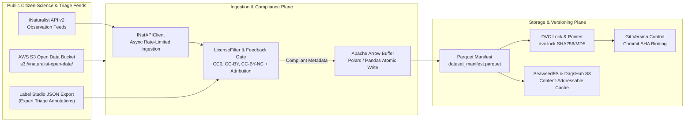

# Ingestion Engine & Cryptographic Versioning

Processing planetary-scale citizen-science data streams requires strict cryptographic reproducibility, legal compliance safeguards, and resource-bounded storage strategies right at the network boundary. Rather than treating dataset assembly as an ad-hoc preprocessing script, TaxonVision-MLOps governs every observation from initial API discovery and active learning feedback ingestion through to multi-split tensor extraction under deterministic cryptographic content hashes.



---

## 1. Data Topography & Open-Access Mandates

Global biodiversity portals aggregate continuous streams of species observations:

* **Ecosystem Scale:** Combined registries (iNaturalist and GBIF) host over 270 million raw observations, with approximately 170 million having achieved research-grade consensus status.
* **API Ingestion Caps:** Direct API consumption is throttled to 60 requests per minute, with a download cap of 5 GB per hour and 24 GB per day.
* **Strict Open Licensing:** Only observations explicitly released under open Creative Commons licences are admitted into the pipeline. Assets hosted on unauthorized static domains or lacking verified licence metadata are rejected.

### Programmatic Licence Filtering

Incoming observation records pass through [`LicenseFilter`](file:///home/benni/Documents/antigravity_workspace/taxon-vision-mlops/src/taxon_vision/data/license_filter.py#L19), evaluating metadata against permitted Creative Commons licences:

* **Permitted:** `CC0` (Public Domain Dedication), `CC-BY` (Attribution), and `CC-BY-NC` (Attribution-NonCommercial).
* **Rejected:** Commercial or restrictive variants (`CC-BY-ND`, `CC-BY-SA`, `all-rights-reserved` copyright, or missing attribution) are discarded at the edge during Stage 1 (`ingest`) and verified again during Stage 2 (`audit_license`).
* **Attribution Retention:** Every ingested observation retains its `photographer_name`, `license_code`, `photo_id`, and `observation_uuid`, serialised directly into downstream Parquet tables so that operator dashboards and `/api/v1/explain` endpoints always display legal photographer credits alongside predicted taxa.

---

## 2. Circumventing the 50-Terabyte Storage Trap

The raw citizen-science image dataset hosted on AWS Open Data exceeds 50 Terabytes. Downloading and duplicating this volume onto local workstation or cluster storage would cause immediate disk exhaustion and severe network I/O bottlenecks.

TaxonVision-MLOps circumvents this trap via **zero-duplication streaming**:

* **Zero-Disk S3 Batch Streaming:** [`S3ImageStreamer`](file:///home/benni/Documents/antigravity_workspace/taxon-vision-mlops/src/taxon_vision/data/s3_streamer.py#L16) streams image objects directly from the public AWS S3 bucket (`s3://inaturalist-open-data/`) into ephemeral RAM buffers during Stage 3 (`extract_features`) without writing raw JPEG files to local disk.
* **Lightweight Parquet Manifests:** The local repository stores only cryptographically validated Parquet index files (`raw_manifest.parquet` and `dataset_manifest.parquet`) containing observation UUIDs, taxon IDs, source URLs, and attribution headers.
* **Minimal Storage Footprint:** An index representing 10 million biological observations occupies less than 300 MB of disk space, whilst our curated 1,646-observation Level 1 baseline manifest occupies $< 500\,\text{KB}$.

### Downstream Feature Extraction & Embedding Cache

The lightweight Parquet manifests feed directly into the feature extraction pipeline ([`src/taxon_vision/pipelines/extract_features.py`](file:///home/benni/Documents/antigravity_workspace/taxon-vision-mlops/src/taxon_vision/pipelines/extract_features.py)):

* **Contiguous Taxonomic Mapping:** [`build_taxon_index_map`](file:///home/benni/Documents/antigravity_workspace/taxon-vision-mlops/src/taxon_vision/pipelines/extract_features.py#L67) scans the manifest and constructs a deterministic integer mapping from sparse biological `taxon_id` keys to contiguous target indices $[0, K-1]$.
* **In-Memory Tensor Preprocessing:** [`S3ImageStreamer`](file:///home/benni/Documents/antigravity_workspace/taxon-vision-mlops/src/taxon_vision/data/s3_streamer.py#L16) fetches raw image bytes over pooled HTTP keep-alive connections (`http_max_connections=16`, exponential retry backoff). Images are transformed into standardised evaluation tensors ($224 \times 224$ bicubic resize, ImageNet channel normalisation) and passed through the frozen vision backbone (e.g. `dinov3` or `bioclip-2`).
* **Stratified 4-Way Cache Serialisation:** [`create_stratified_embedding_split`](file:///home/benni/Documents/antigravity_workspace/taxon-vision-mlops/src/taxon_vision/pipelines/extract_features.py) performs deterministic 4-way stratified partitioning (70% train, 10% validation, 10% conformal calibration, 10% holdout test) seeded from `params.yaml:seed` (`42`), enforcing a strict multi-class cardinality gate ($\ge 2$ classes). The split is serialised into four discrete physical tensor files (`train_embeddings.pt`, `val_embeddings.pt`, `cal_embeddings.pt`, `test_embeddings.pt`) under `data/embeddings/`, enabling second-scale classification head training, zero-leakage Bayesian hyperparameter optimisation, and rigorous statistical coverage calibration.

---

## 3. Active Learning Feedback Ingestion & Manifest Merging

When the production serving engine encounters an observation whose negative Helmholtz free energy exceeds the OOD threshold $\tau_{\text{OOD}}$ or whose conformal prediction set $C(X)$ is empty or overly ambiguous ($|C(X)| > k_{\text{max}}$), the specimen is routed to human experts for taxonomic verification. Once annotated in Label Studio, these high-information specimens must be reintroduced into the training manifest without violating open-licensing mandates or corrupting existing Parquet tables.

The module [`src/taxon_vision/active_learning/feedback.py`](file:///home/benni/Documents/antigravity_workspace/taxon-vision-mlops/src/taxon_vision/active_learning/feedback.py) implements this gatekeeper boundary via [`merge_feedback_to_manifest()`](file:///home/benni/Documents/antigravity_workspace/taxon-vision-mlops/src/taxon_vision/active_learning/feedback.py#L265-L333):

1. **Bidirectional Taxonomic Resolution (`load_taxa_mappings`):** Parses [`config/taxa_catalog.yaml`](file:///home/benni/Documents/antigravity_workspace/taxon-vision-mlops/config/taxa_catalog.yaml) into an immutable [`TaxaMappings`](file:///home/benni/Documents/antigravity_workspace/taxon-vision-mlops/src/taxon_vision/active_learning/feedback.py#L34-L44) `NamedTuple` mapping lowercase scientific names, vernacular common names, and raw integer IDs to canonical iNaturalist `taxon_id` integers in $\mathcal{O}(1)$ lookup time.
2. **Out-of-Distribution Separation (`parse_single_task_annotation`):** Inspects each Label Studio task annotation. If a human expert classifies an observation as `"Out of Distribution (Non-Target / Novel Organism)"`, [`ParsedTaskAnnotation`](file:///home/benni/Documents/antigravity_workspace/taxon-vision-mlops/src/taxon_vision/active_learning/feedback.py#L46-L55) flags `is_ood=True` and sets `record=None`, ensuring novel background species never pollute the closed-set classification head.
3. **Strict Licence & Attribution Enforcement (`_validate_licensing_and_attribution`):** Verifies that `license_code` belongs to `PERMITTED_LICENSES = frozenset({"cc0", "cc-by", "cc-by-nc"})` and that `photographer_name`, `observation_uuid`, and `image_url` are non-empty. Any non-compliant annotation is rejected and logged before reaching disk.
4. **Idempotent UUID Deduplication & Atomic Write (`_atomic_write_manifest`):** Loads the existing `data/manifests/dataset_manifest.parquet`, filters out any `observation_uuid` already present in the dataset, appends only genuinely new verified records, and writes the combined DataFrame to a temporary `.parquet` file in the same directory before executing an atomic POSIX `Path.replace()`. It returns a typed [`FeedbackMergeResult`](file:///home/benni/Documents/antigravity_workspace/taxon-vision-mlops/src/taxon_vision/active_learning/feedback.py#L58-L71) (`new_records_added`, `ood_records_skipped`, `total_manifest_records`, and `status` in `{"merged", "skipped_empty", "skipped_no_new_records"}`), which the Airflow `model_retraining` DAG inspects to determine whether downstream feature extraction (`INGEST_DATA=true`) is required.

---

## 4. Bounded Exemplar Storage Mathematics

For visual retrieval in the taxonomic Multi-Modal Knowledge Graph (MMKG), the system maintains a curated **Reference Exemplar Catalogue**, strictly capped at 50 validated environmental crops per taxon:

$$N_{\text{total}} = 2{,}000 \text{ baseline taxa} \times 50 \text{ crops} = 100{,}000 \text{ exemplar crops}$$

Assuming compressed WebP images averaging 45 KB per crop (with an upper bound of 60 KB), the storage footprint evaluates to:

$$\text{Storage}_{\text{Exemplars}} = 100{,}000 \times 45 \text{ KB} = 4{,}500{,}000 \text{ KB} \approx 4.5 \text{ GB}$$

Accounting for manifests, statically calibrated INT8 ONNX checkpoints, and DVC churn:

$$\text{Storage}_{\text{Total}} = 0.3 \text{ GB (Manifests)} + 4.5 \text{ GB (Exemplars)} + 2.0 \text{ GB (ONNX)} + 1.5 \text{ GB (DVC Churn)} \approx 8.3 \text{ GB}$$

This 8.3 GB allocation consumes less than **$50\%$ of DagsHub's 20 GB free-tier storage quota**, eliminating external cloud storage egress fees.

---

## 5. DVC Pipeline Topology & Multi-Remote Storage

Data Version Control (DVC) establishes the data management control plane for TaxonVision-MLOps, combining content-addressable object storage with deterministic pipeline DAG execution.

### 5.1 Remote Architecture: SeaweedFS & DagsHub S3

The repository configures two complementary S3-compatible DVC remotes in `.dvc/config`:

* **In-Cluster High-Throughput Cache (`remote = local-seaweedfs`):** Points to `http://seaweedfs.taxon-vision.svc.cluster.local:8333/taxon-dvc-cache` on the bare-metal K3s cluster (`hive-mind`). SeaweedFS's Haystack/Needle architecture prevents disk-seek degradation and provides $< 2\,\text{ms}$ NVMe loopback transfers for intermediate embedding tensors (`data/embeddings/*.pt`) across Jenkins CI builds and Optuna HPO sweeps.
* **Offsite Cloud Archive (`remote = origin`):** Points to `s3://dvc` at `https://dagshub.com/foersben/taxon-vision-mlops.s3`, providing an immutable offsite backup of validated manifests and release checkpoints (`head.pt`, `model_int8.onnx`).
* **Zero-Leak Secret Management via Secret Service:** Rather than persisting sensitive cloud tokens in plaintext `.dvc/config.local` or `.env` files on disk, local developer workstations query credentials directly from KeePassXC in memory via `secret-tool`. The `just dvc-push` and `just dvc-pull` recipes inject `AWS_ACCESS_KEY_ID` and `AWS_SECRET_ACCESS_KEY` solely into the ephemeral child process environment.

### 5.2 Complete 8-Stage Pipeline DAG Specification (`dvc.yaml`)

Rather than relying on isolated shell scripts, TaxonVision-MLOps coordinates its end-to-end training, representation drift auditing, quantisation, calibration, and promotion lifecycle as an unbroken **8-stage Directed Acyclic Graph (DAG)** declared in [`dvc.yaml`](file:///home/benni/Documents/antigravity_workspace/taxon-vision-mlops/dvc.yaml):

```yaml
stages:
  ingestion:
    frozen: true
    cmd: >-
      pixi run -e dev python -m taxon_vision.pipelines.ingest
      --out data/manifests/raw_manifest.parquet
    deps:
      - config/taxa_catalog.yaml
      - src/taxon_vision/data/inat_client.py
      - src/taxon_vision/pipelines/ingest.py
    params:
      - ingestion.per_page
      - ingestion.taxa_to_fetch
    outs:
      - data/manifests/raw_manifest.parquet

  audit_license:
    cmd: >-
      pixi run -e dev python -m taxon_vision.pipelines.audit_license
      --manifest data/manifests/raw_manifest.parquet
      --out-manifest data/manifests/dataset_manifest.parquet
      --out reports/license_audit.json
    deps:
      - data/manifests/raw_manifest.parquet
      - src/taxon_vision/data/license_filter.py
      - src/taxon_vision/domain/license.py
      - src/taxon_vision/pipelines/audit_license.py
    outs:
      - data/manifests/dataset_manifest.parquet
    metrics:
      - reports/license_audit.json:
          cache: false

  extract_features:
    cmd: >-
      pixi run -e dev python -m taxon_vision.pipelines.extract_features
      --extractor ${model.extractor}
      --image-size ${model.image_size}
      --batch-size ${feature_extraction.batch_size}
      --val-split ${feature_extraction.val_split}
      --cal-split ${feature_extraction.cal_split}
      --test-split ${feature_extraction.test_split}
      --manifest data/manifests/dataset_manifest.parquet
      --out-dir data/embeddings
    deps:
      - config/taxa_catalog.yaml
      - data/manifests/dataset_manifest.parquet
      - src/taxon_vision/data/s3_streamer.py
      - src/taxon_vision/models/factory.py
      - src/taxon_vision/pipelines/extract_features.py
    params:
      - feature_extraction.batch_size
      - feature_extraction.cal_split
      - feature_extraction.test_split
      - feature_extraction.val_split
      - model.extractor
      - model.image_size
    outs:
      - data/embeddings/train_embeddings.pt
      - data/embeddings/val_embeddings.pt
      - data/embeddings/cal_embeddings.pt
      - data/embeddings/test_embeddings.pt

  data_drift:
    cmd: >-
      pixi run -e dev python -m taxon_vision.pipelines.data_drift
      --reference data/reference/reference_train_embeddings.pt
      --current data/embeddings/train_embeddings.pt
      --metrics-out reports/data_drift.json
    deps:
      - data/reference/reference_train_embeddings.pt
      - data/embeddings/train_embeddings.pt
      - src/taxon_vision/monitoring/drift.py
      - src/taxon_vision/monitoring/drift_runner.py
      - src/taxon_vision/pipelines/data_drift.py
    metrics:
      - reports/data_drift.json:
          cache: false

  train:
    cmd: >-
      pixi run -e dev python -m taxon_vision.pipelines.train
      --extractor ${model.extractor}
      --epochs ${training.epochs}
      --batch-size ${training.batch_size}
      --lr ${training.learning_rate}
      --train-embeddings data/embeddings/train_embeddings.pt
      --val-embeddings data/embeddings/val_embeddings.pt
      --checkpoint-path models/checkpoints/head.pt
      --metrics-out reports/train_metrics.json
    deps:
      - data/embeddings/train_embeddings.pt
      - data/embeddings/val_embeddings.pt
      - reports/data_drift.json
      - src/taxon_vision/models/loss.py
      - src/taxon_vision/models/training/
      - src/taxon_vision/pipelines/train.py
    params:
      - model.extractor
      - training.batch_size
      - training.cb_beta
      - training.epochs
      - training.learning_rate
      - training.tune
      - training.weight_decay
    outs:
      - models/checkpoints/head.pt
    metrics:
      - reports/train_metrics.json:
          cache: false

  export:
    cmd: >-
      pixi run -e dev python -m taxon_vision.pipelines.export_onnx
      --extractor ${model.extractor}
      --image-size ${model.image_size}
      --checkpoint models/checkpoints/head.pt
      --quantize-int8
      --quantize-mode dynamic
      --quantized-output models/checkpoints/model_int8.onnx
      --allow-untrained
    deps:
      - models/checkpoints/head.pt
      - src/taxon_vision/inference/onnx_exporter.py
      - src/taxon_vision/inference/quantizer.py
      - src/taxon_vision/pipelines/export_onnx.py
    params:
      - export.quantize_int8
      - model.extractor
      - model.image_size
    outs:
      - models/checkpoints/model_int8.onnx

  calibrate:
    cmd: >-
      pixi run -e dev python -m taxon_vision.pipelines.calibrate
      --onnx-model models/checkpoints/model_int8.onnx
      --embeddings data/embeddings/cal_embeddings.pt
      --out config/conformal_config.yaml
      --metrics-out reports/conformal_metrics.json
      --alpha ${conformal.alpha}
      --ood-tpr ${conformal.ood_tpr}
    deps:
      - data/embeddings/cal_embeddings.pt
      - models/checkpoints/model_int8.onnx
      - src/taxon_vision/inference/onnx_engine.py
      - src/taxon_vision/pipelines/calibrate.py
      - src/taxon_vision/uncertainty/conformal.py
      - src/taxon_vision/uncertainty/ood_detector.py
    params:
      - conformal.alpha
      - conformal.min_confidence
      - conformal.ood_tpr
    outs:
      - config/conformal_config.yaml:
          cache: false
    metrics:
      - reports/conformal_metrics.json:
          cache: false

  eval:
    cmd: >-
      pixi run -e dev python -m taxon_vision.pipelines.evaluate
      --onnx-model models/checkpoints/model_int8.onnx
      --embeddings data/embeddings/test_embeddings.pt
      --conformal-config config/conformal_config.yaml
      --out docs/assets/pareto_results.json
      --metrics-out reports/pareto_evaluation.json
      --latency-sla-ms ${evaluation.latency_sla_ms}
    deps:
      - config/conformal_config.yaml
      - data/embeddings/test_embeddings.pt
      - models/checkpoints/model_int8.onnx
      - src/taxon_vision/inference/onnx_engine.py
      - src/taxon_vision/pipelines/evaluate.py
      - src/taxon_vision/uncertainty/conformal.py
      - src/taxon_vision/uncertainty/ood_detector.py
    params:
      - conformal.alpha
      - evaluation.latency_sla_ms
    outs:
      - docs/assets/pareto_results.json:
          cache: false
    metrics:
      - reports/pareto_evaluation.json:
          cache: false
```

### 5.3 Why Stage 3.5 (`data_drift`) Guards Stage 4 (`train`)

Notice that the `train` stage declares `reports/data_drift.json` as an explicit dependency (`deps`), interposing the [`data_drift`](file:///home/benni/Documents/antigravity_workspace/taxon-vision-mlops/src/taxon_vision/pipelines/data_drift.py) stage directly between `extract_features` and `train`.

When new citizen-science observations or human feedback annotations are merged into `dataset_manifest.parquet` and re-extracted into `data/embeddings/train_embeddings.pt`, retraining blindly on the updated tensor risks silent manifold distortion. Stage 3.5 compares `data/embeddings/train_embeddings.pt` against the frozen historical baseline `data/reference/reference_train_embeddings.pt` using both Tier 1 1D Wasserstein-1 distance on vector norms and Tier 2 multivariate RBF MMD² permutation testing, logs an Evidently 8-D PCA snapshot report to MLflow (`drift_scope="training"`), and writes `reports/data_drift.json`. This guarantees an immutable historical-versus-current representation lineage audit before a single gradient update is applied to the classification head.

---

## 6. Filesystem Determinism: BTRFS NOCOW Subvolumes

Under continuous local dataset writes, PostgreSQL WAL flushes, and DVC chunk caching, Copy-on-Write (CoW) filesystems such as BTRFS suffer severe physical block fragmentation.

To ensure deterministic read bandwidth across the 2 TB PCIe Gen4 NVMe bus, persistent storage directories for DVC, SeaweedFS, PostgreSQL, and MLflow are initialised with the non-CoW attribute (`chattr +C`), guaranteeing contiguous physical block allocations during multi-gigabyte training and evaluation streams.
