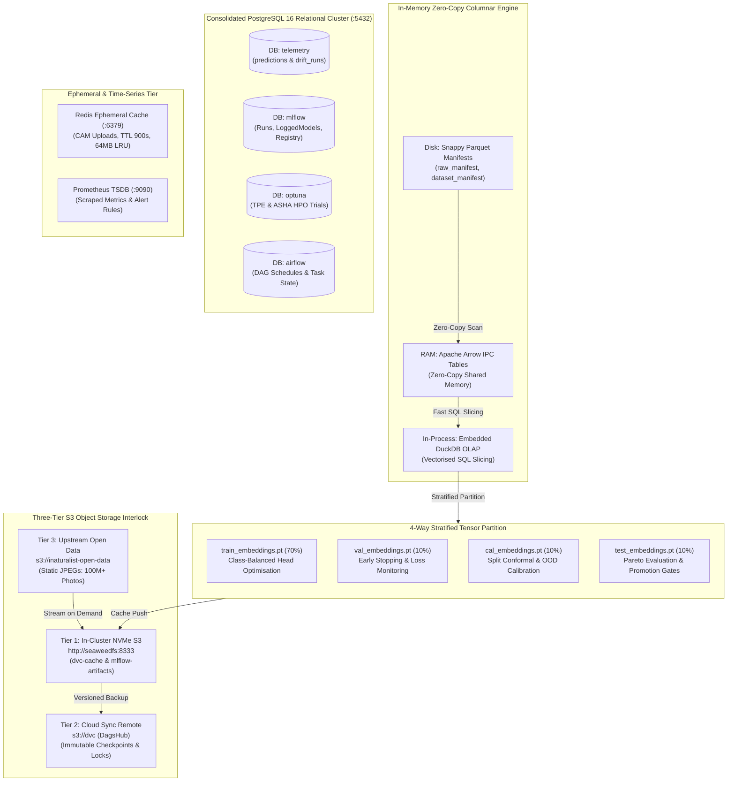
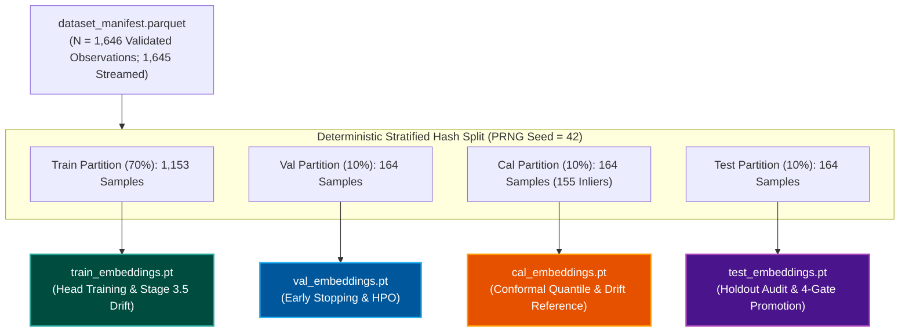
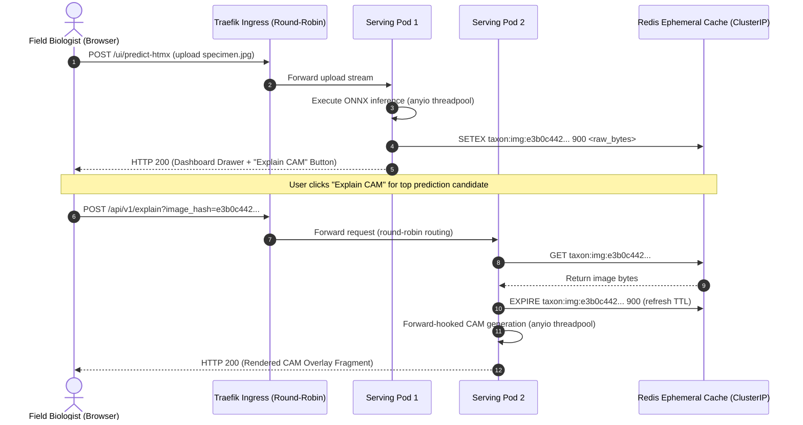

# Polyglot Storage Architecture & Database Matrix

## 1. Conceptual Motivation: Why One Database Cannot Serve All MLOps Workloads

A recurring anti-pattern in early-stage machine learning systems is the attempt to force every data asset - from raw training photographs and multi-megabyte neural embeddings to hyperparameter trial records and sub-millisecond HTTP session caches - into a single storage engine (either a flat filesystem directory or a monolithic relational database). Whilst convenient for a prototype notebook, this uniform approach collapses under production workloads because different stages of an MLOps lifecycle exhibit fundamentally incompatible physical access patterns:

* **Analytical Columnar Scans vs. Transactional Row Writes:** Training data ingestion and licence auditing scan tens of thousands of observation records across a handful of columns (`taxon_id`, `license_code`, `photographer_name`). Row-oriented relational databases must read every byte of every row from disk to evaluate such predicates, whereas columnar formats (Apache Parquet bridged into Apache Arrow and DuckDB) read only the requested column pages using vectorised SIMD instructions without copying memory. Conversely, live inference telemetry and workflow orchestration require concurrent, row-level ACID transactions (`INSERT INTO predictions ...`) where re-writing an entire immutable Parquet file on every HTTP request would cause catastrophic I/O amplification.
* **Binary Tensor Blobs vs. Relational Metadata:** Storing multi-megabyte PyTorch embedding tensors (`train_embeddings.pt`) or quantised ONNX graphs (`model_int8.onnx`) inside relational `BYTEA` columns bloats database write-ahead logs (WAL) and degrades buffer-pool cache efficiency. Content-addressed S3 object stores (SeaweedFS on local NVMe and DagsHub S3 in the cloud) coupled with Data Version Control (DVC) handle immutable binary artefacts far more efficiently, whilst relational tables store only lightweight metadata pointers and cryptographic SHA-256 digests.
* **Concurrent Multi-Service State vs. Embedded SQLite File Locks:** Embedded file-based databases such as SQLite rely on POSIX filesystem locks that serialise writers across the entire database file. When multiple microservices - such as an asynchronous FastAPI worker pool, an Airflow scheduler, an MLflow tracking server, and parallel Optuna hyperparameter trials - attempt concurrent writes, SQLite rapidly fails with `OperationalError: database is locked`. Consolidating these transactional workloads onto a single PostgreSQL 16 instance with isolated logical databases provides multi-version concurrency control (MVCC) without deploying four separate database servers.
* **Ephemeral High-Frequency Lookups vs. Durable Disk Persistence:** Interactive explainability workflows (such as generating a Grad-CAM heatmap moments after a user uploads a specimen photograph) require sharing raw image bytes across load-balanced FastAPI pods for a few minutes. Persisting temporary uploads to durable disk wastes NVMe endurance, whereas an in-memory Redis cache with a strict least-recently-used (LRU) memory cap and automatic time-to-live (TTL) eviction resolves multi-pod state sharing in sub-millisecond time.

To balance cloud egress economics, training throughput, concurrent transactional integrity, and serving latency ceilings, TaxonVision-MLOps implements a **polyglot storage architecture** in which each data modality is assigned to the engine specifically engineered for its mathematical and operational profile.



---

## 2. Complete Storage & Database Matrix

The platform maps every data asset across eleven specialised storage tiers, governed by explicit invalidation rules and service-level objectives:

| Storage Technology | Architectural Tier & Location | Primary Data Assets | Access Pattern & Protocols | Invalidation & Lifecycle SLO |
| :--- | :--- | :--- | :--- | :--- |
| **Apache Parquet + Polars + Arrow** | Local Filesystem & Host RAM | Observation manifests (`raw_manifest.parquet`, `dataset_manifest.parquet`, `human_feedback.parquet`) | Snappy-compressed columnar reads, Arrow IPC zero-copy memory transfers | Immutable per DVC stage hash; regenerated upon pipeline re-execution or feedback ingestion. |
| **PyTorch `.pt` Split Tensors** | Local NVMe & SeaweedFS S3 | Extracted foundation embeddings (`{train,val,cal,test}_embeddings.pt`, `reference_train_embeddings.pt`) | Sequential batch slicing, contiguous float32 tensor loads (`torch.load(..., weights_only=True)`) | Cached locally and in SeaweedFS; invalidated when backbone model or dataset manifest changes. |
| **DuckDB In-Process OLAP** | Ephemeral Process Memory | Taxon catalogue joins, licence filtering, analytical metadata queries | Direct SQL queries over Arrow tables without daemon overhead (pinned to 2.0.0 LTS) | Ephemeral; lives strictly within the Python pipeline process runtime. |
| **PostgreSQL 16 (`telemetry` DB)** | Consolidated Relational Pod (`postgres:5432`) | Live prediction audit records (`predictions`) and two-tier drift history (`drift_runs`) | Asynchronous `BackgroundTasks` inserts and sliding-window `REAL[]` vector reads via `psycopg_pool` | Persistent transactional audit trail; indexed by `created_at DESC` for $\mathcal{O}(\log N)$ window retrieval. |
| **PostgreSQL 16 (`mlflow` DB)** | Consolidated Relational Pod (`postgres:5432`) | MLflow 3.16.0 experiment runs, `LoggedModel` entities, dataset lineage, and `@Production` / `@Challenger` registry aliases | SQLAlchemy ACID transactions managed by the `mlflow-server` container (`:5000`) | Persistent across training lifecycles; offline CLI execution falls back to `sqlite:///data/mlflow/mlflow.db`. |
| **PostgreSQL 16 (`optuna` DB)** | Consolidated Relational Pod (`postgres:5432`) | Bayesian TPE hyperparameter trial histories and ASHA pruning milestones | SQLAlchemy relational transactions via `TAXON_OPTUNA_STORAGE_URI` | Persistent across HPO sweeps; offline local runs fall back to `sqlite:///data/optuna/optuna_studies.db`. |
| **PostgreSQL 16 (`airflow` DB)** | Consolidated Relational Pod (`postgres:5432`) | Airflow 3.0 DAG schedules, task instance states, and XCom metadata | SQLAlchemy connection pool from `airflow-scheduler` and `airflow-apiserver` (`:8090`) | Persistent orchestration state; initialised idempotently by `airflow-init`. |
| **SeaweedFS In-Cluster S3** | Local Cluster Daemon (`:8333`) | DVC tensor cache (`s3://taxon-dvc-cache`), human triage feedback (`s3://triage-queue`), and MLflow artefacts (`s3://mlflow-artifacts` - plots, Evidently HTML, `pyfunc_model`) | High-throughput S3 API over cluster loopback (`strategy.type: Recreate`) | Local NVMe object store providing $< 2\,\text{ms}$ loopback read latency with zero cloud egress cost. |
| **Redis Ephemeral Upload Cache** | In-Cluster Ephemeral Pod (`redis-ephemeral:6379`) | Raw specimen image uploads (`taxon:img:{sha256}`) for on-demand Grad-CAM attribution | Connection-pooled RESP protocol, non-blocking AnyIO threadpool offload | 15-minute rolling TTL (`SETEX 900`), `maxmemory 64mb` with `allkeys-lru` eviction policy. |
| **Grafana Loki TSDB** | Local Cluster Daemon (`:3100`) | Aggregated container logs (FastAPI JSON records, Airflow DAG worker logs, Traefik access records) | Promtail log shipping, LogQL stream expressions over HTTP | 168-hour (7-day) rolling retention on non-CoW host NVMe storage (`/var/lib/taxon-vision/loki`). |
| **DagsHub S3 DVC Remote** | Cloud Object Store (`s3://dvc` / `origin`) | Canonical checkpoints (`head.pt`, `model_int8.onnx`), DVC locks | Remote S3 API authenticated via ephemeral KeePassXC `secret-tool` injection | Content-addressed cloud archive; updated upon verified pipeline releases. |
| **AWS Open Data Registry S3** | Public Cloud Storage (`s3://inaturalist-open-data`) | Raw citizen-science photographs | Unauthenticated direct HTTP/S3 batch streaming | Upstream public repository; images are streamed on demand into RAM and immediately discarded. |
| **Prometheus TSDB** | In-Cluster Telemetry Daemon (`:9090`) | Inference latency histograms, conformal set sizes, OOD counters, and drift gauges (`w1_distance`, `mmd2_p_value`) | HTTP pull scraping every 15 seconds from `/metrics` | 15-day rolling retention buffer driving Grafana dashboards and Alertmanager webhooks. |

---

## 3. Consolidated PostgreSQL 16 Relational Tier & Telemetry Store

### 3.1 Single-Engine Multi-Database Topology

Running four distinct database engines on a single bare-metal node would waste gigabytes of system RAM on duplicated buffer pools and background worker processes. Instead, TaxonVision-MLOps provisions a single **PostgreSQL 16 (`postgres:16-alpine`)** instance ([`deploy/k8s/postgres.yaml`](file:///home/benni/Documents/antigravity_workspace/taxon-vision-mlops/deploy/k8s/postgres.yaml) and [`docker-compose.yml`](file:///home/benni/Documents/antigravity_workspace/taxon-vision-mlops/docker-compose.yml)) capped at a modest 512 MB memory envelope. Upon first container bootstrap, [`deploy/postgres/init/01-databases.sql`](file:///home/benni/Documents/antigravity_workspace/taxon-vision-mlops/deploy/postgres/init/01-databases.sql) executes automatically to provision four strictly isolated logical databases and dedicated least-privilege login roles:

```sql
-- 1. Create Dedicated Service Roles
CREATE ROLE telemetry LOGIN PASSWORD 'taxon_telemetry_pass';
CREATE ROLE optuna    LOGIN PASSWORD 'taxon_optuna_pass';
CREATE ROLE airflow   LOGIN PASSWORD 'taxon_airflow_pass';
CREATE ROLE mlflow    LOGIN PASSWORD 'taxon_mlflow_pass';

-- 2. Provision Isolated Logical Databases
CREATE DATABASE telemetry OWNER telemetry;
CREATE DATABASE optuna    OWNER optuna;
CREATE DATABASE airflow   OWNER airflow;
CREATE DATABASE mlflow    OWNER mlflow;
```

On the bare-metal host (`hive-mind`), the PostgreSQL data directory (`/var/lib/taxon-vision/postgres`) resides on a BTRFS subvolume initialised with the non-Copy-on-Write attribute (`chattr +C`), preventing physical NVMe block fragmentation during continuous write-ahead log (WAL) checkpoints. In Kubernetes, the database is exposed under the cluster-internal fully-qualified domain name (FQDN) `postgres.taxon-vision.svc.cluster.local:5432`, allowing both production pods in `taxon-vision` and staging pods in `taxon-vision-staging` to connect to the unified relational store seamlessly across namespace boundaries.

### 3.2 Prediction Telemetry Schema (`telemetry` Database)

Online covariate drift detection requires comparing recent production feature representations against the reference calibration distribution (`cal_embeddings.pt`). Rather than coupling drift computation to the synchronous inference path, the `telemetry` database persists each evaluated observation via [`deploy/postgres/telemetry/001_predictions.sql`](file:///home/benni/Documents/antigravity_workspace/taxon-vision-mlops/deploy/postgres/telemetry/001_predictions.sql):

```sql
CREATE TABLE IF NOT EXISTS predictions (
    id               BIGSERIAL PRIMARY KEY,
    observation_id   UUID        NOT NULL UNIQUE,
    created_at       TIMESTAMPTZ NOT NULL DEFAULT now(),
    model_version    TEXT,
    extractor        TEXT        NOT NULL,
    top1_taxon       TEXT,
    top1_confidence  REAL,
    conformal_set    TEXT[]      NOT NULL,
    set_size         SMALLINT    NOT NULL,
    ood_energy       REAL,
    is_ood           BOOLEAN     NOT NULL,
    requires_review  BOOLEAN     NOT NULL,
    latency_ms       REAL        NOT NULL,
    embedding        REAL[]      -- Raw pre-normalised activations (length 384 for ViT-S)
);

CREATE INDEX IF NOT EXISTS predictions_created_at_idx ON predictions (created_at DESC);

CREATE TABLE IF NOT EXISTS drift_runs (
    id                BIGSERIAL PRIMARY KEY,
    created_at        TIMESTAMPTZ NOT NULL DEFAULT now(),
    window_size       INTEGER          NOT NULL,
    w1_distance       DOUBLE PRECISION NOT NULL,
    w1_threshold      DOUBLE PRECISION NOT NULL,
    mmd2              DOUBLE PRECISION NOT NULL,
    mmd2_p_value      DOUBLE PRECISION NOT NULL,
    drift_detected    BOOLEAN          NOT NULL,
    mlflow_run_id     TEXT
);

CREATE INDEX IF NOT EXISTS drift_runs_created_at_idx ON drift_runs (created_at DESC);
```

> [!IMPORTANT]
> **Why Raw Pre-Normalised Embeddings Are Stored:** The `embedding` column (`REAL[]`) stores the 384-dimensional penultimate feature vector extracted *prior* to $L_2$ unit-sphere normalisation. If post-normalised unit vectors were persisted, every vector would satisfy $\|\mathbf{z}\|_2 = 1.0$, collapsing the 1D Wasserstein-1 norm drift detector to zero and blinding Tier 1 monitoring to radial activation shifts (such as camera sensor blur, overexposure, or out-of-domain backgrounds).

### 3.3 Asynchronous Persistence & Fail-Fast `TelemetryStore` Protocol

To guarantee that relational database I/O never inflates the $< 25\,\text{ms}$ p95 microservice latency ceiling, [`src/taxon_vision/service/telemetry_store.py`](file:///home/benni/Documents/antigravity_workspace/taxon-vision-mlops/src/taxon_vision/service/telemetry_store.py) abstracts persistence behind the [`TelemetryStore`](file:///home/benni/Documents/antigravity_workspace/taxon-vision-mlops/src/taxon_vision/service/telemetry_store.py#L97-L166) protocol with two concrete implementations:

* **[`PostgresTelemetryStore`](file:///home/benni/Documents/antigravity_workspace/taxon-vision-mlops/src/taxon_vision/service/telemetry_store.py#L190-L360):** Manages a thread-safe `psycopg_pool.ConnectionPool` (`pool_min_size=2`, `pool_max_size=10`, `timeout_seconds=5.0`). When `POST /api/v1/predict` completes an inference forward pass, it constructs an immutable [`PredictionRecord`](file:///home/benni/Documents/antigravity_workspace/taxon-vision-mlops/src/taxon_vision/service/telemetry_store.py#L30-L65) and dispatches `get_telemetry_store().record(rec)` via FastAPI `BackgroundTasks`. The HTTP response returns immediately to the caller while the background worker leases a pooled connection and executes an idempotent `INSERT ... ON CONFLICT (observation_id) DO NOTHING`. Any write failure increments the Prometheus counter `taxon_telemetry_write_failures_total` and logs a full traceback without crashing the ASGI worker.
* **[`BoundedInMemoryTelemetryStore`](file:///home/benni/Documents/antigravity_workspace/taxon-vision-mlops/src/taxon_vision/service/telemetry_store.py#L363-L470) & Fail-Fast Governance:** In compliance with Rule 08 (Zero Silent Error Masking), `telemetry.allow_in_memory_fallback` defaults to `false` in `config/default_config.yaml`. If PostgreSQL is unreachable in production, `get_telemetry_store()` fails fast with a `RuntimeError` rather than silently discarding telemetry. For offline unit testing or isolated developer sandboxes where `TAXON_TELEMETRY_ALLOW_IN_MEMORY_FALLBACK=true` is explicitly exported, the service falls back to a fixed-capacity ring buffer (`collections.deque(maxlen=500)`), bounding heap consumption to $\mathcal{O}(\text{maxlen})$ and preventing out-of-memory container terminations.

---

## 4. The Three-Tier S3 Interlock & MLflow Artefact Proxy

Large-scale computer vision workflows frequently suffer from severe network bottlenecks when downloading raw imagery or synchronising multi-gigabyte feature representations. TaxonVision-MLOps resolves this using the **Three-Tier S3 Interlock**:

### Tier 3: Upstream Open Data (`s3://inaturalist-open-data`)

* Public repository hosting over 100 million research-grade observation photographs.
* Rather than mirroring terabytes of static imagery locally, the ingestion pipeline stores only image URLs, licence codes, and observation identifiers in `data/manifests/raw_manifest.parquet` ($< 500\,\text{KB}$).
* Images stream directly into ephemeral memory buffers during Stage 3 (`extract_features`) and are discarded immediately after forward-pass embedding generation.

### Tier 1: In-Cluster NVMe Cache (`http://seaweedfs:8333` / `local-seaweedfs`)

* High-performance SeaweedFS object store running inside the local Kubernetes cluster (`namespace: taxon-vision`) and local Docker Compose network, backed directly by host NVMe storage.
* Hosts two dedicated S3 buckets:
    * `s3://taxon-dvc-cache`: Functions as an accelerated NVMe read mirror ($< 2\,\text{ms}$ loopback latency) for intermediate feature tensors (`{train,val,cal,test}_embeddings.pt`) and manifests during cluster GPU feature extraction and Optuna HPO sweeps.
    * `s3://mlflow-artifacts`: Stores heavy MLflow 3.16.0 artefacts - including serialized `TaxonVisionPyFuncModel` bundles (`pyfunc_model`), 6 holdout diagnostic visualisations (`visualizations/*.png`), per-taxon holdout audit tables (`per_taxon_holdout_audit.json`), and standalone Evidently PCA drift reports (`drift_report.html`). Because the `mlflow-server` container is launched with `--serve-artifacts` and `--artifacts-destination s3://mlflow-artifacts`, pipeline workers upload artefacts via the standard MLflow HTTP proxy on port `5000` without needing direct S3 credentials on the client side.
* **Storage Lock Collision Prevention:** The SeaweedFS volume daemon manages embedded LevelDB metadata stores on bare-metal `hostPath` mounts. Because LevelDB enforces strict single-writer file locks (`LOCK: Resource temporarily unavailable`), standard Kubernetes `RollingUpdate` deployments would cause new pods to crash while terminating pods still hold the file lock. Consequently, the deployment manifest ([`deploy/k8s/mlops-storage-and-optuna.yaml`](file:///home/benni/Documents/antigravity_workspace/taxon-vision-mlops/deploy/k8s/mlops-storage-and-optuna.yaml)) mandates `strategy.type: Recreate`, ensuring old pods fully release volume locks before replacement pods mount the storage bus.

### Tier 2: Cloud Sync Remote (DagsHub `s3://dvc` / `origin`)

* Acts as the immutable, canonical cloud source of truth archiving all Epistemic Diamond pipeline artefacts (~25 MB total).
* Stores validated manifests (`raw_manifest.parquet`, `dataset_manifest.parquet`), the 4 split embedding tensors (~2.6 MB combined), the trained classification head (`head.pt`), and the quantised INT8 ONNX runtime graph (`model_int8.onnx`).
* Guarantees that external developers and CI runners can clone the repository and execute `just dvc-pull` seamlessly without requiring private VPN access to the bare-metal K3s cluster.

---

## 5. The 4-Way Stratified Tensor Partition & Leakage Prevention

In conformal prediction and safety-critical machine learning, data leakage between calibration, validation, and evaluation splits invalidates statistical coverage guarantees. TaxonVision-MLOps enforces strict mathematical isolation during Stage 3 (`extract_features`):



### Mathematical Zero-Leakage Invariant

Let the complete validated observation set be $\mathcal{D} = \{(\mathbf{x}_i, y_i, \text{uuid}_i)\}_{i=1}^N$. The dataset is partitioned into four disjoint index sets:

$$\mathcal{D} = \mathcal{D}_{\text{train}} \cup \mathcal{D}_{\text{val}} \cup \mathcal{D}_{\text{cal}} \cup \mathcal{D}_{\text{test}}$$

Subject to the strict mutual exclusivity constraints:

$$I_{\text{train}} \cap I_{\text{val}} = \emptyset, \quad I_{\text{train}} \cap I_{\text{cal}} = \emptyset, \quad I_{\text{train}} \cap I_{\text{test}} = \emptyset$$

$$I_{\text{val}} \cap I_{\text{cal}} = \emptyset, \quad I_{\text{val}} \cap I_{\text{test}} = \emptyset, \quad I_{\text{cal}} \cap I_{\text{test}} = \emptyset$$

* **$\mathcal{D}_{\text{train}}$ ($70\%$):** Utilised by Stage 3.5 (`data_drift`) to verify training distribution stability against `reference_train_embeddings.pt`, and by Stage 4 (`train`) to optimise cosine classification head weights $\mathbf{W}$ via Class-Balanced Loss.
* **$\mathcal{D}_{\text{val}}$ ($10\%$):** Monitored during Stage 4 (`train`) to guide Optuna TPE/ASHA hyperparameter pruning and trigger early stopping on validation Macro PR-AUC.
* **$\mathcal{D}_{\text{cal}}$ ($10\%$):** Reserved exclusively for Stage 6 (`calibrate`) to compute non-conformity scores $s_i = 1 - \hat{\pi}(y_i \mid \mathbf{x}_i)$, derive the finite-sample conformal quantile $\hat{q}_\alpha$, and anchor the reference baseline for online serving drift detection (`drift_runner.py`). Model weights $\mathbf{W}$ remain strictly frozen.
* **$\mathcal{D}_{\text{test}}$ ($10\%$):** Reserved exclusively for Stage 7 (`eval`) to verify empirical holdout coverage $P(Y \in C(X)) \ge 1 - \alpha$, benchmark INT8 latency, and execute the Four-Gate Model Promotion audit (`promotion.py`).

---

## 6. In-Memory Columnar Buffers: Parquet, Arrow & DuckDB

To process tabular observation manifests with zero serialisation overhead:

* **Apache Parquet (On-Disk Columnar Storage):** Columnar compression using Snappy. Dictionary encoding compresses repetitive `taxon_id` integers and Creative Commons `license_code` strings by over $85\%$.
* **Apache Arrow (In-Memory IPC):** Tabular data is transferred between Polars and DuckDB in-process without copying bytes in system RAM.
* **Embedded DuckDB (In-Process OLAP):** Pinned to DuckDB 2.0.0 LTS to guarantee backward-compatible storage serialisation and zero-copy Apache Arrow memory-table bridging. Executes analytical queries (such as verifying taxonomic class balance or auditing photographer licences) directly against Parquet files via vectorised SIMD execution engines:

```python
import duckdb

# Direct in-process query over Snappy Parquet manifest without server daemons
summary = duckdb.query("""
    SELECT
        taxon_id,
        count(*) AS total_obs,
        count(DISTINCT license_code) AS unique_licenses
    FROM read_parquet('data/manifests/dataset_manifest.parquet')
    GROUP BY taxon_id
    ORDER BY total_obs DESC
""").to_arrow_table()
```

---

## 7. Distributed Ephemeral Cache & Split-Brain Mitigation

In production serving topologies, the FastAPI inference runtime scales horizontally across multiple Kubernetes pod replicas (`replicas: 2` in [`deploy/k8s/api-deployment.yaml`](file:///home/benni/Documents/antigravity_workspace/taxon-vision-mlops/deploy/k8s/api-deployment.yaml)) behind a round-robin Traefik ingress proxy. When a user uploads a high-resolution observation specimen, computing visual explainability via Class Activation Mapping (CAM) synchronously on the hot prediction path would violate the $< 25\,\text{ms}$ p95 latency budget. Instead, CAM overlays are generated asynchronously on demand when the operator expands a candidate drawer.

### Multi-Pod Split-Brain Failure Mode

Under a naive single-node in-memory cache (`MemoryImageCache`), uploaded images reside exclusively in the local heap memory of the pod that serviced the initial prediction request:

1. A field biologist uploads `specimen.jpg` to `POST /ui/predict-htmx`.
2. Traefik routes the upload stream to **Pod 1**. Pod 1 executes ONNX inference, caches the raw image bytes in its local process memory keyed by SHA-256 digest (`image_hash`), and returns the HTML prediction drawer.
3. The user clicks "Explain CAM" for a candidate taxon, triggering `POST /api/v1/explain?image_hash=...`.
4. Traefik round-robin load-balances this second request to **Pod 2**.
5. Pod 2 inspects its local memory, finds no record of `image_hash`, and returns **HTTP 422 Unprocessable Entity** (`Image not found in cache`), producing an operational split-brain failure.

### Distributed Shared Cache Architecture (`RedisImageCache`)

To eliminate split-brain failures whilst maintaining sub-millisecond cache access, the platform implements [`ImageCacheProtocol`](file:///home/benni/Documents/antigravity_workspace/taxon-vision-mlops/src/taxon_vision/service/storage.py#L46-L108) in [`src/taxon_vision/service/storage.py`](file:///home/benni/Documents/antigravity_workspace/taxon-vision-mlops/src/taxon_vision/service/storage.py) backed by a dedicated, in-cluster Redis ephemeral instance ([`deploy/k8s/redis-ephemeral.yaml`](file:///home/benni/Documents/antigravity_workspace/taxon-vision-mlops/deploy/k8s/redis-ephemeral.yaml)):

* **Content-Addressed Storage:** Uploaded image bytes are hashed via SHA-256 and stored under key `taxon:img:{sha256}`.
* **Bounded LRU Memory Envelope:** Redis is configured with `maxmemory 64mb` and `maxmemory-policy allkeys-lru`, guaranteeing a hard memory ceiling with $\mathcal{O}(1)$ eviction under heavy upload traffic.
* **Monotonic Rolling TTL:** Keys are written using `SETEX` with a configurable 15-minute expiration (`image_cache_ttl_seconds = 900.0`). Every successful lookup refreshes the TTL via `EXPIRE`, keeping active investigation specimens warm.
* **Non-Blocking AnyIO Threadpool:** Synchronous Redis socket operations inside `views.py` and `explain.py` are offloaded via `await anyio.to_thread.run_sync(...)`, preventing event-loop stalls.
* **Graceful Local Fallback:** If `TAXON_SERVICE__REDIS_URL` is unset or Redis is unreachable in local offline development, `get_image_cache()` logs a structured warning and falls back to thread-safe `MemoryImageCache`.


