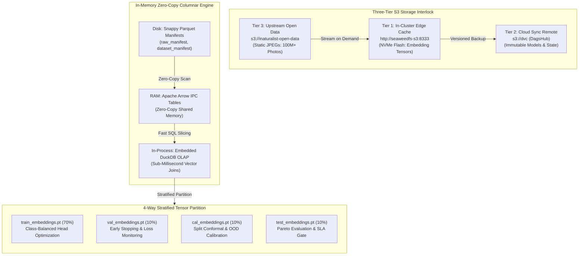
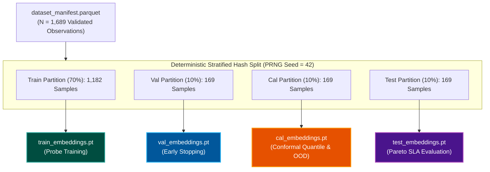

# Polyglot Storage Architecture & Database Matrix

Enterprise biodiversity computer vision systems operate at the intersection of streaming citizen-science media, multi-gigabyte foundation model embedding representations, sub-millisecond analytical query paths, and strict cryptographic audit trails. To balance cloud egress costs, training throughput, and serving latencies, TaxonVision-MLOps implements a **polyglot storage architecture**.



---

## 1. Complete Storage & Database Matrix

The system avoids monolithic databases by deploying specialized engines for each data modality and access pattern:

| Storage Technology | Architectural Tier & Location | Primary Data Assets | Access Pattern & Protocols | Invalidation & Lifecycle SLA |
| :--- | :--- | :--- | :--- | :--- |
| **Apache Parquet + Polars + Arrow** | Local Filesystem & Host RAM | Observation manifests (`raw_manifest.parquet`, `dataset_manifest.parquet`) | Snappy-compressed columnar reads, Arrow IPC zero-copy memory transfers | Immutable per DVC stage hash; regenerated upon pipeline re-execution. |
| **PyTorch `.pt` Split Tensors** | Local NVMe & SeaweedFS S3 | Extracted foundation embeddings (`*_embeddings.pt`) | Sequential batch slicing, memory-mapped tensor reads (`torch.load`) | Cached locally; invalidated when backbone model or dataset manifest changes. |
| **DuckDB In-Process OLAP** | Ephemeral Process Memory | Taxon catalog joins, license filtering, metadata queries | Direct SQL queries over Arrow tables without daemon overhead | Ephemeral; lives within Python pipeline process runtime. |
| **SQLite on k3s PVC** | Bare-Metal Kubernetes HostPath PVC | Optuna hyperparameter optimization trial histories | ACID relational transactions via SQLAlchemy (`optuna.db`) | Persistent across Jenkins agent pod restarts; retained for post-hoc analysis. |
| **SeaweedFS In-Cluster S3** | Local Cluster Daemon (`:8333`) | Heavy intermediate tensors (`*.pt`) | High-throughput S3 API over loopback networking | Edge cache; mirrors intermediate stage artifacts with $< 2\text{ ms}$ read latency. |
| **DagsHub S3 DVC Remote** | Cloud Object Store (`s3://dvc`) | Canonical checkpoints (`head.pt`, `model_int8.onnx`), DVC locks | Remote S3 API authenticated via GPG/SSH credentials | Content-addressed cloud archive; updated upon successful CI release tags. |
| **AWS Open Data Registry S3** | Public Cloud Storage (`s3://inaturalist-open-data`) | Raw citizen-science photographs | Unauthenticated direct HTTP/S3 streaming | Upstream public repository; images streamed on demand and discarded from RAM. |
| **MLflow Model Registry** | Tracking Server & S3 Artifact Store | Run parameters, loss curves, explicit `ModelSignature` | MLflow REST API and S3 artifact downloads | Retained indefinitely across training experiments; tags champion models. |
| **Prometheus TSDB** | In-Cluster Telemetry Daemon | Inference latencies, conformal set sizes, OOD rejections | HTTP pull scraping every 5 seconds (`/metrics`) | 15-day rolling retention buffer for real-time Prometheus monitoring. |

---

## 2. The Three-Tier S3 Interlock

Large-scale computer vision workflows frequently suffer from severe network bottlenecks when downloading imagery or syncing multi-gigabyte feature representations. TaxonVision-MLOps resolves this using the **Three-Tier S3 Interlock**:

### Tier 3: Upstream Open Data (`s3://inaturalist-open-data`)

* Public repository hosting over 100 million research-grade observation images.
* Rather than mirroring terabytes of static imagery locally, the ingestion pipeline stores only image URLs and observation identifiers in `data/manifests/raw_manifest.parquet` ($< 500\text{ KB}$).
* Images stream directly into ephemeral memory buffers during Stage 3 (`extract_features`) and are discarded immediately after forward-pass embedding generation.

### Tier 1: In-Cluster Edge Cache (`http://seaweedfs-s3:8333`)

* High-performance, distributed SeaweedFS object store running directly on bare-metal Kubernetes nodes with NVMe backing.
* Stores intermediate feature tensors (`train_embeddings.pt`, `val_embeddings.pt`, `cal_embeddings.pt`, `test_embeddings.pt`).
* Downstream stages (`train`, `calibrate`, `eval`) pull tensors locally over loopback networking with read latencies $< 2\text{ ms}$, eliminating cloud egress charges and external network latency.

### Tier 2: Cloud Sync Remote (DagsHub `s3://dvc`)

* Acts as the immutable cloud source of truth for all verified model releases.
* Only lightweight artifacts that have passed the full 7-stage quality gate (`head.pt`, `model_int8.onnx`, and `.dvc` tracking files) are pushed to DagsHub.
* Guarantees that any developer or CI runner can reproduce production inference bundles without local cluster access.

---

## 3. The 4-Way Stratified Tensor Partition & Leakage Prevention

In conformal prediction and safety-critical machine learning, data leakage between calibration, validation, and evaluation splits invalidates statistical guarantees. TaxonVision-MLOps enforces strict mathematical isolation during Stage 3 (`extract_features`):



### Mathematical Zero-Leakage Invariant

Let the complete validated observation set be $\mathcal{D} = \{(\mathbf{x}_i, y_i, \text{uuid}_i)\}_{i=1}^N$. The dataset is partitioned into index sets:

$$\mathcal{D} = \mathcal{D}_{\text{train}} \cup \mathcal{D}_{\text{val}} \cup \mathcal{D}_{\text{cal}} \cup \mathcal{D}_{\text{test}}$$

Subject to the strict mutual exclusivity constraints:

$$I_{\text{train}} \cap I_{\text{val}} = \emptyset, \quad I_{\text{train}} \cap I_{\text{cal}} = \emptyset, \quad I_{\text{train}} \cap I_{\text{test}} = \emptyset$$

$$I_{\text{val}} \cap I_{\text{cal}} = \emptyset, \quad I_{\text{val}} \cap I_{\text{test}} = \emptyset, \quad I_{\text{cal}} \cap I_{\text{test}} = \emptyset$$

* **$\mathcal{D}_{\text{train}}$ ($70\%$):** Exclusively utilized by Stage 4 (`train`) to optimize linear probe weights $\mathbf{W}$ and bias $\mathbf{b}$ via Class-Balanced Loss.
* **$\mathcal{D}_{\text{val}}$ ($10\%$):** Exclusively monitored during Stage 4 to prevent probe overfitting and trigger early stopping.
* **$\mathcal{D}_{\text{cal}}$ ($10\%$):** Exclusively utilized by Stage 6 (`calibrate`) to calculate non-conformity scores and derive the finite-sample empirical quantile $\hat{q}_\alpha$ and Helmholtz Free Energy threshold $\tau_{\text{ood}}$. Weights $\mathbf{W}$ are strictly frozen.
* **$\mathcal{D}_{\text{test}}$ ($10\%$):** Exclusively utilized by Stage 7 (`evaluate`) to verify empirical coverage $P(Y \in C(X)) \ge 1 - \alpha$. If empirical test coverage falls below $95\%$, Stage 7 exits with code 1.

---

## 4. In-Memory Columnar Buffers: Parquet, Arrow & DuckDB

To process tabular manifests with zero serialization overhead:

* **Apache Parquet (Storage):** Columnar compression using Snappy. Dictionary encoding compresses repetitive taxon IDs and license codes by over $85\%$.
* **Apache Arrow (In-Memory IPC):** Tabular data is transferred between Python processes without copying bytes. PyTorch and Polars directly read Arrow memory pointers.
* **Embedded DuckDB (In-Process OLAP):** Executes analytical queries (e.g., verifying taxonomic coverage or filtering licenses) directly against Parquet files via vectorized SIMD execution engines:

```python
import duckdb

# Direct in-process query over Snappy Parquet manifest without server processes
summary = duckdb.query("""
    SELECT
        taxon_id,
        count(*) AS total_obs,
        count(DISTINCT license_code) AS unique_licenses
    FROM read_parquet('data/manifests/dataset_manifest.parquet')
    GROUP BY taxon_id
    ORDER BY total_obs DESC
""").to_arrow_table()
```

---

## 5. MLflow ModelSignature & TensorSpec Invariants

Every model registered in the MLflow tracking registry declares an explicit, typed `ModelSignature`. This prevents serving runtime errors caused by mismatched embedding dimensions or input shapes:

```python
from mlflow.models.signature import ModelSignature
from mlflow.types.schema import Schema, TensorSpec
import numpy as np

# Input: Batch of normalized image tensors (Float32, [Batch, 3, 224, 224])
input_schema = Schema([
    TensorSpec(np.dtype(np.float32), (-1, 3, 224, 224), name="image")
])

# Output: Logits vector across 10 taxa perimeter (Float32, [Batch, 10])
output_schema = Schema([
    TensorSpec(np.dtype(np.float32), (-1, 10), name="logits")
])

signature = ModelSignature(inputs=input_schema, outputs=output_schema)
```

---

## 6. Optuna SQLite State Persistence on Kubernetes PVC

Hyperparameter optimization (HPO) studies executed during training utilize Optuna's Tree-structured Parzen Estimator (TPE) and Asynchronous Successive Halving Algorithm (ASHA).

* Trial parameters, intermediate objective scores, and pruning states are persisted in SQLite at `/var/lib/taxon-vision/optuna/optuna.db`.
* On Kubernetes, this directory is backed by a HostPath Persistent Volume Claim (`deploy/k8s/mlops-storage-and-optuna.yaml`).
* When Jenkins runner pods terminate, trial history remains completely intact. Subsequent pipeline runs immediately resume or analyze the Pareto frontier without re-running completed trials.
