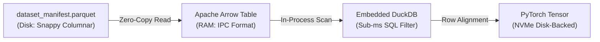

# Storage Tiers & Database Architecture

Handling millions of biodiversity observations requires balancing cloud storage costs, network latency, and memory utilization. TaxonVision-MLOps implements a **3-tier storage hierarchy** combined with zero-copy columnar in-memory buffers to eliminate data duplication and disk bottlenecks.

---

## 1. The 3-Tier Object Storage Hierarchy

| Storage Tier | Technology | Endpoint & Access | Primary Data Assets | Performance SLA |
| :--- | :--- | :--- | :--- | :--- |
| **Tier 1: In-Cluster Edge** | SeaweedFS S3 Daemon | `http://local-seaweedfs:8333` | Embedding tensors (`*.pt`), Parquet manifests | Read latency $< 2\text{ ms}$ on NVMe |
| **Tier 2: Cloud Sync** | DagsHub S3 Remote | `s3://dvc/` (`origin`) | Canonical checkpoints (`head.pt`, `model_int8.onnx`) | Content-addressed cloud storage |
| **Tier 3: Upstream Open Data** | AWS Open Data Registry | `s3://inaturalist-open-data/` | Raw citizen-science photographs (JPEG) | Direct HTTP streaming on demand |

### Storage Tier Isolation Rationale

* **Why SeaweedFS in Tier 1?** Large foundation model embedding splits (`train_embeddings.pt`, etc.) exceed several gigabytes. Caching them in our local bare-metal SeaweedFS instance allows training runs to pull tensors over loopback networking in milliseconds, avoiding cloud egress costs.
* **Why DagsHub in Tier 2?** Acts as our immutable cloud backup. When models pass Stage 7 verification, Jenkins automatically pushes the final quantized ONNX graph and locked DVC state to DagsHub.
* **Why AWS Open Data in Tier 3?** Prevents downloading terabytes of static imagery. Images stream directly into ephemeral memory buffers during feature extraction and are discarded immediately after embedding computation.

---

## 2. In-Memory Columnar Buffers: Parquet, Arrow & DuckDB

* **Apache Parquet (On-Disk):** Manifests are stored in Snappy-compressed columnar Parquet files. Predicate pushdown skips irrelevant row groups without reading raw bytes.
* **Apache Arrow (In-Memory):** Standardizes tabular memory layout. Python, C++, and PyTorch share underlying memory pointers without serialization overhead.
* **Embedded DuckDB (In-Process SQL):** Executes complex taxonomic joins and legal filter queries directly on Arrow tables in sub-millisecond time without spawning database server processes.

---

## 3. Exact 1:1 Row-to-Tensor Alignment Invariant

To eliminate memory bloat during training, the system enforces a strict mathematical invariant:

$$\text{Row } i \in \texttt{dataset\_manifest.parquet} \iff \text{Vector } \mathbf{z}_i \in \texttt{split\_embeddings.pt}$$

* PyTorch data loaders slice arbitrary mini-batches directly from memory-mapped disk tensors with zero RAM allocation overhead.
* If an observation is discarded during active learning triage or license revocation, the entire split is re-indexed deterministically during the next DVC extraction cycle.

---

## 4. Optuna SQLite State Persistence

Hyperparameter optimization (HPO) studies are persisted to a HostPath-backed Persistent Volume Claim mounted at `/var/lib/taxon-vision/optuna/optuna.db`. This SQLite database retains trial history, pruning thresholds, and objective values across ephemeral Jenkins runner pod teardowns.
