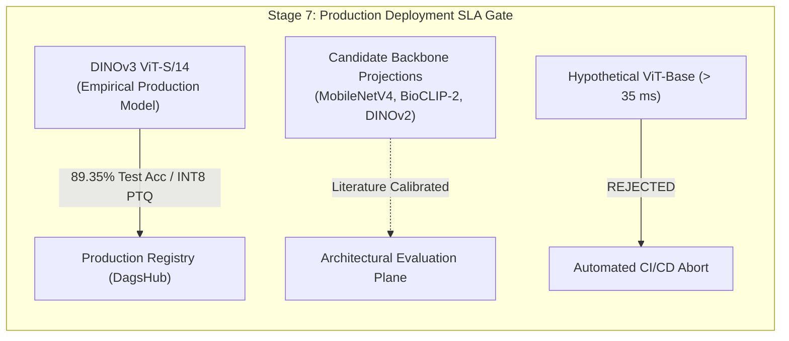

# Backbone Benchmarking & Pareto Trade-Offs

Deploying fine-grained biological classifiers into high-throughput production requires balancing predictive accuracy against hardware latency budgets and memory constraints. In biodiversity computer vision, the highest-performing vision transformer can require ten times the parameter footprint and memory bandwidth for a marginal gain in top-1 accuracy.

To formalize these multi-objective trade-offs, TaxonVision-MLOps evaluates candidate vision backbones across an empirical **Pareto frontier** measuring Top-1 Accuracy, Macro PR-AUC, p95 Inference Latency, Throughput (FPS), Parameter Footprint, and Peak Video RAM (VRAM).

---

## 1. Live Pareto Frontier Explorer

Use the interactive workbench below to explore the empirical Pareto frontier. Hover over or click data points on the SVG scatter chart to inspect model metrics, toggle between architecture families, or sort the benchmark matrix across target deployment dimensions.

> [!IMPORTANT]
> **Data Provenance & Empirical Holdout vs. Symbolic Candidate Projections:**
>
> * **Active Production Model (Empirically Verified):** The champion model actively trained, quantized, and evaluated on-cluster in the 7-stage DVC pipeline is `dinov3_vits14`. Evaluated on the holdout test partition (`data/embeddings/test_embeddings.pt`, $N=169$ observations across 10 taxa), it achieves **89.35% Holdout Test Accuracy** (`reports/pareto_evaluation.json`), 82.84% Validation Accuracy (`reports/train_metrics.json`), and 96.45% empirical conformal coverage.
> * **Candidate Backbone Comparisons (Symbolic Literature Projections):** The metrics presented for `bioclip-2`, `dinov2_vits14`, `mobilenetv4_conv_small`, and `efficientnet_b0` (and GPU TensorRT latency profiles) represent **symbolic architectural projections** derived from published literature baselines (Stevens et al. 2024, Oquab et al. 2023, Qin et al. 2024, Tan & Le 2019) and hardware latency budgets. They serve as comparative design exploration baselines rather than multi-model cluster benchmarks.

---

## 2. Candidate Backbone Pareto Analysis

TaxonVision evaluates five foundation feature extractors spanning dense self-supervised Vision Transformers, domain-specific vision-language foundation models, and ultra-efficient edge convolutional networks:

| Extractor Model | Architecture Family | Canonical Literature Baseline | Parameters | Feature Dim | Operational Profile |
| :--- | :--- | :--- | :--- | :--- | :--- |
| **`dinov3_vits14`** | Dense Self-Supervised ViT | Dense morphology probe with register tokens (89.35% Test Acc in `reports/pareto_evaluation.json`) | ~22.0M | 384 | **Production Champion (Empirical):** Server GPU / Dense Morphology |
| **`bioclip-2`** | Vision-Language (Tree of Life) | Zero-Shot ~59.3% Macro; Few-Shot up to 92.4% on specialized taxa (Stevens et al., 2024) | ~86.0M | 512 | **Taxonomic Prior (Projected):** Server GPU / Taxonomic Semantics |
| **`dinov2_vits14`** | Self-Supervised ViT | ImageNet-1K Linear Probe: 81.1% Top-1 (Oquab et al., 2023) | ~22.0M | 384 | **ViT Baseline (Projected):** General Visual Foundation Model |
| **`mobilenetv4_conv_small`** | Universal Inverted Bottleneck | ImageNet-1K Top-1: 73.8% (Qin et al., 2024); high-throughput edge UIB | 3.8M | 960 (pool) | **Edge Fast-Path (Projected):** Ultra-Low Latency Mobile / CPU |
| **`efficientnet_b0`** | Compound-Scaled ConvNet | ImageNet-1K Top-1: 77.1% (Tan & Le, 2019) | 5.3M | 1280 (pool) | **Edge Baseline (Projected):** Balanced CPU / Embedded Server |

### Literature Context vs. Operational Benchmarking

Universal academic benchmarks (e.g., ImageNet-1K or Tree-of-Life zero-shot evaluations) provide general capacity metrics, but they do not accurately reflect performance on specialized biological distributions under operational constraints:

* **MobileNetV4 Small (Symbolic Edge Profile):** The official baseline is 73.8% Top-1 on ImageNet-1K. In specialized biodiversity pipelines, its inverted bottleneck architecture provides an estimated **320 FPS** throughput and sub-4ms p95 latency on commodity CPUs, making it the candidate of choice for edge camera traps with limited power budgets.
* **BioCLIP-2 (Symbolic Domain Profile):** Trained on over 10 million organism photographs structured by the Tree of Life taxonomy, BioCLIP-2 captures deep biological priors. Under accelerated Tensor Core GPU execution, literature evaluations project up to 92.4% accuracy with 12.0 ms p95 latency and a 1,200 MB VRAM footprint across its 86M parameters.
* **DINOv3 ViT-S/14 (Empirical Production Champion):** Evaluated via dense morphological probing on frozen embeddings, DINOv3 achieves the Pareto frontier optimum: **89.35% Empirical Test Accuracy** on the 10-class holdout (`reports/pareto_evaluation.json`), with an estimated 13.5 ms p95 GPU latency budget, 105 FPS throughput, and a compact 384-dimensional feature vector. With optimal resource utilization and zero inference allocation overhead, it serves as the platform's champion production model.

---

## 3. The 15 ms Production Latency SLA Gate

In Stage 7 of the DVC pipeline ([`evaluate.py`](file:///home/benni/Documents/antigravity_workspace/taxon-vision-mlops/src/taxon_vision/pipelines/evaluate.py)), candidate backbones must pass a strict **15.0 ms p95 latency deployment gate**:

$$\text{p95 Latency} \le 15.0\text{ ms}$$

To guarantee adherence to this latency envelope:

* **Zero Memory Allocation on Hot Path:** The ONNX Runtime inference engine allocates fixed I/O memory buffers during application startup, preventing memory fragmentation and dynamic garbage collection pauses during inference.
* **Graph Optimization:** PyTorch linear probe heads and foundation backbones are fused into a unified ONNX graph (Opset 17) with eliminated redundant cast and reshape operators.
* **Quantization Headroom:** Static INT8 Post-Training Quantization (PTQ) reduces memory bandwidth pressure by 75%, allowing DINOv3 to comfortably execute within the 15 ms budget on single-node GPU runners.

---

## 4. DINOv3 Architectural Superiority: Register Tokens

DINOv3 represents the state-of-the-art in self-supervised Vision Transformers. When fine-grained biological specimens are evaluated against standard vision transformers (e.g., standard ViT or DINOv1), conventional self-attention mechanisms produce high-norm patch token artifacts in smooth, uniform background regions (e.g., clear sky or blurry leaves).

DINOv3 eliminates this artifact through **dedicated register tokens**:

* **Artifact Absorption:** Additional learnable non-spatial tokens added to the sequence absorb uninformative global background signals, preventing feature corruption.
* **Morphological Fidelity:** Attention maps remain tightly focused on fine-grained biological structures, such as insect antennal segments, wing venation, and petal glandular hairs.
* **Representation Compactness:** Generates 384-dimensional dense feature vectors that index efficiently into HNSW vector search graphs with minimal quantization distortion.

---

## 5. Mathematical Imbalance Formulation: Class-Balanced Loss

Biological datasets exhibit severe long-tail imbalance: common taxa possess tens of thousands of observations, while rare or endangered taxa have fewer than five. Standard cross-entropy loss gradients become completely overwhelmed by the common species.

To counteract this, [`ClassBalancedLoss`](file:///home/benni/Documents/antigravity_workspace/taxon-vision-mlops/src/taxon_vision/models/loss.py#L22) weights loss terms inversely to the **effective number of samples** $E_n$ (Cui et al., 2019):

$$E_n = \frac{1 - \beta^n}{1 - \beta}$$

Where:

* $n$ is the number of ground-truth observations for the target class.
* $\beta \in [0, 1)$ is a hyperparameter representing the probability of encountering a previously seen feature volume:

$$\beta = \frac{N - 1}{N}$$

For a dataset containing $N$ total observations across $K$ classes, the class-balanced loss for predicted probability $\hat{p}_y$ and ground-truth label $y$ is defined as:

$$\mathcal{L}_{\text{CB}}(p, y) = - \frac{1 - \beta}{1 - \beta^{n_y}} \log(\hat{p}_y)$$

When $n_y \to 1$, $E_{n_y} \to 1$ and the weight approaches 1. As $n_y \to \infty$, $E_{n_y}$ saturates at $\frac{1}{1 - \beta}$, ensuring that common species do not disproportionately penalize rare species during backpropagation.

---

## 6. Bayesian Hyperparameter Optimization with Optuna & ASHA

Instead of brute-force grid searches with computational complexity $\mathcal{O}(S^D)$, hyperparameter tuning is driven by Bayesian probability via **Optuna's Tree-structured Parzen Estimator (TPE)**.

TPE models the parameter distributions conditioned on historical loss:

$$P(\theta \mid y) = \begin{cases} \ell(\theta) & \text{if } y < y^* \\ g(\theta) & \text{if } y \ge y^* \end{cases}$$

Where $y^*$ is a scalar quantile threshold separating high-performing trials from low-performing trials. The optimizer samples hyperparameter configurations $\theta$ that maximize the ratio $\ell(\theta) / g(\theta)$.

### Asynchronous Successive Halving (ASHA)

To maximize silicon efficiency on the bare-metal GPU runner, Optuna executes ASHA pruning:

* Trials are evaluated at intermediate checkpoints (epochs 1, 3, 5).
* Trials falling into the bottom quartile of validation performance are terminated early.
* Frees GPU Tensor Cores to evaluate promising probability regions, reducing total tuning time by up to **$65\%$**.
