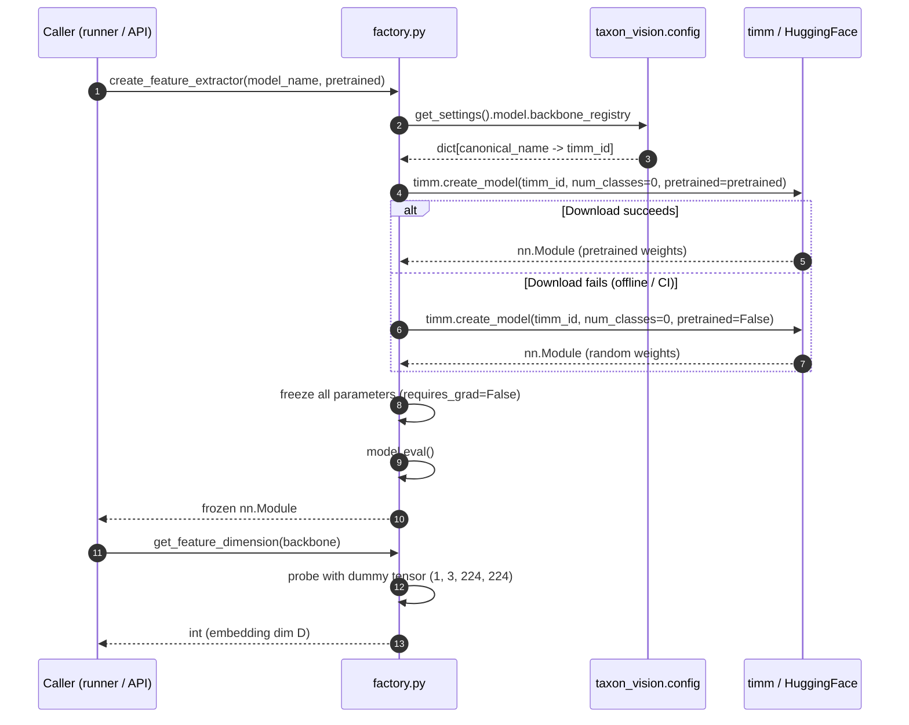
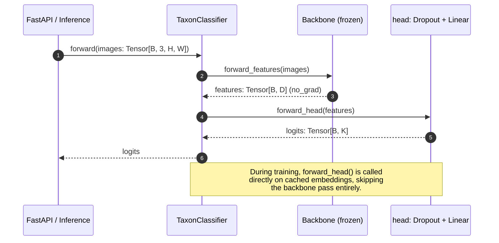
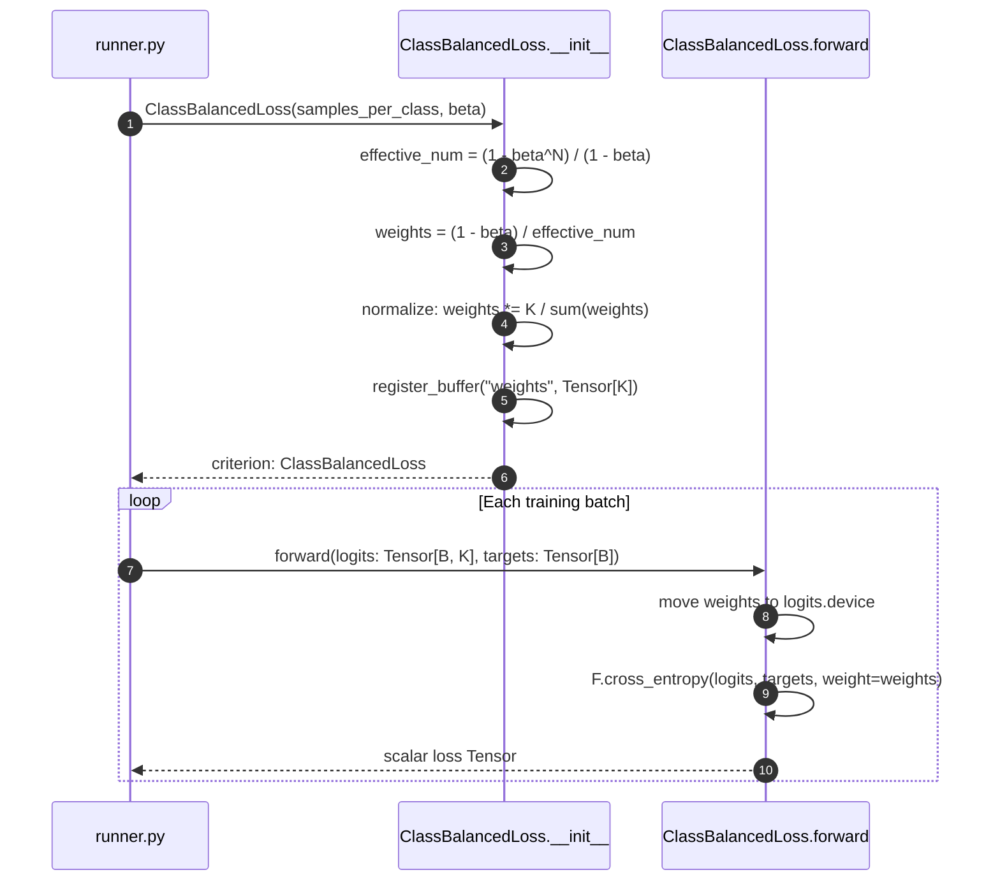

# Vision Model Architecture

TaxonVision decouples feature representation learning from taxonomic classification by
combining a **frozen Vision Foundation Model (VFM) backbone** with a lightweight
**trainable linear head**. This design eliminates catastrophic forgetting while reducing
GPU training time for the classification stage to seconds rather than hours.

## Module Overview

| Module | Class / Function | Role |
| --- | --- | --- |
| `factory.py` | `create_feature_extractor()` | Instantiates frozen timm backbone |
| `factory.py` | `get_feature_dimension()` | Resolves embedding dimensionality |
| `factory.py` | `extract_features()` | Batched image to embedding projection |
| `head.py` | `TaxonClassifier` | End-to-end backbone + trainable head |
| `head.py` | `forward_features()` | Frozen backbone pass - images to embeddings |
| `head.py` | `forward_head()` | Head-only pass - embeddings to logits |
| `loss.py` | `ClassBalancedLoss` | Effective-number-of-samples weighted cross-entropy |

## Backbone Factory

The `factory.py` module provides a centralized registry-driven approach to instantiating
all supported backbones. The canonical model names (e.g. `bioclip-2`, `dinov3`,
`vit_base_patch14_reg4_dinov2`, `mobilenetv4_conv_small`) are resolved to their corresponding `timm` identifiers from the
application configuration file, eliminating hardcoded magic strings throughout the codebase.

All backbones are loaded with:

* `num_classes=0` - removes the original classification head, returning dense pooled features.
* `requires_grad=False` on every parameter - ensures backbone weights remain frozen during head training.
* `model.eval()` mode set immediately to disable Dropout and BatchNorm stochasticity.



## TaxonClassifier

`TaxonClassifier` is the top-level end-to-end model that holds both the frozen backbone
and the trainable head as two separate sub-modules:

```text
TaxonClassifier
├── backbone: nn.Module     # frozen, requires_grad=False
└── head: nn.Sequential
    ├── nn.Dropout(p)       # regularization
    └── nn.Linear(D -> K)   # trainable weights only
```

It exposes two forward paths to support the **embedding-caching optimization**:

* `forward_features(images)` - runs the frozen backbone and returns `(batch, D)` feature embeddings. Wrapped in `torch.no_grad()`.
* `forward_head(features)` - projects pre-computed embeddings directly to `(batch, K)` logits, bypassing the backbone entirely. Used during all training and hyperparameter tuning loops.



## Class-Balanced Loss & Effective Sample Weighting

Biological observations adhere strictly to an extreme **Zipfian power-law distribution**: common synanthropic taxa accumulate thousands of recorded observations, whilst rare or endangered species possess minimal verifiable specimens. Optimising standard unweighted Cross-Entropy loss over such skewed distributions causes minority class representations to collapse into the dominant feature subspace. Conversely, naive inverse-frequency weighting ($W_i \propto 1 / N_i$) destabilises optimization by generating explosive gradient variance on singletons and noisy outliers.

To resolve this trade-off, `ClassBalancedLoss` implements the *effective number of samples* formulation introduced by Cui et al. (CVPR 2019), modelling diminishing marginal information as sample volume expands in continuous feature space:

$$E_{N_i} = \frac{1 - \beta^{N_i}}{1 - \beta}, \quad W_i = \frac{1 - \beta}{1 - \beta^{N_i} + \epsilon}, \quad \sum_{i=1}^K W_i = K$$

$$\mathcal{L}_{\text{CB}}(z, y) = - \frac{W_y}{\sum_{c} W_c} \log \left( \frac{\exp(z_y)}{\sum_{j} \exp(z_j)} \right)$$

where hyperparameter $\beta \in [0.0, 1.0)$ parameterises feature space volume overlap.

### Mathematical Dynamics: The Saturation Horizon and the Role of $\beta$

A frequent intuition error is assuming that $\beta = 0.9999$ represents "weak" or "negligible" balancing because $0.9999 \approx 1.0$. The mathematical reality is the exact inverse:

* **Lower Boundary ($\beta \to 0$):**
  $$E_{N_i} = \lim_{\beta \to 0} \frac{1 - \beta^{N_i}}{1 - \beta} = 1.0 \implies W_i = 1.0$$
  All classes receive identical weights regardless of specimen frequency. This collapses to standard unweighted Cross-Entropy (zero balancing).
* **Upper Boundary ($\beta \to 1^-$):**
  Applying L'Hôpital's Rule:
  $$\lim_{\beta \to 1^-} \frac{1 - \beta^{N_i}}{1 - \beta} = \lim_{\beta \to 1^-} \frac{-N_i \beta^{N_i - 1}}{-1} = N_i \implies W_i \propto \frac{1}{N_i}$$
  Weights converge to pure inverse class frequency weighting.

The effective number of samples is bounded by an asymptotic saturation ceiling:

$$E_{\text{max}} = \lim_{N_i \to \infty} E_{N_i} = \frac{1}{1 - \beta}$$

| $\beta$ Parameter | Saturation Horizon $E_{\text{max}}$ | Critical Sample Count $N_{\text{crit}}$ | Practical Effect on Ecological Datasets ($N_i \ge 100$) |
| :--- | :--- | :--- | :--- |
| $\beta = 0.0$ | $E = 1$ | $N = 1$ | **Zero balancing**; standard unweighted Cross-Entropy loss. |
| $\beta = 0.90$ | $E_{\text{max}} = 10$ | $N \approx 25$ | **Premature saturation**; all classes with $N_i > 25$ yield $E \approx 10$ and uniform weights $1.0000$. |
| $\beta = 0.99$ | $E_{\text{max}} = 100$ | $N \approx 200$ | Moderately damped weighting; saturates for common classes. |
| $\beta = 0.999$ | $E_{\text{max}} = 1,000$ | $N \approx 2,000$ | Active reweighting across standard photographic collections. |
| $\beta = 0.9999$ | $E_{\text{max}} = 10,000$ | $N \approx 20,000$ | **Full dynamic reweighting** approaching $1/N$ whilst suppressing singleton divergence. |

If $\beta$ were configured to a smaller value such as $0.90$, $\beta^{N_i} = 0.90^{100} \approx 2.6 \times 10^{-5} \approx 0$, yielding $E_{N_i} = 10$ for every class and entirely neutralising the balancing effect. Consequently, $\beta$ must reside within the high-sensitivity range $[0.99, 0.9999]$ for datasets possessing tens to thousands of observations per taxon.

### Empirical Weight Distribution on Active Training Tensors

In the active training split (`data/embeddings/train_embeddings.pt`), the 10 catalogued taxa possess the following post-licence sample frequencies:
$$N = [114, 122, 111, 116, 119, 118, 129, 111, 111, 102]$$

Evaluating normalized class weights across candidate values of $\beta$ illustrates the transition:

| Candidate $\beta$ | Minimum Weight $W_{\min}$ | Maximum Weight $W_{\max}$ | Ratio ($W_{\max} / W_{\min}$) | Functional Regime |
| :--- | :--- | :--- | :--- | :--- |
| $\beta = 0.0$ | $1.0000$ | $1.0000$ | $1.0000$ | Uniform Cross-Entropy (no balancing) |
| $\beta = 0.90$ | $1.0000$ | $1.0000$ | $1.0000$ | Saturated ($E_{N_i} \approx 10$ for all classes) |
| $\beta = 0.99$ | $0.9424$ | $1.0677$ | $1.1330$ | Mild balancing |
| **$\beta = 0.9959$ (Optuna Best)** | **$0.9163$** | **$1.0968$** | **$1.1969$** | **Optimal validation balance ($+19.7\%$ minority boost)** |
| $\beta = 0.999$ | $0.8967$ | $1.1191$ | $1.2481$ | Strong balancing |
| $\beta = 0.9999$ (Params Default) | $0.8911$ | $1.1255$ | $1.2630$ | Near-inverse frequency ($+26.3\%$ minority boost) |
| Pure Inverse Frequency ($1/N$) | $0.8905$ | $1.1262$ | $1.2647$ | Unconstrained reciprocal frequency |

### Bayesian Optimization & Hyperparameter Hierarchy

The origin and resolution of $\beta$ across the TaxonVision pipeline follows a deterministic three-tier hierarchy:

* **Search Space Definition:** In `src/taxon_vision/models/training/tuning.py`, Optuna samples $\beta$ uniformly within the active theoretical window: `trial.suggest_float("cb_beta", 0.99, 0.9999)`.
* **Optuna Empirical Output:** Evaluating validation Macro PR-AUC over 30 Bayesian trials with ASHA pruning converged to $\beta_{\text{optuna}} = 0.9959267189935507 \approx 0.9959$. This checkpoint parameter is persisted to `models/checkpoints/best_params.yaml`.
* **Execution Precedence in `runner.py`:** When Stage 5 (`pipelines.train`) executes, the runner resolves hyperparameters hierarchically:
    * *Tier 1 (Live Study):* Uses active Optuna trial parameters if `--tune` is passed.
    * *Tier 2 (Persisted Best Params):* Loads $\beta \approx 0.9959$ from `best_params.yaml` (the active production path logged in `reports/train_metrics.json`).
    * *Tier 3 (Configuration Baseline):* Falls back to `params.yaml:training.cb_beta = 0.9999` if no tuning artifacts exist.



## Multi-Head Hierarchical Taxonomic Loss

Rather than relying solely on a single-head flat classification over terminal leaf nodes (e.g., thousands of species), the system can optionally project embeddings into a multi-head taxonomy (Class, Order, Family, Genus, Species). A hierarchical loss formulation ensures that coarse-grained taxonomic errors (e.g., misclassifying an insect as a bird) are penalized far more heavily than fine-grained errors (e.g., confusing two congeneric sparrow species).

## API Reference

::: taxon_vision.models.factory
::: taxon_vision.models.head
::: taxon_vision.models.loss
