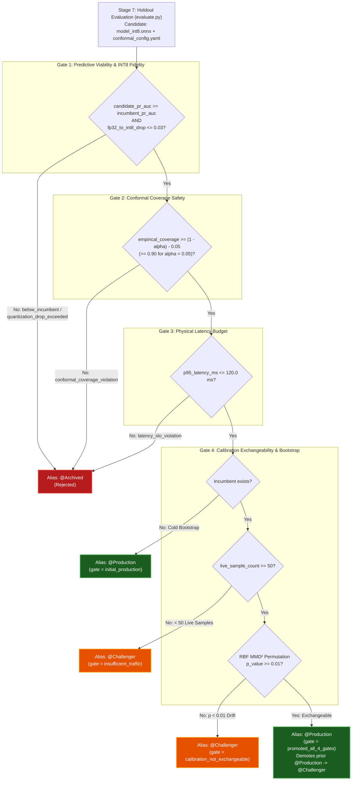
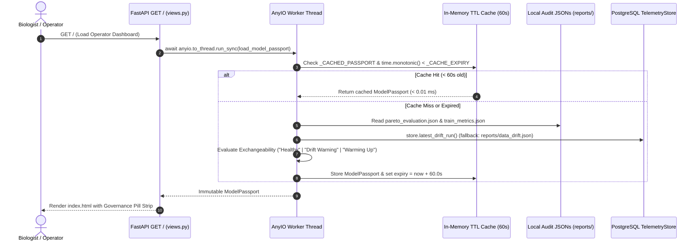

# Four-Gate Model Promotion & Active Model Passport

## 1. Conceptual Motivation: Why Single-Metric Promotion Is Unsafe in Production MLOps

In introductory machine learning courses, deciding whether a newly trained candidate model should replace the active production model is reduced to a single inequality: *"Does the candidate achieve a higher validation accuracy (or F1 / PR-AUC) than the incumbent?"*

In an industrial computer vision system operating under strict latency budgets and mathematical uncertainty guarantees, promoting a model immediately after training based solely on FP32 validation accuracy introduces four severe operational hazards:

1. **Post-Training Quantisation Collapse:** A classification head that achieves 99.6% Macro PR-AUC in 32-bit floating point (FP32) during Stage 4 (`train`) may suffer severe logit distortion when fused with the vision backbone and quantised to 8-bit integers (INT8) in Stage 5 (`export_onnx`). If promotion occurs at Stage 4, a quantisation-damaged model is already tagged `@Production` before INT8 export even runs.
2. **Conformal Coverage Violations on Unseen Holdout Data:** Split Conformal Prediction calibrates the non-conformity threshold $\hat{q}_\alpha$ on the calibration split (`cal_embeddings.pt`) in Stage 6 (`calibrate`). Until $\hat{q}_\alpha$ is evaluated against the untouched holdout test split (`test_embeddings.pt`) in Stage 7 (`eval`), there is no empirical verification that the quantised model actually satisfies $P(Y \in C(X)) \ge 1 - \alpha$.
3. **Physical Latency Regressions:** Switching to a heavier backbone or altering graph operators can push 95th-percentile inference latency beyond the physical CPU/GPU service-level objective (SLO), causing HTTP request queueing and timeout cascades in FastAPI.
4. **Non-Exchangeable Calibration Under Live Covariate Shift:** Split Conformal Prediction's marginal coverage guarantee relies on the mathematical precondition of **exchangeability** between the calibration split and live production traffic. If recent field observations stored in the PostgreSQL `telemetry` database have drifted significantly away from `cal_embeddings.pt` (or if the system has not yet accumulated enough live traffic to verify exchangeability), promoting a candidate directly to `@Production` without human inspection violates statistical safety.

To eliminate these failure modes, TaxonVision-MLOps relocates authoritative model promotion from Stage 4 (`train`) to Stage 7 (`evaluate`), enforcing the **Four-Gate Model Promotion Architecture** in [`src/taxon_vision/models/training/promotion.py`](file:///home/benni/Documents/antigravity_workspace/taxon-vision-mlops/src/taxon_vision/models/training/promotion.py).

---

## 2. Mathematical & Operational Specification of the Four Gates

During Stage 7 (`evaluate`), [`evaluate_promotion_gates(criteria: PromotionCriteria, incumbent_pr_auc: float | None)`](file:///home/benni/Documents/antigravity_workspace/taxon-vision-mlops/src/taxon_vision/models/training/promotion.py#L395-L500) evaluates the candidate sequentially across four gates configured via `settings.promotion` ([`PromotionConfig`](file:///home/benni/Documents/antigravity_workspace/taxon-vision-mlops/src/taxon_vision/config/schemas.py#L324-L346)):

| Gate | Evaluated Condition | Default Threshold (`config/default_config.yaml`) | Failure Verdict & Gate Tag | Mathematical & Systems Rationale |
| :--- | :--- | :--- | :--- | :--- |
| **Gate 1a: Incumbent Supremacy** | $\text{PR-AUC}_{\text{cand}} \ge \text{PR-AUC}_{\text{incumbent}}$ | Dynamic (queried from `@Production` & `@Challenger` runs) | `@Archived` (`gate="below_incumbent"`) | Guarantees monotonic non-degradation of macro precision-recall across imbalanced biological classes. |
| **Gate 1b: INT8 Quantisation Fidelity** | $\text{Acc}_{\text{FP32}} - \text{Acc}_{\text{INT8}} \le \delta_{\text{quant}}$ | `quantization_drop_tol: 0.03` ($3.0\%$) | `@Archived` (`gate="quantization_drop_exceeded"`) | Prevents promoting models whose activation distributions clip severely under INT8 dynamic/static quantisation. |
| **Gate 2: Conformal Coverage Guarantee** | $\hat{c}_{\text{test}} \ge (1 - \alpha) - \epsilon_{\text{cov}}$ | `coverage_tolerance: 0.05` (floor $= 0.90$ for $1-\alpha = 0.95$) | `@Archived` (`gate="conformal_coverage_violation"`) | Accounts for finite-sample binomial variance on the holdout test split ($N_{\text{test}}=169$, where $\pm 0.05$ corresponds to $\approx 2.5\sigma$ binomial sampling tolerance) while rejecting miscalibrated sets. |
| **Gate 3: Physical Latency Budget** | $L_{p95} \le \tau_{\text{latency}}$ | `latency_slo_ms: 120.0` ms | `@Archived` (`gate="latency_slo_violation"`) | Enforces an upper bound on single-stream ONNX Runtime execution across both bare-metal P-cores and virtualised CI runners. |
| **Gate 4a: Cold-Start Bootstrap** | $\text{PR-AUC}_{\text{incumbent}} \text{ is None}$ | First registered model | `@Production` (`gate="initial_production"`) | Allows an unpopulated registry to bootstrap its initial `@Production` champion once Gates 1-3 pass. |
| **Gate 4b: Live Telemetry Sample Volume** | $N_{\text{live}} \ge N_{\min}$ | `min_telemetry_samples: 50` | `@Challenger` (`gate="insufficient_traffic"`) | Prevents premature promotion when an incumbent already exists but the PostgreSQL `predictions` table holds fewer than 50 recent observations. |
| **Gate 4c: Calibration Exchangeability** | $p_{\text{MMD}^2}(\mathbf{Z}_{\text{cal}}, \mathbf{Z}_{\text{live}}) \ge \alpha_{\text{drift}}$ | `drift_alpha: 0.01` ($B=200$ permutations) | `@Challenger` (`gate="calibration_not_exchangeable"`) | Verifies that the calibration tensor $\mathbf{Z}_{\text{cal}}$ is statistically exchangeable with recent live production embeddings $\mathbf{Z}_{\text{live}}$ in the RBF Reproducing Kernel Hilbert Space before granting `@Production`. |

---

## 3. Registry Alias Lifecycle & Provenance Tagging

When [`promote_candidate_model(target: ModelPromotionTarget, criteria: PromotionCriteria)`](file:///home/benni/Documents/antigravity_workspace/taxon-vision-mlops/src/taxon_vision/models/training/promotion.py#L552-L636) completes evaluation, it executes two atomic governance actions in the MLflow Model Registry (applied to both `taxon_vision_classifier` and `taxon_vision_onnx`):

### 3.1 Champion/Challenger Alias Rotation (`_apply_promotion_aliases`)

* **Promotion to `@Production`:** Before assigning `@Production` to the new candidate version, `_apply_promotion_aliases()` queries the existing `@Production` version and automatically demotes it to `@Challenger`. This guarantees an instant one-step rollback target (`@Challenger`) if an operator ever needs to revert a deployment.
* **Staging as `@Challenger`:** When a candidate passes Gates 1-3 (it is accurate, INT8-faithful, well-calibrated on holdout data, and fast) but Gate 4 detects insufficient live traffic ($N_{\text{live}} < 50$) or active covariate shift ($p_{\text{MMD}^2} < 0.01$), the candidate is staged as `@Challenger` rather than discarded as `@Archived`.
* **Rejection as `@Archived`:** Any violation of Gate 1, Gate 2, or Gate 3 assigns `@Archived`, preventing deployment.

### 3.2 Immutable Version Provenance Tags

Every registered model version is stamped with cryptographic and statistical provenance tags via `client.set_model_version_tag()`:

* `git_sha`: Exact Git commit SHA-1 hash (`git rev-parse HEAD`).
* `dvc_dataset_hash`: Content MD5 digest of `dataset_manifest.parquet` parsed directly from `dvc.lock`.
* `extractor`: Vision foundation backbone identifier (`dinov3`, `bioclip-2`, etc.).
* `val_pr_auc`: Candidate Macro PR-AUC score (`0.9965`).
* `empirical_coverage`: Measured holdout conformal coverage (`0.9645`).
* `p95_latency_ms`: Measured 95th-percentile INT8 ONNX latency in milliseconds.
* `exchangeability_mmd2_p_value`: Permutation test $p$-value comparing `cal_embeddings.pt` against live telemetry.
* `gate` & `promotion_verdict`: Exact decision path (e.g. `promoted_all_4_gates` / `Production`).

---

## 4. Operator Visibility: The Active Model Passport

A rigorous governance pipeline is only useful if human operators and field biologists can see the active model's epistemic trustworthiness directly at the point of decision without logging into external MLflow or Grafana consoles.

To surface this metadata with zero impact on inference latency, [`src/taxon_vision/service/passport.py`](file:///home/benni/Documents/antigravity_workspace/taxon-vision-mlops/src/taxon_vision/service/passport.py) compiles an immutable [`ModelPassport`](file:///home/benni/Documents/antigravity_workspace/taxon-vision-mlops/src/taxon_vision/service/passport.py#L41-L73) dataclass rendered as a frosted-glass governance pill strip at the top of the operator dashboard (`GET /`).

### 4.1 Non-Blocking Compilation & 60-Second Monotonic Cache

* **Event-Loop Protection (Rule 08):** In [`src/taxon_vision/service/routes/views.py`](file:///home/benni/Documents/antigravity_workspace/taxon-vision-mlops/src/taxon_vision/service/routes/views.py), `load_model_passport()` is invoked via `await anyio.to_thread.run_sync(load_model_passport)` so that JSON file reads and PostgreSQL `drift_runs` queries never block the primary `asyncio` event loop.
* **Bounded 60-Second TTL (`_CACHE_TTL_SECONDS = 60.0`):** `load_model_passport()` caches the compiled `ModelPassport` in memory against `time.monotonic()`. Subsequent dashboard refreshes within 60 seconds return the cached frozen dataclass instantaneously without touching disk or PostgreSQL.

### 4.2 Exchangeability Health Badge States (`_resolve_drift_state`)

The right-hand badge of the Active Model Passport translates the latest two-tier drift evaluation (`store.latest_drift_run()` with graceful offline fallback to `reports/data_drift.json`) into three operator-actionable states:

* **`Healthy` (Emerald Badge):** `window_size >= 50`, `drift_detected == False`, and `mmd2_p_value >= 0.01`. The live serving distribution is statistically exchangeable with the calibration split; conformal coverage guarantees ($1 - \alpha = 95\%$) hold rigorously.
* **`Drift Warning` (Amber/Red Badge):** Either `drift_detected == True` ($W_1 > \tau_{W_1}$) or `mmd2_p_value < 0.01`. Covariate shift has breached the calibrated null distribution; operators should expect larger conformal set sizes and increased human triage referrals while automated retraining executes.
* **`Warming Up` (Slate Badge):** Fewer than 50 live observations have been recorded in the current telemetry window (`window_size < 50`). Statistical hypothesis testing is deferred until the minimum sample size ($N_{\min} = 50$) is reached.
