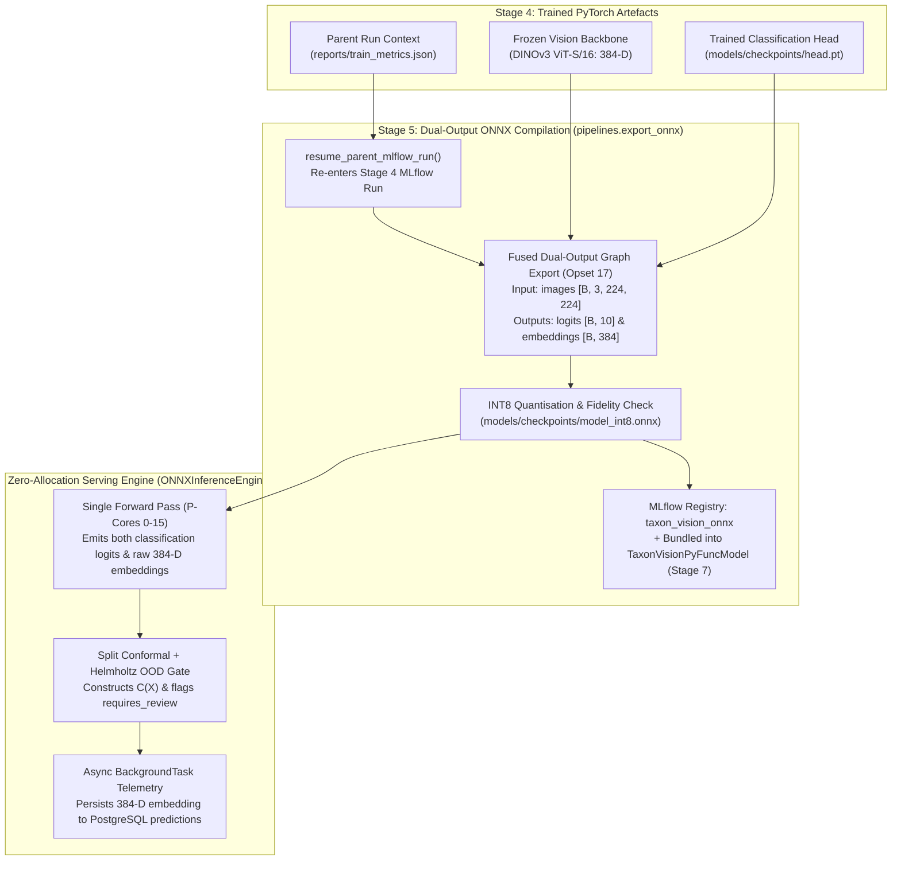

# ONNX Runtime Optimisation & Latency Invariants

Operating an interactive biodiversity identification and camera-trap triage platform requires strict adherence to deterministic latency Service Level Objectives (SLOs). Whilst unoptimised PyTorch forward passes on general-purpose CPUs often exceed 100 to 200 ms due to Python interpreter dispatch overhead and un-fused FP32 memory reads, TaxonVision-MLOps enforces a strict latency hierarchy (Rule 02):

* **GPU Execution Budget (FP16 CUDA EP):** End-to-end inference latency must not exceed **$10.0\,\text{ms}$ p95** on the NVIDIA GeForce RTX 5070 Ti (16 GB GDDR7 VRAM).
* **CPU Execution Budget (INT8 Quantised):** End-to-end inference latency (preprocessing + ONNX Runtime forward pass) must not exceed **$15.0\,\text{ms}$ p95** on the Intel Core i7-14700K Performance cores (`taskset -c 0-15`).
* **Microservice HTTP SLO Ceiling:** Complete FastAPI `/api/v1/predict` round-trip latency (including image decoding, ONNX forward pass, Split Conformal set construction, and JSON serialisation) must remain **$< 25.0\,\text{ms}$ p95** on production nodes (with a pragmatic $120.0\,\text{ms}$ ceiling in Stage 7 Gate 3 to accommodate shared CI runners).

This latency profile is achieved through **dual-output ONNX graph compilation**, **INT8 Post-Training Quantisation (PTQ)**, **zero-allocation contiguous buffer reuse**, and **forward-hooked Class Activation Mapping (CAM)**.

---

## 1. Dual-Output ONNX Graph Standard & MLflow Continuity

### 1.1 Why a Dual-Output Graph Is Mandatory

Online covariate drift detection (Tier 1 Wasserstein-1 on vector norms and Tier 2 multivariate RBF MMD²) requires capturing the 384-dimensional penultimate feature embedding $\mathbf{z} \in \mathbb{R}^{384}$ for every production inference request, whilst the user-facing response requires the taxonomic classification logits $\mathbf{f}(\mathbf{x}) \in \mathbb{R}^{K}$.

Running two separate models - one for feature extraction and another for classification - would double vision backbone compute and violate the $15\,\text{ms}$ CPU latency budget. Therefore, [`src/taxon_vision/inference/onnx_exporter.py`](file:///home/benni/Documents/antigravity_workspace/taxon-vision-mlops/src/taxon_vision/inference/onnx_exporter.py) wraps the frozen backbone and trained classification head into a single unified graph (`opset_version = 17`) with two named output tensors:

1. **`logits` (`float32[batch, num_classes]`):** Unnormalised class scores fed into temperature-scaled softmax, Helmholtz free energy OOD gating, and Split Conformal set generation.
2. **`embeddings` (`float32[batch, embedding_dim]`):** Raw pre-normalised penultimate feature vectors returned simultaneously by [`ONNXInferenceEngine.predict_outputs()`](file:///home/benni/Documents/antigravity_workspace/taxon-vision-mlops/src/taxon_vision/inference/onnx_engine.py) and dispatched asynchronously to the PostgreSQL `predictions` table via FastAPI `BackgroundTasks`.

### 1.2 Cross-Stage MLflow Resumption & PyFunc Packaging

When Stage 5 ([`src/taxon_vision/pipelines/export_onnx.py`](file:///home/benni/Documents/antigravity_workspace/taxon-vision-mlops/src/taxon_vision/pipelines/export_onnx.py)) executes under `dvc repro`, it invokes `resume_parent_mlflow_run("reports/train_metrics.json")` to re-enter the parent MLflow run created by Stage 4 (`train`). It logs the quantised graph to the `taxon_vision_onnx` registry with an explicit `ModelSignature` (`input_images: float32[-1, 3, 224, 224] -> taxonomic_logits: float32[-1, 10]`). Subsequently, Stage 7 (`evaluate.py`) packages `model_int8.onnx` alongside `config/conformal_config.yaml` and `config/taxa_catalog.yaml` into the self-contained [`TaxonVisionPyFuncModel`](file:///home/benni/Documents/antigravity_workspace/taxon-vision-mlops/src/taxon_vision/inference/mlflow_model.py).

---

## 2. Static vs. Dynamic INT8 Quantisation Mathematics

By default, PyTorch stores weight matrices in 32-bit floating-point (FP32) precision. During production serving, FP32 matrix multiplications saturate memory bandwidth and L2/L3 CPU caches.

To optimise throughput, [`src/taxon_vision/inference/quantizer.py`](file:///home/benni/Documents/antigravity_workspace/taxon-vision-mlops/src/taxon_vision/inference/quantizer.py) maps continuous FP32 weights and activations onto a discrete 8-bit integer grid:

$$q = \operatorname{round}\left(\frac{x}{S}\right) + Z$$

Where:

* $q \in [-128, 127]$ (or $[0, 255]$) is the 8-bit quantised integer.
* $x \in \mathbb{R}$ is the continuous FP32 weight or activation value.
* $S = \frac{x_{\max} - x_{\min}}{255} \in \mathbb{R}^+$ is the continuous scale factor.
* $Z \in \mathbb{Z}$ is the integer zero-point offset aligning real $0.0$ with an exact integer grid value.

### Static vs. Dynamic PTQ Modes

* **Dynamic INT8 Quantisation (`--quantize-mode dynamic`):** Pre-quantises static weight matrices offline to INT8 while computing activation scale factors $S$ and zero-points $Z$ dynamically per forward pass. This is the default mode for Vision Transformer (`dinov3`, `bioclip-2`) linear projections (`MatMul` / `Gemm` nodes), where activation ranges vary across token positions.
* **Static INT8 PTQ (`--quantize-mode static`):** Passes a representative calibration image set (`calibration_samples = 128`) through convolutional backbones (`mobilenetv4_conv_small`) offline via [`calibration.py`](file:///home/benni/Documents/antigravity_workspace/taxon-vision-mlops/src/taxon_vision/inference/calibration.py) to precompute static $S$ and $Z$ constants for every spatial convolution layer.
* **Standalone Head Export (`--export-head`):** Optionally exports the standalone linear head (`head.onnx` / `head_int8.onnx`) for sub-millisecond ($< 0.2\,\text{ms}$) evaluation directly over pre-extracted embedding tensors (`ONNXInferenceEngine.project_embeddings()`).

### Silicon Acceleration & Gate 1 Fidelity Verification

Quantising to INT8 yields three hardware-level advantages:

1. **4:1 Memory Footprint Compression:** Reduces model checkpoint size by approximately $75\%$, keeping weight tensors resident in the Intel Core i7-14700K's L2/L3 cache.
2. **AVX-512 VNNI / Tensor Core Vectorisation:** Packs four 8-bit integer multiply-accumulate operations into a single SIMD instruction word alongside ONNX Runtime operator fusion (`Conv + BatchNorm + ReLU`).
3. **Gate 1 Quantisation Drop Guardrail:** Stage 7 (`evaluate.py`) compares the FP32 validation baseline against the INT8 ONNX model on the holdout split. If the accuracy drop exceeds `promotion.quantization_drop_tol` ($3.0\%$), Gate 1 (`quantization_drop_exceeded`) automatically rejects the model (`@Archived`).

---

## 3. Zero-Allocation Hot Inference Path

Dynamic heap allocations inside high-frequency inference loops trigger Python garbage collection pauses and inflate p95 tail latency. [`ONNXInferenceEngine`](file:///home/benni/Documents/antigravity_workspace/taxon-vision-mlops/src/taxon_vision/inference/onnx_engine.py) enforces Rule 02 (Zero-Allocation Inference):

* **Contiguous C-Order Buffers:** Input batches are validated and coerced via `np.ascontiguousarray(..., dtype=np.float32)` before crossing the C++ ONNX Runtime C-API boundary, eliminating internal array copying.
* **Zero Python Object Boxing on the Hot Path:** `predict_outputs()` returns a lightweight typed structure holding direct NumPy array views (`logits` and `embeddings`) rather than boxing individual floating-point scalars into Python dictionaries per class.
* **OS Thread Affinity Pinning:** On the bare-metal host (`hive-mind`), ONNX Runtime intra-op execution threads are pinned to the 16 physical Performance-core threads (`taskset -c 0-15`), isolating matrix math from asynchronous E-core telemetry and database I/O (`16-27`).

---

## 4. Forward-Hooked Class Activation Mapping (CAM)

Visual explainability is essential for biological verification, allowing taxonomists to inspect whether the model focused on the organism's morphology (wing venation, beak curvature, petal arrangement) or spurious background foliage. Standard Grad-CAM requires computing backward spatial gradients:

$$\alpha_k^c = \frac{1}{Z} \sum_{i} \sum_{j} \frac{\partial Y^c}{\partial A_{i, j}^k}$$

Executing backward gradient propagation through a forward-only INT8 ONNX graph is impossible and would violate latency and memory envelopes. Instead, [`ForwardHookCAM`](file:///home/benni/Documents/antigravity_workspace/taxon-vision-mlops/src/taxon_vision/inference/cam.py) computes a forward-only linear projection over spatial patch tokens or penultimate convolutional feature maps $A^k$:

$$L_{\text{CAM}}^c = \operatorname{ReLU}\left(\sum_{k} w_k^c A^k\right)$$

Where $w_k^c$ is the static classification head weight connecting feature channel $k$ to target taxon $c$.

### Operational Serving & Distributed Cache Integration

* **Zero-Allocation Fast Path (`explain=false`):** Automated camera-trap requests to `POST /api/v1/predict` default to `explain=false`, bypassing CAM rendering entirely to maintain the $< 15.0\,\text{ms}$ CPU / $< 25.0\,\text{ms}$ HTTP p95 latency ceiling.
* **On-Demand HTMX Inspection (`POST /api/v1/explain`):** When a field biologist uploads a specimen in the web dashboard (`/ui/predict-htmx`), the raw image bytes are cached in the in-cluster Redis ephemeral store (`taxon:img:{sha256}`, 15-minute rolling TTL). Clicking **Explain CAM** dispatches an asynchronous HTMX request that retrieves the image from Redis, computes the forward-hooked Viridis heatmap inside an AnyIO worker thread (`await anyio.to_thread.run_sync(...)`), and swaps the rendered attribution overlay into the DOM without blocking the event loop.
