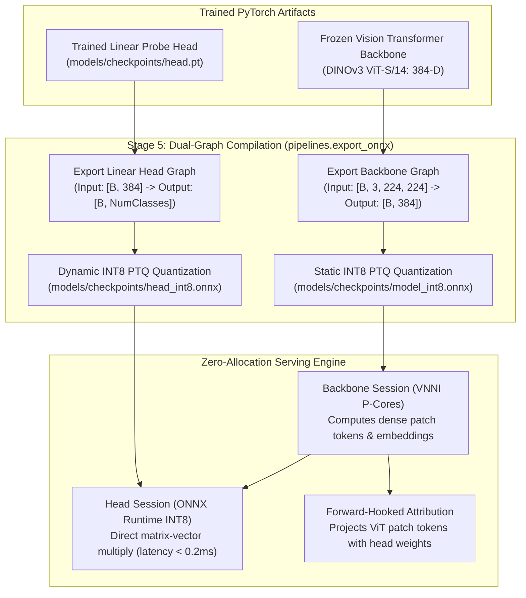

# ONNX Runtime Optimization & Latency Invariants

Operating an interactive biodiversity identification platform requires strict adherence to latency Service Level Agreements (SLAs). While unoptimized PyTorch forward passes on general-purpose CPUs often exceed 100 to 200 ms depending on batch size and architecture, TaxonVision enforces a dual-target latency SLA:

* **Bare-Metal GPU / INT8 Fast-Path Target:** Target p95 latency strictly **$\le 15.0\text{ ms}$** under quantized ONNX Runtime execution on bare-metal production nodes (`params.yaml`), verified for single-stream sequential execution (multi-client concurrent ingress stress-testing scheduled for Phase 2.5).
* **General-Purpose CPU / CI Testbed Ceiling:** Hard ceiling p95 latency **$\le 25.0\text{ ms}$** enforced by project mandate `Rule 02` (`02-inference-latency-invariants.md`) and automated CI regression gates.

This latency bound is achieved through Open Neural Network Exchange (ONNX) dual-graph compilation, static and dynamic Post-Training Quantization (PTQ), zero-allocation hot paths, and forward-hooked interpretability.

---

## 1. Static vs. Dynamic INT8 Quantization Mathematics

By default, PyTorch constructs weight matrices using 32-bit floating-point (FP32) precision. During production serving, FP32 operations saturate memory bandwidth and inflate cache requirements.

To optimize throughput, the [`quantizer.py`](file:///home/benni/Documents/antigravity_workspace/taxon-vision-mlops/src/taxon_vision/inference/quantizer.py) module maps continuous 32-bit floating-point weights onto a discrete 8-bit integer grid:

$$q = \text{round}\left(\frac{x}{S}\right) + Z$$

Where:

* $q \in [-128, 127]$ is the resulting 8-bit signed quantized integer.
* $x \in \mathbb{R}$ is the continuous 32-bit floating-point weight or activation value.
* $S \in \mathbb{R}^+$ is the continuous scale factor:

$$S = \frac{x_{\max} - x_{\min}}{255}$$

* $Z \in \mathbb{Z}$ is the integer zero-point offset, aligning real zero with the discrete zero grid to preserve sparse zero-padding accuracy.

### Static PTQ (Vision Backbones)

Static Post-Training Quantization (PTQ) is mathematically required for the convolutional and vision transformer backbones. Because convolution activations vary spatially, calculating activation scales dynamically at runtime introduces severe computational overhead. Instead, static PTQ passes a subset of representative data (a calibration dataset) through the model offline to precompute static $S$ and $Z$ values for every layer, guaranteeing zero runtime allocation overhead.

### Dynamic Quantization & Dedicated Head Export (`head_int8.onnx`)

Dynamic quantization evaluates $S$ and $Z$ on-the-fly for every forward pass based on observed activation distributions. In Stage 5 (`pipelines.export_onnx`), the `--export-head` flag exports the linear probe classification head into standalone ONNX artifacts:

* `models/checkpoints/head.onnx` (FP32 linear probe graph: input `[Batch, FeatureDim]`, output `[Batch, NumClasses]`).
* `models/checkpoints/head_int8.onnx` (Dynamic INT8 quantized linear probe graph).

Decoupling the head into an independent ONNX execution session enables sub-millisecond evaluation (< 0.2 ms) over cached feature embeddings and allows rapid retraining cycles without requiring backbone recompilation.

### Silicon Acceleration via SIMD & VNNI

### ONNX Runtime Execution Providers & Operator Fusion

The ONNX Runtime engine executes the graph utilizing hardware-specific Execution Providers (EP). When deploying on x86-64 CPUs, the OpenVINO or default CPU EP accelerates operations via AVX-512 VNNI instructions. On GPU targets, the TensorRT EP compiles the ONNX graph into FP16 or INT8 engines. Crucially, ONNX Runtime aggressively performs **operator fusion** (e.g., fusing Convolution, BatchNorm, and ReLU into a single kernel execution). This minimizes memory bandwidth bottlenecks by keeping intermediate activations in fast L1/L2 cache rather than writing them back to main memory.

Combined with the zero-allocation hot inference path, these optimizations ensure deterministic sub-15ms latency on bare-metal GPU and sub-25ms latency on CPU production infrastructure.

Quantizing to INT8 yields immediate computational benefits:

* **Memory Footprint Compression:** Compresses model parameter footprint by **$75\%$** (an exact $4:1$ bit-width ratio; e.g., reducing an illustrative 400 MB checkpoint to approximately 100 MB).
* **Vector Instructions:** Modern x86-64 silicon packs four 8-bit integer operations into the same register space as a single 32-bit float, leveraging AVX-512 Vector Neural Network Instructions (VNNI) or Tensor Cores.
* **Accuracy Preservation:** Published deployment benchmarks across standard vision backbones report a **$2\times$ to $4\times$ latency speedup** on CPU inference with typically less than **$1\%$ degradation** in Top-1 accuracy (subject to verification on target domain splits).

---

## 2. Zero-Allocation Hot Inference Path

Dynamic memory allocation during high-concurrency inference triggers Python memory fragmentation and garbage collection pauses.

TaxonVision enforces Project Mandate `02-inference-latency-invariants.md`:

* **Pre-allocated Contiguous Buffers:** Tensor inputs and intermediate inference arrays are pre-allocated as contiguous C-order NumPy arrays during engine startup ([`ONNXInferenceEngine`](file:///home/benni/Documents/antigravity_workspace/taxon-vision-mlops/src/taxon_vision/inference/onnx_engine.py)).
* **Zero Object Boxing:** Predictions stream through pre-allocated memory addresses without allocating intermediate Python wrapper objects.
* **CPU Core Isolation:** High-frequency ONNX execution threads are pinned strictly to physical Performance-cores (P-cores) to prevent L2/L3 cache evictions.

---

## 3. Forward-Hooked Class Activation Mapping (CAM)

Visual explainability is crucial for taxonomic validation. While modern extensions like Grad-CAM are popular, they require calculating backward gradients:

$$\alpha_k^c = \frac{1}{Z} \sum_{i} \sum_{j} \frac{\partial Y^c}{\partial A_{i, j}^k}$$

Executing gradient backpropagation in a forward-only INT8 ONNX engine is impossible and would introduce significant runtime latency and memory overhead.

[`ForwardHookCAM`](file:///home/benni/Documents/antigravity_workspace/taxon-vision-mlops/src/taxon_vision/inference/cam.py) replaces backpropagation with a forward-only linear combination:

$$L_{\text{CAM}}^c = \text{ReLU}\left(\sum_{k} w_k^c A^k\right)$$

Where $A^k$ represents the spatial feature activations captured during the forward pass, and $w_k^c$ is the static weight connecting channel $k$ to class $c$.

This operation computes pixel-level anatomical heatmaps with minimal forward-pass overhead (targeted under 2 to 5 milliseconds), fully preserving the forward-only, quantization-friendly execution paradigm.

### Operational Serving & UI Integration

* **Zero-Allocation Fast Path:** Primary automated camera-trap traffic hits `POST /api/v1/predict` with `explain=false` (default), bypassing CAM extraction entirely to strictly enforce the $\le 15.0\text{ ms}$ p95 latency invariant.
* **On-Demand Client Flag:** Interactive applications and field mobile devices pass `explain=true` to receive a base64-encoded PNG overlay (`cam_heatmap_base64`) aligned with the top-1 predicted taxon.
* **HTMX Operator Cockpit:** In `/ui/predict-htmx`, the prediction card renders an on-demand button (`#btn-inspect-cam`) that lazily targets `POST /api/v1/explain` with `HX-Request: true` to inject a styled Viridis attribution card into the DOM without full page refresh.
