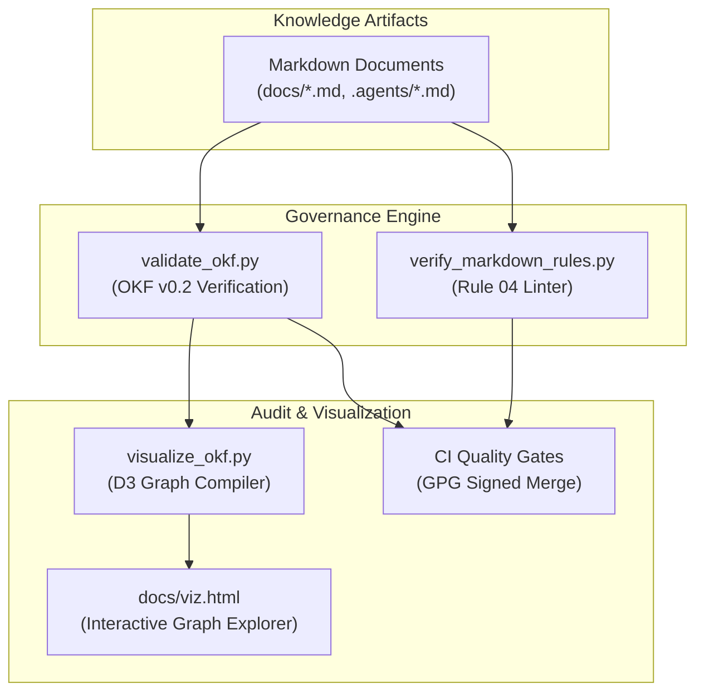

# Agentic Governance & Open Knowledge Format (OKF v0.2)

Modern MLOps codebases are maintained collaboratively by human engineers and autonomous AI agents (such as Antigravity and Jules). Without formal documentation contracts, context drift, stale guides, and broken links accumulate rapidly. TaxonVision-MLOps implements **Google's Open Knowledge Format (OKF v0.2)** to turn documentation into a machine-verified, cryptographically audited semantic graph.



---

## 1. OKF v0.2 Architectural Specification

Every markdown document in the repository (excluding reserved filenames like subdirectory `index.md` and `log.md`) must declare a standardized YAML frontmatter header conforming to the OKF v0.2 schema:

```yaml
---
type: Concept
title: Systematic Domain Title
status: stable
stale_after: "2027-01-01T00:00:00Z"
version: 1.0
description: Clear, machine-readable summary of the document's purpose.
tags: [tag1, tag2, tag3]
generated: {by: process:docs-librarian, at: "2026-10-18T12:00:00Z"}
verified: {by: process:docs-librarian, at: "2026-10-18T12:00:00Z"}
---
```

### Schema Rules & Invariants

* **Document Types (`type`):** Mandatory field categorizing the knowledge item (e.g., `Concept`, `System Pattern`, `Reference`, `Architecture`, `Guide`, `Tool`).
* **Lifecycle Status (`status`):** Strictly restricted to `draft`, `stable`, or `deprecated`.
* **ISO-8601 UTC Timestamps:** `stale_after`, `generated.at`, and `verified.at` must match the canonical regex `^\d{4}-\d{2}-\d{2}T\d{2}:\d{2}:\d{2}(?:\.\d+)?Z$`.
* **Actor Format:** Authors and verifiers must adhere to `human:<id>`, `process:<id>`, or `<producer>/<version>`.
* **Broken Link Prevention:** All cross-document markdown links (`[text](path.md)`) are statically resolved against the workspace filesystem. Broken references fail the validation gate.

---

## 2. Trust Tiers (§5.3) & Freshness Reporting (§5.5)

The validation script `scripts/governance/validate_okf.py` categorizes documents into three trust tiers:

* **Tier 1 (Human-Reviewed):** Documents verified by an authenticated human maintainer (`human:<id>`).
* **Tier 2 (Machine-Confirmed):** Documents audited and verified by automated static analyzers or subagents (`process:<id>`).
* **Tier 3 (Unverified):** Draft documents lacking explicit verification metadata.

Freshness checks compare current UTC system time against `stale_after`. Expired documents trigger CI warnings, ensuring documentation is proactively refreshed.

---

## 3. Automated Knowledge Graph Generation

The script `scripts/governance/visualize_okf.py` parses all compliant OKF documents, constructs a directed semantic graph, and outputs `docs/viz.html`. This standalone Cytoscape.js application enables real-time visual traversal of repository dependencies, accessible via the [Interactive Architecture Hub](../interactive_hub.md).

```bash
# Validate entire OKF v0.2 knowledge bundle
pixi run -e dev python scripts/governance/validate_okf.py

# Recompile interactive knowledge graph
pixi run -e dev python scripts/governance/visualize_okf.py
```
