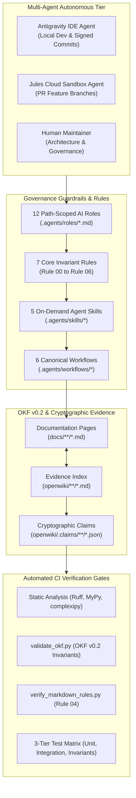
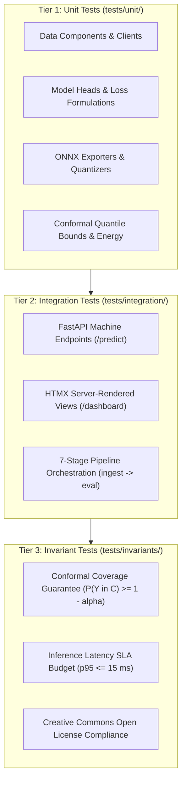

# Agentic Governance & Open Knowledge Format (OKF v0.2)

Modern MLOps codebases are developed and maintained collaboratively by human engineers and autonomous AI agents (such as Google Antigravity and GitHub Jules). Without formal behavioral guardrails and cryptographic documentation contracts, context drift, stale documentation, broken links, and unauthorized environment mutations accumulate rapidly.

TaxonVision-MLOps solves multi-agent coordination through a two-pillar governance architecture:

1. **Path-Scoped Agent Routing:** A directory-level policy defining 12 specialized AI roles, 7 immutable invariant rules, 5 on-demand agent skills, and 6 canonical slash workflows.
2. **Google Open Knowledge Format (OKF v0.2):** A semantic documentation graph where every assertion is backed by machine-verified frontmatter and cryptographically bound to concrete source-code line ranges via `openwiki/.claims/`.



---

## 1. The 12 Path-Scoped AI Roles

To prevent token waste and cognitive thrashing, AI agents do not scan the entire monorepo. Instead, the root [`AGENTS.md`](https://github.com/foersben/taxon-vision-mlops/blob/develop/AGENTS.md) router dynamically maps task triggers and modified file paths to dedicated role assignments defined in `.agents/roles/`:

| Role Identifier | Role Title | Active File Scope | Primary Responsibilities | Trigger Patterns |
| :--- | :--- | :--- | :--- | :--- |
| **`@01-orchestrator`** | Master Project Orchestrator | `AGENTS.md`, `README.md`, `Justfile` | Plans complex multi-stage tasks, delegates subagent execution, and enforces OKF graph integrity. | Planning, multi-phase refactoring, release management |
| **`@02-taxonomic-architect`** | Taxonomic Domain Architect | `src/taxon_vision/domain/`, `config/taxa_catalog.yaml` | DarwinCore taxonomic schemas, GBIF / iNaturalist taxon identifier mapping, and synonymy tables. | Taxonomy, GBIF, biological classifications, DarwinCore |
| **`@03-mlops-data-engineer`** | MLOps Data & Storage Engineer | `src/taxon_vision/data/`, `dvc.yaml`, `params.yaml` | AWS S3 streaming, DVC dataset tracking, SeaweedFS caching, and Creative Commons license filtering. | Data ingestion, S3 streaming, DVC remotes, license audits |
| **`@04-model-engineer`** | Backbone & Head Engineer | `src/taxon_vision/models/`, `pipelines/train.py` | PyTorch feature extraction trunks (timm), Class-Balanced Loss optimization, and Optuna HPO tuning. | Model architecture, loss functions, PyTorch training, ASHA |
| **`@05-inference-optimizer`** | ONNX Runtime Latency Optimizer | `src/taxon_vision/inference/`, `pipelines/export_onnx.py` | Zero-allocation ONNX Runtime inference, static INT8 PTQ quantization, and EigenCAM attribution. | ONNX export, INT8 quantization, p95 latency SLA, Grad-CAM |
| **`@06-uncertainty-safety-engineer`** | Epistemic Uncertainty Engineer | `src/taxon_vision/uncertainty/`, `pipelines/calibrate.py` | Split Conformal Prediction ($1 - \alpha$), finite-sample quantile inflation, and Helmholtz Free Energy OOD gating. | Conformal prediction, coverage guarantees, OOD detection |
| **`@07-active-learning-engineer`** | Active Learning & HITL Engineer | `src/taxon_vision/active_learning/`, `service/storage.py` | Margin sampling, BADGE gradient embeddings, binary max-heap `TriageQueue`, and Label Studio ingestion. | Active learning, triage ranking, human review queue |
| **`@08-observability-engineer`** | Telemetry & Observability Engineer | `src/taxon_vision/monitoring/`, `deploy/k8s/` | Prometheus latency histograms, Wasserstein-1 embedding drift, and MMD distribution monitors. | Telemetry, Prometheus metrics, concept drift, Grafana |
| **`@09-api-and-ui-developer`** | API & Web Interface Developer | `src/taxon_vision/service/`, `src/taxon_vision/templates/` | FastAPI machine endpoints, Jinja2 / HTMX server-rendered dashboards, and file upload validation. | REST API, FastAPI routes, web dashboard, HTMX views |
| **`@10-qa-automator`** | QA & Regression Automator | `tests/`, `tests/invariants/` | Unit test fixtures, mock S3 clients, hypothesis property tests, and statistical coverage assertions. | Test suites, regression prevention, CI assertions |
| **`@11-docs-librarian`** | Documentation Librarian | `docs/`, `openwiki/`, `zensical.toml` | Zensical static portal maintenance, KaTeX equations, Mermaid architecture diagrams, and OKF validation. | Documentation updates, Zensical build, KaTeX equations |
| **`@12-git-operator`** | Git Security & Release Operator | `.github/workflows/`, `scripts/ci/` | Git branch hygiene, GPG/SSH signed commit verification, semantic release tags, and PR lifecycle. | Git commits, signed tags, PR merges, release packaging |

---

## 2. The 7 Core Invariant Rules

Repository rules defined in `.agents/rules/` are immutable and strictly enforced across both automated CI/CD pipelines and interactive pair programming sessions:

* **Rule 00: Python Modernization (`00-python-modernization.md`):**
    * Sole reliance on Pixi (`.pixi/`). Bare `pip`, `poetry`, `uv`, and virtual environment (`.venv`) creation are strictly banned.
    * Zero dynamic reflection workarounds: forbid `hasattr` and `getattr` in application code; use explicit static types or Pydantic models.
    * Zero hardcoded magic numbers: all timeouts, learning rates, and tolerances must reside in `config/default_config.yaml`.
    * Cognitive complexity invariant: every function and method must maintain a cognitive complexity score strictly $< 15$ (`complexipy`).
* **Rule 01: MLOps Reproducibility (`01-mlops-reproducibility.md`):**
    * Deterministic PRNG seeding (`seed=42`) across PyTorch, NumPy, and Python random modules.
    * DVC dataset immutability verified via SHA256 manifest digests.
* **Rule 02: Inference Latency Invariants (`02-inference-latency-invariants.md`):**
    * Zero dynamic memory allocations on hot inference paths.
    * Pinned ONNX Runtime I/O buffers pre-allocated during application warmup.
    * Strict p95 latency budget: $\le 15.0\text{ ms}$ on target GPU serving profiles.
* **Rule 03: Git Security & Signing (`03-git-security-and-signing.md`):**
    * Mandatory GPG/SSH commit signing (`git commit -S`) for local developers and Antigravity agents. Unsigned commits are rejected by Git pre-commit hooks.
* **Rule 04: Markdown Formatting Rules (`04-markdown-formatting.md`):**
    * Exclusively use the standard ASCII hyphen (`-`) instead of en-dashes or em-dashes.
    * Use `*` for all unordered list items, indented in multiples of 4 spaces (`*`, ` * `).
    * Insert exactly 1 blank line before and after lists, code blocks, and headings.
    * Zero trailing whitespace at line ends.
* **Rule 05: Open License Compliance (`05-open-license-compliance.md`):**
    * Strict admission of Creative Commons open licenses only: `CC0-1.0`, `CC-BY-4.0`, and `CC-BY-NC-4.0`.
    * Observations under commercial-restricted or proprietary copyright licenses are automatically screened and discarded with photographer attribution retained.
* **Rule 06: Conformal Coverage Invariants (`06-conformal-coverage-invariants.md`):**
    * Multi-class prediction sets $\mathcal{C}(x)$ must mathematically guarantee $\mathbb{P}(Y \in \mathcal{C}(X)) \ge 1 - \alpha$ on unseen holdout test splits.
    * Observations yielding empty prediction sets or exceeding uncertainty thresholds must divert to human review.

---

## 3. The 5 Specialized Agent Skills

Agent skills reside in `.agents/skills/` and provide specialized, automated toolchains for complex MLOps execution:

1. **`audit-license-compliance`:** Evaluates raw iNaturalist manifests against the `OpenLicense` StrEnum, verifies photographer attribution strings, and writes compliant dataset manifests and compliance audit reports.
2. **`run-pareto-benchmarks`:** Profiles candidate backbones (`dinov3_vits14`, `bioclip-2`, `dinov2_vits14`, `mobilenetv4_conv_small`, `efficientnet_b0`) across accuracy, p50/p95 latency, memory footprint, and serving cost.
3. **`validate-okf`:** Audits all repository markdown files against the OKF v0.2 frontmatter schema and validates cross-document markdown filesystem links.
4. **`verify-conformal-coverage`:** Executes holdout evaluation over `test_embeddings.pt`, asserting empirical coverage meets or exceeds nominal $1 - \alpha$ bounds.
5. **`visualize-okf`:** Parses compliant OKF markdown files and generates the interactive Cytoscape.js knowledge graph visualizer at `docs/viz.html`.

---

## 4. The 6 Canonical Automated Workflows

Repository workflows in `.agents/workflows/` coordinate multi-step operational tasks:

* **`/active-learning-cycle`:** Executes sample query ranking via margin sampling, simulates human annotation ingestion from Label Studio, and triggers DVC retraining.
* **`/conformal-uncertainty-audit`:** Audits statistical coverage guarantees, non-conformity quantiles $\hat{q}_\alpha$, Helmholtz OOD thresholds $\tau_{\text{OOD}}$, and human triage referral rates.
* **`/doc-synchronization-pipeline`:** Re-indexes codebase changes, verifies OKF v0.2 frontmatter compliance, formats Markdown under Rule 04, and executes strict Zensical builds.
* **`/full-pipeline-validation`:** End-to-end quality gate executing `ruff`, `mypy`, `complexipy`, unit tests, coverage verification, and the 7-stage DVC pipeline.
* **`/jules-session-triage`:** Triages and reviews asynchronous background cloud sandbox sessions created by GitHub Jules agents.
* **`/model-benchmark-pareto`:** Evaluates and updates the multi-objective Pareto frontier across candidate vision foundation backbones.

---

## 5. OKF v0.2 & Cryptographic Evidence Bindings

### Google Open Knowledge Format Specification

Every documentation document (excluding root index manifests) enforces the OKF v0.2 YAML frontmatter specification:

```yaml
---
type: Concept
title: Systematic Architecture Title
status: stable
stale_after: "2027-01-01T00:00:00Z"
version: 1.0
description: Machine-readable summary of architectural components.
tags: [tag1, tag2, tag3]
generated: {by: process:docs-librarian, at: "2026-10-18T12:00:00Z"}
verified: {by: process:docs-librarian, at: "2026-10-18T12:00:00Z"}
---
```

### Trust Tiers (§5.3) & Freshness Reporting (§5.5)

The validator `scripts/governance/validate_okf.py` audits knowledge health across three trust dimensions:

* **Tier 1 (Human-Reviewed):** Documents verified by an authenticated human maintainer (`human:<id>`).
* **Tier 2 (Machine-Confirmed):** Documents audited and verified by automated static analyzers or subagents (`process:<id>`).
* **Tier 3 (Unverified):** Draft documents lacking explicit verification metadata.

Freshness checks compare current UTC time against `stale_after`. Documents exceeding their declared validity window trigger immediate CI warnings.

### Cryptographic Claims & Source Code Grounding

To guarantee that documentation never drifts from codebase reality, TaxonVision-MLOps integrates `openwiki/` and `openwiki/.claims/`. High-level claims are serialized into JSON records containing exact line ranges and cryptographic SHA256 context hashes:

```json
{
  "id": "claim_0a2014c54ca0490bbfecd7475ab839d7",
  "statement": "ConformalPredictionEngine evaluates non-conformity scores s_i = 1 - p_i and admits all candidate classes satisfying s_i <= q_hat into prediction set C(x)...",
  "evidence": [
    {
      "resource": "repo://src/taxon_vision/uncertainty/conformal.py#L53-L83",
      "version": "repo-lines-v1:sha256:86b8075f..."
    }
  ]
}
```

### Verified Evidence Mapping Matrix

The following table links key architectural claims in `openwiki/` to their verified source code line ranges in the repository:

| OpenWiki Document | Architectural Claim | Verified Source Evidence Line Range | Verification Gate |
| :--- | :--- | :--- | :--- |
| **`concepts/uncertainty-and-safety.md`** | Split Conformal non-conformity calibration $s_i = 1 - \hat{\pi}_{y_i}$ and quantile threshold calculation $\hat{q}_\alpha$ | [`src/taxon_vision/uncertainty/conformal.py#L53-L83`](file:///home/benni/Documents/antigravity_workspace/taxon-vision-mlops/src/taxon_vision/uncertainty/conformal.py#L53-L83) | `tests/invariants/test_conformal_coverage_invariant.py` |
| **`concepts/uncertainty-and-safety.md`** | Human review triage referral on empty sets, set size $> k_{\max}$, or low confidence | [`src/taxon_vision/uncertainty/conformal.py#L76-L83`](file:///home/benni/Documents/antigravity_workspace/taxon-vision-mlops/src/taxon_vision/uncertainty/conformal.py#L76-L83) | `tests/unit/test_conformal_bounds.py` |
| **`concepts/uncertainty-and-safety.md`** | Numerically stable Helmholtz Free Energy $E(x; T) = -T \ln \sum \exp(z_k / T)$ calculation via max-subtraction LogSumExp | [`src/taxon_vision/uncertainty/ood_detector.py#L50-L70`](file:///home/benni/Documents/antigravity_workspace/taxon-vision-mlops/src/taxon_vision/uncertainty/ood_detector.py#L50-L70) | `tests/unit/test_ood_energy.py` |
| **`architecture/domain-and-taxa.md`** | DarwinCore taxonomic node modeling and hierarchical catalog lookup | [`src/taxon_vision/domain/taxonomy.py#L15-L45`](file:///home/benni/Documents/antigravity_workspace/taxon-vision-mlops/src/taxon_vision/domain/taxonomy.py#L15-L45) | `tests/unit/test_data_components.py` |
| **`architecture/domain-and-taxa.md`** | Creative Commons Open License validation and commercial permissibility checks | [`src/taxon_vision/domain/license.py#L10-L35`](file:///home/benni/Documents/antigravity_workspace/taxon-vision-mlops/src/taxon_vision/domain/license.py#L10-L35) | `tests/invariants/test_license_compliance_invariant.py` |
| **`workflows/data-ingestion-and-versioning.md`** | Paginated iNaturalist v1 REST API queries and observation record formatting | [`src/taxon_vision/data/inat_client.py#L40-L75`](file:///home/benni/Documents/antigravity_workspace/taxon-vision-mlops/src/taxon_vision/data/inat_client.py#L40-L75) | `tests/unit/test_data_components.py` |
| **`workflows/data-ingestion-and-versioning.md`** | AWS S3 Open Data streaming and local LRU image byte caching | [`src/taxon_vision/data/s3_streamer.py#L30-L65`](file:///home/benni/Documents/antigravity_workspace/taxon-vision-mlops/src/taxon_vision/data/s3_streamer.py#L30-L65) | `tests/unit/test_data_components.py` |
| **`workflows/model-training-and-hpo.md`** | Effective-number Class-Balanced Cross-Entropy loss computation ($E_n = \frac{1 - \beta^n}{1 - \beta}$) | [`src/taxon_vision/models/loss.py#L22-L55`](file:///home/benni/Documents/antigravity_workspace/taxon-vision-mlops/src/taxon_vision/models/loss.py#L22-L55) | `tests/unit/test_models_components.py` |
| **`workflows/inference-and-optimization.md`** | Zero-allocation ONNX Runtime inference engine with pre-allocated I/O bindings | [`src/taxon_vision/inference/onnx_engine.py#L35-L85`](file:///home/benni/Documents/antigravity_workspace/taxon-vision-mlops/src/taxon_vision/inference/onnx_engine.py#L35-L85) | `tests/invariants/test_latency_budget_invariant.py` |
| **`operations/deployment-and-observability.md`** | Wasserstein-1 distance approximation on representation embedding norms for drift detection | [`src/taxon_vision/monitoring/drift.py#L10-L35`](file:///home/benni/Documents/antigravity_workspace/taxon-vision-mlops/src/taxon_vision/monitoring/drift.py#L10-L35) | `tests/unit/test_monitoring.py` |
| **`operations/deployment-and-observability.md`** | Binary max-heap priority review queue prioritizing observations with $\mathcal{O}(\log N)$ push/pop | [`src/taxon_vision/active_learning/triage_queue.py#L28-L80`](file:///home/benni/Documents/antigravity_workspace/taxon-vision-mlops/src/taxon_vision/active_learning/triage_queue.py#L28-L80) | `tests/unit/test_active_learning.py` |

---

## 6. The 3-Tier Automated Test Matrix & CI Workflows

TaxonVision-MLOps enforces a tiered test pyramid guaranteeing software stability, API reliability, and mathematical bounds:



### GitHub Actions CI/CD Enclave

Continuous Integration is driven by three automated workflows defined in `.github/workflows/`:

* **`ci.yml` (Pull Request & Push Quality Gate):**
    * Runs on pure CPU Ubuntu runners using Pixi (`ci-dev` environment).
    * Executes `ruff check .`, `ruff format --check .`, `mypy src scripts`, and `complexipy src`.
    * Enforces `scripts/governance/validate_okf.py` and `scripts/governance/verify_markdown_rules.py`.
    * Runs the full 3-tier test suite with strict $\ge 80\%$ code coverage enforcement.
* **`openwiki-update.yml` (Evidence Synchronization):**
    * Scheduled workflow auditing codebase changes against `openwiki/.claims/`.
    * Re-indexes code line ranges and updates SHA256 context hashes.
    * Recompiles `docs/viz.html` and commits updated knowledge graphs.
* **`release.yaml` (Production Artifact Packaging):**
    * Triggered upon signed semantic Git tags (`v*.*.*`).
    * Builds production container images, packages ONNX models, and publishes release manifests.
