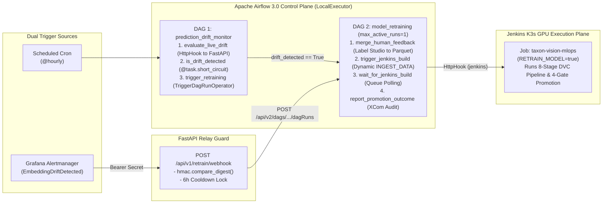

# Apache Airflow 3.0 Workflow Orchestration & Retraining Relay

## 1. Conceptual Motivation: Why an MLOps Platform Needs Airflow Alongside DVC and Jenkins

Beginners exploring a mature MLOps repository often ask a pragmatic architectural question: *"If we already have Data Version Control (DVC) to define our 8-stage machine learning DAG and Jenkins to run our CI/CD builds on the GPU server, why introduce Apache Airflow as a third tool?"*

Each of these three systems operates at a distinct layer of the MLOps control plane, and forcing any one of them to do the others' jobs creates severe architectural smells:

| Orchestration Layer | Canonical Tool | Primary Responsibility | Why It Cannot Replace the Other Two |
| :--- | :--- | :--- | :--- |
| **1. Data & Model Artifact DAG** | **DVC (`dvc.yaml`)** | Content-addressed dependency tracking (`dvc.lock`) across deterministic local/GPU pipeline stages (`ingest` -> `eval`). | DVC is a stateless CLI tool; it has no cron scheduler, no retry state machine, no REST API for webhook triggers, and no cross-service coordination. |
| **2. Heavy Compute & CI/CD Runner** | **Jenkins (`Jenkinsfile`)** | Provisions ephemeral Kubernetes GPU pods (`nvidia.com/gpu: 1`), runs static quality gates, executes `dvc repro`, builds container images, and rolls out K3s deployments. | Jenkins is designed for code-commit and build execution rather than stateful data-science control flows, conditional short-circuit branching over statistical payloads, or fine-grained task XCom lineage. |
| **3. Autonomous Control-Plane Orchestrator** | **Apache Airflow 3.0 (`airflow/dags/`)** | Schedules periodic drift evaluations (`@hourly`), evaluates JSON statistical verdicts via `@task.short_circuit`, merges human Label Studio annotations (`feedback.py`), and dispatches parameterised Jenkins GPU builds only when mathematically justified. | Airflow scheduler pods run continuously with lightweight CPU/RAM footprints; running heavy PyTorch GPU training directly inside the Airflow container would starve the scheduler and require embedding CUDA runtimes into the orchestrator image. |

In short: **Airflow is the brain** that decides *when* and *why* the system must act; **Jenkins is the muscle** that provisions the ephemeral GPU pod on `hive-mind`; and **DVC is the reproducible recipe** executed inside that GPU pod.



---

## 2. Airflow 3.0 `LocalExecutor` Topology & Resource Budgeting

Distributed Airflow deployments often provision `CeleryExecutor` (requiring dedicated Redis/RabbitMQ message brokers and multiple standby worker nodes) or `KubernetesExecutor` (which spawns a brand-new Kubernetes pod for every trivial 50-millisecond Python task). On a single bare-metal node (`hive-mind`), both patterns introduce unnecessary memory ballast and pod-startup latency.

TaxonVision-MLOps configures **Apache Airflow 3.0 (`apache/airflow:3.0.0-python3.12`)** with **`LocalExecutor`** backed by the `airflow` database on our consolidated PostgreSQL 16 instance ([`docker-compose.yml`](file:///home/benni/Documents/antigravity_workspace/taxon-vision-mlops/docker-compose.yml)):

| Container Service | Command & Role | Memory Ceiling (`mem_limit`) | Architectural Purpose |
| :--- | :--- | :--- | :--- |
| **`airflow-init`** | `airflow db migrate && airflow users create ...` | Ephemeral (exits `0`) | Idempotently runs Alembic schema migrations on the PostgreSQL `airflow` database and provisions the local operator account before starting daemons. |
| **`airflow-apiserver`** | `api-server` (Host port `8090` -> Container `8080`) | `768m` | Serves the Airflow 3 React UI, the `/api/v2/` REST API (consumed by the FastAPI retraining webhook relay), and the internal Task Execution API (`/execution/`). |
| **`airflow-scheduler`** | `scheduler` (`LocalExecutor`) | `1024m` | Evaluates cron schedules (`@hourly`), manages task retries, and executes lightweight Python/HTTP tasks as local subprocesses. |
| **`airflow-dag-processor`** | `dag-processor` (`MIN_FILE_PROCESS_INTERVAL=60`) | `512m` | Parses `airflow/dags/*.py` in an isolated process every 60 seconds, preventing syntax errors or slow imports in user DAGs from stalling the scheduler loop. |

### Declarative Zero-Touch Connection Injection

Rather than clicking through the Airflow Admin UI to configure HTTP endpoints (which would be lost whenever the database volume is recreated), connections are injected declaratively via Airflow's `AIRFLOW_CONN_<ID>` environment variable convention:

* **`AIRFLOW_CONN_TAXON_APP` (`conn_id="taxon_app"`):** Points to `http://app:8000` and embeds `TAXON_INTERNAL_API_TOKEN` as the connection password so `prediction_drift_monitor` can authenticate against `POST /api/v1/drift/evaluate`.
* **`AIRFLOW_CONN_JENKINS` (`conn_id="jenkins"`):** Points to `http://hive-mind:8080` with the Jenkins API user and token so `model_retraining` can trigger parameterised GPU builds.

---

## 3. Workflow 1: Hourly Drift Monitor (`prediction_drift_monitor`)

Defined in [`airflow/dags/prediction_drift_monitor.py`](file:///home/benni/Documents/antigravity_workspace/taxon-vision-mlops/airflow/dags/prediction_drift_monitor.py), the `prediction_drift_monitor` DAG executes on an `@hourly` schedule (`catchup=False`, `max_active_runs=1`, 2 retries with 5-minute delay):

1. **`evaluate_live_drift` (`@task`):** Instantiates `HttpHook(method="POST", http_conn_id="taxon_app")`, attaches the `Authorization: Bearer <TAXON_INTERNAL_API_TOKEN>` header, and invokes `POST /api/v1/drift/evaluate` (`timeout=300`). The FastAPI service computes the Tier 1 Wasserstein-1 norm distance and Tier 2 RBF MMD² permutation test over the latest 500 predictions in PostgreSQL, logs the Evidently PCA report to MLflow, and returns the serialised `DriftEvaluationResponse` JSON dictionary into Airflow XCom.
2. **`is_drift_detected` (`@task.short_circuit`):** Inspects `verdict.get("drift_detected", False)`.
    * If `False` (either traffic is healthy or `status == "insufficient_data"` when $< 50$ samples exist), the `@task.short_circuit` decorator marks all downstream tasks as **Skipped**, concluding the hourly check cleanly in under 2 seconds.
    * If `True`, execution proceeds to the next operator.
3. **`trigger_retraining` (`TriggerDagRunOperator`):** Triggers the `model_retraining` DAG with configuration payload `{"trigger_source": "prediction_drift_monitor"}`.

---

## 4. Workflow 2: Event-Driven Retraining (`model_retraining`)

Defined in [`airflow/dags/model_retraining.py`](file:///home/benni/Documents/antigravity_workspace/taxon-vision-mlops/airflow/dags/model_retraining.py), the `model_retraining` DAG is strictly event-driven (`schedule=None`, `catchup=False`, `max_active_runs=1`). Setting `max_active_runs=1` guarantees that even if an operator manually triggers a run while an automated drift run is active, Airflow queues the second run rather than launching competing GPU training jobs on `hive-mind`.

The DAG executes four sequential TaskFlow stages:

1. **`merge_human_feedback` (`@task`):** Checks for pending human expert annotations exported from Label Studio at `TAXON_LABEL_STUDIO_EXPORT_PATH` (default `data/flagged_observations/label_studio_export.json`). If present, invokes [`merge_feedback_to_manifest()`](file:///home/benni/Documents/antigravity_workspace/taxon-vision-mlops/src/taxon_vision/active_learning/feedback.py#L265-L333) to filter out OOD specimens, validate open Creative Commons licences (`CC0`, `CC-BY`, `CC-BY-NC`) and mandatory photographer attribution, deduplicate by `observation_uuid`, and atomically append new verified rows into `data/manifests/dataset_manifest.parquet`.
2. **`trigger_jenkins_build` (`@task`):** Inspects `feedback_status["new_annotations_merged"] > 0` to dynamically set `INGEST_DATA="true"` (when new observations require feature extraction) or `INGEST_DATA="false"`. Dispatches `POST /job/taxon-vision-mlops/buildWithParameters?RETRAIN_MODEL=true&INGEST_DATA=...` via `HttpHook(method="POST", http_conn_id="jenkins")` and captures the queued item `Location` header. If Jenkins is unreachable in offline developer testing, the task degrades gracefully into `status="simulated_local_execution"` so local DAG dry-runs remain testable.
3. **`wait_for_jenkins_build` (`@task`):** Polls the Jenkins build queue and execution status until terminal completion (bounded by a 150-minute timeout).
4. **`report_promotion_outcome` (`@task`):** Compiles the terminal build status, evaluated Four-Gate Promotion gates (`predictive_superiority`, `conformal_coverage`, `latency_slo`, `exchangeability_mmd2`), and active model alias (`taxon_vision_onnx@Production`) into an executive summary dictionary persisted in Airflow XCom.

---

## 5. The Grafana-to-Airflow Retraining Webhook Relay (`retrain.py`)

In addition to the hourly `prediction_drift_monitor` poll, real-time Prometheus/Grafana alerts can trigger `model_retraining` immediately when `EmbeddingDriftDetected` (`taxon_drift_detected == 1.0`) fires.

Why not point Grafana Alertmanager directly at Airflow's `/api/v2/dags/model_retraining/dagRuns` endpoint?

1. **Payload Schema Mismatch:** Grafana Alertmanager sends a complex nested JSON batch of firing and resolved alerts (`GrafanaWebhookPayload`), whereas Airflow's `/dagRuns` endpoint expects a clean `{"conf": {...}}` trigger body.
2. **Alert Storm Protection:** During a sustained distribution shift, Alertmanager may re-send webhook notifications every few minutes. Without a stateful cooldown lock, this would flood the orchestrator with redundant retraining requests.

Therefore, [`src/taxon_vision/service/routes/retrain.py`](file:///home/benni/Documents/antigravity_workspace/taxon-vision-mlops/src/taxon_vision/service/routes/retrain.py) exposes `POST /api/v1/retrain/webhook`:

* **Constant-Time Token Authentication (`verify_retrain_token`):** Validates `Authorization: Bearer <TAXON_RETRAIN_WEBHOOK_SECRET>` using `hmac.compare_digest()`, preventing cryptographic timing side-channels.
* **Actionable Alert Filtering (`extract_firing_retrain_alert`):** Iterates through `payload.alerts` and `payload.common_labels`, ignoring resolved alerts or infrastructure alerts (`tier=platform`) and extracting only firing alerts carrying `labels["action"] == "retrain"`. If none match, increments `taxon_retrain_triggers_total{source="grafana", outcome="ignored"}` and returns HTTP 200 `{"status": "ignored"}`.
* **Atomic 6-Hour Cooldown Lock (`acquire_retrain_cooldown`):** Acquires a thread-safe lock (`_cooldown_lock`) and checks whether `TAXON_RETRAIN_COOLDOWN_SECONDS` (default `21600.0` seconds = 6 hours) has elapsed since `_last_retrain_timestamp`. If the cooldown window is still active, increments `outcome="suppressed"` and returns HTTP 200 `{"status": "suppressed"}` with the remaining seconds.
    * *Architectural Note:* The cooldown timestamp is currently maintained in process memory (`_last_retrain_timestamp`), which resets across container restarts and is local to each Uvicorn worker.
* **Asynchronous Airflow API v2/v1 Dispatch (`dispatch_airflow_retraining`):** Uses `httpx.AsyncClient(timeout=10.0)` with Basic Auth (`TAXON_AIRFLOW_USER` / `TAXON_AIRFLOW_PASSWORD`) to POST `{"conf": {"trigger_source": "grafana", "alert": alert_name}}` to `/api/v2/dags/model_retraining/dagRuns` (automatically falling back to `/api/v1/dags/model_retraining/dagRuns` for backward compatibility), increments `outcome="triggered"`, and returns HTTP 200 `{"status": "triggered", "dag_run_id": ...}`.

---

## 6. Zero-Residue Offline AST Topology Verification (`just airflow-dag`)

Running `airflow tasks list` via the official Airflow CLI requires spinning up PostgreSQL and initialising the full Airflow database metadata schema. To provide developers and CI pipelines with an instant, zero-dependency verification tool matching `dvc dag` ergonomics, [`scripts/maintenance/visualize_airflow_dag.py`](file:///home/benni/Documents/antigravity_workspace/taxon-vision-mlops/scripts/maintenance/visualize_airflow_dag.py) parses `airflow/dags/*.py` directly using Python's built-in `ast` module in $< 50\,\text{ms}$:

```bash
pixi run -e dev python scripts/maintenance/visualize_airflow_dag.py
# Or via Justfile recipe:
just airflow-dag
```

```text
TaxonVision Airflow Topology (2 registered workflows):

┌────────────────────────────────────────────────────────────────────────────┐
│ DAG: model_retraining                                                      │
│ Schedule: None | Catchup: False | Max Active Runs: 1                       │
│ Tags: taxon-vision, retraining, pipeline                                   │
│ File: airflow/dags/model_retraining.py                                     │
└────────────────────────────────────────────────────────────────────────────┘
  ├── [Task] merge_human_feedback
  │     └─ Check for and merge newly annotated observations from human triage queues.
  ├── [Task] trigger_jenkins_build
  │     └─ Dispatch a parameterised build request to the remote Jenkins pipeline runner.
  ├── [Task] wait_for_jenkins_build
  │     └─ Poll the remote Jenkins queue and build execution until completion.
  └── [Task] report_promotion_outcome
        └─ Inspect the resulting MLflow run and extract the Four-Gate Promotion Verdict.

┌────────────────────────────────────────────────────────────────────────────┐
│ DAG: prediction_drift_monitor                                              │
│ Schedule: @hourly | Catchup: False | Max Active Runs: 1                    │
│ Tags: taxon-vision, drift, monitoring                                      │
│ File: airflow/dags/prediction_drift_monitor.py                             │
└────────────────────────────────────────────────────────────────────────────┘
  ├── [Task] evaluate_live_drift
  │     └─ Trigger on-demand drift evaluation via the internal microservice endpoint.
  ├── [Short-Circuit] is_drift_detected
  │     └─ Evaluate whether distribution shift requires model retraining.
  └── [Operator] trigger_retraining
        └─ Instantiates TriggerDagRunOperator
```
