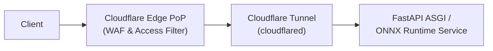

# Deployment Runbook & Containerization

## Section 1: Local Development & Verification

The local development environment requires initialization of the dependent infrastructure and application services.

Start the complete local microservices stack via Docker Compose:

```bash
docker compose up -d
```

Start the Pixi-managed FastAPI service:

```bash
pixi run -e dev api
```

Start the local MLflow tracking server:

```bash
pixi run -e dev mlflow
```

## Section 2: Safe Production Deployment Invariants

Production deployments enforce strict invariants to guarantee uninterrupted service and correct operation.

* Zero-downtime rolling deployment strategy: Kubernetes `RollingUpdate` with `maxSurge: 1` and `maxUnavailable: 0`.
* Inference engine startup warmup: Readiness probe validating ONNX Runtime session execution with dummy input tensor (latency threshold < 20 ms) before receiving traffic.
* Calibration cache invariant: Split Conformal Prediction non-conformity threshold cache ($q_{\text{val}}$) must be validated and loaded into memory before the pod transitions to `Ready`.
* Automated canary verification & rollback: Prometheus metric gates monitoring p95 latency (< 50 ms) and HTTP 5xx error rate (< 0.5%). Automated rollback if thresholds are violated.

## Section 3: Edge Ingress Topology via Cloudflare Tunnel

The system utilizes a zero-open-ports architecture. The `cloudflared` daemon operates via outbound-only multiplexed QUIC/HTTP2 tunnels to Cloudflare Edge PoPs, completely isolating the internal Kubernetes/Docker network from public inbound scanning.

The `cloudflared` daemon configuration routes the public hostname to the internal service endpoint:

```yaml
tunnel: <TUNNEL_ID>
credentials-file: /etc/cloudflared/credentials.json

ingress:
  - hostname: taxon.benjamin-foerster.eu
    service: http://localhost:30080
  - service: http_status:404
```

The packet flow visualizes the path from client to backend:



## Section 4: Restricted Private Access Control Topology

The preview/operator service is exposed to a selected external audience using two distinct Cloudflare defense layers.

* Layer A (Programmatic API Access Key via WAF):
    * Custom Cloudflare WAF Expression filtering HTTP request headers: `http.request.headers["X-Taxon-Access-Key"][0] eq "REDACTED_ACCESS_KEY"` (or custom HMAC query token).
    * Requests lacking the valid key are dropped immediately at the Cloudflare Edge PoP with HTTP 403 Forbidden, protecting the backend from compute starvation.
* Layer B (Operator Dashboard Identity Gate via Cloudflare Zero Trust):
    * Cloudflare Access Application wrapping operator paths (`/ui`, `/triage`, `/docs`).
    * Identity provider whitelist (One-Time PIN via email whitelist or Google Workspace SSO).
    * Prevents unauthorized browser access to the HTMX triage dashboard while allowing authenticated taxonomists.

## Section 5: Dataset Scaling Horizons

> [!NOTE]
> **Data Horizon Provenance:** The Dev Baseline reflects the active verified ground truth of the repository (1,689 verified observations across 10 biological taxa in `data/manifests/dataset_manifest.parquet` filtered from 2,000 ingested records). Horizons 1 through 3 represent forward-looking architectural scaling roadmap milestones and capacity planning projections, rather than completed runs.

The architectural breakdown details how TaxonVision-MLOps scales across data horizons:

| Horizon | Scale | Infrastructure & Architecture Details | Validation & Verification |
| --- | --- | --- | --- |
| Dev Baseline (Current) | 1,689 verified observations, 10 taxa | Local SQLite & disk cache | Rapid offline unit/conformal testing |
| Horizon 1 (Pilot Perimeter, Projected) | ~5,000 observations, 10 curated target taxa | Single GPU training, DVC versioning on DagsHub | Strict CC-BY/CC0 verification |
| Horizon 2 (Regional Production, Projected) | ~50,000 observations, 100 taxa | Multi-GPU Distributed Data Parallel (DDP), S3/SeaweedFS bucket versioning | Automated concept drift detection |
| Horizon 3 (Global Scale, Projected) | 100,000+ exemplars, ~50 TB raw imagery | Distributed zero-copy streaming with Ray Data and PyTorch WebDataset, fine-tuning foundation vision backbones (DINOv2, BioCLIP-2) | Conformal calibration on stratified holdouts |

## Section 6: Cluster Bootstrapping vs. Continuous Delivery Lifecycle

The deployment infrastructure separates Day-0 cluster prerequisites from Day-2 continuous deployment pipelines:

* **Day-0 Cluster Bootstrap (One-Time Setup):**
    * Configures host-level infrastructure, hardware device plugins, and authentication boundaries on `hive-mind` (`192.168.178.30`).
    * Applied once by cluster administrators using `kubectl apply`:
        * [deploy/k8s/jenkins-agent-rbac.yaml](file:///home/benni/Documents/antigravity_workspace/taxon-vision-mlops/deploy/k8s/jenkins-agent-rbac.yaml): Provisions `jenkins-ci` and `taxon-vision` namespaces, machine ServiceAccount `jenkins-agent`, and RBAC bindings for deployments, services, pods, configmaps, secrets, persistentvolumeclaims, and Traefik CRDs.
        * [deploy/k8s/nvidia-time-slicing-config.yaml](file:///home/benni/Documents/antigravity_workspace/taxon-vision-mlops/deploy/k8s/nvidia-time-slicing-config.yaml): Partitions the physical RTX 5070 Ti into 4 virtual GPU slices in `kube-system`.
        * [deploy/k8s/mlops-storage-and-optuna.yaml](file:///home/benni/Documents/antigravity_workspace/taxon-vision-mlops/deploy/k8s/mlops-storage-and-optuna.yaml): Provisions the in-cluster SeaweedFS object store (ports 8333 S3, 8888 Filer, 9333 Master, 8080 Volume) and the persistent Optuna SQLite telemetry dashboard (`NodePort 30081`).
        * [deploy/k8s/monitoring-prometheus-grafana.yaml](file:///home/benni/Documents/antigravity_workspace/taxon-vision-mlops/deploy/k8s/monitoring-prometheus-grafana.yaml): Provisions in-cluster Prometheus TSDB (`NodePort 30090`) and Grafana visualizer (`NodePort 30300`) with BTRFS NOCOW persistent storage.
        * [deploy/k8s/traefik-ingress.yaml](file:///home/benni/Documents/antigravity_workspace/taxon-vision-mlops/deploy/k8s/traefik-ingress.yaml): Provisions Traefik v3.1 `IngressRoute` and 80/20 weighted `TraefikService` for canary deployment.
    * Storing these manifests in Git provides Infrastructure as Code (IaC) without requiring repetitive manual execution.
* **Day-2 Continuous Delivery (Automated via Jenkins):**
    * Operates entirely within the CI/CD pipeline triggered by Git commits and PR events.
    * Eliminates brittle host-level cronjobs, systemd file watchers, or local `git pull` shell loops on the server.
    * Jenkins checks out code via authenticated GitHub PAT, executes test gates, builds documentation, applies manifests directly via the in-cluster `jenkins-agent` ServiceAccount, and performs rolling updates.

## Section 7: NVIDIA Device Plugin GPU Time-Slicing Specification

Consumer and workstation GPUs (such as our NVIDIA GeForce RTX 5070 Ti) lack hardware Multi-Instance GPU (MIG) slicing. Without time-slicing, requesting `nvidia.com/gpu: 1` places an exclusive lock on the entire card, starving co-located workloads.

### Time-Slicing Configuration Architecture

The cluster exposes 4 virtual GPU slots using the official NVIDIA Kubernetes Device Plugin:

```yaml
apiVersion: v1
kind: ConfigMap
metadata:
  name: nvidia-device-plugin-config
  namespace: kube-system
data:
  config.yaml: |
    version: v1
    sharing:
      timeSlicing:
        resources:
          - name: nvidia.com/gpu
            replicas: 4
```

The `nvidia-device-plugin-daemonset` in `kube-system` mounts this ConfigMap at `/etc/config/config.yaml` and reads environment variable `CONFIG_FILE=/etc/config/config.yaml`.

### Cluster Verification Command

Validate allocatable GPU slices on `hive-mind`:

```bash
kubectl get node hive-mind -o jsonpath='{.status.allocatable.nvidia\.com/gpu}{"\n"}'
# Output: 4
```

### Application VRAM Guardrails

Because hardware time-slicing multiplexes compute cores while sharing device memory globally, PyTorch batch training pipelines enforce a strict allocation cap:

```python
import os
import torch

if torch.cuda.is_available():
    fraction = float(os.getenv("TAXON_CUDA_MEMORY_FRACTION", "0.7"))
    torch.cuda.set_per_process_memory_fraction(fraction)
```

This reserves 30% (4.8 GB) of VRAM for live ONNX Runtime FastAPI inference and host display outputs.

## Section 8: Automated Kubernetes Continuous Deployment Pipeline

When commits are pushed to `main` or release tags, the declarative pipeline in [Jenkinsfile](file:///home/benni/Documents/antigravity_workspace/taxon-vision-mlops/Jenkinsfile) executes automated verification, remote model training, and zero-downtime rolling updates.

> [!IMPORTANT]
> **Zero Local Training Paradigm:** The local developer workstation has zero GPU allocation for model training. All PyTorch training loops, Optuna sweeps, and ONNX graph exports are performed remotely by the bare-metal CI runner on `hive-mind`, ensuring full reproducibility and eliminating local hardware strain.

### Pipeline Execution Flow

* **Step 1 (Toolchain Provisioning):** The container runner installs `kubernetes-client` (from conda-forge, exposing `kubectl`) and standalone `git` into `/root/.pixi/bin`.
* **Step 2 (Verification Gates):** Executes Ruff linting, MyPy type checks, License compliance audits, OKF validation, unit tests (with 78% line coverage threshold), integration tests, and strict Zensical build.
* **Step 3 (GPU Model Training & Checkpoint - main branch only):**
    * Targets 1 of the 4 NVIDIA time-slicing partitions on `hive-mind` using the dedicated GPU agent pod requesting `nvidia.com/gpu: 1` in `Jenkinsfile`.
    * Extracts ViT feature representations from S3 images into 4-way partitions: `pixi run -e dev python -m taxon_vision.pipelines.extract_features --extractor dinov3 --manifest data/manifests/dataset_manifest.parquet --out-dir data/embeddings`.
    * Caps VRAM at 70% (`--cuda-memory-fraction 0.7`) to reserve headroom for live services.
    * Executes classification head training with Optuna tuning: `pixi run -e dev python -m taxon_vision.pipelines.train --extractor dinov3 --epochs 15 --train-embeddings data/embeddings/train_embeddings.pt --val-embeddings data/embeddings/val_embeddings.pt`.
    * Re-exports and quantizes the ONNX graph (`taxon_vision.pipelines.export_onnx`) and pushes `models/checkpoints/head.pt` and `models/checkpoints/model_int8.onnx` to the DagsHub DVC remote.
    * Logs metrics and registry aliases to DagsHub MLflow.
* **Step 4 (Deployment Rollout):**
    * Applies [deploy/k8s/api-deployment.yaml](file:///home/benni/Documents/antigravity_workspace/taxon-vision-mlops/deploy/k8s/api-deployment.yaml) and [deploy/k8s/monitoring-prometheus-grafana.yaml](file:///home/benni/Documents/antigravity_workspace/taxon-vision-mlops/deploy/k8s/monitoring-prometheus-grafana.yaml) using `jenkins-deployer-role` permissions. `imagePullPolicy: Always` ensures the pod pulls the fresh container published by GitHub Actions.
    * Triggers zero-downtime rolling update: `kubectl rollout restart deployment/taxon-vision-api -n taxon-vision`.
    * Awaits readiness probe verification: `kubectl rollout status deployment/taxon-vision-api -n taxon-vision --timeout=120s`.

## Section 9: Container Packaging & GitHub Container Registry (GHCR)

The production serving image is containerized using a non-root, multi-stage build and published to the GitHub Container Registry.

### Automated CI/CD Publishing Pipeline

When commits merge to `main`, GitHub Actions (`.github/workflows/ci.yml`) executes the `build-and-push-container` workflow:

* **Authentication & Model Hydration:** The workflow authenticates against DagsHub DVC using `DAGSHUB_TOKEN` and pulls the latest promoted checkpoints (`head.pt` and `model_int8.onnx`) directly into `models/checkpoints/`.
* **Multi-Tag Container Serialization:** Docker Buildx builds the image from `deploy/docker/Dockerfile` and publishes it to GitHub Container Registry under two tags:
    * `ghcr.io/foersben/taxon-vision-mlops:latest` (stable production tracking tag)
    * `ghcr.io/foersben/taxon-vision-mlops:sha-<short_sha>` (immutable commit-bound tag)
* **Kubernetes Consumption:** The Kubernetes deployment manifest ([deploy/k8s/api-deployment.yaml](file:///home/benni/Documents/antigravity_workspace/taxon-vision-mlops/deploy/k8s/api-deployment.yaml)) specifies `ghcr.io/foersben/taxon-vision-mlops:latest` with `imagePullPolicy: Always`, ensuring that pod rollout restarts immediately pull and activate the newly published release.

## Section 10: In-Cluster Storage & Optuna Telemetry Administration

Operating a self-contained bare-metal MLOps cluster requires ongoing management of persistent storage volumes and Bayesian optimization state.

### SeaweedFS Operational Management

The in-cluster SeaweedFS service (`chrislusf/seaweedfs:latest`) manages the high-throughput DVC cache and triage queue on the host NVMe filesystem:

* **Topology and Status Inspection:** Operators can verify cluster master status and volume allocation via HTTP API:

    ```bash
    curl -s http://192.168.178.30:9333/dir/status | jq .
    ```

* **Filer Directory Cataloging:** Inspect declarative bucket roots directly through the Filer gateway:

    ```bash
    curl -s http://192.168.178.30:8888/buckets/ | jq .
    ```

* **Dynamic Bucket Provisioning:** If new storage tiers are required, buckets are created instantaneously via idempotent HTTP POST requests without container reboots:

    ```bash
    wget -q -O - --post-data="" "http://192.168.178.30:8888/buckets/new-bucket-name/?op=mkdir"
    ```

* **Volume Garbage Collection & Vacuuming:** Over prolonged retraining iterations, deleted or superseded intermediate embeddings create fragmented volume space. SeaweedFS allows online compaction:

    ```bash
    curl -s "http://192.168.178.30:9333/vol/vacuum?garbageThreshold=0.3"
    ```

* **S3 Endpoint Verification:** The S3 gateway listens on port `8333` in the cluster (`http://seaweedfs.taxon-vision.svc.cluster.local:8333`). Verification from adjacent pods or the host is executed via standard AWS CLI tools:

    ```bash
    AWS_ACCESS_KEY_ID=taxonadmin AWS_SECRET_ACCESS_KEY=taxonpassword \
      aws --endpoint-url=http://192.168.178.30:8333 s3 ls
    ```

### Optuna Telemetry Dashboard Administration

Hyperparameter optimization telemetry is persisted across pipeline runs to prevent search space loss:

* **Web UI Access:** The Optuna dashboard is accessible on the local network at:

    ```text
    http://192.168.178.30:30081/
    ```

* **Database Verification on Host:** The database resides on the host at `/var/lib/taxon-vision/optuna/optuna_studies.db`. Operators can verify that Write-Ahead Logging (`WAL`) is active:

    ```bash
    sqlite3 /var/lib/taxon-vision/optuna/optuna_studies.db "PRAGMA journal_mode;"
    # Output: wal
    ```

* **Concurrent Access Integrity:** WAL mode guarantees that the web dashboard process (reading historical trials) does not acquire exclusive database locks that could stall active training jobs on the GPU.

---

## Section 11: In-Cluster Observability & Traefik A/B Canary Runbook

Operating the production serving plane requires monitoring real-time telemetry and managing traffic splitting across candidate model versions.

### Cluster Observability Health Inspection

Operators can verify in-cluster observability components from any machine on the local network (`192.168.178.0/24`):

```bash
# Verify Prometheus TSDB health and active scrape targets
curl -s http://192.168.178.30:30090/-/healthy
curl -s http://192.168.178.30:30090/api/v1/targets | jq .data.activeTargets[].scrapeUrl

# Verify Grafana visualizer availability
curl -s http://192.168.178.30:30300/api/health

# Verify live model serving endpoint health
curl -s http://192.168.178.30:30080/health
```

### Traefik A/B Canary Traffic Management

The Traefik ingress controller on `hive-mind` manages weighted traffic distribution between the baseline production model and challenger models via [`deploy/k8s/traefik-ingress.yaml`](file:///home/benni/Documents/antigravity_workspace/taxon-vision-mlops/deploy/k8s/traefik-ingress.yaml):

* **Baseline 80/20 Distribution:** Default configuration sends $80\%$ of traffic to `taxon-vision-serving:8000` and $20\%$ to `taxon-vision-serving-challenger:8000`.
* **Canary Promotion Step 1 (50/50 Split):** Once the challenger model processes initial inference requests with zero runtime exceptions, increase confidence by adjusting weights in `deploy/k8s/traefik-ingress.yaml`:

    ```yaml
    spec:
      weighted:
        services:
          - name: taxon-vision-serving
            port: 8000
            weight: 50
          - name: taxon-vision-serving-challenger
            port: 8000
            weight: 50
    ```

    Apply the update without pod restarts:

    ```bash
    kubectl apply -f deploy/k8s/traefik-ingress.yaml
    ```

* **Canary Promotion Step 2 (Full Cutover 100/0):** If Prometheus metrics confirm the challenger meets latency SLA (p95 $\le 15.0\text{ ms}$) and conformal error guarantees ($1 - \alpha \ge 0.90$), update the primary deployment image tag to the challenger release and reset weights to 100/0.
* **Instant Emergency Rollback:** If the challenger experiences elevated error rates, instantly route 100% of traffic back to the stable baseline:

    ```bash
    kubectl patch traefikservice taxon-vision-ab-service -n taxon-vision --type=json \
        -p='[{"op": "replace", "path": "/spec/weighted/services/0/weight", "value": 100}, {"op": "replace", "path": "/spec/weighted/services/1/weight", "value": 0}]'
    ```

### HostPath Storage Permissions Maintenance

Prometheus and Grafana run as unprivileged users (`UID 65534` and `UID 472`). While declarative `initContainers` automatically enforce ownership during pod startups, manual filesystem resets or backup restorations on the host may require explicit permission alignment:

```bash
# Correct hostPath volume permissions on hive-mind (if manual reset occurs)
sudo chown -R 65534:65534 /var/lib/taxon-vision/prometheus && sudo chmod -R 775 /var/lib/taxon-vision/prometheus
sudo chown -R 472:472 /var/lib/taxon-vision/grafana && sudo chmod -R 775 /var/lib/taxon-vision/grafana
```

---

## Section 12: Evidently AI Drift Monitoring & Retraining Workflows

The platform deploys a dual-tier drift strategy: an inline real-time 1D Wasserstein-1 check and an offline multivariate RKHS MMD batch analysis.

### Online Real-Time Drift Alerting

* **Prometheus Exposition:** Forward passes calculate the Wasserstein-1 distance across unnormalized $L_2$ embedding norms in $< 1\text{ ms}$ on CPU, exposed at `GET /metrics` via gauge `embedding_drift_w1`.
* **Alert Trigger:** A sustained value exceeding threshold $\tau = 0.15$ indicates sudden sensor exposure shifts, optical fouling, or severe feature magnitude distortion.

### Offline Scheduled Batch Audit via Evidently AI

For deep geometric manifold audits across scheduled weekly windows:

```bash
# Execute batch drift analysis across calibration baseline and current window
pixi run -e dev python -m taxon_vision.pipelines.audit_drift \
    --reference data/embeddings/cal_embeddings.pt \
    --current data/embeddings/production_window.pt \
    --report-html reports/data_drift_report.html \
    --metrics-json metrics/drift_summary.json
```

* **Interactive Report Inspection:** Operators inspect distribution comparisons, feature energy shifts, and multivariate MMD test statistics in `reports/data_drift_report.html`.
* **Automated Pipeline Retraining:** If the multivariate permutation test rejects the null hypothesis ($p < 0.01$), the script exits with status code 2, signalling Jenkins to trigger the unified DVC retraining DAG:

    ```bash
    dvc repro extract_features train export_onnx calibrate evaluate
    ```

---

## Section 13: Enterprise GitOps & Multi-Cluster Migration Runbook

For enterprise organizations migrating from in-cluster Jenkins ServiceAccount deployments to pull-based GitOps, the cluster architecture transitions seamlessly to **ArgoCD** or **Flux CD**.

### ArgoCD Bootstrapping on K3s

Deploy the ArgoCD control plane into an isolated namespace:

```bash
kubectl create namespace argocd
kubectl apply -n argocd -f https://raw.githubusercontent.com/argoproj/argo-cd/stable/manifests/install.yaml
kubectl rollout status deployment -n argocd argocd-server --timeout=120s
```

### Declarative Application CRD

Create and apply the GitOps Application definition (`deploy/k8s/argocd-application.yaml`):

```yaml
apiVersion: argoproj.io/v1alpha1
kind: Application
metadata:
  name: taxon-vision-mlops
  namespace: argocd
spec:
  project: default
  source:
    repoURL: https://github.com/foersben/taxon-vision-mlops.git
    targetRevision: main
    path: deploy/k8s
  destination:
    server: https://kubernetes.default.svc
    namespace: taxon-vision
  syncPolicy:
    automated:
      prune: true
      selfHeal: true
    syncOptions:
      - CreateNamespace=true
```

### Decoupling Continuous Integration from Continuous Delivery

Upon adopting GitOps:

1. **Jenkins Scope Narrowing:** The Jenkins declarative pipeline no longer executes `kubectl apply`. Its responsibility terminates after static quality gates, GPU training, container image publishing to GHCR, and committing updated image tags to the Git repository.
2. **Pull-Based Continuous Reconciliation:** ArgoCD detects changes in `deploy/k8s/` and reconciles cluster state automatically, eliminating cluster administrative credentials from CI runners.
3. **Enterprise Monitoring Migration:** For multi-cluster observability, single-node Prometheus is upgraded to **Prometheus Operator (`kube-prometheus-stack`)** using Helm, and long-term storage is federated to **VictoriaMetrics** or **Thanos**.
