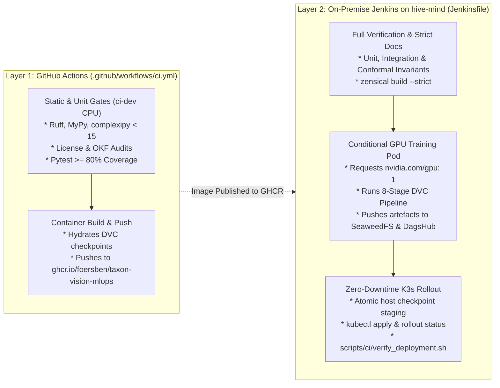
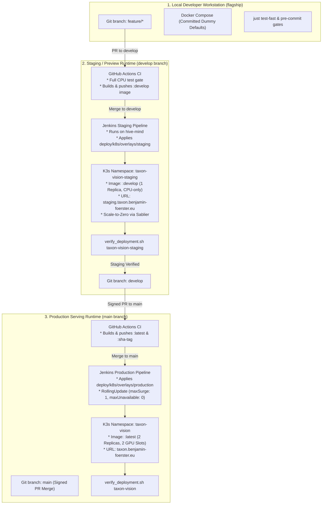

# Multi-Tier Deployment & Promotion Strategy

## 1. Conceptual Overview: Why MLOps Deployment Differs from Classical Continuous Delivery

In a conventional stateless web application, continuous delivery (CD) is a one-dimensional operation: a CI runner compiles source code into a container image, pushes the image to a registry, and instructs Kubernetes to replace old pods with new pods. Machine learning systems break this simplicity because a running inference service is the product of **two coupled yet independently evolving artefacts**:

1. **The Application Runtime (Code & Environment):** The FastAPI ASGI routes, Pydantic schemas, ONNX Runtime C++ shared libraries, and Python dependencies locked in `pixi.lock`.
2. **The Epistemic State (Weights & Thresholds):** The INT8-quantised neural network graph (`model_int8.onnx`), the linear classification head (`head.pt`), and the calibrated conformal/OOD thresholds configured in `params.yaml` and tracked by DVC (`dvc.lock`).

Deploying code changes or updated model weights directly to production without an intermediate verification tier risks three classes of failures:

* **Container-to-Hardware Mismatches:** A container that passes CPU unit tests in GitHub Actions may fail when binding to the NVIDIA CUDA Execution Provider or reading host-mounted checkpoint volumes on the bare-metal server.
* **Database Schema & Telemetry Regressions:** Changes to SQLAlchemy telemetry models or Airflow DAG definitions can collide with live PostgreSQL state if not validated against an isolated database schema first.
* **Silent Epistemic Degradation:** Even when a candidate model passes offline holdout gates, its live HTTP serialization, Redis CAM caching, and Prometheus exposition must be verified end-to-end under real ingress routing before shifting 100% of user traffic.

To resolve these challenges without introducing sprawling multi-server cloud bills or complex GitOps operators (such as ArgoCD or Flux CD), TaxonVision-MLOps combines a **two-layer hybrid CI/CD pipeline (Active)** with a **three-tier branch promotion and in-cluster staging architecture (Target State - Step 10)**.

---

## 2. Active Two-Layer Hybrid CI/CD Architecture

Because the local developer workstation (`flagship`) has zero dedicated GPU allocation for model training, and public GitHub Actions runners lack access to our on-premise NVIDIA GeForce RTX 5070 Ti GPU and local SeaweedFS storage tier, continuous integration and continuous delivery are split across two complementary planes:



### 2.1 Layer 1: GitHub Actions (Cloud CPU Gates & GHCR Packaging)

Defined in [`.github/workflows/ci.yml`](file:///home/benni/Documents/antigravity_workspace/taxon-vision-mlops/.github/workflows/ci.yml), GitHub Actions executes on every push and pull request targeting `main` or `develop`:

* **Deterministic CPU Quality Gate:** Installs the locked `ci-dev` environment via `pixi install --frozen -e ci-dev` and runs Ruff linting, MyPy strict type checking across `src` and `scripts`, cognitive complexity enforcement (`complexipy`), open-licence compliance (`audit_license`), OKF frontmatter validation (`validate_okf.py`), and the unit/integration test suite.
* **Multi-Stage Container Publishing:** On merges to `main`, the `build-and-push-container` job authenticates against DagsHub DVC via `DAGSHUB_TOKEN`, pulls the certified production checkpoints (`head.pt` and `model_int8.onnx`), builds the non-root container (`UID 10001`) from [`deploy/docker/Dockerfile`](file:///home/benni/Documents/antigravity_workspace/taxon-vision-mlops/deploy/docker/Dockerfile), and publishes `ghcr.io/foersben/taxon-vision-mlops:latest` alongside an immutable `:sha-<short_sha>` tag.

### 2.2 Layer 2: On-Premise Jenkins Controller on `hive-mind` (GPU Training & K3s CD)

Defined in [`Jenkinsfile`](file:///home/benni/Documents/antigravity_workspace/taxon-vision-mlops/Jenkinsfile), our self-hosted Jenkins controller on `hive-mind` (`192.168.178.30`) receives webhook events via a zero-open-ports Cloudflare Tunnel and spawns ephemeral Kubernetes agent pods in `namespace: jenkins-ci` using the `jenkins-agent` ServiceAccount:

1. **Conditional Bare-Metal GPU Training (`Model Training & Checkpoint (GPU)`):** Triggered automatically on monthly cron schedules (`0 2 1 * *`), manual `RETRAIN_MODEL=true` / `INGEST_DATA=true` parameters (including automated triggers from the Airflow `model_retraining` DAG), or when commits on `develop` modify `config/taxa_catalog.yaml`, `params.yaml`, `dvc.yaml`, or `src/taxon_vision/{models,pipelines}/**`. Jenkins schedules a dedicated GPU pod ([`deploy/k8s/jenkins-gpu-pod.yaml`](file:///home/benni/Documents/antigravity_workspace/taxon-vision-mlops/deploy/k8s/jenkins-gpu-pod.yaml)) requesting 1 of the 4 virtual slices of the NVIDIA GeForce RTX 5070 Ti (`nvidia.com/gpu: 1`) and executes [`scripts/ci/jenkins_gpu_train.sh`](file:///home/benni/Documents/antigravity_workspace/taxon-vision-mlops/scripts/ci/jenkins_gpu_train.sh).
2. **Two-Tier DVC Checkpoint Hydration (`Deploy to Kubernetes`):** Before rolling out serving pods, the deployer stage hydrates `head.pt` and `model_int8.onnx` using a fast local-first hierarchy:
    * **Primary (Zero-Egress Local S3):** Queries `http://seaweedfs.taxon-vision.svc.cluster.local:8333` (`local-seaweedfs` DVC remote) over the internal cluster network.
    * **Secondary (Cloud Archive Fallback):** If the local SeaweedFS cache misses, falls back to pulling from the DagsHub S3 remote (`origin`).
3. **Atomic Host-Volume Staging:** To ensure the non-root FastAPI serving containers (`UID 10001`) never read a partially written checkpoint file during a rollout, Jenkins copies each checkpoint to a hidden temporary file on `/var/lib/taxon-vision/checkpoints/.<filename>.tmp`, sets world-readable permissions (`chmod a+r`), and performs an atomic POSIX `mv -f` rename on the same filesystem.
4. **Zero-Downtime Rolling Update & Smoke Verification:** Jenkins applies [`deploy/k8s/postgres.yaml`](file:///home/benni/Documents/antigravity_workspace/taxon-vision-mlops/deploy/k8s/postgres.yaml), [`deploy/k8s/api-deployment.yaml`](file:///home/benni/Documents/antigravity_workspace/taxon-vision-mlops/deploy/k8s/api-deployment.yaml), and [`deploy/k8s/monitoring-prometheus-grafana.yaml`](file:///home/benni/Documents/antigravity_workspace/taxon-vision-mlops/deploy/k8s/monitoring-prometheus-grafana.yaml), awaits `kubectl rollout status deployment/taxon-vision-serving -n taxon-vision --timeout=120s`, and executes [`scripts/ci/verify_deployment.sh`](file:///home/benni/Documents/antigravity_workspace/taxon-vision-mlops/scripts/ci/verify_deployment.sh) to verify `/health`, `/health/ready`, and live inference functionality.

---

## 3. Verified Multi-Tier Promotion Architecture: Local, Staging & Production

The repository enforces strict branch-aware continuous delivery across three distinct operational tiers, governed by native Kustomize overlays in [`deploy/k8s/overlays/`](file:///home/benni/Documents/antigravity_workspace/taxon-vision-mlops/deploy/k8s/overlays/):

### 3.1 Architectural Trade-Off: Separate Staging Server vs In-Cluster Namespace

When designing a staging environment for `develop`, an engineering team must choose between provisioning a second physical/cloud machine or isolating a dedicated namespace on the existing cluster:

| Evaluation Criterion | Separate Physical or Cloud GPU Server | In-Cluster Namespace (`taxon-vision-staging` on `hive-mind`) | Systems Engineering Verdict |
| :--- | :--- | :--- | :--- |
| **Capital & Operational Cost** | Requires a second workstation or EUR 80-150/month cloud GPU instance that sits idle 95% of the week | **EUR 0 additional cost** - leverages existing `hive-mind` capacity (128 GB DDR5 RAM, 20-core i7-14700K, RTX 5070 Ti) | Renting redundant silicon for sporadic staging checks is unneeded economic ballast. |
| **Hardware & Driver Parity** | Suffers from kernel, GPU architecture, and network topology drift relative to production | **100% hardware and kernel parity** - identical Ubuntu 26.04 LTS kernel, NVIDIA 615.71.09 / CUDA 13.4 driver, and Traefik v3 ingress | Bugs caused by Blackwell SM 120 kernel compatibility or BTRFS mounts are caught reliably in staging. |
| **VRAM & Compute Contention** | Physically separate memory bus | Staging operates strictly on **CPU Performance Cores (< 15ms latency)** paired with **Sablier Scale-to-Zero** (15-minute idle timeout) | Consuming **0 GPU slots**, staging guarantees that Jenkins training jobs never stall on scheduling starvation. |
| **State & Data Isolation** | Separate physical disk | Strictly partitioned via Kubernetes Namespace boundaries and dedicated `telemetry_staging` PostgreSQL database | Zero cross-talk between staging test traffic and production drift telemetry. |

### 3.2 The Three-Tier Promotion Funnel



### 3.3 Hardware & Resource Partitioning Matrix on `hive-mind`

To guarantee that staging verification and Jenkins GPU training never degrade production p95 inference latency ($\le 10-15\text{ ms}$ GPU target / `50.38 ms` empirical CPU INT8 within the $\le 120.0\text{ ms}$ Stage 7 SLA gate), compute and memory resources on `hive-mind` are partitioned across the Intel Core i7-14700K (8 Performance-cores / 16 threads `0-15`, 12 Efficient-cores `16-27`), 128 GB DDR5 RAM, and the 4 virtual time-sliced replicas of the NVIDIA GeForce RTX 5070 Ti (16 GB GDDR7 VRAM):

| Cluster Workload | Kubernetes Namespace | CPU Allocation & Affinity Target | RAM Limit | GPU Slot & VRAM Budget | Lifecycle Policy |
| :--- | :--- | :--- | :--- | :--- | :--- |
| **GitHub Actions Runner (`gpu-runner`)** | `arc-systems` | 2.0 Cores | 8 GiB | **Slot 0** (1 GPU slot) | Standing / Re-spawned |
| **Production Serving (`taxon-vision-serving`)** | `taxon-vision` | 2.0 Cores (P-core threads `0-3`) | 4,096 MiB | **Slots 1 & 2** (1 GPU slot per replica) | Always Warm (2 Replicas, `maxUnavailable: 0`) |
| **Staging Serving (`taxon-vision-serving`)** | `taxon-vision-staging` | 2.0 Cores (P-core threads `4-5`) | 4,096 MiB | **0 Slots (Pure CPU INT8)** | Scale-to-Zero via Sablier after 15m inactivity |
| **Jenkins GPU Training (`ml-runner`)** | `jenkins-ci` | 8.0 Cores (P-core threads `6-13`) | 16 GiB | **Slot 3** ($f=0.7 \implies 11.2\text{ GB}$ PyTorch cap) | Ephemeral Pod (terminated immediately after run) |
| **Storage, Databases & Observability** | `taxon-vision`, `kube-system` | 4.0 Cores (E-core threads `16-27`) | 8 GiB | None (CPU only) | Persistent (PostgreSQL 16, SeaweedFS, MLflow, Prometheus, Grafana, Loki) |

---

## 4. Declarative Manifest Organisation with Native Kustomize

Rather than duplicating YAML files across environments or introducing Helm chart templating complexity, **Step 10** structures [`deploy/k8s/`](file:///home/benni/Documents/antigravity_workspace/taxon-vision-mlops/deploy/k8s/) using Kubernetes' built-in Kustomize engine (`kubectl apply -k`), which ships natively inside `kubectl`:

```text
deploy/k8s/
├── base/                              # Shared workload specifications
│   ├── kustomization.yaml
│   ├── api-deployment.yaml            # Base Deployment & Service
│   └── sablier-config.yaml            # Scale-to-zero middleware definition
├── overlays/
│   ├── staging/                       # Applied when BRANCH_NAME == 'develop'
│   │   ├── kustomization.yaml         # namespace: taxon-vision-staging, image tag: :develop
│   │   ├── ingress.yaml               # Host: staging.taxon.benjamin-foerster.eu
│   │   └── patch-replicas.yaml        # replicas: 1, Sablier middleware enabled, telemetry_staging DB
│   └── production/                    # Applied when BRANCH_NAME == 'main'
│       ├── kustomization.yaml         # namespace: taxon-vision, image tag: :latest
│       ├── ingress.yaml               # Host: taxon.benjamin-foerster.eu
│       └── patch-replicas.yaml        # replicas: 2, Always Warm, RollingUpdate maxSurge: 1
```

In `Jenkinsfile`, the deployment stage selects the target overlay dynamically from `env.BRANCH_NAME`:

```groovy
def targetEnv = (env.BRANCH_NAME == 'main') ? 'production' : 'staging'
def targetNamespace = (env.BRANCH_NAME == 'main') ? 'taxon-vision' : 'taxon-vision-staging'

sh "kubectl apply -k deploy/k8s/overlays/${targetEnv}"
sh "kubectl rollout restart deployment/taxon-vision-serving -n ${targetNamespace}"
sh "kubectl rollout status deployment/taxon-vision-serving -n ${targetNamespace} --timeout=120s"
sh "bash scripts/ci/verify_deployment.sh ${targetNamespace}"
```

---

## 5. Progressive Canary Delivery & Instant Rollback Playbook

### 5.1 Weighted 80/20 Canary Traffic Splitting in Production (Active)

When promoting a major architectural upgrade (such as transitioning the frozen vision trunk from `dinov3_vits14` to `bioclip-2` or deploying a newly promoted `@Challenger` model from MLflow), binary cutover can be preceded by live traffic splitting using [`deploy/k8s/canary-ab-service.yaml`](file:///home/benni/Documents/antigravity_workspace/taxon-vision-mlops/deploy/k8s/canary-ab-service.yaml) and [`deploy/k8s/traefik-ingress.yaml`](file:///home/benni/Documents/antigravity_workspace/taxon-vision-mlops/deploy/k8s/traefik-ingress.yaml):

1. Deploy the challenger pod (`taxon-vision-serving-challenger`) alongside the incumbent baseline (`taxon-vision-serving`) in `namespace: taxon-vision`.
2. Traefik's `TraefikService` (`taxon-vision-ab-service`) routes **80% of live requests to the stable baseline** and **20% to the challenger**.
3. Inspect the Grafana observability dashboard (`http://192.168.178.30:30300`) to compare p95 latency, conformal prediction set cardinality $|C(X)|$, and human referral rate across both revisions.
4. Once verified, shift weight to `100 / 0` and promote the challenger checkpoint to primary `@Production`.

### 5.2 Two-Stage Emergency Rollback Runbook

If an anomaly escapes staging and triggers elevated error rates or latency breaches in production, operators execute a deterministic two-stage rollback:

1. **Stage A - Sub-5-Second In-Cluster Container Rollback:** Immediately revert the Kubernetes `Deployment` to the previous healthy `ReplicaSet` stored in cluster history (`revisionHistoryLimit: 3`):

```bash
kubectl rollout undo deployment/taxon-vision-serving -n taxon-vision
kubectl rollout status deployment/taxon-vision-serving -n taxon-vision --timeout=60s
```

1. **Stage B - Cryptographic Git & DVC State Rollback:** Revert the offending merge commit on `main` using a cryptographically signed commit (`-S` per Rule 03) and push:

```bash
git revert -S HEAD
git push origin main
```

Pushing the signed revert commit automatically triggers Jenkins, which checks out the prior `dvc.lock` cryptographic hashes, hydrates the previous verified `head.pt` and `model_int8.onnx` checkpoints from SeaweedFS/DagsHub, atomically stages them to `/var/lib/taxon-vision/checkpoints/`, and reconciles the cluster state.
