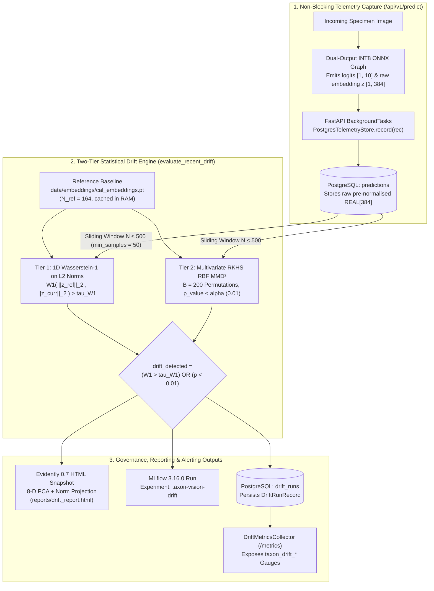

# Two-Tier Statistical Drift Detection & Telemetry Persistence

## 1. Conceptual Motivation: Why Vision Models Decay Silently and How Drift Detection Restores Guarantees

When a conventional web microservice fails - for instance, when a database table is missing or a JSON payload is malformed - it raises an immediate runtime exception and returns an HTTP `4xx` or `5xx` status code. Standard DevOps monitoring easily catches such crashes.

Machine learning models fail in a far more insidious manner: **silent epistemic decay**. Suppose our taxonomic classifier is trained and calibrated on springtime citizen-science photographs of adult monarch butterflies (*Danaus plexippus*) under bright daylight. Months later, field biologists begin uploading autumn camera-trap images captured under heavy morning fog, lens condensation, or different foliage backgrounds. The FastAPI `/api/v1/predict` endpoint continues to return HTTP `200 OK` in ~50 milliseconds on CPU INT8 (or under 15 milliseconds on GPU), and the CPU and memory graphs in Grafana look completely normal. Yet the underlying probability distribution of the input images $P_{\text{live}}(X)$ has shifted away from the calibration distribution $P_{\text{cal}}(X)$ - a phenomenon known as **covariate shift** or **representation drift**.

In TaxonVision-MLOps, detecting representation drift is not merely a heuristic "nice-to-have"; it is a **strict mathematical requirement** for our Split Conformal Prediction safety guarantee:

$$P\big(Y_{n+1} \in C(X_{n+1})\big) \ge 1 - \alpha \quad (\text{where } 1 - \alpha = 95\%)$$

By Vovk et al. (2005), this finite-sample coverage bound holds **if and only if** the new test observation $(X_{n+1}, Y_{n+1})$ is **exchangeable** with the calibration sample $\{(X_i, Y_i)\}_{i=1}^n$ stored in `cal_embeddings.pt`. Once $P_{\text{live}}(X) \ne P_{\text{cal}}(X)$, exchangeability is broken and the $95\%$ coverage guarantee is mathematically void until the model is retrained and recalibrated.

### Why Naive Column-by-Column Drift Tests Fail on Embeddings

A beginner's first instinct is often to pass the 384-dimensional DINOv3 feature vector $\mathbf{z} \in \mathbb{R}^{384}$ into a standard tabular monitoring tool that runs a univariate Kolmogorov-Smirnov (KS) test on each coordinate $z_1, z_2, \dots, z_{384}$ at significance level $\alpha = 0.01$. That approach fails for two reasons:

1. **Multiple-Testing False-Alarm Explosion:** Running $D = 384$ independent hypothesis tests at $\alpha = 0.01$ inflates the family-wise false-positive rate under the null hypothesis to $1 - (1 - 0.01)^{384} \approx 97.9\%$. The monitor would trigger false drift alarms on almost every single batch of healthy traffic.
2. **Blindness to Covariance Rotations:** Marginal 1D tests inspect each coordinate in isolation and cannot detect angular rotations or class-composition shifts across the joint 384-dimensional manifold.

To achieve both **zero-false-alarm stability** and **full multivariate sensitivity**, TaxonVision-MLOps implements a **Two-Tier Statistical Drift Architecture** in [`src/taxon_vision/monitoring/drift.py`](file:///home/benni/Documents/antigravity_workspace/taxon-vision-mlops/src/taxon_vision/monitoring/drift.py) and [`src/taxon_vision/monitoring/drift_runner.py`](file:///home/benni/Documents/antigravity_workspace/taxon-vision-mlops/src/taxon_vision/monitoring/drift_runner.py).



---

## 2. The Pre-Normalisation Architectural Invariant

Before examining the two statistical tests, a crucial representation invariant must be understood:

> [!CAUTION]
> **Never L2-Normalise Embeddings Before Drift Evaluation:** Cosine classification heads and vector similarity indices (such as LanceDB) project feature embeddings onto the unit hypersphere $\hat{\mathbf{z}} = \mathbf{z} / \|\mathbf{z}\|_2$ so that $\|\hat{\mathbf{z}}\|_2 \equiv 1.0$. If unit-normalised vectors were persisted to the telemetry database, every observation's Euclidean norm would equal $1.0$, forcing the Tier 1 Wasserstein-1 distance on vector norms to evaluate identically to $|1.0 - 1.0| = 0.0$ regardless of how severely the input imagery degraded.

Consequently, [`ONNXInferenceEngine.predict_outputs()`](file:///home/benni/Documents/antigravity_workspace/taxon-vision-mlops/src/taxon_vision/inference/onnx_engine.py) and Stage 3 (`extract_features.py`) emit **raw pre-normalised penultimate activations** $\mathbf{z} \in \mathbb{R}^{384}$. These unnormalised vectors are stored in `predictions.embedding` (`REAL[]`) so that Tier 1 captures radial activation magnitude shifts (caused by blur, exposure anomalies, or out-of-distribution textures) whilst Tier 2 captures both radial and angular manifold shifts.

---

## 3. Tier 1: Exact 1D Wasserstein-1 Distance on Embedding Norms

### 3.1 Mathematical Formulation (`compute_wasserstein_drift`)

Tier 1 projects each $D$-dimensional pre-normalised feature vector onto its scalar Euclidean $L_2$ norm $u_i = \|\mathbf{z}_i\|_2 = \sqrt{\sum_{d=1}^D z_{i,d}^2}$ and computes the exact 1D **Kantorovich-Rubinstein Wasserstein-1 (Earth Mover's) distance** between the empirical cumulative distribution functions (CDFs) $F_{\text{ref}}(u)$ and $F_{\text{curr}}(u)$ via [`compute_wasserstein_drift()`](file:///home/benni/Documents/antigravity_workspace/taxon-vision-mlops/src/taxon_vision/monitoring/drift.py#L46-L75):

$$W_1(P_{\text{ref}}, P_{\text{curr}}) = \int_{-\infty}^{\infty} \left| F_{\text{ref}}(u) - F_{\text{curr}}(u) \right| \, du$$

* **Why Exact CDF Integration Beats Mean Differences:** Simply comparing first moments $|\mathbb{E}[\|\mathbf{z}_{\text{ref}}\|_2] - \mathbb{E}[\|\mathbf{z}_{\text{curr}}\|_2]|$ fails whenever a distribution splits bimodally or widens in variance while keeping its mean constant. Integrating the absolute area between the sorted empirical CDFs (`scipy.stats.wasserstein_distance`) captures shifts in location, scale, skewness, and tail heaviness in $\mathcal{O}(N D + N \log N)$ time ($< 1\,\text{ms}$ on CPU).

### 3.2 Bootstrap Null-Distribution Threshold Calibration (`calibrate_drift.py`)

What value of $W_1$ constitutes a genuine drift alert? Hardcoding an arbitrary magic number (such as $\tau = 0.35$) is unscientific because finite samples drawn from the *exact same* biological distribution always exhibit non-zero sample-to-sample Wasserstein distance due to random sampling variance, and different vision backbones (`dinov3` vs `bioclip-2`) produce different activation norm scales.

To derive a mathematically defensible threshold with a controlled **$1\%$ false-alarm rate ($\alpha = 0.01$)**, [`src/taxon_vision/pipelines/calibrate_drift.py`](file:///home/benni/Documents/antigravity_workspace/taxon-vision-mlops/src/taxon_vision/pipelines/calibrate_drift.py) executes a **1,000-iteration bootstrap null-distribution simulation** ([`calibrate_drift_threshold()`](file:///home/benni/Documents/antigravity_workspace/taxon-vision-mlops/src/taxon_vision/pipelines/calibrate_drift.py#L124-L181)):

1. Loads the pre-normalised Euclidean norms of the in-distribution calibration split (`data/embeddings/cal_embeddings.pt`, currently $N_{\text{cal}} = 164$; $N = 169$ in the initial bootstrap calibration snapshot recorded below) and the independent in-distribution holdout test split (`data/embeddings/test_embeddings.pt`, currently $N_{\text{test}} = 164$).
2. For $b = 1, \dots, 1{,}000$ iterations (seeded deterministically with `seed = 42`), draws a random bootstrap sample from `test_norms` and computes the null Wasserstein-1 distance $W_1^{(b)}$ against `ref_norms`.
3. Selects the **99th percentile** of $\big\{W_1^{(1)}, \dots, W_1^{(1000)}\big\}$ as the calibrated alert ceiling $\tau_{W_1}$ and writes [`config/drift_config.yaml`](file:///home/benni/Documents/antigravity_workspace/taxon-vision-mlops/config/drift_config.yaml) alongside the cryptographic SHA-256 digest of `cal_embeddings.pt`:

```yaml
drift:
  tau_w1: 0.12812
  alpha: 0.01
  window_size: 169
  n_bootstraps: 1000
  percentile: 99.0
  null_median_w1: 0.071163
  null_max_w1: 0.163083
  reference_source: data/embeddings/cal_embeddings.pt
  reference_sha256: 0a676f8ac95edb1a255906ed02b7f8bb1d143493056b3abd0de0659a2af1583f
  test_source: data/embeddings/test_embeddings.pt
  calibrated_at: '2026-11-02T12:16:47.473824+00:00'
```

> [!NOTE]
> **Configuration Resolution Nuance Across Training vs. Serving:** Stage 3.5 (`src/taxon_vision/pipelines/data_drift.py`) explicitly parses `config/drift_config.yaml` via `_resolve_drift_thresholds()`, applying the calibrated $\tau_{W_1} = 0.12812$. The online serving evaluator (`src/taxon_vision/monitoring/drift_runner.py`) currently reads `resolved_settings.drift.tau_w1`, which defaults to `0.15` in `config/default_config.yaml` unless overridden at runtime via `TAXON_DRIFT__TAU_W1=0.12812`.

---

## 4. Tier 2: Multivariate RKHS Maximum Mean Discrepancy (`compute_mmd2_permutation`)

Whilst Tier 1 catches radial magnitude shifts in sub-millisecond time, a seasonal shift in species composition (for instance, 90% of incoming photos suddenly depicting *Canis lupus* instead of *Danaus plexippus*) rotates the embedding distribution along the surface of the hypersphere without necessarily altering average vector lengths.

To detect arbitrary multivariate distribution shifts across all $D = 384$ dimensions simultaneously without parametric assumptions, [`compute_mmd2_permutation()`](file:///home/benni/Documents/antigravity_workspace/taxon-vision-mlops/src/taxon_vision/monitoring/drift.py#L113-L186) in [`src/taxon_vision/monitoring/drift.py`](file:///home/benni/Documents/antigravity_workspace/taxon-vision-mlops/src/taxon_vision/monitoring/drift.py) evaluates the **unbiased squared Maximum Mean Discrepancy ($\text{MMD}_u^2$)** in a Reproducing Kernel Hilbert Space (RKHS) (Gretton et al., 2012).

### 4.1 Unbiased Estimator & Median Heuristic Bandwidth

Given reference embeddings $X = \{\mathbf{x}_1, \dots, \mathbf{x}_m\} \sim P_{\text{ref}}$ and current window embeddings $Y = \{\mathbf{y}_1, \dots, \mathbf{y}_n\} \sim P_{\text{curr}}$ (subsampled without replacement to at most `max_samples = 500` each):

1. **Pooled Pairwise Distance Matrix:** Concatenates $\mathbf{Z} = [X; Y] \in \mathbb{R}^{(m+n) \times D}$ and computes the exact pairwise squared Euclidean distance matrix $D_{ij}^2 = \|\mathbf{z}_i - \mathbf{z}_j\|_2^2$ via vectorised Einstein summation (`np.einsum`).
2. **Median Heuristic Bandwidth ($\sigma$):** To prevent kernel saturation across varying embedding dimensionalities, the Radial Basis Function (RBF) bandwidth $\sigma$ is chosen adaptively from the median of all off-diagonal pairwise squared distances:

    $$\sigma = \sqrt{\frac{1}{2} \operatorname{median}_{i \ne j}\left(\|\mathbf{z}_i - \mathbf{z}_j\|_2^2\right)}, \qquad k(\mathbf{z}_i, \mathbf{z}_j) = \exp\left(-\frac{\|\mathbf{z}_i - \mathbf{z}_j\|_2^2}{2\sigma^2}\right)$$

3. **Unbiased $\text{MMD}_u^2$ Statistic (`_mmd2_unbiased`):** Excludes self-similarity diagonal terms ($i = j$) to yield an unbiased finite-sample estimator whose expectation under the null hypothesis $P_{\text{ref}} = P_{\text{curr}}$ is exactly $0$:

    $$\text{MMD}_u^2(X, Y) = \frac{1}{m(m - 1)} \sum_{i=1}^m \sum_{j \ne i}^m k(\mathbf{x}_i, \mathbf{x}_j) + \frac{1}{n(n - 1)} \sum_{i=1}^n \sum_{j \ne i}^n k(\mathbf{y}_i, \mathbf{y}_j) - \frac{2}{mn} \sum_{i=1}^m \sum_{j=1}^n k(\mathbf{x}_i, \mathbf{y}_j)$$

### 4.2 Exact Finite-Sample Monte Carlo Permutation Test

Rather than relying on asymptotic Chi-square approximations that break on moderate window sizes ($N \in [50, 500]$), `compute_mmd2_permutation()` computes an exact distribution-free $p$-value using **Gram-matrix index permutation**:

* Because the $(m+n) \times (m+n)$ RBF Gram matrix $\mathbf{K}$ is computed once up front, each of the $B = 200$ permutations simply shuffles the index array $\pi = \text{rng.permutation}(m + n)$ and slices $\mathbf{K}[\pi, \pi]$ in $\mathcal{O}((m+n)^2)$ time without recomputing distances or exponentials.
* Counting the number of permuted statistics $N_{\text{exceed}}$ that satisfy $\text{MMD}_u^2(\mathbf{K}[\pi, \pi]) \ge \text{MMD}_{\text{obs}}^2$, the exact finite-sample $p$-value with +1 continuity correction (Davison & Hinkley, 1997) is:

    $$p = \frac{N_{\text{exceed}} + 1}{B + 1} = \frac{N_{\text{exceed}} + 1}{201}$$

* If $p < \alpha = 0.01$, the null hypothesis of exchangeability is rejected and `drift_detected` is set to `True`.

---

## 5. End-to-End Drift Runner, Evidently 8-D PCA Snapshot & Prometheus Collector

### 5.1 Unified Execution Orchestrator (`evaluate_recent_drift`)

[`evaluate_recent_drift()`](file:///home/benni/Documents/antigravity_workspace/taxon-vision-mlops/src/taxon_vision/monitoring/drift_runner.py#L191-L343) in [`src/taxon_vision/monitoring/drift_runner.py`](file:///home/benni/Documents/antigravity_workspace/taxon-vision-mlops/src/taxon_vision/monitoring/drift_runner.py) coordinates the complete evaluation lifecycle:

1. **In-Memory Reference Caching (`load_reference_embeddings`):** Deserialises `data/embeddings/cal_embeddings.pt` once and caches the contiguous float32 array in `_REFERENCE_CACHE` to avoid repeated disk I/O across hourly runs.
2. **Minimum Sample Guardrail (`min_samples = 50`):** Queries `store.recent_embeddings(limit=500)`. If fewer than 50 predictions have been recorded in PostgreSQL, returns `DriftVerdict(drift_detected=False, status="insufficient_data", ...)` immediately so cold-started deployments never trigger false retraining alarms.
3. **Two-Tier Evaluation:** Computes `w1_distance` (Tier 1) and `mmd_res` (Tier 2), setting `drift_detected = bool(w1_distance > tau_w1 or p_val < alpha)`.
4. **Compact 8-D PCA Evidently 0.7 HTML Report (`generate_evidently_drift_report`):** Passing all 384 raw embedding columns into Evidently produces bloated, multi-megabyte HTML files that take tens of seconds to render. Instead, `generate_evidently_drift_report()` fits an 8-component Principal Component Analysis (`PCA(n_components=8, random_state=42)`) on the reference embeddings, projects both reference and current windows onto `["norm", "pca_0", ..., "pca_7"]`, and executes Evidently 0.7's `Report(metrics=[DataDriftPreset()]).run(...)` to save a fast, human-interpretable standalone report at `reports/drift_report.html`.
5. **MLflow & PostgreSQL Persistence:** Logs `drift_w1`, `drift_w1_threshold`, `drift_mmd2`, `drift_mmd2_p_value`, `window_size`, and `reports/drift_report.html` into the MLflow experiment `taxon-vision-drift`, and inserts a [`DriftRunRecord`](file:///home/benni/Documents/antigravity_workspace/taxon-vision-mlops/src/taxon_vision/service/telemetry_store.py#L68-L95) into the PostgreSQL `drift_runs` table.

### 5.2 Custom Prometheus Collector (`DriftMetricsCollector`)

Whenever Prometheus scrapes `GET /metrics`, [`DriftMetricsCollector.collect()`](file:///home/benni/Documents/antigravity_workspace/taxon-vision-mlops/src/taxon_vision/monitoring/telemetry.py) queries `get_telemetry_store().latest_drift_run()` and dynamically emits five gauge families:

* `taxon_drift_w1_distance`: Latest observed 1D Wasserstein-1 distance on embedding norms.
* `taxon_drift_w1_threshold`: Active $\tau_{W_1}$ decision threshold.
* `taxon_drift_mmd2_p_value`: Latest Monte Carlo permutation $p$-value ($p \in [1/201, 1.0]$).
* `taxon_drift_detected`: Binary indicator (`1.0` if drift detected, `0.0` if nominal).
* `taxon_drift_last_run_timestamp_seconds`: UNIX epoch timestamp of the latest drift evaluation.

---

## 6. Training-Side vs. Serving-Side Drift Comparison

TaxonVision-MLOps applies the exact same two-tier mathematical engine (`compute_wasserstein_drift`, `compute_mmd2_permutation`, and `generate_evidently_drift_report`) at two distinct points in the MLOps loop:

| Dimension | Training-Side Drift Audit (DVC Stage 3.5) | Serving-Side Online Drift Monitor (Station 5) |
| :--- | :--- | :--- |
| **Entrypoint & Trigger** | `python -m taxon_vision.pipelines.data_drift` (automatic DVC stage before `train`) | `POST /api/v1/drift/evaluate` (triggered hourly by Airflow `prediction_drift_monitor`) |
| **Reference Population ($P_{\text{ref}}$)** | `data/reference/reference_train_embeddings.pt` (historical training baseline) | `data/embeddings/cal_embeddings.pt` (active Split Conformal calibration split) |
| **Current Population ($P_{\text{curr}}$)** | `data/embeddings/train_embeddings.pt` (newly extracted training split) | PostgreSQL `predictions` table (`ORDER BY created_at DESC LIMIT 500`) |
| **MLflow Target Experiment** | `taxon-vision-head-training` (`run_name="training_data_drift"`, tag `drift_scope="training"`) | `taxon-vision-drift` (`run_name="drift_evaluation"`) |
| **Output Artefacts** | `reports/data_drift.json` & `reports/data_drift_report.html` | PostgreSQL `drift_runs` row & `reports/drift_report.html` |
| **Downstream Governance Role** | Audits representation stability of new training data prior to Stage 4 gradient descent | Drives Grafana alerts, Active Model Passport badge, Stage 7 Gate 4 exchangeability, and automated retraining |

---

## 7. Synthetic Traffic Generation & Live Drift Validation

Cold-started or freshly deployed Kubernetes clusters operate with unpopulated PostgreSQL tables and empty Prometheus time-series buffers, displaying "No data" across Grafana panels. To validate telemetry pipelines without waiting for asynchronous organic field traffic, TaxonVision provides a dedicated simulation utility in [`scripts/maintenance/simulate_traffic.py`](file:///home/benni/Documents/antigravity_workspace/taxon-vision-mlops/scripts/maintenance/simulate_traffic.py).

### 7.1 Operational Mechanics

```bash
# Dispatch 60 synthetic observation requests at 50ms pacing and trigger drift evaluation
pixi run -e dev python scripts/maintenance/simulate_traffic.py --count 60 --delay-ms 50 --trigger-drift
```

* **Warmup & Pacing:** Iterates through genuine sample images in `data/sample/`, formats multipart HTTP POST requests, and transmits them to `/api/v1/predict` at a controlled rate (`--delay-ms`).
* **PostgreSQL Population:** Verifies that raw pre-normalised activations $\mathbf{z} \in \mathbb{R}^{384}$ are successfully persisted to `predictions.embedding` via non-blocking FastAPI `BackgroundTasks`.
* **Immediate Drift Evaluation:** When `--trigger-drift` is set, calls `POST /api/v1/drift/evaluate` immediately upon completing the batch, triggering Tier 1 Wasserstein-1 calculation, Tier 2 MMD² permutation tests, and Evidently 8-D PCA snapshot rendering.
* **Metric Verification:** Asserts that Prometheus counters `taxon_predictions_total` and drift gauges `taxon_drift_w1_distance` increment as expected, transitioning Grafana dashboards to green status.
