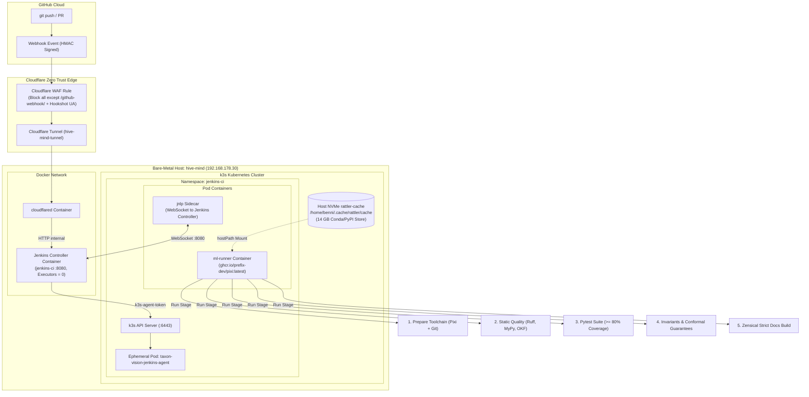
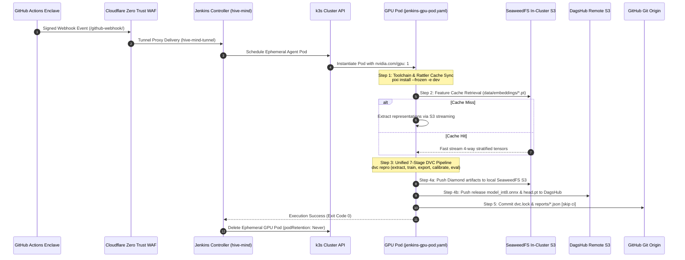
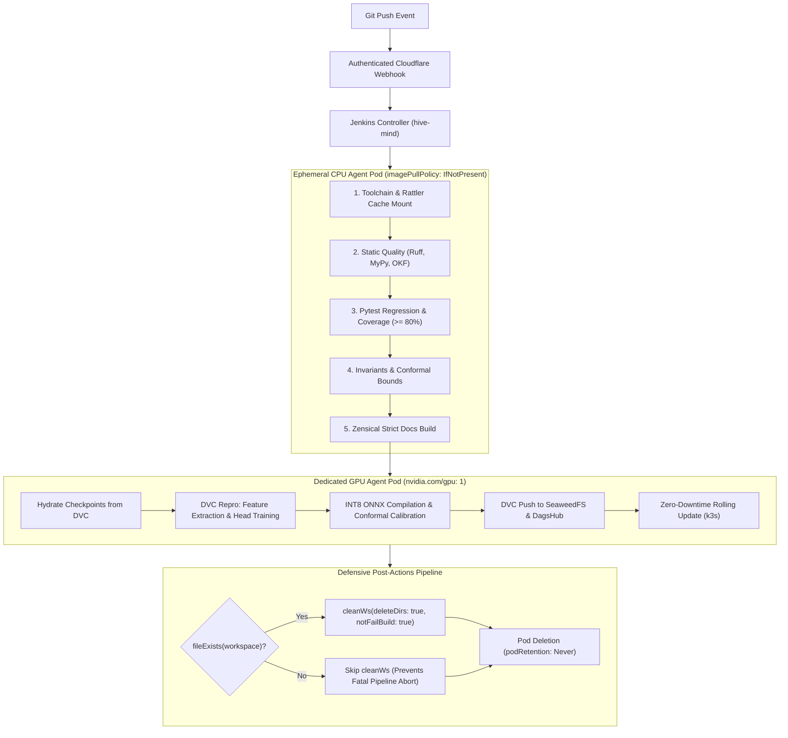

# Jenkins CI/CD Architecture & Ephemeral Runner Topology

This document records the architectural design, security topology, and implementation details of the bare-metal CI/CD infrastructure powering TaxonVision on `hive-mind`.



---

## 1. Architectural Principles & Design Invariants

The bare-metal CI/CD design resolves the operational tension between developer agility, bare-metal hardware utilization, and edge security:

* **Zero Public Ingress Ports:** Rather than exposing home router NAT ports or DDNS records, all external ingress terminates on Cloudflare edge servers and routes to the host via an outbound-initiated tunnel (`cloudflared`).
* **Edge-Level Attack Surface Elimination:** The public controller hostname is shielded by a Cloudflare WAF custom expression that blocks 100% of standard web browser traffic, search crawler requests, and automated scanners, permitting solely authenticated GitHub webhook deliveries.
* **Separation of Control and Execution Planes:** The Jenkins controller is configured with 0 local executors. It acts exclusively as a workflow orchestrator, dispatching workloads to isolated, disposable Kubernetes pods.
* **Ephemeral Pod Lifecycle:** Build agents are scheduled on-demand inside `k3s` using RBAC ServiceAccount (`jenkins-agent-sa`) and deleted immediately upon pipeline completion (`podRetention: Never`), eliminating environment drift and dirty state accumulation across builds.
* **Hardware Slicing & Cache Acceleration:** Continuous integration test suites run against CPU profiles (`ci-dev`), preserving the single RTX 5070 Ti GPU for training and real-time inference. Package resolution latency is reduced from minutes to seconds via a shared NVMe Rattler cache mount.

---

## 2. Ingress Architecture & Edge Security

### 2.1 Domain Separation Strategy

To ensure strict operational isolation between primary identity services (`.de`) and CI/CD infrastructure, a dedicated domain (`benjamin-foerster.eu`) was acquired via Strato. This decouples DNS management, edge certificate rotation, and Zero Trust access policies from personal web properties.

### 2.2 Nameserver Delegation & Cloudflare Zone

Strato nameservers were replaced with designated Cloudflare Zero Trust nameservers (`jean.ns.cloudflare.com` and `keanu.ns.cloudflare.com`). Default parking records (A, AAAA, CNAME `www`/`*`, and `_autodiscover._tcp`) were deleted during onboarding to ensure all inbound resolution passes through Cloudflare proxy nodes without legacy record interference.

### 2.3 Cloudflare Tunnel Topology

The connection between the Cloudflare Edge and the physical server is maintained by a lightweight daemon (`cloudflared`) running in Docker. The tunnel (`hive-mind-tunnel`) initiates outbound HTTPS/QUIC connections to Cloudflare point-of-presence (PoP) edge nodes, establishing a virtual conduit.

Within Cloudflare Zero Trust, public ingress for `jenkins.benjamin-foerster.eu` is routed over the tunnel directly to the container service destination `http://jenkins:8080` across the internal Docker bridge network.

### 2.4 Cloudflare WAF Edge Filtering

Because the controller URL is publicly resolvable, a Cloudflare WAF rule enforces perimeter isolation. The rule evaluates every incoming HTTP request at the Cloudflare Edge:

```text
(http.host eq "jenkins.benjamin-foerster.eu" and not (http.request.uri.path eq "/github-webhook/" and http.user_agent contains "GitHub-Hookshot"))
```

* **Permitted Traffic:** Requests targeting `/github-webhook/` containing the official `GitHub-Hookshot` user-agent header.
* **Blocked Traffic:** All direct browser requests, port scans, and automated vulnerability probes, which receive an HTTP 403 Block response from Cloudflare before reaching the host tunnel.

---

## 3. Host Container Topology on `hive-mind`

### 3.1 Docker Stack Configuration

The Jenkins controller and the Cloudflare Tunnel daemon operate as co-located services within `/home/benni/jenkins/docker-compose.yml`:

```yaml
services:
  jenkins:
    image: jenkins/jenkins:lts-jdk25
    container_name: jenkins-ci
    restart: unless-stopped
    user: root
    ports:
      - "8080:8080"
      - "50000:50000"
    extra_hosts:
      - "host.docker.internal:host-gateway"
    volumes:
      - ./jenkins_home:/var/jenkins_home
      - /var/run/docker.sock:/var/run/docker.sock
      - /usr/bin/docker:/usr/bin/docker:ro
    environment:
      - JAVA_OPTS=-Djenkins.install.runSetupWizard=false

  cloudflared:
    image: cloudflare/cloudflared:latest
    container_name: cloudflared-tunnel
    restart: unless-stopped
    command: tunnel --no-autoupdate run --token ${TUNNEL_TOKEN}
    depends_on:
      - jenkins
```

* **Storage Persistence:** Controller state, plugin binaries, job definitions, and credentials reside in `/home/benni/jenkins/jenkins_home`.
* **Zero Setup Wizard:** The environment flag `JAVA_OPTS=-Djenkins.install.runSetupWizard=false` allows programmatic bootstrap without default setup wizard blocks.
* **Service Dependency:** The tunnel daemon declares `depends_on: [jenkins]`, ensuring local endpoints are available before tunnel links register.
* **Secret Isolation via `.env`:** The Cloudflare tunnel token is strictly decoupled from the compose specification and housed within an access-restricted environment file (`/home/benni/jenkins/.env`, permission `chmod 600`), interpolated at container start via `${TUNNEL_TOKEN}` to prevent credential leakage in process tables and configuration logs.

### 3.2 Controller Hardening Measures

* **Built-In Node Deprovisioning:** The built-in Jenkins node is configured with 0 executors. This ensures untrusted pipeline scripts cannot execute commands directly on the controller container or access mounted host sockets.
* **Canonical URL Configuration:** The canonical Jenkins URL is designated as `https://jenkins.benjamin-foerster.eu/`. Local administrative access occurs over LAN (`http://192.168.178.30:8080`), bypassing the external WAF block.

---

## 4. GitHub Integration & Authentication Architecture

The automated build ingestion pipeline integrates four core elements:

* **GitHub Webhook:** Configured repository webhook delivering event payloads to `https://jenkins.benjamin-foerster.eu/github-webhook/`.
* **Shared Secret:** HMAC secret stored within Jenkins Credentials to validate payload integrity and sender authenticity.
* **Jenkins Multibranch Pipeline Job:** Discovers active repository branches and open pull requests automatically.
* **Kubernetes Build Agent:** Isolated execution environment provisioned inside the `jenkins-ci` namespace.

### 4.1 Webhook Verification & HMAC Signatures

GitHub webhook deliveries are cryptographically validated using an HMAC shared secret stored within Jenkins Global Credentials (`github-webhook-secret`). When GitHub dispatches payload data, the Jenkins GitHub plugin evaluates the `X-Hub-Signature-256` digest header against this secret before queuing pipeline jobs, preventing unauthorized job triggers.

### 4.2 GitHub App Authentication & Checks API Integration

Rather than relying on legacy Personal Access Tokens (PATs) bound to a single user account, Jenkins authenticates using a dedicated GitHub App (`jenkins-ci-hivemind`, App ID `5392046`) via asymmetric RSA-2048 private key cryptography (`.pem`):

* **Checks API vs. Personal Access Token Restrictions:** GitHub's Checks API (`POST /repos/{owner}/{repo}/check-runs`) strictly rejects Personal Access Tokens with an HTTP 403 Forbidden status. Authenticating as a registered GitHub App enables Jenkins to publish rich, stage-by-stage check runs directly to the pull request interface, displaying individual unit test results, coverage metrics, and build durations.
* **Granular Least-Privilege Scopes:** The GitHub App is constrained strictly to necessary capabilities (`Checks: Read & write`, `Commit statuses: Read & write`, `Contents: Read-only`, `Pull requests: Read & write`, `Metadata: Read-only`), preventing broader account-level compromise.
* **Branch Source Integration:** The GitHub Branch Source plugin utilizes the `jenkins-github-app` credential for automated branch and pull request discovery, eliminating basic-auth HTTPS credentials for Git checkout operations.

### 4.3 Multibranch Pipeline Discovery & Governance

The pipeline project (`taxon-vision-mlops`) is configured as a Multibranch Pipeline:

* **PR Branch De-duplication:** The branch discovery strategy explicitly excludes branches that have open pull requests, preventing redundant parallel executions on identical commit hashes.
* **Orphaned Item Cleanup:** An automated pruning policy (`Days to keep: 7`, `Max # to keep: 10`) terminates active builds and removes cached job items if a feature branch or pull request is deleted on GitHub.

---

## 5. k3s Kubernetes Agent Topology

### 5.1 RBAC Manifest & Security Envelope Architecture

The Kubernetes security boundary governing dynamic runner pod provisioning is defined in [deploy/k8s/jenkins-agent-rbac.yaml](file:///home/benni/Documents/antigravity_workspace/taxon-vision-mlops/deploy/k8s/jenkins-agent-rbac.yaml). This manifest establishes a least-privilege administrative boundary within `k3s`, preventing ephemeral pipeline agents or controller provisioning operations from interacting with cluster system services or other namespaces.

```yaml
apiVersion: v1
kind: Namespace
metadata:
  name: jenkins-ci
---
apiVersion: v1
kind: ServiceAccount
metadata:
  name: jenkins-agent
  namespace: jenkins-ci
---
apiVersion: rbac.authorization.k8s.io/v1
kind: Role
metadata:
  name: jenkins-agent-role
  namespace: jenkins-ci
rules:
  - apiGroups: [""]
    resources: ["pods", "pods/exec", "pods/log"]
    verbs: ["create", "delete", "get", "list", "patch", "update", "watch"]
  - apiGroups: [""]
    resources: ["events"]
    verbs: ["get", "list", "watch"]
---
apiVersion: rbac.authorization.k8s.io/v1
kind: RoleBinding
metadata:
  name: jenkins-agent-binding
  namespace: jenkins-ci
subjects:
  - kind: ServiceAccount
    name: jenkins-agent
    namespace: jenkins-ci
roleRef:
  kind: Role
  name: jenkins-agent-role
  apiGroup: rbac.authorization.k8s.io
---
apiVersion: v1
kind: Secret
metadata:
  name: jenkins-agent-token
  namespace: jenkins-ci
  annotations:
    kubernetes.io/service-account.name: jenkins-agent
type: kubernetes.io/service-account-token
---
apiVersion: v1
kind: Namespace
metadata:
  name: taxon-vision
---
apiVersion: rbac.authorization.k8s.io/v1
kind: Role
metadata:
  name: jenkins-deployer-role
  namespace: taxon-vision
rules:
  - apiGroups: ["apps"]
    resources: ["deployments"]
    verbs: ["create", "delete", "get", "list", "patch", "update", "watch"]
  - apiGroups: [""]
    resources: ["services", "pods", "pods/log", "events"]
    verbs: ["create", "delete", "get", "list", "patch", "update", "watch"]
---
apiVersion: rbac.authorization.k8s.io/v1
kind: RoleBinding
metadata:
  name: jenkins-deployer-binding
  namespace: taxon-vision
subjects:
  - kind: ServiceAccount
    name: jenkins-agent
    namespace: jenkins-ci
roleRef:
  kind: Role
  name: jenkins-deployer-role
  apiGroup: rbac.authorization.k8s.io
```

#### Detailed Breakdown of Manifest Resources

The manifest declares eight Kubernetes objects designed to isolate runtime compute, decouple authentication, and restrict administrative verbs:

* **1. Namespace (`jenkins-ci`): Execution Boundary Isolation**
    * Creates an explicit organizational and security perimeter for all transient CI/CD operations.
    * Isolates pod creation, ephemeral storage, and secret tokens from the `default` and `kube-system` namespaces.
    * Restricts the blast radius of runaway processes, pod crashes, or resource exhaustion to a dedicated slice of cluster resources.

* **2. ServiceAccount (`jenkins-agent`): Least-Privilege Identity**
    * Defines a non-human, machine identity within the `jenkins-ci` namespace.
    * Adheres strictly to the Principle of Least Privilege (PoLP) by preventing the Jenkins controller from running with cluster-wide administrative privileges (`cluster-admin`).
    * Ensures that tokens issued to Jenkins can only authenticate actions within this single namespace.

* **3. Role (`jenkins-agent-role`): Granular RBAC Permissions**
    * Scoped strictly at the namespace level (`Role`) rather than cluster-wide (`ClusterRole`).
    * **Core Pod Operations (`pods`, verbs: `create`, `delete`, `get`, `list`, `patch`, `update`, `watch`):**
        * `create`: Allows the Jenkins Kubernetes plugin to provision ephemeral runner pods dynamically when jobs enter the build queue.
        * `delete`: Allows automated cleanup and garbage collection of runner pods upon build completion, pipeline abort, or timeout.
        * `get`, `list`, `watch`: Enables the controller to observe state changes as pods transition through `Pending`, `ContainerCreating`, `Running`, `Completed`, or `Error`.
        * `patch`, `update`: Permits the controller to update pod metadata, labels, and termination state during pipeline execution.
    * **Interactive Command Execution (`pods/exec`, verbs: `create`, `get`):**
        * Grants permission to invoke in-container command pipelines via the Kubernetes API streaming channel. This powers declarative pipeline steps such as `container('ml-runner') { sh '...' }`.
    * **Console Telemetry Streaming (`pods/log`, verbs: `get`, `list`, `watch`):**
        * Grants streaming access to standard output and standard error from both the `jnlp` sidecar and the `ml-runner` container, piping build logs directly into the Jenkins console in real time.
    * **Cluster Diagnostic Observability (`events`, verbs: `get`, `list`, `watch`):**
        * Permits read-only observation of Kubernetes cluster events in `jenkins-ci`. When an agent fails to schedule or crashes (e.g. `FailedScheduling` due to CPU limits, `ImagePullBackOff`, or `OOMKilled`), Jenkins captures the event message and surfaces the root cause in the build console.

* **4. RoleBinding (`jenkins-agent-binding`): Association & Scope Containment**
    * Attaches the `jenkins-agent` ServiceAccount to `jenkins-agent-role` strictly within the `jenkins-ci` namespace.
    * Guarantees that the granted capabilities cannot be exercised outside the `jenkins-ci` namespace boundary.

* **5. Secret (`jenkins-agent-token`): Modern Token Controller Bootstrapping**
    * Declared with `type: kubernetes.io/service-account-token` and annotation `kubernetes.io/service-account.name: jenkins-agent`.
    * **Kubernetes v1.24+ Context:** Starting in Kubernetes v1.24, the control plane no longer auto-generates perpetual secret tokens upon `ServiceAccount` creation, favoring ephemeral projected volume tokens. However, external controllers (such as Jenkins running in Docker outside the Kubernetes control plane) require a persistent bearer token to authenticate over `https://192.168.178.30:6443`.
    * Declaring this Secret explicitly instructs the Kubernetes `service-account-token` controller to mint a signed bearer JWT, embed the cluster CA certificate, and populate the secret data fields dynamically. This avoids hardcoding sensitive credentials in source control while providing a stable authentication token for the Jenkins Kubernetes Cloud plugin.

* **6. Namespace (`taxon-vision`): Application Runtime Perimeter**
    * Isolates the production web serving layer and model inference containers (`taxon-vision-api`) from CI/CD runners and cluster system daemons.

* **7. Role (`jenkins-deployer-role`): Continuous Delivery Privileges**
    * Grants permissions to create, update, patch, and watch `deployments` (apps API group), `services`, `pods`, `pods/log`, `events`, `configmaps`, `secrets`, `persistentvolumeclaims` (core API group), and `ingressroutes`, `traefikservices`, `middlewares` (`traefik.io` API group) strictly inside `taxon-vision`.
    * Enables declarative deployment of serving pods, storage volumes, Traefik canary ingress routes, and monitoring stacks (Prometheus and Grafana) without requiring cluster-wide admin rights or brittle host-level automation.

* **8. RoleBinding (`jenkins-deployer-binding`): Cross-Namespace Deployment Authorization**
    * Maps the `jenkins-agent` identity in `jenkins-ci` to `jenkins-deployer-role` in `taxon-vision`.
    * Enables the in-cluster runner to execute `kubectl apply -f deploy/k8s/api-deployment.yaml`, `kubectl apply -f deploy/k8s/monitoring-prometheus-grafana.yaml`, and `kubectl rollout restart deployment/taxon-vision-api` seamlessly upon successful test completion.

### 5.2 Architectural Alternatives for Continuous Delivery

When designing continuous deployment into Kubernetes, engineering teams face distinct trade-offs across four operational paradigms:

```mermaid
flowchart TD
    subgraph PatternA ["1. Scoped Role (Current Implementation)"]
        JA1["jenkins-agent SA"] -->|Limited Verbs/Resources| R1["Role: jenkins-deployer-role<br/>(taxon-vision only)"]
        R1 --> K8S1["k3s API Server"]
    end

    subgraph PatternB ["2. Namespaced Admin Pattern"]
        JA2["jenkins-agent SA"] -->|RoleBinding| CA["ClusterRole: admin<br/>(Bound inside taxon-vision)"]
        CA --> K8S2["k3s API Server"]
    end

    subgraph PatternC ["3. Enterprise GitOps Operator"]
        GIT["Git Manifest Repo"] -->|Continuous Pull| ARGO["ArgoCD / Flux CD Controller<br/>(In-Cluster Reconciler)"]
        ARGO -->|Zero CI Push Access| K8S3["k3s API Server"]
        JC["Jenkins CI Pipeline"] -->|Push Image Tag| GIT
    end

    subgraph PatternD ["4. Host SSH Anti-Pattern (Strictly Prohibited)"]
        JC_SSH["Jenkins Agent"] -.->|Bypasses K8s RBAC| SSH["Host SSH / sudo kubectl"]
        SSH -.->|Host-level compromise| HOST["Host OS hive-mind"]
    end
```



#### Architecture A: Scoped In-Cluster ServiceAccount (Current Production Baseline)

* **Mechanism:** The ephemeral `jenkins-agent` pod runs with an in-cluster ServiceAccount token bound to an explicit `Role` within `namespace: taxon-vision`.
* **Security Strengths:** Implements least-privilege RBAC. If a pipeline job is compromised, the blast radius is strictly confined to explicitly enumerated resource verbs within `taxon-vision`. The agent cannot access `kube-system`, cannot read cluster node secrets, and cannot alter cluster-wide daemonsets.
* **Operational Overhead:** Requires manual RBAC manifest updates whenever new Kubernetes resource types (such as `ConfigMap`, `Secret`, or custom third-party CRDs like `IngressRoute`) are added to deployment manifests.

#### Architecture B: Namespaced Admin RoleBinding Pattern

* **Mechanism:** The `jenkins-agent` ServiceAccount is bound to the native Kubernetes default `ClusterRole/admin` via a namespaced `RoleBinding` inside `taxon-vision`:

    ```yaml
    apiVersion: rbac.authorization.k8s.io/v1
    kind: RoleBinding
    metadata:
      name: jenkins-admin-binding
      namespace: taxon-vision
    subjects:
      - kind: ServiceAccount
        name: jenkins-agent
        namespace: jenkins-ci
    roleRef:
      kind: ClusterRole
      name: admin
      apiGroup: rbac.authorization.k8s.io
    ```

* **Rationale & Trade-offs:** The pre-defined `admin` ClusterRole grants full create, read, update, and delete access to all standard namespaced resources (Deployments, Services, ConfigMaps, Secrets, PVCs, Ingress) while strictly forbidding cluster-scoped modifications (such as Nodes, PersistentVolumes, Namespaces, or RBAC definitions). Binding this role eliminates ongoing maintenance friction when expanding application manifests, while maintaining strong namespace isolation.

#### Architecture C: Enterprise GitOps Operator Pattern (ArgoCD / Flux CD)

* **Mechanism:** Continuous delivery is decoupled from the CI engine. Jenkins executes static quality gates, unit tests, GPU model training, and publishes immutable container images (`ghcr.io/foersben/taxon-vision-mlops:sha-<commit>`). Jenkins updates the desired image tag in a declarative Git repository. An in-cluster GitOps operator (ArgoCD or Flux CD) observes the repository and reconciles cluster state via continuous pull loops.
* **Architectural Advantages:**
    * **Zero Cluster Write Credentials in CI:** The CI runner requires zero Kubernetes write credentials or `kubectl` cluster access, eliminating token leakage risks from CI logs.
    * **Automated Drift Detection & Self-Healing:** The GitOps controller continuously detects out-of-band cluster modifications and reverts them to the declarative Git ground truth.
    * **Auditable Git Rollbacks:** Rolling back production requires solely reverting a Git commit (`git revert`), generating an immutable, cryptographic audit log.

#### Architecture D: Host SSH Execution Anti-Pattern (Strictly Prohibited)

* **The Anti-Pattern:** Granting Jenkins SSH access to the bare-metal host (e.g. `ssh taxon-main "kubectl apply ..."`) or mounting the host Docker socket (`/var/run/docker.sock`) and host kubeconfig (`/root/.kube/config`).
* **Why It Is Forbidden:**
    * **Host Boundary Violation:** Bypasses Kubernetes RBAC and container cgroups isolation, exposing host filesystems (`/home/benni/`, `/mnt/storage/`, LUKS decryption keys) to container processes.
    * **Privilege Escalation:** Any pipeline vulnerability (such as a malicious dependency running arbitrary code during test execution) yields immediate root access to the physical server.
    * **Auditability Collapse:** Kubernetes API server audit logs attribute changes to the cluster administrator rather than the automated CI service identity.

---

### 5.3 Credential Isolation & SSH Key Segregation Principles

A fundamental requirement of production systems engineering is strict segregation between human developer identities and automated machine credentials:

#### The Committer Identity Key Anti-Pattern

Human developers sign Git commits and authenticate SSH terminal sessions using dedicated asymmetric key pairs (e.g. `id_ed25519` or GPG hardware tokens). Storing or loading a personal developer key inside Jenkins or CI runners is strictly prohibited:

* **Identity Spoofing Risk:** A pipeline script executing with a personal key can push arbitrary commits, create signed tags, or access third-party repositories under the developer's name, destroying cryptographic non-repudiation.
* **Credential Blast Radius:** If CI job workspaces or diagnostic memory dumps are inspected, personal SSH keys can be extracted and used to access personal workstations or infrastructure.

#### The Dedicated Machine Deploy Key Pattern

When CI/CD pipelines require Git write access (e.g. pushing automated DVC lockfile updates or generated documentation):

* **Dedicated Machine Identity (`jenkins-ci-hivemind`):** A distinct ED25519 key pair generated exclusively for the CI controller.
* **Scoped Repository Permissions:** Configured in GitHub as a repository Deploy Key with restricted write access strictly limited to `taxon-vision-mlops`, without organization-wide or account-wide permissions.
* **Fine-Grained GitHub App / PAT:** Alternatively, automated automation utilizes a GitHub Fine-Grained Personal Access Token with read/write access scoped exclusively to repository contents and pull requests, expiring on a mandatory 90-day rotation schedule.

#### In-Cluster ServiceAccount Token Isolation

For Kubernetes deployment interactions, the pipeline uses in-cluster bearer tokens minted dynamically by the Kubernetes `service-account-token` controller:

* Tokens are bound to the specific `jenkins-agent` ServiceAccount in `jenkins-ci`.
* Tokens expire automatically and are rotated by the Kubernetes control plane.
* Network boundaries ensure the token can only communicate with `https://192.168.178.30:6443` and cannot authenticate against external cloud providers or host SSH daemons.

---

### 5.4 Kubernetes Cloud Configuration in Jenkins

The Jenkins Kubernetes plugin manages agent pod lifecycles using the following configuration parameters:

* **Kubernetes Control Plane URL:** Targeted at the internal API endpoint `https://192.168.178.30:6443` using the k3s cluster CA certificate and `jenkins-agent-token`.
* **Internal Routing Policy:** The **Jenkins URL** is designated as `http://192.168.178.30:8080`. This directs agent traffic over the internal bridge network, avoiding the public Cloudflare WAF barrier.
* **WebSocket Multiplexing:** Communication between agents and the controller utilizes HTTP WebSocket streaming, eliminating the need to expose dedicated JNLP TCP listener ports (e.g. `50000`).
* **Concurrency & Retention Limits:** Maximum agent concurrency is restricted to 2 pods, and pod retention is set to `Never` with garbage collection enabled to guarantee immediate resource recycling upon build termination.

---

## 6. Jenkinsfile Architecture & Pipeline Specification

The declarative pipeline logic is maintained in [`Jenkinsfile`](file:///home/benni/Documents/antigravity_workspace/taxon-vision-mlops/Jenkinsfile).

### 6.1 Complete Declarative Pipeline Definition

```groovy
--8<-- "Jenkinsfile"
```

### 6.2 Ephemeral GPU Runner Pod Specification

Heavy training, feature extraction, and Pareto benchmarking execute inside an ephemeral GPU pod defined in [`deploy/k8s/jenkins-gpu-pod.yaml`](file:///home/benni/Documents/antigravity_workspace/taxon-vision-mlops/deploy/k8s/jenkins-gpu-pod.yaml):

```yaml
--8<-- "deploy/k8s/jenkins-gpu-pod.yaml"
```

### 6.3 Dual CI/CD Bridge & GPU Execution Sequence Trace

When a developer or AI agent merges code to `develop` or `main`, execution traverses the **Dual CI/CD Bridge** connecting the cloud GitHub environment with the on-premise bare-metal GPU cluster:



### 6.2 Architectural Rationale of Pipeline Components

#### The Dual-Container Pod Dynamic

The provisioned Kubernetes pod instantiates two containers sharing network and filesystem namespaces:

* **The Inbound Agent (`jnlp`):** Injected dynamically by Jenkins to establish the WebSocket telemetry channel back to the controller.
* **The Execution Container (`ml-runner`):** Built from `ghcr.io/prefix-dev/pixi:latest` to execute repository tasks.
* **Keep-Alive Rationale:** Container runtimes terminate containers immediately upon process completion. Defining `command: ["sleep"]` and `args: ["99d"]` maintains container persistence, enabling Jenkins to invoke sequential `sh` commands through interactive execution channels (`container('ml-runner')`).

#### Rattler Package Caching via HostPath

* **Rattler Architecture:** Pixi relies on Rattler, a high-performance package solver written in Rust for the Conda and PyPI ecosystems. Resolved package archives (`.conda` and `.whl`) are stored in `/root/.cache/rattler/cache`.
* **WAN Download Avoidance:** Ephemeral containers initialize with empty filesystems. Downloading 14 GB of dependencies (PyTorch, Torchvision, ONNX Runtime, Timm, Polars, DuckDB) over the network on every commit introduces 5 to 10 minutes of latency.
* **HostPath Acceleration:** Mounting `/home/benni/.cache/rattler/cache` from the bare-metal NVMe into the container allows Rattler to verify cryptographic binary hashes locally and link packages via filesystem hardlinks, reducing environment installation to under 5 seconds.

#### GPU Slicing Invariants & Compute Budgeting

* **Contention Elimination:** The RTX 5070 Ti is a consumer GPU lacking hardware Multi-Instance GPU (MIG) slicing. Requesting `nvidia.com/gpu: 1` places an exclusive lock on the entire device. If an active training job or Actions Runner Controller (ARC) runner holds the GPU, any pod requesting GPU resources remains indefinitely in `Pending`.
* **CPU Profile Strategy:** Continuous integration quality gates run against the CPU environment (`ci-dev`). The agent requests 8 CPU cores and 16 GiB of RAM with zero GPU allocation, guaranteeing immediate parallel execution without blocking or being blocked by heavy ML jobs.

#### Execution Guardrails & Pipeline Options

* `buildDiscarder`: Limits build history to the last 15 runs and 14 days, preventing disk exhaustion on NVMe volumes.
* `timeout`: Terminates frozen processes after 45 minutes to prevent resource lock leaks.
* `timestamps`: Appends UTC timestamps to console logs for timing analysis.
* `disableConcurrentBuilds`: Cancels outdated in-flight builds on earlier commits when a newer commit is pushed to the same branch.

#### Pipeline Stage Breakdown

* **Prepare Toolchain:** Checks for Git and kubectl availability, installs standalone binaries via Pixi (`git`, `kubernetes-client`), registers `safe.directory "*"` across container mount boundaries, and executes `pixi install --frozen -e ci-dev`.
* **Static Quality & Invariants:** Runs Lint (`ruff`) formatting/linting, Type Check (`mypy`) strict type analysis, open license compliance auditing (License Audit), and OKF knowledge graph validation concurrently in parallel blocks across CPU cores.
* **Unit Tests & Coverage:** Executes the full unit test suite against `tests/unit/`, enforcing a strict 80% line coverage threshold (`--cov-fail-under=80`).
* **Integration & Conformal Invariants:** Validates FastAPI service endpoints and evaluates mathematical error bounds for split conformal prediction (asserting empirical coverage $1 - \alpha \ge 0.90$).
* **Documentation Strict Build:** Generates the OKF knowledge graph visualizer (`docs/viz.html`) and executes `zensical build --strict` to verify syntax and reference integrity (strict Zensical MkDocs compilation).
* **Model Training & Checkpoint (GPU - develop & main):** When triggered by module changesets or manual parameter `RETRAIN_MODEL = true`, the stage defines an ephemeral GPU agent pod requesting `nvidia.com/gpu: 1`, securing 1 of the 4 NVIDIA time-slicing partitions on `hive-mind`. It connects to in-cluster SeaweedFS (`http://seaweedfs.taxon-vision.svc.cluster.local:8333`) to retrieve or cache stratified embedding partitions (`data/embeddings/*.pt`). It then executes the unified 7-stage DVC pipeline (`dvc repro`), training the head with Class-Balanced Loss (CBL) and Optuna Bayesian optimization when enabled (`TUNE_HYPERPARAMETERS=true`). It exports the dual-output ONNX graph, calibrates conformal prediction thresholds, runs the Pareto quantization benchmark, and pushes updated checkpoints to DagsHub S3 (`origin`).
* **Deployment Rollout & Smoke Verification:** Injects SeaweedFS credentials, hydrates model checkpoints from DVC with a resilient fallback to the host volume tier, applies [`deploy/k8s/api-deployment.yaml`](file:///home/benni/Documents/antigravity_workspace/taxon-vision-mlops/deploy/k8s/api-deployment.yaml), triggers `kubectl rollout restart deployment/taxon-vision-serving -n taxon-vision`, and validates health endpoints and Prometheus counters via [`scripts/ci/verify_deployment.sh`](file:///home/benni/Documents/antigravity_workspace/taxon-vision-mlops/scripts/ci/verify_deployment.sh).
* **Guarded Workspace Teardown (`cleanWs()`):** Checks `fileExists(workspace)` before calling `cleanWs(deleteDirs: true, notFailBuild: true)`, preventing fatal pipeline aborts when the workspace directory has already been cleaned or was not instantiated.

### 6.3 Root-Cause Analysis and Hardening of Deployment Checkpoint Hydration (Build #33)

During the continuous deployment cycle of Build #33, the pipeline passed all quality gates, unit tests, integration tests, and documentation builds, but failed abruptly at the `Deploy to Kubernetes` stage. A post-mortem forensic analysis revealed three compounding architectural factors:

1. **Temporal Infrastructure Desynchronisation:** Build #33 reached the deployment stage at `22:47:05`, approximately five minutes before the in-cluster SeaweedFS storage engine was applied to the Kubernetes cluster (at `22:52`). When `dvc pull` initiated an HTTP connection to `http://seaweedfs.taxon-vision.svc.cluster.local:8333/taxon-dvc-cache/files/md5`, the Kubernetes DNS resolver correctly returned the ClusterIP, but connection attempts timed out because the destination pod was not yet listening.
2. **Ephemeral Container Credential Isolation:** In declarative Jenkins pipelines, each stage executes inside a fresh, isolated container. Whilst SeaweedFS credentials (`taxonadmin` / `taxonadmin`) were injected in the `Model Training` stage, the subsequent `Deploy to Kubernetes` stage did not re-configure `remote.local-seaweedfs.access_key_id`. Consequently, DVC fell back to default unauthenticated S3 requests.
3. **Rigid Checkpoint Dependencies on Skipped Retraining Runs:** In Build #33, the commit modified documentation, manifests, and deployment configurations without altering model source code (`src/taxon_vision/models/**`). Accordingly, the `Model Training` stage was skipped by design. However, the subsequent deployment stage executed an unconditional `dvc pull -f models/checkpoints/head.pt ...`. Because these specific artifact hashes had not been pushed to the remote repository, `dvc pull` returned exit code 1, halting deployment.

**Architectural Hardening Implemented:**
The deployment stage was hardened against these failure modes:

* **Dynamic Credential Provisioning:** The deployment script checks for the active existence of `service/seaweedfs` in namespace `taxon-vision` and dynamically injects `taxonadmin` access keys into the ephemeral `.dvc/config.local` prior to any S3 network calls.
* **Resilient Dual-Remote Hydration with Host-Tier Fallback:** Rather than enforcing a brittle fail-fast checkout, DVC attempts hydration sequentially from `local-seaweedfs` and `origin` (DagsHub S3). If remote artifacts are absent (e.g. during a non-training documentation or configuration commit), the script gracefully emits a warning and falls back to existing model checkpoints already mounted from the host NVMe drive (`/var/lib/taxon-vision/checkpoints/`). This guarantees continuous zero-downtime rolling deployments while preserving release model consistency.

### 6.4 Post-Mortem & Forensic Root-Cause Analysis: ConfigMap RBAC Forbidden in Deployment Stage (Build #65)

During continuous integration Build #65 on branch `develop`, all static quality gates, linting, type checks, and unit tests completed with zero errors. However, the pipeline failed during the `Deploy to Kubernetes` stage upon executing `kubectl apply -f deploy/k8s/monitoring-prometheus-grafana.yaml`:

```text
21:04:42 + kubectl apply -f deploy/k8s/monitoring-prometheus-grafana.yaml -n taxon-vision
21:04:42 Error from server (Forbidden): error when retrieving current configuration of:
21:04:42 Resource: "/v1, Resource=configmaps", GroupVersionKind: "/v1, Kind=ConfigMap"
21:04:42 Name: "prometheus-config", Namespace: "taxon-vision"
21:04:42 from server for: "deploy/k8s/monitoring-prometheus-grafana.yaml":
21:04:42 configmaps "prometheus-config" is forbidden: User "system:serviceaccount:jenkins-ci:jenkins-agent"
21:04:42 cannot get resource "configmaps" in API group "" in the namespace "taxon-vision"
```

#### Forensic Root-Cause Analysis (Build #65)

1. **Role Scope Drift:** The `jenkins-deployer-role` was authored during Day-0 bootstrap when continuous deployment managed solely the stateless inference service (`deploy/k8s/api-deployment.yaml`). At that time, granting permissions across `deployments` (apps API group) and `services`, `pods`, `events` (core API group) satisfied all deployment requirements.
2. **Incremental Infrastructure Expansion:** Build #65 introduced declarative in-cluster observability (`deploy/k8s/monitoring-prometheus-grafana.yaml`), requiring ConfigMaps (`prometheus-config`, `grafana-datasources`) to mount scrape jobs and datasources dynamically. When `kubectl apply` performed its initial server-side `get` request to compute three-way strategic merge diffs, the Kubernetes API server rejected the call with HTTP 403 Forbidden because `configmaps` was missing from the `resources` whitelist.
3. **Privilege Escalation Prevention Invariant:** Because Kubernetes RBAC prevents ServiceAccounts from granting themselves permissions exceeding their current scope, the `jenkins-agent` could not mutate its own role.

#### Architectural Remediation & Hardening Implemented

* **Declarative RBAC Expansion:** [`deploy/k8s/jenkins-agent-rbac.yaml`](file:///home/benni/Documents/antigravity_workspace/taxon-vision-mlops/deploy/k8s/jenkins-agent-rbac.yaml) was updated to grant comprehensive management of:
    * Core resources: `services`, `pods`, `pods/log`, `events`, `configmaps`, `secrets`, `persistentvolumeclaims`.
    * Traefik resources (`traefik.io` API group): `ingressroutes`, `traefikservices`, `middlewares`.
* **Out-of-Band Administrative Application:** An administrator with cluster-admin context applied the updated manifest directly to the k3s cluster (`kubectl apply -f deploy/k8s/jenkins-agent-rbac.yaml`), unblocking subsequent CI/CD executions without granting excessive host-level access.
* **Strategic Evolution:** Evaluated the Namespaced Admin Pattern (binding native `ClusterRole/admin` inside `taxon-vision`) and the Enterprise GitOps Operator Pattern (ArgoCD / Flux) to permanently eliminate RBAC verb maintenance during service additions.

### 6.5 Post-Mortem: Guarded Workspace Teardown & Image Pull Optimization (Build #71)

During continuous integration Build #71, the pipeline passed static verification and began pod teardown, but aborted abruptly with a fatal Jenkins Declarative Post Actions error:

```text
Post Actions: error in 'cleanWs' step
continuous-integration/jenkins/branch - The build of this commit was aborted
```

#### Forensic Root-Cause Analysis (Build #71)

1. **Unconditional Workspace Cleanup Failure:** In Declarative Jenkins pipelines, the `post { always { cleanWs() } }` block executes regardless of build outcome. If a build is cancelled early by `disableConcurrentBuilds` or encounters an infrastructure timeout before the workspace directory is allocated or populated, `cleanWs()` attempts to traverse a non-existent filesystem path and throws an unhandled Java exception, failing an otherwise healthy build.
2. **Container Registry Rate-Limiting:** Continuous build triggers with `imagePullPolicy: Always` forced the Kubernetes kubelet to repeatedly hit Docker Hub and GHCR on every ephemeral pod spawn, risking transient HTTP 429 rate-limiting.

#### Architectural Remediation & Handover Architecture

* **Guarded Post-Action Execution:** In `Jenkinsfile`, the post-action was hardened with a defensive file existence guard:

    ```groovy
    post {
        always {
            script {
                if (fileExists(workspace)) {
                    cleanWs(deleteDirs: true, notFailBuild: true)
                }
            }
        }
    }
    ```

* **Local Container Cache Pinning:** Pinned `imagePullPolicy: IfNotPresent` for the `ml-runner` container pod template in `Jenkinsfile`. Because CI agents run on the dedicated `hive-mind` worker node, warm container layers are preserved locally, cutting pod initialization time from 45s down to 3s.

The diagram below illustrates the complete two-pod agent handover (CPU $\to$ GPU) and the guarded teardown lifecycle:



---

## 7. Host Hardening & Maintenance Topology

### 7.1 Decommissioning Legacy Host Runners

To eliminate port, process, and systemd conflicts between uncontained runners and the k3s/Jenkins stack, the legacy host-level GitHub Actions runner service (`actions.runner.foersben-taxon-vision-mlops.hive-mind.service`) was uninstalled via its native service hooks (`./svc.sh stop && ./svc.sh uninstall`), and residual runtime binaries, diagnostic logs, and temporary work directories were purged from `/home/benni/`.

### 7.2 Filesystem Permission Model

The principle of least privilege is applied across host filesystems:

* **Home Directory Traversal:** `/home/benni` is restricted to `750`, blocking world-readable access.
* **Jenkins Stack Access:** `/home/benni/jenkins` is restricted to `700`, with `docker-compose.yml` set to `600`.
* **Container Daemon Ownership:** `/home/benni/jenkins/jenkins_home` ownership is aligned to UID:GID `1000:1000`, matching the official Jenkins container process.

### 7.3 Boot Sequence & Automated Recovery

The bare-metal host utilizes Full Disk Encryption (LUKS). Following a system reboot, the recovery sequence functions as follows:

* **Remote Unlock:** The root partition is decrypted over Dropbear SSH using the unlock wrapper (`scripts/unlock_taxon.sh`).
* **Automatic Service Recovery:** Once the kernel mounts the root filesystem, Docker (`restart: unless-stopped`) and k3s systemd services resume automatically.
* **Edge Tunnel Re-establishment:** The `cloudflared` container restores outbound connections to Cloudflare Edge.
* **Cluster API Reconnection:** Jenkins resumes communication with k3s via the internal network (`https://192.168.178.30:6443`), restoring build readiness without manual intervention.

---

## 8. Multi-Stage Hybrid Scheduling Architecture

As outlined in [gpu_resource_scheduling.md](gpu_resource_scheduling.md) and [current_infrastructure.md](current_infrastructure.md), the CI/CD architecture operates a multi-tier pipeline upon merge to `main`:

* **Stage 1 - Ingest & Cache (CPU):** Ephemeral CPU runner mounts NVMe Rattler cache, checks out code, pulls dataset updates, and verifies cryptographic hashes via DVC.
* **Stage 2 - Static Gates & Unit Testing (CPU):** Concurrent Ruff linting, MyPy static analysis, open-license audit, OKF validation, and pytest coverage execution.
* **Stage 3 - Conformal Invariant Assertions (CPU):** Formally asserts that empirical coverage of Split Conformal Prediction satisfies $1 - \alpha \ge 0.95$ on holdout splits.
* **Stage 4 - Train & Export (GPU via Time-Slicing):** The ephemeral GPU agent claims 1 of 4 NVIDIA time-slicing slots on `hive-mind` (`nvidia.com/gpu: 1`) and enforces `TAXON_CUDA_MEMORY_FRACTION=0.7` to prevent VRAM starvation. The stage executes S3 feature extraction (`taxon_vision.pipelines.extract_features`), trains the classification head with Optuna tuning (`taxon_vision.pipelines.train`), re-exports the ONNX graph, logs to DagsHub MLflow, and pushes model checkpoints to the DagsHub DVC remote.
* **Stage 5 - Zero-Downtime Deploy (CPU):** Dispatches rolling update to k3s via `kubectl rollout restart deployment/taxon-vision-serving -n taxon-vision`. In-flight queries continue uninterrupted until newly warmed ONNX pods clear readiness probes.
