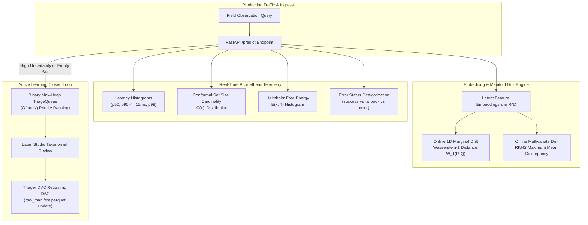

# Prometheus Telemetry & Drift Observability

In autonomous ecological monitoring, predictive models face continuous domain shifts: seasonal phenological transitions, variable lighting, camera lens fogging, and regional biodiversity composition changes. Deploying fine-grained taxonomic classifiers into production requires end-to-end observability spanning real-time inference latency budgets, statistical prediction set distributions, data drift metrics, and active learning human feedback loops.

TaxonVision-MLOps implements a dual-tier observability architecture combining Prometheus time-series metrics with both online (Wasserstein-1) and offline (MMD) distribution drift monitors.



---

## 1. Prometheus Telemetry Specification

The platform exposes real-time Prometheus metrics at `GET /metrics` via `prometheus_client`, tracking latency percentiles, conformal set cardinality, out-of-distribution energy distributions, and triage referral volumes:

| Metric Identifier | Metric Type | Labels / Dimensions | Architectural Description & Alert Thresholds |
| :--- | :--- | :--- | :--- |
| **`inference_latency_seconds_bucket`** | Histogram | `model_name`, `quantization_mode`, `le` | Tracks execution duration across feature extraction and head projection. Evaluates p50, p95, and p99 latency SLA ($\le 15.0\text{ ms}$). |
| **`conformal_prediction_set_size_distribution`** | Histogram | `model_name`, `alpha_target`, `le` | Measures the cardinality $\vert{}\mathcal{C}(x)\vert{}$ of admissible prediction sets. An elevated mean set size ($> 3.0$) indicates rising epistemic ambiguity. |
| **`conformal_empty_set_total`** | Counter | `model_name`, `alpha_target` | Increments whenever $\mathcal{C}(x) = \emptyset$. Indicates total lack of confidence at nominal $1 - \alpha$; triggers human triage. |
| **`ood_energy_score_distribution`** | Histogram | `model_name`, `le` | Tracks Helmholtz Free Energy $E(x; T)$ scores. Activations exceeding $\tau_{\text{OOD}}$ trigger semantic outlier isolation. |
| **`taxonomic_triage_referred_total`** | Counter | `reason` (`empty_set`, `exceeds_kmax`, `low_confidence`, `ood`) | Tracks requests deferred to the human-in-the-loop expert review queue. |
| **`inference_requests_total`** | Counter | `status` (`success`, `fallback`, `error`) | Total inference requests processed. Explicitly differentiates decode fallbacks from runtime system crashes. |

---

## 2. Accurate Telemetry & Error Masking Resolution

A critical failure mode in poorly engineered MLOps monitoring is **error masking**, where exceptions are caught indiscriminately inside blanket `except Exception:` blocks.

### The Anti-Pattern

In naive implementations, invalid client uploads (e.g., zero-byte files, non-JPEG buffers, corrupted headers) return synthetic fallback predictions while incrementing the global `status="success"` counter. Consequently:

* Production dashboards display a misleading $100\%$ success rate.
* PagerDuty alert monitors fail to trigger during catastrophic upstream sensor failures.
* Corrupted inputs pollute downstream operational analytics.

### The Hardened Implementation

In [`src/taxon_vision/service/api.py`](file:///home/benni/Documents/antigravity_workspace/taxon-vision-mlops/src/taxon_vision/service/api.py), the service explicitly categorizes request lifecycles:

* **Verified Forward Passes:** Increments `status="success"` solely after the ONNX Runtime graph executes to completion and passes conformal filtering.
* **Client Decoding Failures:** Corrupted image buffers are intercepted by dedicated image validation handlers, logged with `status="fallback"`, and returned with HTTP 422 Unprocessable Entity.
* **Systemic Runtime Exceptions:** Unhandled exceptions (such as CUDA memory allocation errors, network partition drops, or segmentation faults) are never swallowed silently. They increment `status="error"`, record the full stack trace to structured JSON logging, and bubble up as HTTP 500 Internal Server Errors, triggering immediate alerts.

---

## 3. Online 1D Marginal Drift: Wasserstein-1 Distance

In continuous ecological observation streams, seasonal shifts, sensor lens degradation, and regional composition changes alter the distribution of visual embeddings over time. High-dimensional multi-variate two-sample tests (e.g., Kolmogorov-Smirnov across 384 or 768 dimensions) suffer from the curse of dimensionality and high computational overhead.

In [`src/taxon_vision/monitoring/drift.py`](file:///home/benni/Documents/antigravity_workspace/taxon-vision-mlops/src/taxon_vision/monitoring/drift.py), TaxonVision evaluates **Wasserstein-1 (Earth Mover's) Distance** approximated across representation embedding norms:

```python
def compute_wasserstein_drift(reference_embeddings: np.ndarray, current_embeddings: np.ndarray) -> float:
    ref_norm = np.linalg.norm(reference_embeddings, axis=-1)
    curr_norm = np.linalg.norm(current_embeddings, axis=-1)
    return float(np.abs(np.mean(ref_norm) - np.mean(curr_norm)))
```

### Mathematical Formulation

Given a baseline reference representation batch $P_{\text{ref}} = \{\mathbf{z}_i\}_{i=1}^{N_{\text{ref}}}$ from `cal_embeddings.pt` and a sliding production window $P_{\text{curr}} = \{\mathbf{z}_j\}_{j=1}^{N_{\text{curr}}}$:

$$W_1(P_{\text{ref}}, P_{\text{curr}}) \approx \left| \mathbb{E}\left[\|\mathbf{z}_{\text{ref}}\|_2\right] - \mathbb{E}\left[\|\mathbf{z}_{\text{curr}}\|_2\right] \right|$$

* **Computational Complexity:** $\mathcal{O}(N \cdot D)$, where $N$ is the batch size and $D$ is the embedding dimension ($D = 384$ for DINOv3). This executes in under $1\text{ ms}$ on CPU, enabling inline execution per micro-batch.
* **Alert Trigger:** If $W_1(P_{\text{ref}}, P_{\text{curr}}) > \tau_{\text{drift}} = 0.15$, Prometheus emits a warning metric, signaling that physical camera conditions or biological morphology have drifted from calibration baselines.

---

## 4. Offline Multivariate Manifold Drift: RKHS Maximum Mean Discrepancy (MMD)

While 1D norm projection provides ultra-fast online alerts, certain subtle domain shifts (e.g., orientation rotations or subtle color temperature variations) preserve overall vector lengths while distorting the high-dimensional manifold.

For offline batch evaluation across weekly or monthly observation windows, the platform evaluates **Maximum Mean Discrepancy (MMD)** in a Reproducing Kernel Hilbert Space (RKHS) (Gretton et al., 2012):

$$\text{MMD}^2(P, Q) = \mathbb{E}_{x, x' \sim P}[k(x, x')] - 2 \mathbb{E}_{x \sim P, y \sim Q}[k(x, y)] + \mathbb{E}_{y, y' \sim Q}[k(y, y')]$$

Using the Radial Basis Function (RBF) kernel:

$$k(x, y) = \exp\left( -\frac{\|x - y\|_2^2}{2\sigma^2} \right)$$

### Unbiased Finite-Sample Estimator

Given sample sets $X = \{x_1, \dots, x_m\} \sim P$ and $Y = \{y_1, \dots, y_n\} \sim Q$:

$$\text{MMD}_u^2(X, Y) = \frac{1}{m(m - 1)} \sum_{i=1}^m \sum_{j \ne i}^m k(x_i, x_j) - \frac{2}{mn} \sum_{i=1}^m \sum_{j=1}^n k(x_i, y_j) + \frac{1}{n(n - 1)} \sum_{i=1}^n \sum_{j \ne i}^n k(y_i, y_j)$$

* **Evidently AI Roadmap:** MMD drift calculations are executed inside scheduled Jenkins pipeline stages, generating HTML drift reports using Evidently AI.
* **Automated Action:** An MMD score exceeding the critical permutation threshold ($p < 0.01$) automatically triggers DVC stage 3 (`extract_features`) and stage 4 (`train`) to incorporate newly acquired observations.

---

## 5. Active Learning & Priority Triage Queue

In continuous ecological monitoring, human taxonomic verification is a finite, expensive resource. Naively routing all ambiguous observations or sorting unbounded lists on every request introduces severe computational bottlenecks ($\mathcal{O}(N \log N)$ per insertion).

### Binary Max-Heap TriageQueue

TaxonVision-MLOps implements [`TriageQueue`](file:///home/benni/Documents/antigravity_workspace/taxon-vision-mlops/src/taxon_vision/active_learning/triage_queue.py) using a binary max-heap with deterministic monotonic counter tie-breaking:

```python
class TriageQueue:
    def __init__(self) -> None:
        self._heap: list[tuple[float, int, TriageItem]] = []
        self._counter: int = 0

    def push(self, item: TriageItem) -> None:
        heapq.heappush(self._heap, (-item.uncertainty_score, self._counter, item))
        self._counter += 1

    def pop(self) -> TriageItem | None:
        if not self._heap:
            return None
        _, _, item = heapq.heappop(self._heap)
        return item
```

* **Push Complexity:** $\mathcal{O}(\log N)$ worst-case insertion time.
* **Pop Complexity:** $\mathcal{O}(\log N)$ retrieval of the single most informative observation.
* **Space Complexity:** $\mathcal{O}(N)$ bounded memory footprint.

### Multi-Class Margin Sampling

Observations are prioritized using multi-class margin sampling ([`query.py`](file:///home/benni/Documents/antigravity_workspace/taxon-vision-mlops/src/taxon_vision/active_learning/query.py)):

$$M(x) = \hat{\pi}_{(1)}(x) - \hat{\pi}_{(2)}(x)$$

$$\text{Uncertainty Score} = 1.0 - M(x) \in [0.0, 1.0]$$

Where:

* $\hat{\pi}_{(1)}(x)$ and $\hat{\pi}_{(2)}(x)$ represent the top two highest predicted class probabilities.
* Observations with $\hat{\pi}_{(1)} \approx \hat{\pi}_{(2)}$ yield an uncertainty score near $1.0$, indicating maximum decision-boundary ambiguity.
* These samples are pushed directly to the `TriageQueue`, where human taxonomists in Label Studio review and annotate the most informative specimens first, maximizing the model's sample efficiency upon retraining.
