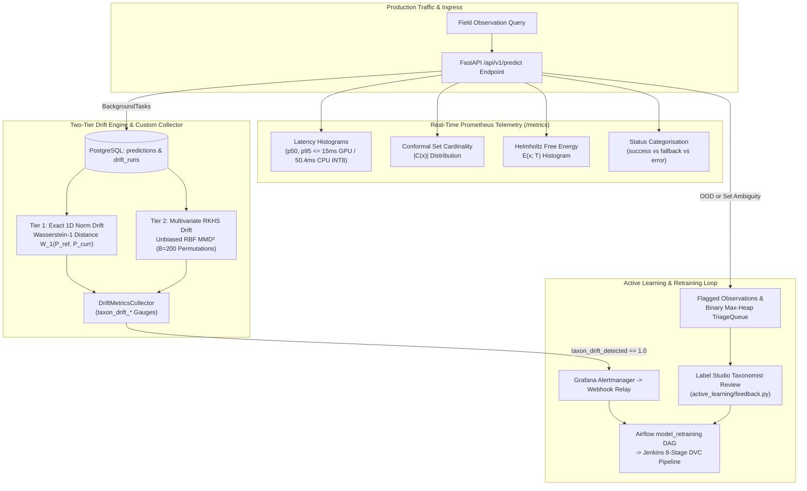
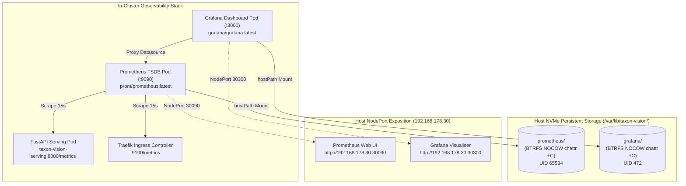
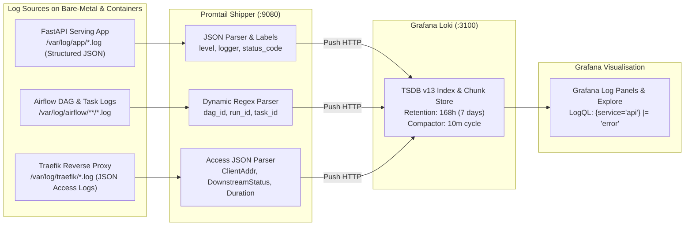

# Prometheus Telemetry, Grafana Provisioning & Ingress Routing

In autonomous ecological monitoring, predictive models face continuous domain shifts: seasonal phenological transitions, variable lighting, camera lens fogging, and regional biodiversity composition changes. Deploying fine-grained taxonomic classifiers into production requires end-to-end observability spanning real-time inference latency budgets, statistical prediction set distributions, two-tier covariate drift metrics, and active learning human feedback loops.

For the deep mathematical derivation of our Two-Tier Statistical Drift Engine and PostgreSQL telemetry persistence, see [Two-Tier Statistical Drift Detection & Telemetry Persistence](drift_detection_and_telemetry.md). For the Airflow 3.0 control-plane DAGs triggered by drift alerts, see [Apache Airflow 3.0 Workflow Orchestration & Retraining Relay](airflow_orchestration.md).



---

## 1. Prometheus Telemetry Specification

The platform exposes real-time Prometheus metrics at `GET /metrics` via `prometheus_client` and the custom [`DriftMetricsCollector`](file:///home/benni/Documents/antigravity_workspace/taxon-vision-mlops/src/taxon_vision/monitoring/telemetry.py), tracking latency percentiles, conformal set cardinality, out-of-distribution energy distributions, drift verdicts, and retraining relay triggers:

| Metric Identifier | Metric Type | Labels / Dimensions | Architectural Description & Alert Thresholds |
| :--- | :--- | :--- | :--- |
| **`taxon_inference_latency_seconds_bucket`** | Histogram | `extractor`, `backend`, `le` | Tracks execution duration across feature extraction and head projection. Evaluates p50, p95, and p99 latency SLO ($\le 15.0\,\text{ms}$ GPU target / `50.38 ms` empirical CPU INT8 within $\le 120.0\,\text{ms}$ SLA). |
| **`taxon_conformal_set_size_bucket`** | Histogram | `le` | Measures the cardinality $\lvert C(X) \rvert$ of admissible prediction sets. An elevated mean set size ($> 3.0$) indicates rising epistemic ambiguity. |
| **`taxon_conformal_empty_set_total`** | Counter | None | Increments whenever $C(X) = \emptyset$. Indicates total lack of confidence at nominal $1 - \alpha$; routes to human triage. |
| **`taxon_ood_energy_score_bucket`** | Histogram | `le` | Tracks negative Helmholtz free energy $E(\mathbf{x}; T)$ scores. Activations exceeding $\tau_{\text{OOD}}$ trigger outlier isolation. |
| **`taxon_human_review_referrals_total`** | Counter | `reason` (`empty_set`, `exceeds_kmax`, `low_confidence`, `ood`) | Tracks requests deferred to the human-in-the-loop expert review queue. |
| **`taxon_predictions_total`** | Counter | `status` (`success`, `fallback`, `error`, `unavailable`) | Total inference requests processed. Explicitly differentiates client decode errors from runtime system crashes. |
| **`taxon_telemetry_write_failures_total`** | Counter | None | Increments if a background PostgreSQL telemetry insert fails, ensuring fail-fast observability without crashing the ASGI worker. |
| **`taxon_drift_w1_distance`** | Gauge | None | Observed 1D Wasserstein-1 distance on pre-normalised embedding norms from the latest `drift_runs` record. |
| **`taxon_drift_w1_threshold`** | Gauge | None | Active 1D Wasserstein-1 decision threshold ($\tau_{W_1}$) from the latest `drift_runs` record. |
| **`taxon_drift_mmd2_p_value`** | Gauge | None | Multivariate RBF MMD² Monte Carlo permutation test $p$-value ($B=200$ shuffles). |
| **`taxon_drift_detected`** | Gauge | None | Binary indicator flag (`1.0` = drift detected, `0.0` = nominal) triggering Grafana `EmbeddingDriftDetected` alerts. |
| **`taxon_drift_last_run_timestamp_seconds`** | Gauge | None | UTC UNIX timestamp in seconds of the most recent drift evaluation run execution. |
| **`taxon_retrain_triggers_total`** | Counter | `source`, `outcome` | Total model retraining triggers evaluated by `/api/v1/retrain/webhook` (`source="grafana"`, `outcome` in `triggered`, `suppressed`, `ignored`, `error`). |

---

## 2. Fail-Fast Telemetry & Error Masking Prevention

A critical failure mode in poorly engineered MLOps monitoring is **silent error masking** (Rule 08), where exceptions are caught indiscriminately inside blanket `except Exception:` blocks.

### The Anti-Pattern

In naive implementations, invalid client uploads (e.g. zero-byte files, non-JPEG buffers, corrupted headers) return synthetic fallback predictions while incrementing the global `status="success"` counter. Consequently, production dashboards display a misleading $100\%$ success rate, alerts fail to fire during upstream camera failures, and corrupted inputs pollute downstream telemetry tables.

### The Hardened Implementation

In [`src/taxon_vision/service/routes/predict.py`](file:///home/benni/Documents/antigravity_workspace/taxon-vision-mlops/src/taxon_vision/service/routes/predict.py) and [`src/taxon_vision/service/inference.py`](file:///home/benni/Documents/antigravity_workspace/taxon-vision-mlops/src/taxon_vision/service/inference.py), the service enforces strict metric ordering:

* **Verified Forward Passes:** Increments `status="success"` strictly *after* the ONNX Runtime graph executes to completion and constructs the Split Conformal prediction set.
* **Client Decoding Failures:** Corrupted image buffers raise `InvalidImageError`, increment error/validation counters, and return HTTP `422 Unprocessable Entity`.
* **Systemic Runtime Exceptions:** Unhandled runtime exceptions increment `status="error"`, log the full traceback via `logger.exception()`, and return HTTP `500 Internal Server Error` (or `503 Service Unavailable` when `ModelNotReadyError` is raised and `allow_untrained_fallback` is `false`).

---

## 3. Summary of the Two-Tier Statistical Drift Engine

The drift detection subsystem implemented in [`src/taxon_vision/monitoring/drift.py`](file:///home/benni/Documents/antigravity_workspace/taxon-vision-mlops/src/taxon_vision/monitoring/drift.py) and [`src/taxon_vision/monitoring/drift_runner.py`](file:///home/benni/Documents/antigravity_workspace/taxon-vision-mlops/src/taxon_vision/monitoring/drift_runner.py) combines two complementary statistical tests over the pre-normalised 384-D penultimate embeddings stored in PostgreSQL (see [Two-Tier Statistical Drift Detection & Telemetry Persistence](drift_detection_and_telemetry.md) for full derivations):

### 3.1 Tier 1: Exact 1D Wasserstein-1 Distance on Embedding Norms

[`compute_wasserstein_drift()`](file:///home/benni/Documents/antigravity_workspace/taxon-vision-mlops/src/taxon_vision/monitoring/drift.py#L46-L75) projects each pre-normalised feature vector onto its Euclidean $L_2$ norm $\|\mathbf{z}\|_2$ and evaluates the exact Kantorovich-Rubinstein distance between empirical CDFs via `scipy.stats.wasserstein_distance`:

```python
def compute_wasserstein_drift(reference_embeddings: np.ndarray, current_embeddings: np.ndarray) -> float:
    ref_norm = np.linalg.norm(reference_embeddings, axis=-1).ravel()
    curr_norm = np.linalg.norm(current_embeddings, axis=-1).ravel()
    if ref_norm.size == 0 or curr_norm.size == 0:
        return 0.0
    return float(wasserstein_distance(ref_norm, curr_norm))
```

* **Complexity:** $\mathcal{O}(N D + N \log N)$, executing in $< 1\,\text{ms}$ on CPU.
* **Bootstrap Threshold Calibration:** [`src/taxon_vision/pipelines/calibrate_drift.py`](file:///home/benni/Documents/antigravity_workspace/taxon-vision-mlops/src/taxon_vision/pipelines/calibrate_drift.py) runs 1,000 bootstrap iterations between `cal_embeddings.pt` and `test_embeddings.pt` to derive the 99th-percentile null threshold $\tau_{W_1} = 0.12812$ (`config/drift_config.yaml`).

### 3.2 Tier 2: Unbiased Multivariate RKHS Maximum Mean Discrepancy (`compute_mmd2_permutation`)

To detect angular manifold rotations and species-composition shifts that preserve average vector norms, [`compute_mmd2_permutation()`](file:///home/benni/Documents/antigravity_workspace/taxon-vision-mlops/src/taxon_vision/monitoring/drift.py#L113-L186) computes the unbiased squared Maximum Mean Discrepancy ($\text{MMD}_u^2$) in an RBF Reproducing Kernel Hilbert Space with adaptive median-heuristic bandwidth $\sigma = \sqrt{0.5 \cdot \operatorname{median}(D_{ij}^2)}$ and $B = 200$ Monte Carlo Gram-matrix index permutations:

$$p = \frac{N_{\text{exceed}} + 1}{B + 1} = \frac{N_{\text{exceed}} + 1}{201}$$

When either $W_1 > \tau_{W_1}$ or $p < \alpha = 0.01$, `evaluate_recent_drift()` flags `drift_detected = True`.

### 3.3 Evidently 0.7+ 8-D PCA Snapshot Report (`generate_evidently_drift_report`)

During every evaluation cycle (both in Stage 3.5 `data_drift.py` and online `drift_runner.py`), [`generate_evidently_drift_report()`](file:///home/benni/Documents/antigravity_workspace/taxon-vision-mlops/src/taxon_vision/monitoring/drift_runner.py#L149-L189) fits an 8-component PCA on the reference embeddings, constructs a compact 9-column DataFrame (`["norm", "pca_0", ..., "pca_7"]`), and renders a standalone HTML report via Evidently 0.7's `Report` and `DataDriftPreset`:

```python
from evidently import Report
from evidently.presets import DataDriftPreset
from sklearn.decomposition import PCA

pca = PCA(n_components=min(8, reference.shape[1], reference.shape[0]), random_state=42)
ref_pca = pca.fit_transform(reference)
curr_pca = pca.transform(current)

report = Report(metrics=[DataDriftPreset()])
snapshot = report.run(reference_data=ref_df, current_data=curr_df)
snapshot.save_html(str(output_path))
```

---

## 4. Active Learning & Priority Triage Queue

In continuous ecological monitoring, human taxonomic verification is a finite, expensive resource. Naively routing all ambiguous observations or sorting unbounded lists on every request introduces computational bottlenecks ($\mathcal{O}(N \log N)$ per insertion).

### Binary Max-Heap `TriageQueue`

TaxonVision-MLOps implements [`TriageQueue`](file:///home/benni/Documents/antigravity_workspace/taxon-vision-mlops/src/taxon_vision/active_learning/triage_queue.py) using a binary max-heap with deterministic monotonic counter tie-breaking:

```python
class TriageQueue:
    def __init__(self) -> None:
        self._heap: list[tuple[float, int, TriageItem]] = []
        self._counter: int = 0

    def push(self, item: TriageItem) -> None:
        heapq.heappush(self._heap, (-item.uncertainty_score, self._counter, item))
        self._counter += 1

    def pop(self) -> TriageItem | None:
        if not self._heap:
            return None
        _, _, item = heapq.heappop(self._heap)
        return item
```

* **Push / Pop Complexity:** $\mathcal{O}(\log N)$ worst-case insertion and retrieval of the single most informative observation.
* **Multi-Class Margin Sampling ([`query.py`](file:///home/benni/Documents/antigravity_workspace/taxon-vision-mlops/src/taxon_vision/active_learning/query.py)):** Prioritises observations via $1.0 - (\hat{\pi}_{(1)}(\mathbf{x}) - \hat{\pi}_{(2)}(\mathbf{x})) \in [0.0, 1.0]$.
* **Closed-Loop Feedback Merging ([`feedback.py`](file:///home/benni/Documents/antigravity_workspace/taxon-vision-mlops/src/taxon_vision/active_learning/feedback.py)):** Once taxonomists export verified annotations from Label Studio (`label_studio_export.json`), `merge_feedback_to_manifest()` filters out OOD specimens, validates `CC0`/`CC-BY`/`CC-BY-NC` licensing and mandatory photographer attribution, and atomically appends new observations into `dataset_manifest.parquet` during the Airflow `model_retraining` DAG.

---

## 5. In-Cluster Prometheus & Grafana Deployment on K3s

To guarantee operational visibility on bare metal without cloud SaaS vendor lock-in, the platform runs an in-cluster observability stack in `namespace: taxon-vision`, defined declaratively in [`deploy/k8s/monitoring-prometheus-grafana.yaml`](file:///home/benni/Documents/antigravity_workspace/taxon-vision-mlops/deploy/k8s/monitoring-prometheus-grafana.yaml).



### 5.1 Host NVMe Persistence, BTRFS NOCOW & Root `initContainers`

* **Non-CoW Flag Enforcement:** Host directories `/var/lib/taxon-vision/prometheus` and `/var/lib/taxon-vision/grafana` on the 2 TB PCIe Gen4 NVMe drive are initialised with `chattr +C` (`NOCOW`) to prevent Copy-on-Write block fragmentation during continuous TSDB WAL appends.
* **UID/GID Permission Alignment:** Because Prometheus executes as `nobody` (`65534:65534`) and Grafana executes as `grafana` (`472:472`), both deployments run a lightweight BusyBox `initContainer` (`chown -R ... && chmod -R 775 ...`) prior to daemon startup so K3s `DirectoryOrCreate` host mounts never trigger `permission denied` crashes.

---

## 6. Dual Declarative Grafana Dashboards

All Grafana dashboards are declaratively versioned under [`deploy/grafana/provisioning/dashboards/json/`](file:///home/benni/Documents/antigravity_workspace/taxon-vision-mlops/deploy/grafana/provisioning/dashboards/json) and loaded automatically upon container boot via [`dashboards.yaml`](file:///home/benni/Documents/antigravity_workspace/taxon-vision-mlops/deploy/grafana/provisioning/dashboards/dashboards.yaml).

### 6.1 Dashboard 1: TaxonVision MLOps - Production Overview (`taxon_overview.json`)

The primary operator dashboard incorporates **10 interactive panels across 3 operational tiers**, bridging real-time request metrics, statistical drift tests, and live application logs:

* **Row 1: Service Health & Latency**
    * **Prediction Request Rate (timeseries):** Evaluates `sum(rate(taxon_predictions_total[1m]))`, displaying real-time inference throughput partitioned by status (`success`, `fallback`, `error`, `unavailable`).
    * **Error Ratio (5m) (stat):** Evaluates `sum(rate(taxon_predictions_total{status=~"error|unavailable"}[5m])) / clamp_min(sum(rate(taxon_predictions_total[5m])), 1e-9)`. Displays green for $< 1\%$, orange for $1\text{--}5\%$, and red above $5\%$ critical SLA threshold.
    * **p95 Inference Latency (timeseries):** Evaluates `1000 * histogram_quantile(0.95, sum by (le) (rate(taxon_inference_latency_seconds_bucket[5m])))` against the $120.0\,\text{ms}$ CPU SLA ceiling (operating at $\approx 50.4\,\text{ms}$ on i7-14700K P-cores).
* **Row 2: Statistical Drift & Manifold Exchangeability**
    * **Tier 1: Wasserstein-1 Distance vs Calibrated Threshold (timeseries):** Plots observed 1D Wasserstein-1 feature norm drift `taxon_drift_w1_distance` directly against the bootstrap-calibrated decision threshold `taxon_drift_w1_threshold` ($\tau_{W_1} = 0.12812$).
    * **Tier 2: MMD² Permutation p-value (timeseries):** Plots the multivariate RBF kernel $\text{MMD}_u^2$ Monte Carlo permutation test $p$-value (`taxon_drift_mmd2_p_value`) on a logarithmic scale against significance level $\alpha = 0.01$.
    * **Active Drift Verdict (stat):** Displays the binary state flag `taxon_drift_detected` (`0.0` = Nominal / Healthy, `1.0` = Drift Confirmed) with instant red alert styling.
* **Row 3: Live Application Logs & Triage Traces**
    * **Real-Time Inference Logs (logs):** Streams live application logs directly from the in-cluster Loki datasource via LogQL `{job="taxon-vision", service="api"} |= "prediction"`, displaying execution traces, incoming MIME types, and conformal set referral notices alongside numerical telemetry.

---

### 6.2 Dashboard 2: TaxonVision Infrastructure & Hardware Invariants (`infrastructure_overview.json`)

To strictly audit physical hardware utilization against the zero-hallucination ground truth mandated by Rule 07, the second dashboard provisions **14 specialized panels across 4 systems-engineering tiers**:

* **Row 1: Memory Discipline & Leak Analysis**
    * **Process Resident Memory (RSS) (timeseries):** Evaluates `process_resident_memory_bytes` to track long-term memory footprint across ONNX Runtime and PyTorch worker sessions.
    * **Memory Leak Slope (15m Derivative) (stat):** Computes `deriv(process_resident_memory_bytes[15m])` in bytes/second. Positive slopes sustained over multiple scrape windows reveal dynamic memory allocation leaks or unbounded cache growth on the inference hot path (violating Rule 02).
    * **Process RAM vs 128 GB Host DDR5 (gauge):** Evaluates `process_resident_memory_bytes / (128 * 1024 * 1024 * 1024) * 100` against the 128 GB DDR5 physical host memory ceiling.
* **Row 2: Computational Compute & CPU Invariants (Intel Core i7-14700K)**
    * **Active CPU Core Utilization (timeseries):** Evaluates `rate(process_cpu_seconds_total[1m])` to inspect CPU load across the 8 Performance cores (affinity threads `0-15`) and 12 Efficient cores (affinity threads `16-27`).
    * **CPU Computational Cost per Prediction (timeseries):** Calculates `rate(process_cpu_seconds_total[1m]) / clamp_min(rate(taxon_predictions_total[1m]), 1e-6)`, exposing the exact CPU seconds invested per inference request.
    * **Throughput Efficiency (Req/s per Core) (stat):** Measures normalized serving efficiency per active CPU core.
* **Row 3: GPU Silicon & VRAM Invariants (NVIDIA GeForce RTX 5070 Ti 16 GB)**
    * **Inference VRAM Allocation vs 4.8 GB Serving Ceiling (timeseries):** Tracks active GPU memory footprint against the designated $4.8\,\text{GB}$ serving envelope (with PyTorch training capped at $f=0.7 \implies 11.2\,\text{GB}$ under time-slicing).
    * **Serving VRAM Envelope Utilization (gauge):** Renders percentage utilization of the $4.8\,\text{GB}$ serving envelope, triggering visual warnings above $80\%$ allocation.
* **Row 4: OS Resource Handles & Descriptor Limits**
    * **Open File Descriptors (timeseries):** Evaluates `process_open_fds` to track socket handles, network connections, and memory-mapped model file allocations.
    * **File Descriptor Capacity % (stat):** Evaluates `(process_open_fds / process_max_fds) * 100` to prevent OS file descriptor exhaustion crashes under sustained concurrency.

---

## 7. Centralized Log Aggregation: Grafana Loki & Promtail

To achieve deep observability without fragile shell log scraping, TaxonVision incorporates a dedicated log aggregation subsystem powered by Grafana Loki and Promtail.



### 7.1 Grafana Loki Configuration (`config/loki.yaml`)

Loki executes in single-binary filesystem mode on port `3100` ([`config/loki.yaml`](file:///home/benni/Documents/antigravity_workspace/taxon-vision-mlops/config/loki.yaml)):

* **Storage Engine:** Employs the `tsdb` index store paired with `filesystem` chunk storage in `/loki/chunks`, guaranteeing sub-second indexed queries across millions of log lines.
* **Retention Enforcement:** Configured with `retention_period: 168h` (7 days) and `compaction_interval: 10m`. The built-in compactor automatically purges expired log chunks to prevent disk bloat on the host NVMe filesystem.
* **Single-Node In-Memory Ring:** Configured with `replication_factor: 1` and `inmemory` KV store, eliminating multi-node distributed consensus overhead on bare metal.

### 7.2 Promtail Ingestion Pipelines (`config/promtail.yaml`)

Promtail ([`config/promtail.yaml`](file:///home/benni/Documents/antigravity_workspace/taxon-vision-mlops/config/promtail.yaml)) executes on port `9080` and tails three distinct log streams:

1. **FastAPI Application Logs (`taxon-vision-app`):**
    * Scrapes `/var/log/app/*.log`.
    * Parses JSON payloads, extracting `level`, `logger`, and `status_code` into queryable index labels, formatting timestamps via `RFC3339Nano`.
2. **Airflow DAG & Task Logs (`taxon-vision-airflow`):**
    * Scrapes `/var/log/airflow/**/*.log`.
    * Dynamically extracts `dag_id`, `run_id`, and `task_id` from the directory structure using regex pattern `'/var/log/airflow/dag_id=(?P<dag_id>[^/]+)/run_id=(?P<run_id>[^/]+)/task_id=(?P<task_id>[^/]+)/.*\.log'` and promotes them to searchable labels.
3. **Traefik Ingress Access Logs (`taxon-vision-traefik`):**
    * Scrapes `/var/log/traefik/*.log`.
    * Parses Traefik's native JSON access log structure, mapping `ClientAddr`, `DownstreamStatus`, `Duration`, `RequestPath`, and `RouterName`.

### 7.3 Declarative Datasource Provisioning

The Loki engine is wired into Grafana automatically via [`deploy/grafana/provisioning/datasources/loki.yaml`](file:///home/benni/Documents/antigravity_workspace/taxon-vision-mlops/deploy/grafana/provisioning/datasources/loki.yaml) with UID `Loki`, enabling unified correlation between Prometheus metric spikes and underlying stack traces in Grafana Explore.

---

## 8. Declarative Alertmanager Rules & Retraining Relay Bridge

All alerting rules, contact points, and notification routing trees are declaratively maintained in [`deploy/grafana/provisioning/alerting/rules.yaml`](file:///home/benni/Documents/antigravity_workspace/taxon-vision-mlops/deploy/grafana/provisioning/alerting/rules.yaml).

### 8.1 Active Alert Rule Definitions

Grafana Alertmanager continuously evaluates four operational alert rules in group `TaxonVision_Operational_Alerts`:

| Alert UID | Rule Name | Condition & PromQL Expression | Severity | Action / Handling |
| :--- | :--- | :--- | :--- | :--- |
| `prediction_latency_p95_high` | `PredictionLatencyP95High` | `1000 * histogram_quantile(0.95, sum by (le) (rate(taxon_inference_latency_seconds_bucket[5m]))) > 120` for 5m | Warning | Dispatches email to `default-channel`. Signals compute starvation or CPU thread affinity contention. |
| `prediction_error_ratio_high` | `PredictionErrorRatioHigh` | `sum(rate(taxon_predictions_total{status=~"error\|unavailable"}[5m])) / clamp_min(...) > 0.05` for 5m | Critical | Dispatches email to `default-channel`. Signals network degradation or unhandled payload exceptions. |
| `embedding_drift_detected` | `EmbeddingDriftDetected` | `taxon_drift_detected > 0.5` for 0s (immediate) | Critical | Tagged with `action=retrain`. Routes directly to the `retrain-webhook` relay to trigger autonomous Airflow retraining. |
| `drift_monitor_stale` | `DriftMonitorStale` | `time() - taxon_drift_last_run_timestamp_seconds > 7200` for 10m | Warning | Dispatches warning if the Airflow drift monitoring DAG has not executed within 2 hours. |

### 8.2 Retraining Relay Webhook Mechanics

When `EmbeddingDriftDetected` fires:

1. Alertmanager matches label `action=retrain` and routes the payload to contact point `retrain-webhook`.
2. A secure HTTP POST is dispatched to `http://app:8000/api/v1/retrain/webhook` bearing `Authorization: Bearer <TAXON_RETRAIN_WEBHOOK_SECRET>`.
3. The endpoint in [`src/taxon_vision/service/routes/retrain.py`](file:///home/benni/Documents/antigravity_workspace/taxon-vision-mlops/src/taxon_vision/service/routes/retrain.py) verifies the credential via constant-time `hmac.compare_digest()`, enforces a 6-hour atomic cooldown (`TAXON_RETRAIN_COOLDOWN_SECONDS=21600.0`), and triggers the `model_retraining` DAG in Apache Airflow 3.0 via HTTP API.

---

## 9. Traefik v3.1 Ingress, 80/20 Canary Routing & Sablier Scale-to-Zero

### 9.1 Declarative 80/20 A/B Canary Routing

Defined in [`deploy/k8s/traefik-ingress.yaml`](file:///home/benni/Documents/antigravity_workspace/taxon-vision-mlops/deploy/k8s/traefik-ingress.yaml) and [`deploy/k8s/canary-ab-service.yaml`](file:///home/benni/Documents/antigravity_workspace/taxon-vision-mlops/deploy/k8s/canary-ab-service.yaml), the `TraefikService` CRD (`taxon-vision-ab-service`) supports zero-downtime weighted round-robin traffic splitting between the baseline `@Production` deployment (`taxon-vision-serving:8000`, weight `80`) and a `@Challenger` canary deployment (`taxon-vision-serving-challenger:8000`, weight `20`).

### 9.2 On-Demand Scale-to-Zero for Human Dashboards (`Sablier`)

To preserve the 128 GB DDR5 RAM and CPU budget on `hive-mind`, core serving and telemetry daemons (`taxon-vision-serving`, `prometheus`, `postgres`, `seaweedfs`, `jenkins`, `sablier`) remain warm 24/7, while human inspection UIs (`optuna-dashboard`, `grafana`, `evidently-ui`) scale to `replicas: 0` when idle via [`deploy/k8s/sablier-scaler.yaml`](file:///home/benni/Documents/antigravity_workspace/taxon-vision-mlops/deploy/k8s/sablier-scaler.yaml) and the `sablier-traefik-plugin` (`v1.3.0`). When an operator opens `/grafana` or `/optuna` in a browser, Sablier intercepts the request, scales the deployment to 1 replica via the Kubernetes API, renders an auto-refreshing loading theme while the pod starts, and scales the pod back to `0` after 15 to 20 minutes of inactivity.
