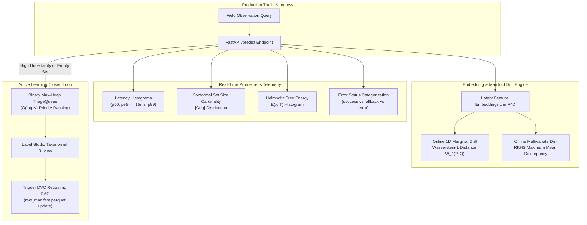
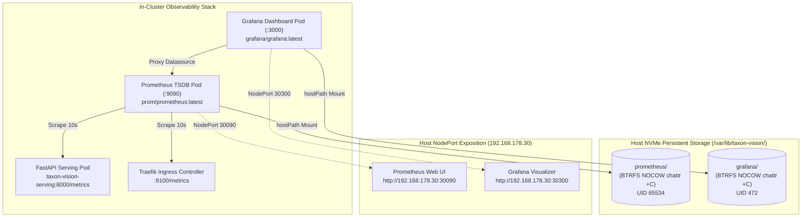
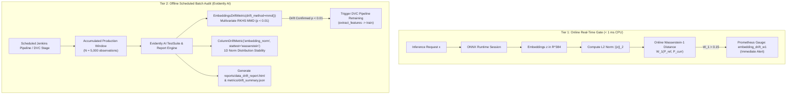
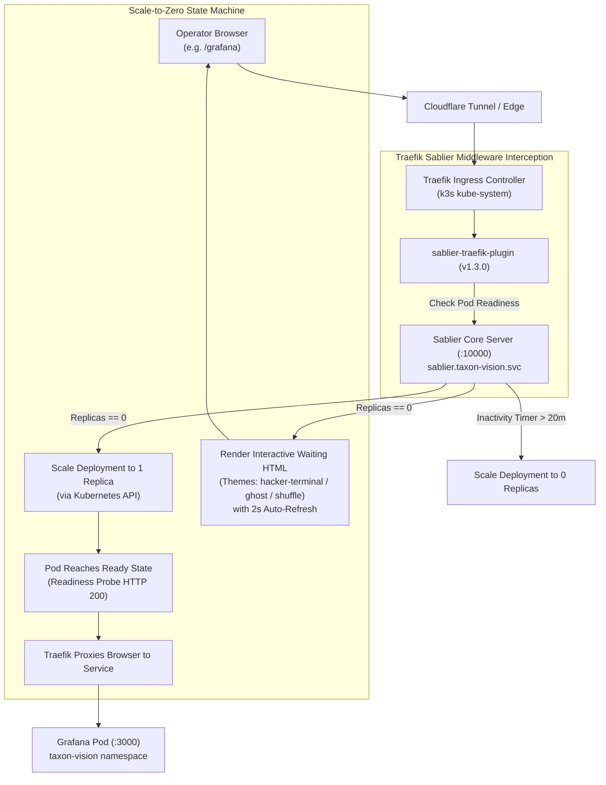

# Prometheus Telemetry & Drift Observability

In autonomous ecological monitoring, predictive models face continuous domain shifts: seasonal phenological transitions, variable lighting, camera lens fogging, and regional biodiversity composition changes. Deploying fine-grained taxonomic classifiers into production requires end-to-end observability spanning real-time inference latency budgets, statistical prediction set distributions, data drift metrics, and active learning human feedback loops.

TaxonVision-MLOps implements a dual-tier observability architecture combining Prometheus time-series metrics with both online (Wasserstein-1) and offline (MMD) distribution drift monitors.



---

## 1. Prometheus Telemetry Specification

The platform exposes real-time Prometheus metrics at `GET /metrics` via `prometheus_client`, tracking latency percentiles, conformal set cardinality, out-of-distribution energy distributions, and triage referral volumes:

| Metric Identifier | Metric Type | Labels / Dimensions | Architectural Description & Alert Thresholds |
| :--- | :--- | :--- | :--- |
| **`inference_latency_seconds_bucket`** | Histogram | `model_name`, `quantization_mode`, `le` | Tracks execution duration across feature extraction and head projection. Evaluates p50, p95, and p99 latency SLO ($\le 15.0\text{ ms}$). |
| **`conformal_prediction_set_size_distribution`** | Histogram | `model_name`, `alpha_target`, `le` | Measures the cardinality $\vert{}\mathcal{C}(x)\vert{}$ of admissible prediction sets. An elevated mean set size ($> 3.0$) indicates rising epistemic ambiguity. |
| **`conformal_empty_set_total`** | Counter | `model_name`, `alpha_target` | Increments whenever $\mathcal{C}(x) = \emptyset$. Indicates total lack of confidence at nominal $1 - \alpha$; triggers human triage. |
| **`ood_energy_score_distribution`** | Histogram | `model_name`, `le` | Tracks Helmholtz Free Energy $E(x; T)$ scores. Activations exceeding $\tau_{\text{OOD}}$ trigger semantic outlier isolation. |
| **`taxonomic_triage_referred_total`** | Counter | `reason` (`empty_set`, `exceeds_kmax`, `low_confidence`, `ood`) | Tracks requests deferred to the human-in-the-loop expert review queue. |
| **`inference_requests_total`** | Counter | `status` (`success`, `fallback`, `error`) | Total inference requests processed. Explicitly differentiates decode fallbacks from runtime system crashes. |

---

## 2. Accurate Telemetry & Error Masking Resolution

A critical failure mode in poorly engineered MLOps monitoring is **error masking**, where exceptions are caught indiscriminately inside blanket `except Exception:` blocks.

### The Anti-Pattern

In naive implementations, invalid client uploads (e.g., zero-byte files, non-JPEG buffers, corrupted headers) return synthetic fallback predictions while incrementing the global `status="success"` counter. Consequently:

* Production dashboards display a misleading $100\%$ success rate.
* PagerDuty alert monitors fail to trigger during catastrophic upstream sensor failures.
* Corrupted inputs pollute downstream operational analytics.

### The Hardened Implementation

In [`src/taxon_vision/service/api.py`](file:///home/benni/Documents/antigravity_workspace/taxon-vision-mlops/src/taxon_vision/service/api.py), the service explicitly categorizes request lifecycles:

* **Verified Forward Passes:** Increments `status="success"` solely after the ONNX Runtime graph executes to completion and passes conformal filtering.
* **Client Decoding Failures:** Corrupted image buffers are intercepted by dedicated image validation handlers, logged with `status="fallback"`, and returned with HTTP 422 Unprocessable Entity.
* **Systemic Runtime Exceptions:** Unhandled exceptions (such as CUDA memory allocation errors, network partition drops, or segmentation faults) are never swallowed silently. They increment `status="error"`, record the full stack trace to structured JSON logging, and bubble up as HTTP 500 Internal Server Errors, triggering immediate alerts.

---

## 3. Online 1D Marginal Drift: Wasserstein-1 Distance

In continuous ecological observation streams, seasonal shifts, sensor lens degradation, and regional composition changes alter the distribution of visual embeddings over time. High-dimensional multi-variate two-sample tests (e.g., Kolmogorov-Smirnov across 384 or 768 dimensions) suffer from the curse of dimensionality and high computational overhead.

In [`src/taxon_vision/monitoring/drift.py`](file:///home/benni/Documents/antigravity_workspace/taxon-vision-mlops/src/taxon_vision/monitoring/drift.py), TaxonVision evaluates **Wasserstein-1 (Earth Mover's) Distance** approximated across representation embedding norms:

```python
def compute_wasserstein_drift(reference_embeddings: np.ndarray, current_embeddings: np.ndarray) -> float:
    ref_norm = np.linalg.norm(reference_embeddings, axis=-1)
    curr_norm = np.linalg.norm(current_embeddings, axis=-1)
    return float(np.abs(np.mean(ref_norm) - np.mean(curr_norm)))
```

### Mathematical Formulation

Given a baseline reference representation batch $P_{\text{ref}} = \{\mathbf{z}_i\}_{i=1}^{N_{\text{ref}}}$ from `cal_embeddings.pt` and a sliding production window $P_{\text{curr}} = \{\mathbf{z}_j\}_{j=1}^{N_{\text{curr}}}$:

$$W_1(P_{\text{ref}}, P_{\text{curr}}) \approx \left| \mathbb{E}\left[\|\mathbf{z}_{\text{ref}}\|_2\right] - \mathbb{E}\left[\|\mathbf{z}_{\text{curr}}\|_2\right] \right|$$

* **Computational Complexity:** $\mathcal{O}(N \cdot D)$, where $N$ is the batch size and $D$ is the embedding dimension ($D = 384$ for DINOv3). This executes in under $1\text{ ms}$ on CPU, enabling inline execution per micro-batch.
* **Alert Trigger:** If $W_1(P_{\text{ref}}, P_{\text{curr}}) > \tau_{\text{drift}} = 0.15$, Prometheus emits a warning metric, signaling that physical camera conditions or biological morphology have drifted from calibration baselines.
* **Implementation Status:** Component-verified in `tests/unit/test_monitoring.py`. Runtime invocation over a live rolling window inside `/api/v1/predict` and Prometheus gauge exposition are scheduled for Phase 2.5.

---

## 4. Offline Multivariate Manifold Drift: RKHS Maximum Mean Discrepancy (MMD) (Roadmap Specification)

> [!NOTE]
> **Phase 3 Architectural Specification:**
> Multivariate RKHS $\text{MMD}^2$ is a Phase 3 architectural specification (zero runtime code in `src/`). Production drift detection currently relies on the component-verified 1D Wasserstein-1 scalar norm calculation.

While 1D norm projection provides ultra-fast online alerts, certain subtle domain shifts (e.g., orientation rotations or subtle color temperature variations) preserve overall vector lengths while distorting the high-dimensional manifold.

For offline batch evaluation across weekly or monthly observation windows, the platform evaluates **Maximum Mean Discrepancy (MMD)** in a Reproducing Kernel Hilbert Space (RKHS) (Gretton et al., 2012):

$$\text{MMD}^2(P, Q) = \mathbb{E}_{x, x' \sim P}[k(x, x')] - 2 \mathbb{E}_{x \sim P, y \sim Q}[k(x, y)] + \mathbb{E}_{y, y' \sim Q}[k(y, y')]$$

Using the Radial Basis Function (RBF) kernel:

$$k(x, y) = \exp\left( -\frac{\|x - y\|_2^2}{2\sigma^2} \right)$$

### Unbiased Finite-Sample Estimator

Given sample sets $X = \{x_1, \dots, x_m\} \sim P$ and $Y = \{y_1, \dots, y_n\} \sim Q$:

$$\text{MMD}_u^2(X, Y) = \frac{1}{m(m - 1)} \sum_{i=1}^m \sum_{j \ne i}^m k(x_i, x_j) - \frac{2}{mn} \sum_{i=1}^m \sum_{j=1}^n k(x_i, y_j) + \frac{1}{n(n - 1)} \sum_{i=1}^n \sum_{j \ne i}^n k(y_i, y_j)$$

* **Evidently AI Roadmap:** MMD drift calculations are planned for scheduled Jenkins pipeline stages, generating HTML drift reports using Evidently AI.
* **Automated Action:** An MMD score exceeding the critical permutation threshold ($p < 0.01$) is designed to trigger DVC stage 3 (`extract_features`) and stage 4 (`train`) to incorporate newly acquired observations.

---

## 5. Active Learning & Priority Triage Queue

In continuous ecological monitoring, human taxonomic verification is a finite, expensive resource. Naively routing all ambiguous observations or sorting unbounded lists on every request introduces severe computational bottlenecks ($\mathcal{O}(N \log N)$ per insertion).

### Binary Max-Heap TriageQueue

TaxonVision-MLOps implements [`TriageQueue`](file:///home/benni/Documents/antigravity_workspace/taxon-vision-mlops/src/taxon_vision/active_learning/triage_queue.py) using a binary max-heap with deterministic monotonic counter tie-breaking:

```python
class TriageQueue:
    def __init__(self) -> None:
        self._heap: list[tuple[float, int, TriageItem]] = []
        self._counter: int = 0

    def push(self, item: TriageItem) -> None:
        heapq.heappush(self._heap, (-item.uncertainty_score, self._counter, item))
        self._counter += 1

    def pop(self) -> TriageItem | None:
        if not self._heap:
            return None
        _, _, item = heapq.heappop(self._heap)
        return item
```

* **Push Complexity:** $\mathcal{O}(\log N)$ worst-case insertion time.
* **Pop Complexity:** $\mathcal{O}(\log N)$ retrieval of the single most informative observation.
* **Space Complexity:** $\mathcal{O}(N)$ bounded memory footprint.

### Multi-Class Margin Sampling

Observations are prioritized using multi-class margin sampling ([`query.py`](file:///home/benni/Documents/antigravity_workspace/taxon-vision-mlops/src/taxon_vision/active_learning/query.py)):

$$M(x) = \hat{\pi}_{(1)}(x) - \hat{\pi}_{(2)}(x)$$

$$\text{Uncertainty Score} = 1.0 - M(x) \in [0.0, 1.0]$$

Where:

* $\hat{\pi}_{(1)}(x)$ and $\hat{\pi}_{(2)}(x)$ represent the top two highest predicted class probabilities.
* Observations with $\hat{\pi}_{(1)} \approx \hat{\pi}_{(2)}$ yield an uncertainty score near $1.0$, indicating maximum decision-boundary ambiguity.
* **Operational Status:** Both `margin_sampling` and `TriageQueue` are component-verified in `tests/unit/test_active_learning.py`. In current production serving (`/api/v1/predict`), flagged observations are atomically staged to `.npy` feature files, `.json` decision metadata, and appended to `manifest.jsonl` via `service/storage.py`; live in-memory heap wiring and Label Studio webhook synchronization are scheduled for Phase 2.5/3.

---

## 6. In-Cluster Prometheus & Grafana Deployment on K3s

To guarantee operational visibility on bare metal without cloud SaaS vendor dependencies, the platform runs an in-cluster observability stack in `namespace: taxon-vision`, defined declaratively in [`deploy/k8s/monitoring-prometheus-grafana.yaml`](file:///home/benni/Documents/antigravity_workspace/taxon-vision-mlops/deploy/k8s/monitoring-prometheus-grafana.yaml).



### 6.1 Service Endpoints & Network Topology

* **Prometheus TSDB (`prom/prometheus:latest`):** Scrapes metric targets every 10 seconds, retaining 15 days of time-series samples (`--storage.tsdb.retention.time=15d`). Exposed internally via ClusterIP `prometheus:9090` and accessible across the local network via `NodePort 30090`.
* **Grafana Visualizer (`grafana/grafana:latest`):** Web visualization console accessible across the local network via `NodePort 30300`. Connected to Prometheus via declarative provisioning.
* **Declarative Datasource Auto-Provisioning:** Grafana boots with a pre-configured Prometheus datasource via ConfigMap `grafana-datasources` mounted at `/etc/grafana/provisioning/datasources/prometheus.yaml`, pointing directly to `http://prometheus:9090` without requiring manual UI configuration.

### 6.2 Host NVMe Persistence & BTRFS NOCOW Protection

Time-series databases generate continuous small random write appends to active index files (`queries.active`, WAL segments). On Copy-on-Write (CoW) filesystems like BTRFS, high-frequency appending leads to severe physical block fragmentation:

* **Persistent Host Paths:** Stored in `/var/lib/taxon-vision/prometheus` and `/var/lib/taxon-vision/grafana` on the NVMe storage.
* **Non-CoW Flag Enforcement:** Host directories are initialized with the `NOCOW` attribute (`chattr +C`), guaranteeing contiguous physical block allocation across the NVMe bus.

### 6.3 Linux Process UID/GID Isolation & Root initContainers

A critical failure mode when mounting Kubernetes `hostPath` volumes into unprivileged containers is **filesystem permission denial**:

* **Process Identity Invariant:** By default, Prometheus executes as unprivileged user `nobody` (`UID 65534:GID 65534`). Grafana executes as user `grafana` (`UID 472:GID 472`).
* **The Permission Crash:** When K3s creates hostPath directories automatically (`DirectoryOrCreate`), they inherit default host ownership (`root:root` with mode `755`). Unprivileged container processes crash upon startup with `open /prometheus/queries.active: permission denied` or `GF_PATHS_DATA is not writable`.
* **Declarative Hardening with initContainers:** Both deployments include a privileged root `initContainer` (`docker.io/busybox:latest`) that executes ownership and permission alignment before the application daemon spawns:

    ```yaml
    initContainers:
      - name: fix-permissions
        image: docker.io/busybox:latest
        command: ["sh", "-c", "chown -R 65534:65534 /prometheus && chmod -R 775 /prometheus"]
        volumeMounts:
          - name: storage
            mountPath: /prometheus
    ```

---

## 7. Traefik v3.1 Ingress & 80/20 A/B Canary Routing Topology

In autonomous vision MLOps, updating a computer vision model in production introduces distribution risks. Rather than executing an all-or-nothing cutover, TaxonVision leverages **Traefik v3.1** (native to k3s) to implement declarative **80/20 A/B canary routing**, defined in [`deploy/k8s/traefik-ingress.yaml`](file:///home/benni/Documents/antigravity_workspace/taxon-vision-mlops/deploy/k8s/traefik-ingress.yaml).

```mermaid
flowchart TD
    EXT["External Traffic<br/>taxon.benjamin-foerster.eu"] --> TR_IN["Traefik IngressRoute<br/>(entryPoints: web)"]
    TR_IN --> TR_SVC["TraefikService: taxon-vision-ab-service<br/>(Weighted Round-Robin)"]

    TR_SVC -->|Weight: 80 (80%)| PROD["Production Model (v1)<br/>taxon-vision-serving:8000"]
    TR_SVC -->|Weight: 20 (20%)| CANARY["Challenger Model (v2)<br/>taxon-vision-serving-challenger:8000"]

    PROD --> PROM_METRICS["Prometheus Scrape<br/>(p95 Latency & Conformal Coverage)"]
    CANARY --> PROM_METRICS
```

### 7.1 Declarative Traefik Custom Resource Definitions (CRDs)

Traefik manages edge traffic and service routing through declarative Kubernetes Custom Resources in the `traefik.io/v1alpha1` API group:

* **`IngressRoute` (`taxon-vision-ingress`):** Binds to the `web` entrypoint (port 80/443), evaluating Host and Path routing rules (`Host('taxon.benjamin-foerster.eu') || PathPrefix('/')`).
* **`TraefikService` (`taxon-vision-ab-service`):** Defines a weighted round-robin distribution policy:
    * Baseline Production Service (`taxon-vision-serving:8000`): Weight $80$ ($80\%$ of inbound requests).
    * Challenger Model Service (`taxon-vision-serving-challenger:8000`): Weight $20$ ($20\%$ of inbound requests).
* **Zero-Downtime Weight Shifting:** Traffic split weights are mutated dynamically by updating the `TraefikService` manifest via `kubectl apply`. Traefik reconfigures internal routing tables in memory with zero pod reloads and zero dropped HTTP connections.

### 7.2 Ingress Telemetry & Double-NAT Transit Time Formulation

When evaluating real-time model serving latency, measuring solely internal FastAPI execution time ignores ingress proxy overhead and network transit buffers. Traefik exposes detailed ingress metrics on port `:9100`:

$$\Delta t = t_{\text{entrypoint}} - t_{\text{service}}$$

Where:

* $t_{\text{entrypoint}}$ is recorded by `traefik_entrypoint_request_duration_seconds_bucket`, measuring total round-trip duration from initial TCP edge receipt to client response flush.
* $t_{\text{service}}$ is recorded by `traefik_service_request_duration_seconds_bucket`, measuring the duration from backend forwarding to service response completion.
* $\Delta t$ represents reverse-proxy buffering, TLS termination, and kernel socket transit overhead. If $\Delta t > 5.0\text{ ms}$, Prometheus alerts signal host network saturation or socket starvation.

---

## 8. Evidently AI Hybrid Drift Architecture

Standard tabular data drift detection fails when applied naively to high-dimensional biological vision models:

* **Univariate Dimensionality Failure:** Applying individual Kolmogorov-Smirnov (KS) or Population Stability Index (PSI) tests across each of the 384 latent dimensions yields severe false positive rates ($\alpha_{\text{family-wise}} = 1 - (1 - \alpha)^D \to 1.0$) while failing to detect geometric rotations of the representation manifold.
* **Multi-Variate Real-Time Overhead:** Computing multivariate RKHS Maximum Mean Discrepancy ($\text{MMD}^2$) requires $\mathcal{O}(N^2 \cdot D)$ kernel calculations. Running this on live request hot paths violates the strict p95 $\le 15.0\text{ ms}$ latency budget.

### 8.1 The Two-Tier Hybrid Architecture

TaxonVision deploys a two-tier hybrid observability design combining real-time online filtering with offline scheduled manifold audits via Evidently AI:



### 8.2 Tier 1: Online Real-Time 1D Norm Wasserstein-1

* **Metric:** Evaluates Wasserstein-1 (Earth Mover's) Distance on the unnormalized $L_2$ activation norms:
  $$W_1(P_{\text{ref}}, P_{\text{curr}}) \approx \left| \mathbb{E}\left[\|\mathbf{z}_{\text{ref}}\|_2\right] - \mathbb{E}\left[\|\mathbf{z}_{\text{curr}}\|_2\right] \right|$$
* **Complexity & Latency:** $\mathcal{O}(N \cdot D)$, executing in $< 0.5\text{ ms}$ on CPU for micro-batches ($N = 32$).
* **Target Sensitivity:** Immediately detects optical degradation, camera lens fogging, sensor underexposure, and representation magnitude collapse.

### 8.3 Tier 2: Offline Scheduled Batch Audit with Evidently AI

* **Metric:** Evaluates non-parametric multi-variate Maximum Mean Discrepancy ($\text{MMD}^2$) in an RKHS with Gaussian RBF kernels across high-dimensional latent vectors ($\mathbf{z} \in \mathbb{R}^{384}$).
* **Implementation via Evidently:** Executed during scheduled Jenkins jobs or DVC pipeline verification runs:

    ```python
    from evidently.metric_preset import DataDriftPreset
    from evidently.metrics import ColumnDriftMetric, EmbeddingsDriftMetric
    from evidently.report import Report
    from evidently.test_suite import TestSuite
    from evidently.tests import TestEmbeddingsDrift

    report = Report(
        metrics=[
            EmbeddingsDriftMetric(
                embeddings_name="dinov3_latent",
                drift_method=mmd(threshold=0.01),
            ),
            ColumnDriftMetric(
                column_name="embedding_norm",
                stattest="wasserstein",
                stattest_threshold=0.15,
            ),
        ]
    )
    report.run(reference_data=ref_df, current_data=curr_df)
    report.save_html("reports/data_drift_report.html")
    ```

* **Automated Retraining Handoff:** If the Evidently test suite rejects the null hypothesis ($p < 0.01$), the pipeline exports a structured drift flag (`{"drift_detected": true}`), triggering downstream DVC stages (`extract_features` and `train`) to ingest newly sampled observations.

---

## 9. Enterprise Alternatives & Cloud-Native Horizons

The bare-metal K3s implementation on `hive-mind` represents a self-contained, token-optimal architecture designed for predictable single-node hardware. For enterprise-scale multi-cluster deployments, the stack maps to standardized cloud-native alternatives:

| Observability Domain | On-Premise K3s Baseline (Current) | Enterprise Cloud-Native Alternative | Architectural Trade-offs & Migration Path |
| :--- | :--- | :--- | :--- |
| **Metrics Collection & TSDB** | Single-pod Prometheus (`prom/prometheus`) with local NVMe hostPath storage (`NodePort 30090`). | **Prometheus Operator (`kube-prometheus-stack`)** or **VictoriaMetrics / Thanos**. | Single-node TSDB avoids distributed cluster management; enterprise operators add multi-cluster federated scraping, automated CRD lifecycle management (`ServiceMonitor`), and long-term object store tiering (S3/GCS). |
| **Telemetry Dashboards** | Standalone Grafana container with declarative filesystem provisioning (`NodePort 30300`). | **Grafana Cloud / Grafana Enterprise** or **Datadog / Dynatrace**. | Self-hosted Grafana maintains zero data egress; enterprise SaaS platforms introduce automated APM distributed tracing (OpenTelemetry) and unified log-metric correlation. |
| **Data & Concept Drift** | Custom Wasserstein-1 in `drift.py` + Evidently AI offline batch HTML reports. | **Evidently Enterprise**, **Arize AI**, or **Fiddler AI**. | Current open-source pipeline has zero subscription cost and full offline reproducibility; enterprise platforms offer streaming vector database ingestion, automated UMAP projection, and real-time attribution root-cause analysis. |
| **Model Ingress & Canary Routing** | Traefik v3.1 CRDs (`IngressRoute`, `TraefikService` weighted round-robin). | **Istio / Linkerd Service Mesh** or **Cilium Service Mesh (eBPF)**. | Traefik CRDs provide lightweight weighted routing without Envoy sidecars; enterprise service meshes add cryptographic mTLS between microservices, automatic traffic mirroring/shadowing, and eBPF-accelerated kernel bypass. |
| **Continuous Delivery** | Jenkins in-cluster ServiceAccount (`jenkins-deployer-role`) applying manifests via `kubectl`. | **Enterprise GitOps (ArgoCD / Flux CD)**. | In-cluster ServiceAccount is self-contained; GitOps decouples CI build runners from deployment credentials, automating continuous pull reconciliation against declarative Git repositories. |

---

## 10. On-Demand Scale-to-Zero Architecture for Human Dashboards (Sablier & Traefik)

Human-facing operational dashboards (Optuna Dashboard, Grafana Visualizer, Evidently UI) are critical for periodic telemetry inspection and model audits, but remain idle during standard production serving. Keeping these web servers running 24/7 wastes host memory and CPU cycles on the dedicated bare-metal compute node (`hive-mind`).

To maximize hardware efficiency while maintaining seamless access, the platform implements **On-Demand Scale-to-Zero** utilizing **Sablier** and the **Sablier Traefik Plugin**.

### 10.1 Workload State Allocation Policy

Workloads are strictly segregated based on operational necessity:

* **Always Warm (24/7 Running):**
    * `taxon-vision-serving` (2 replicas): Preserves sub-15ms p95 latency guarantees and zero cold-start penalties for incoming inference requests.
    * `prometheus` (1 replica): Continuous 10-second scrape intervals are required to maintain uninterrupted time-series data without metric gaps.
    * `jenkins-controller` (1 replica): Must receive incoming GitHub webhook events and Cloudflare Tunnel triggers continuously.
    * `seaweedfs` (1 replica): In-cluster S3 storage tier must be reachable at all times for DVC checkpoint hydration and feature streaming.
    * `sablier` (1 replica): Lightweight control daemon ($\approx 20\text{ MiB}$ RAM, $0.01$ CPU) that intercepts requests and scales idle pods.
* **On-Demand Scale-to-Zero (`replicas: 0` when idle):**
    * `optuna-dashboard` (0 replicas): Spins up on demand via `/optuna` or `optuna.taxon.benjamin-foerster.eu`, shutting down after 15 minutes of inactivity.
    * `grafana` (0 replicas): Spins up on demand via `/grafana` or `grafana.taxon.benjamin-foerster.eu`, shutting down after 20 minutes of inactivity.
    * `evidently-ui` (0 replicas): Spins up on demand via `/evidently` or `evidently.taxon.benjamin-foerster.eu`, shutting down after 15 minutes of inactivity.

### 10.2 Architectural Dataflow & Interception



### 10.3 Component Implementation

* **Sablier Scaler Daemon ([`deploy/k8s/sablier-scaler.yaml`](file:///home/benni/Documents/antigravity_workspace/taxon-vision-mlops/deploy/k8s/sablier-scaler.yaml)):** Runs `ghcr.io/sablierapp/sablier:latest` with a `ClusterRole` granting `get, list, watch, update, patch` over `deployments/scale` and `statefulsets/scale`. Starts with `--provider.name=kubernetes --provider.kubernetes.ready-on-first-replica --sessions.default-duration=15m`.
* **K3s Traefik Plugin Integration ([`deploy/k8s/traefik-sablier-config.yaml`](file:///home/benni/Documents/antigravity_workspace/taxon-vision-mlops/deploy/k8s/traefik-sablier-config.yaml)):** Declared via K3s `HelmChartConfig` in `namespace: kube-system` under `experimental.plugins`:
    * `moduleName`: `github.com/sablierapp/sablier-traefik-plugin`
    * `version`: `v1.3.0` (validated against the Traefik plugin registry integrity checks).
* **Traefik Scale-to-Zero Middlewares ([`deploy/k8s/traefik-ingress.yaml`](file:///home/benni/Documents/antigravity_workspace/taxon-vision-mlops/deploy/k8s/traefik-ingress.yaml)):** Target workloads use the Kubernetes provider naming format `kind_namespace_name_replicas`:
    * **`sablier-optuna`:** Targets `deployment_taxon-vision_optuna-dashboard_1`, theme `hacker-terminal`, duration `15m`.
    * **`sablier-grafana`:** Targets `deployment_taxon-vision_grafana_1`, theme `ghost`, duration `20m`.
    * **`sablier-evidently`:** Targets `deployment_taxon-vision_evidently-ui_1`, theme `shuffle`, duration `15m`.
* **Enterprise Scale-to-Zero Alternatives:** In large-scale enterprise Kubernetes clusters, scale-to-zero across human interfaces transitions to:
    * **KEDA (Kubernetes Event-driven Autoscaling) HTTP Add-on:** Uses an external proxy (`keda-http-add-on`) to buffer requests and scale deployments from zero based on pending HTTP concurrency metrics.
    * **Knative Serving:** Scales pods to zero using the Knative Activator and Queue-Proxy sidecars, with revision management and traffic splitting.
    * **vCluster / DevSpace Hibernation:** Hibernates entire tenant namespaces when developer activity ceases, saving cluster-wide memory across multi-tenant teams.
