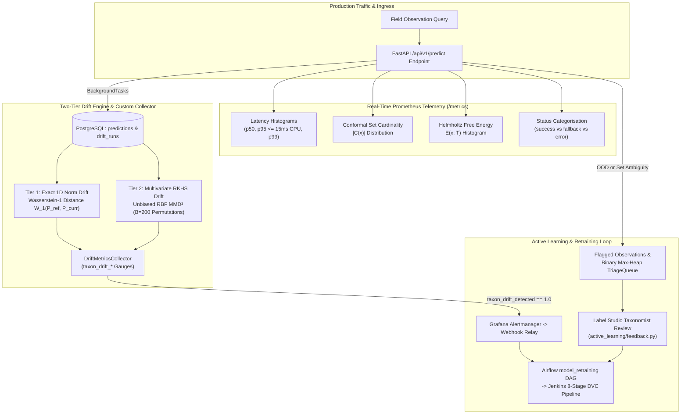
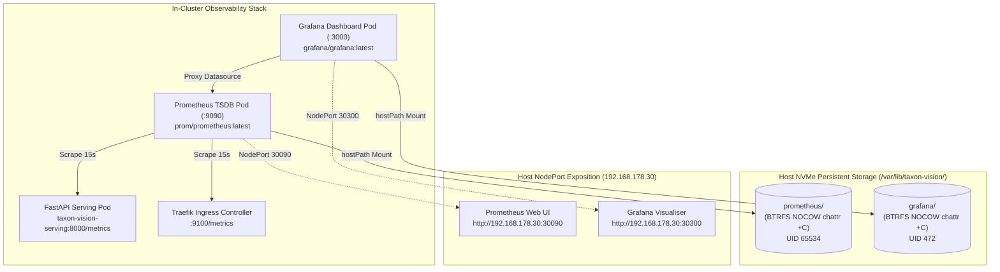

# Prometheus Telemetry, Grafana Provisioning & Ingress Routing

In autonomous ecological monitoring, predictive models face continuous domain shifts: seasonal phenological transitions, variable lighting, camera lens fogging, and regional biodiversity composition changes. Deploying fine-grained taxonomic classifiers into production requires end-to-end observability spanning real-time inference latency budgets, statistical prediction set distributions, two-tier covariate drift metrics, and active learning human feedback loops.

For the deep mathematical derivation of our Two-Tier Statistical Drift Engine and PostgreSQL telemetry persistence, see [Two-Tier Statistical Drift Detection & Telemetry Persistence](drift_detection_and_telemetry.md). For the Airflow 3.0 control-plane DAGs triggered by drift alerts, see [Apache Airflow 3.0 Workflow Orchestration & Retraining Relay](airflow_orchestration.md).



---

## 1. Prometheus Telemetry Specification

The platform exposes real-time Prometheus metrics at `GET /metrics` via `prometheus_client` and the custom [`DriftMetricsCollector`](file:///home/benni/Documents/antigravity_workspace/taxon-vision-mlops/src/taxon_vision/monitoring/telemetry.py), tracking latency percentiles, conformal set cardinality, out-of-distribution energy distributions, drift verdicts, and retraining relay triggers:

| Metric Identifier | Metric Type | Labels / Dimensions | Architectural Description & Alert Thresholds |
| :--- | :--- | :--- | :--- |
| **`taxon_inference_latency_seconds_bucket`** | Histogram | `extractor`, `backend`, `le` | Tracks execution duration across feature extraction and head projection. Evaluates p50, p95, and p99 latency SLO ($\le 15.0\,\text{ms}$ CPU / $\le 25.0\,\text{ms}$ HTTP). |
| **`taxon_conformal_set_size_bucket`** | Histogram | `le` | Measures the cardinality $\lvert C(X) \rvert$ of admissible prediction sets. An elevated mean set size ($> 3.0$) indicates rising epistemic ambiguity. |
| **`taxon_conformal_empty_set_total`** | Counter | None | Increments whenever $C(X) = \emptyset$. Indicates total lack of confidence at nominal $1 - \alpha$; routes to human triage. |
| **`taxon_ood_energy_score_bucket`** | Histogram | `le` | Tracks negative Helmholtz free energy $E(\mathbf{x}; T)$ scores. Activations exceeding $\tau_{\text{OOD}}$ trigger outlier isolation. |
| **`taxon_human_review_referrals_total`** | Counter | `reason` (`empty_set`, `exceeds_kmax`, `low_confidence`, `ood`) | Tracks requests deferred to the human-in-the-loop expert review queue. |
| **`taxon_predictions_total`** | Counter | `status` (`success`, `fallback`, `error`, `unavailable`) | Total inference requests processed. Explicitly differentiates client decode errors from runtime system crashes. |
| **`taxon_telemetry_write_failures_total`** | Counter | None | Increments if a background PostgreSQL telemetry insert fails, ensuring fail-fast observability without crashing the ASGI worker. |
| **`taxon_drift_w1_distance`** | Gauge | None | Observed 1D Wasserstein-1 distance on pre-normalised embedding norms from the latest `drift_runs` record. |
| **`taxon_drift_w1_threshold`** | Gauge | None | Active 1D Wasserstein-1 decision threshold ($\tau_{W_1}$) from the latest `drift_runs` record. |
| **`taxon_drift_mmd2_p_value`** | Gauge | None | Multivariate RBF MMD² Monte Carlo permutation test $p$-value ($B=200$ shuffles). |
| **`taxon_drift_detected`** | Gauge | None | Binary indicator flag (`1.0` = drift detected, `0.0` = nominal) triggering Grafana `EmbeddingDriftDetected` alerts. |
| **`taxon_drift_last_run_timestamp_seconds`** | Gauge | None | UTC UNIX timestamp in seconds of the most recent drift evaluation run execution. |
| **`taxon_retrain_triggers_total`** | Counter | `source`, `outcome` | Total model retraining triggers evaluated by `/api/v1/retrain/webhook` (`source="grafana"`, `outcome` in `triggered`, `suppressed`, `ignored`, `error`). |

---

## 2. Fail-Fast Telemetry & Error Masking Prevention

A critical failure mode in poorly engineered MLOps monitoring is **silent error masking** (Rule 08), where exceptions are caught indiscriminately inside blanket `except Exception:` blocks.

### The Anti-Pattern

In naive implementations, invalid client uploads (e.g. zero-byte files, non-JPEG buffers, corrupted headers) return synthetic fallback predictions while incrementing the global `status="success"` counter. Consequently, production dashboards display a misleading $100\%$ success rate, alerts fail to fire during upstream camera failures, and corrupted inputs pollute downstream telemetry tables.

### The Hardened Implementation

In [`src/taxon_vision/service/routes/predict.py`](file:///home/benni/Documents/antigravity_workspace/taxon-vision-mlops/src/taxon_vision/service/routes/predict.py) and [`src/taxon_vision/service/inference.py`](file:///home/benni/Documents/antigravity_workspace/taxon-vision-mlops/src/taxon_vision/service/inference.py), the service enforces strict metric ordering:

* **Verified Forward Passes:** Increments `status="success"` strictly *after* the ONNX Runtime graph executes to completion and constructs the Split Conformal prediction set.
* **Client Decoding Failures:** Corrupted image buffers raise `InvalidImageError`, increment error/validation counters, and return HTTP `422 Unprocessable Entity`.
* **Systemic Runtime Exceptions:** Unhandled runtime exceptions increment `status="error"`, log the full traceback via `logger.exception()`, and return HTTP `500 Internal Server Error` (or `503 Service Unavailable` when `ModelNotReadyError` is raised and `allow_untrained_fallback` is `false`).

---

## 3. Summary of the Two-Tier Statistical Drift Engine

The drift detection subsystem implemented in [`src/taxon_vision/monitoring/drift.py`](file:///home/benni/Documents/antigravity_workspace/taxon-vision-mlops/src/taxon_vision/monitoring/drift.py) and [`src/taxon_vision/monitoring/drift_runner.py`](file:///home/benni/Documents/antigravity_workspace/taxon-vision-mlops/src/taxon_vision/monitoring/drift_runner.py) combines two complementary statistical tests over the pre-normalised 384-D penultimate embeddings stored in PostgreSQL (see [Two-Tier Statistical Drift Detection & Telemetry Persistence](drift_detection_and_telemetry.md) for full derivations):

### 3.1 Tier 1: Exact 1D Wasserstein-1 Distance on Embedding Norms

[`compute_wasserstein_drift()`](file:///home/benni/Documents/antigravity_workspace/taxon-vision-mlops/src/taxon_vision/monitoring/drift.py#L46-L75) projects each pre-normalised feature vector onto its Euclidean $L_2$ norm $\|\mathbf{z}\|_2$ and evaluates the exact Kantorovich-Rubinstein distance between empirical CDFs via `scipy.stats.wasserstein_distance`:

```python
def compute_wasserstein_drift(reference_embeddings: np.ndarray, current_embeddings: np.ndarray) -> float:
    ref_norm = np.linalg.norm(reference_embeddings, axis=-1).ravel()
    curr_norm = np.linalg.norm(current_embeddings, axis=-1).ravel()
    if ref_norm.size == 0 or curr_norm.size == 0:
        return 0.0
    return float(wasserstein_distance(ref_norm, curr_norm))
```

* **Complexity:** $\mathcal{O}(N D + N \log N)$, executing in $< 1\,\text{ms}$ on CPU.
* **Bootstrap Threshold Calibration:** [`src/taxon_vision/pipelines/calibrate_drift.py`](file:///home/benni/Documents/antigravity_workspace/taxon-vision-mlops/src/taxon_vision/pipelines/calibrate_drift.py) runs 1,000 bootstrap iterations between `cal_embeddings.pt` and `test_embeddings.pt` to derive the 99th-percentile null threshold $\tau_{W_1} = 0.12812$ (`config/drift_config.yaml`).

### 3.2 Tier 2: Unbiased Multivariate RKHS Maximum Mean Discrepancy (`compute_mmd2_permutation`)

To detect angular manifold rotations and species-composition shifts that preserve average vector norms, [`compute_mmd2_permutation()`](file:///home/benni/Documents/antigravity_workspace/taxon-vision-mlops/src/taxon_vision/monitoring/drift.py#L113-L186) computes the unbiased squared Maximum Mean Discrepancy ($\text{MMD}_u^2$) in an RBF Reproducing Kernel Hilbert Space with adaptive median-heuristic bandwidth $\sigma = \sqrt{0.5 \cdot \operatorname{median}(D_{ij}^2)}$ and $B = 200$ Monte Carlo Gram-matrix index permutations:

$$p = \frac{N_{\text{exceed}} + 1}{B + 1} = \frac{N_{\text{exceed}} + 1}{201}$$

When either $W_1 > \tau_{W_1}$ or $p < \alpha = 0.01$, `evaluate_recent_drift()` flags `drift_detected = True`.

### 3.3 Evidently 0.7+ 8-D PCA Snapshot Report (`generate_evidently_drift_report`)

During every evaluation cycle (both in Stage 3.5 `data_drift.py` and online `drift_runner.py`), [`generate_evidently_drift_report()`](file:///home/benni/Documents/antigravity_workspace/taxon-vision-mlops/src/taxon_vision/monitoring/drift_runner.py#L149-L189) fits an 8-component PCA on the reference embeddings, constructs a compact 9-column DataFrame (`["norm", "pca_0", ..., "pca_7"]`), and renders a standalone HTML report via Evidently 0.7's `Report` and `DataDriftPreset`:

```python
from evidently import Report
from evidently.presets import DataDriftPreset
from sklearn.decomposition import PCA

pca = PCA(n_components=min(8, reference.shape[1], reference.shape[0]), random_state=42)
ref_pca = pca.fit_transform(reference)
curr_pca = pca.transform(current)

report = Report(metrics=[DataDriftPreset()])
snapshot = report.run(reference_data=ref_df, current_data=curr_df)
snapshot.save_html(str(output_path))
```

---

## 4. Active Learning & Priority Triage Queue

In continuous ecological monitoring, human taxonomic verification is a finite, expensive resource. Naively routing all ambiguous observations or sorting unbounded lists on every request introduces computational bottlenecks ($\mathcal{O}(N \log N)$ per insertion).

### Binary Max-Heap `TriageQueue`

TaxonVision-MLOps implements [`TriageQueue`](file:///home/benni/Documents/antigravity_workspace/taxon-vision-mlops/src/taxon_vision/active_learning/triage_queue.py) using a binary max-heap with deterministic monotonic counter tie-breaking:

```python
class TriageQueue:
    def __init__(self) -> None:
        self._heap: list[tuple[float, int, TriageItem]] = []
        self._counter: int = 0

    def push(self, item: TriageItem) -> None:
        heapq.heappush(self._heap, (-item.uncertainty_score, self._counter, item))
        self._counter += 1

    def pop(self) -> TriageItem | None:
        if not self._heap:
            return None
        _, _, item = heapq.heappop(self._heap)
        return item
```

* **Push / Pop Complexity:** $\mathcal{O}(\log N)$ worst-case insertion and retrieval of the single most informative observation.
* **Multi-Class Margin Sampling ([`query.py`](file:///home/benni/Documents/antigravity_workspace/taxon-vision-mlops/src/taxon_vision/active_learning/query.py)):** Prioritises observations via $1.0 - (\hat{\pi}_{(1)}(\mathbf{x}) - \hat{\pi}_{(2)}(\mathbf{x})) \in [0.0, 1.0]$.
* **Closed-Loop Feedback Merging ([`feedback.py`](file:///home/benni/Documents/antigravity_workspace/taxon-vision-mlops/src/taxon_vision/active_learning/feedback.py)):** Once taxonomists export verified annotations from Label Studio (`label_studio_export.json`), `merge_feedback_to_manifest()` filters out OOD specimens, validates `CC0`/`CC-BY`/`CC-BY-NC` licensing and mandatory photographer attribution, and atomically appends new observations into `dataset_manifest.parquet` during the Airflow `model_retraining` DAG.

---

## 5. In-Cluster Prometheus & Grafana Deployment on K3s

To guarantee operational visibility on bare metal without cloud SaaS vendor lock-in, the platform runs an in-cluster observability stack in `namespace: taxon-vision`, defined declaratively in [`deploy/k8s/monitoring-prometheus-grafana.yaml`](file:///home/benni/Documents/antigravity_workspace/taxon-vision-mlops/deploy/k8s/monitoring-prometheus-grafana.yaml).



### 5.1 Host NVMe Persistence, BTRFS NOCOW & Root `initContainers`

* **Non-CoW Flag Enforcement:** Host directories `/var/lib/taxon-vision/prometheus` and `/var/lib/taxon-vision/grafana` on the 2 TB PCIe Gen4 NVMe drive are initialised with `chattr +C` (`NOCOW`) to prevent Copy-on-Write block fragmentation during continuous TSDB WAL appends.
* **UID/GID Permission Alignment:** Because Prometheus executes as `nobody` (`65534:65534`) and Grafana executes as `grafana` (`472:472`), both deployments run a lightweight BusyBox `initContainer` (`chown -R ... && chmod -R 775 ...`) prior to daemon startup so K3s `DirectoryOrCreate` host mounts never trigger `permission denied` crashes.

---

## 6. Declarative Grafana Provisioning & Retraining Webhook Relay

All dashboards, datasources, and alert rules are provisioned as code under [`deploy/grafana/provisioning/`](file:///home/benni/Documents/antigravity_workspace/taxon-vision-mlops/deploy/grafana/provisioning):

### 6.1 Six-Panel Operator Overview Dashboard (`taxon_overview.json`)

1. **Request Rate (RPS):** `sum(rate(taxon_predictions_total[1m]))`
2. **Error Ratio:** `sum(rate(taxon_predictions_total{status=~"error|unavailable"}[5m])) / clamp_min(sum(rate(taxon_predictions_total[5m])), 1e-9)`
3. **p95 Inference Latency (ms):** `1000 * histogram_quantile(0.95, sum by (le) (rate(taxon_inference_latency_seconds_bucket[5m])))`
4. **Tier 1 Wasserstein-1 Norm Drift:** `taxon_drift_w1_distance` plotted against `taxon_drift_w1_threshold`
5. **Tier 2 MMD² Permutation p-Value:** `taxon_drift_mmd2_p_value` plotted on a log scale against $\alpha = 0.01$
6. **Active Drift Verdict State Timeline:** `taxon_drift_detected` (`0.0` = Healthy, `1.0` = Drift Detected)

### 6.2 Alert Segregation & Retraining Relay Bridge

Grafana Alertmanager rules in [`deploy/grafana/provisioning/alerting/rules.yaml`](file:///home/benni/Documents/antigravity_workspace/taxon-vision-mlops/deploy/grafana/provisioning/alerting/rules.yaml) separate infrastructure incidents from epistemic model drift:

* **Platform Alerts (`tier=platform`):** `PredictionLatencyP95High` and `PredictionErrorRatioHigh` notify human operators without triggering model retraining.
* **MLOps Retraining Alert (`tier=mlops`, `action=retrain`):** When `EmbeddingDriftDetected` (`taxon_drift_detected == 1.0`) fires, Alertmanager dispatches an authenticated webhook (`Authorization: Bearer <TAXON_RETRAIN_WEBHOOK_SECRET>`) to `POST /api/v1/retrain/webhook`, which verifies the secret via `hmac.compare_digest`, enforces a 6-hour atomic cooldown (`TAXON_RETRAIN_COOLDOWN_SECONDS=21600.0`), and triggers the `model_retraining` DAG in Airflow 3.0.

---

## 7. Traefik v3.1 Ingress, 80/20 Canary Routing & Sablier Scale-to-Zero

### 7.1 Declarative 80/20 A/B Canary Routing

Defined in [`deploy/k8s/traefik-ingress.yaml`](file:///home/benni/Documents/antigravity_workspace/taxon-vision-mlops/deploy/k8s/traefik-ingress.yaml) and [`deploy/k8s/canary-ab-service.yaml`](file:///home/benni/Documents/antigravity_workspace/taxon-vision-mlops/deploy/k8s/canary-ab-service.yaml), the `TraefikService` CRD (`taxon-vision-ab-service`) supports zero-downtime weighted round-robin traffic splitting between the baseline `@Production` deployment (`taxon-vision-serving:8000`, weight `80`) and a `@Challenger` canary deployment (`taxon-vision-serving-challenger:8000`, weight `20`).

### 7.2 On-Demand Scale-to-Zero for Human Dashboards (`Sablier`)

To preserve the 128 GB DDR5 RAM and CPU budget on `hive-mind`, core serving and telemetry daemons (`taxon-vision-serving`, `prometheus`, `postgres`, `seaweedfs`, `jenkins`, `sablier`) remain warm 24/7, while human inspection UIs (`optuna-dashboard`, `grafana`, `evidently-ui`) scale to `replicas: 0` when idle via [`deploy/k8s/sablier-scaler.yaml`](file:///home/benni/Documents/antigravity_workspace/taxon-vision-mlops/deploy/k8s/sablier-scaler.yaml) and the `sablier-traefik-plugin` (`v1.3.0`). When an operator opens `/grafana` or `/optuna` in a browser, Sablier intercepts the request, scales the deployment to 1 replica via the Kubernetes API, renders an auto-refreshing loading theme while the pod starts, and scales the pod back to `0` after 15 to 20 minutes of inactivity.
