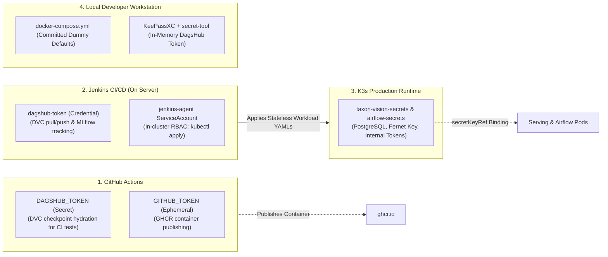
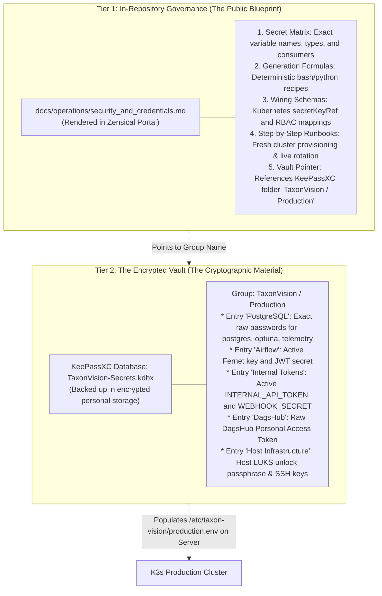

# Security Architecture & Credentials Governance

## 1. Conceptual Overview: Why MLOps Systems Require Dedicated Security Engineering

In traditional web engineering, application security concentrates primarily on network perimeters, SQL injection prevention, and user session authentication. Machine learning operations (MLOps) inherit all of these classical requirements whilst introducing four domain-specific attack surfaces that can silently compromise both infrastructure integrity and scientific reproducibility:

* **Arbitrary Code Execution via Model Serialisation:** Python's standard `pickle` format (used internally by legacy `torch.load` calls) is not a passive data container - it is a stack-based virtual machine capable of executing arbitrary operating system commands during deserialisation. Loading an untrusted or tampered checkpoint file can immediately compromise the serving host. To eliminate this vector at the root, TaxonVision-MLOps bans arbitrary `pickle` execution on the inference path: production serving executes strictly through static, declarative ONNX computation graphs ([`models/checkpoints/model_int8.onnx`](file:///home/benni/Documents/antigravity_workspace/taxon-vision-mlops/src/taxon_vision/inference/onnx_engine.py)), where every operator is bound to a verified C++ mathematical kernel in ONNX Runtime.
* **Dataset Poisoning and Copyright Liability:** Citizen-science repositories aggregate millions of unverified uploads from external domains. Ingesting observations without strict provenance filtering exposes the platform to both adversarial backdoor triggers and copyright infringement. Consequently, Stage 1 and Stage 2 of the DVC pipeline enforce a hard cryptographic and domain gate ([`src/taxon_vision/data/license_filter.py`](file:///home/benni/Documents/antigravity_workspace/taxon-vision-mlops/src/taxon_vision/data/license_filter.py)), admitting exclusively observations from the official `s3://inaturalist-open-data/` bucket licensed under `CC0`, `CC-BY`, or `CC-BY-NC`.
* **Autonomous Retraining Webhook Spoofing:** Closed-loop MLOps platforms expose internal endpoints that evaluate representation drift (`POST /api/v1/drift/evaluate`) and trigger expensive GPU retraining pipelines (`POST /api/v1/retrain/webhook`). If these endpoints lack cryptographic verification or are vulnerable to timing side-channel attacks, an external actor could trigger denial-of-wallet or GPU starvation loops. TaxonVision protects these routes via constant-time HMAC/Bearer token comparison (`hmac.compare_digest`) in [`src/taxon_vision/service/routes/retrain.py`](file:///home/benni/Documents/antigravity_workspace/taxon-vision-mlops/src/taxon_vision/service/routes/retrain.py) and [`src/taxon_vision/service/routes/drift.py`](file:///home/benni/Documents/antigravity_workspace/taxon-vision-mlops/src/taxon_vision/service/routes/drift.py).
* **Credential Leakage in Agentic Workspaces:** Modern software development increasingly pairs human engineers with autonomous AI coding agents that traverse the filesystem, inspect configurations, and diagnose build failures. Traditional local secret management - specifically storing live credentials in untracked `.env` files on disk - breaks down under agentic workflows.

This chapter details how TaxonVision-MLOps addresses these challenges across our existing infrastructure (**GitHub Actions**, **Jenkins on-premise**, **K3s on `hive-mind`**, and **Local Docker Compose**) without introducing heavy external secret daemons such as HashiCorp Vault or External Secrets Operator.

---

## 2. Threat Analysis: Why Untracked `.env` Files Fail in Agentic Workspaces

For over a decade, the Twelve-Factor App methodology recommended placing local developer secrets into an untracked `.env` file listed in `.gitignore`. Whilst effective against accidental `git commit` operations by humans, this pattern introduces a severe vulnerability when operating with AI coding assistants.

```mermaid
flowchart TD
    subgraph ToxicPattern["Anti-Pattern: Untracked .env on Disk"]
        ENV[".env file on disk<br/>(Git-ignored)"]
        AI["AI Coding Agent<br/>(Grep, Glob, File Reader)"]
        LLM["External LLM Provider<br/>(Context Window Transmission)"]
        LOGS["Conversation Transcripts<br/>(Persistent Plaintext Logs)"]

        ENV -->|Accidental Read| AI
        AI -->|Context Injection| LLM
        AI -->|Session Persistence| LOGS
    end

    subgraph HardenedPattern["TaxonVision Hardened Pattern: Dual-Track Separation"]
        COMPOSE["docker-compose.yml<br/>(Committed Explicit Dummy Defaults)"]
        KPXC["KeePassXC Secret Service<br/>(Encrypted in User RAM)"]
        JUST["just dvc-pull / just dvc-push<br/>(secret-tool in-memory query)"]
        K8S["K3s Production Runtime<br/>(In-Cluster Kubernetes Secrets)"]

        COMPOSE -->|Zero Secrets / Friction-Free Boot| DEV["Local Compose Containers"]
        KPXC -->|D-Bus Memory Buffer (No Disk Write)| JUST
        K8S -->|secretKeyRef Injection| PROD["FastAPI Serving Pod"]
    end
```

### 2.1 The Blast Radius of Plaintext Files on Disk

AI coding agents actively read workspace files, run diagnostic commands, and inspect directory trees to resolve errors. Even when `.env` is listed in `.gitignore`, an agent diagnosing an environment variable mismatch or Docker Compose startup error can read the file. Once read, two irreversible exposures occur:

1. **External Context Transmission:** The raw secret string is transmitted over the network into the external LLM provider's context window.
2. **Plaintext Transcript Persistence:** The raw secret is permanently recorded inside local conversation logs (such as `transcript.jsonl`), bypassing repository secret scanners entirely.

### 2.2 The Dual-Track Solution: Committed Dummy Defaults + In-Memory D-Bus Retrieval

To eliminate disk-resident secrets on the developer workstation (`flagship`) whilst preserving a friction-free onboarding experience, TaxonVision separates **local container bootstrap fixtures** from **authentic developer credentials**:

1. **Committed Explicit Dummy Defaults in [`docker-compose.yml`](file:///home/benni/Documents/antigravity_workspace/taxon-vision-mlops/docker-compose.yml):** Local Docker Compose services (`postgres`, `airflow-apiserver`, `airflow-scheduler`, `mlflow`, `seaweedfs`, `redis`, `app`) run exclusively on isolated `localhost` bridge networks and never communicate with the production cluster. Their environment variables use standard shell parameter expansion (`${VAR:-dummy_default}`) with explicit non-sensitive test placeholders committed directly to Git. Consequently, any engineer or CI job can clone the repository and execute `docker compose up -d` immediately with zero `.env` file creation.
2. **Addressing Automated Secret Scanner False Positives:** Certain cryptographic libraries validate key structure at startup. Specifically, Apache Airflow 3 validates that `AIRFLOW__CORE__FERNET_KEY` is a URL-safe Base64-encoded 32-byte sequence before booting. Because a dummy key satisfying this mathematical format matches the entropy profile of a real Fernet key, automated scanners such as GitGuardian flag the committed placeholder. Rather than moving the dummy key into a hazardous `.env` file, we retain the dummy test fixture in `docker-compose.yml` and silence false-positive alerts via a repository-level `.gitguardian.yaml` path exclusion (**Target State - Step 9**).
3. **In-Memory Credential Injection via KeePassXC and `secret-tool` (Active):** When a developer on `flagship` requires a genuine external credential - such as the DagsHub Personal Access Token needed to pull or push DVC tensor artefacts - the secret is never written to `.dvc/config.local` or `.env`. Instead, as implemented in [`Justfile`](file:///home/benni/Documents/antigravity_workspace/taxon-vision-mlops/Justfile), the command queries **KeePassXC** over the Linux Freedesktop Secret Service D-Bus interface (`org.freedesktop.secrets`) directly into a volatile shell sub-process variable:

```bash
# Active implementation in Justfile (dvc-pull and dvc-push recipes)
TOKEN=$(secret-tool lookup Title DagsHub 2>/dev/null || secret-tool lookup service dagshub 2>/dev/null);
pixi run -e dev dvc pull -r origin
```

Because the credential transitions strictly from KeePassXC's encrypted RAM allocation into the child process environment via D-Bus without touching the NVMe filesystem, no AI agent can ever glob, grep, or read the secret.

---

## 3. The Four Storage Pillars & Credential Classification Matrix

Across the complete lifecycle from code commit to bare-metal K3s serving on `hive-mind`, credentials are partitioned across four isolated storage pillars:



### 3.1 Elimination of Static Kubeconfig Files via In-Cluster RBAC

A common DevOps anti-pattern is storing a static cluster-admin `~/.kube/config` file inside CI/CD secret stores so pipelines can run `kubectl apply`. If that credential leaks, the entire Kubernetes cluster is compromised.

In TaxonVision-MLOps, **zero kubeconfig files exist in GitHub Actions or Jenkins Credentials**:

* GitHub Actions is restricted strictly to continuous integration (linting, unit testing, and publishing container images to `ghcr.io`) and never communicates with the K3s API server.
* Jenkins runs inside the K3s cluster on `hive-mind` (`namespace: jenkins-ci`) and spawns ephemeral build pods bound to the `jenkins-agent` Kubernetes `ServiceAccount` defined in [`deploy/k8s/jenkins-agent-rbac.yaml`](file:///home/benni/Documents/antigravity_workspace/taxon-vision-mlops/deploy/k8s/jenkins-agent-rbac.yaml). Kubernetes automatically mounts a short-lived, namespace-scoped service account token at `/var/run/secrets/kubernetes.io/serviceaccount/token`, authorising `kubectl` without human-managed keys.

### 3.2 Complete Credential Classification Matrix

The table below catalogues every credential required across the platform, its authoritative storage pillar, its injection mechanism, and its current implementation status (**Active** vs **Target State - Step 9**):

| Key / Variable Name | Authoritative Storage Location | Injection Mechanism | Permitted Value in Git | Consumer Subsystem & Status |
| :--- | :--- | :--- | :--- | :--- |
| **`DAGSHUB_TOKEN`** | GitHub Repo Secrets, Jenkins Credentials (`dagshub-token`), Local KeePassXC | CI Env Binding / `secret-tool` D-Bus lookup | **Never** | DVC S3 artefact hydration & remote MLflow tracking (**Active**) |
| **`Kubeconfig / Cluster Token`** | None (Eliminated) | Automatic K3s `ServiceAccount` mount (`jenkins-agent`) | **Never** | Jenkins `kubectl apply` and rollout verification (**Active**) |
| **`TAXON_INTERNAL_API_TOKEN`** | K3s Secret (`taxon-vision-secrets`) & Local Compose | `secretKeyRef` (K8s) / `${INTERNAL_API_TOKEN:-taxon-dev-internal-token}` | **Committed dummy default only** in `docker-compose.yml` | FastAPI `POST /api/v1/drift/evaluate` bearer auth (**Active** in Compose & App; K8s `secretKeyRef` is **Target State - Step 9**) |
| **`TAXON_RETRAIN_WEBHOOK_SECRET`** | K3s Secret (`taxon-vision-secrets`) & Local Compose | `secretKeyRef` (K8s) / `${RETRAIN_WEBHOOK_SECRET:-taxon-dev-webhook-secret}` | **Committed dummy default only** in `docker-compose.yml` | Grafana Alertmanager `POST /api/v1/retrain/webhook` relay (**Active** in Compose & App; K8s `secretKeyRef` is **Target State - Step 9**) |
| **`AIRFLOW__CORE__FERNET_KEY`** | K3s Secret (`airflow-secrets`) & Local Compose | `secretKeyRef` (K8s) / Literal dummy default in Compose | **Committed dummy default only** in `docker-compose.yml` | Airflow 3 connection & variable encryption (**Active** in Compose; K8s `secretKeyRef` is **Target State - Step 9**) |
| **`AIRFLOW__API_AUTH__JWT_SECRET`** | K3s Secret (`airflow-secrets`) & Local Compose | `secretKeyRef` (K8s) / Literal dummy default in Compose | **Committed dummy default only** in `docker-compose.yml` | Airflow 3 internal API server & worker JWT auth (**Active** in Compose; K8s `secretKeyRef` is **Target State - Step 9**) |
| **`POSTGRES_PASSWORD`** | K3s Secret (`taxon-vision-secrets`) & Local Compose | `secretKeyRef` (K8s) / `${POSTGRES_PASSWORD:-taxon_super_secret}` | **Committed dummy default only** in `docker-compose.yml` | PostgreSQL 16 root cluster bootstrap (**Active** in Compose; K8s `secretKeyRef` migration is **Target State - Step 9**) |
| **`TAXON_TELEMETRY__DATABASE_URL`** | K3s Secret (`taxon-vision-secrets`) & Local Compose | `secretKeyRef` (K8s) / Literal dummy DSN in Compose | **Committed dummy default only** in `docker-compose.yml` | FastAPI `PostgresTelemetryStore` connection string (**Active** in Compose; K8s `secretKeyRef` migration is **Target State - Step 9**) |
| **`TAXON_OPTUNA__OPTUNA_STORAGE_URI`** | K3s Secret (`taxon-vision-secrets`) & Local Compose | `secretKeyRef` (K8s) / Literal dummy DSN in Compose | **Committed dummy default only** in `docker-compose.yml` | Optuna study persistence & dashboard (**Active** in Compose; K8s `secretKeyRef` migration is **Target State - Step 9**) |
| **`JENKINS_API_TOKEN`** | K3s Secret (`airflow-secrets`) & Local Compose | `secretKeyRef` (K8s) / `${JENKINS_API_TOKEN:-dummy_token}` | **Committed dummy default only** in `docker-compose.yml` | Airflow `model_retraining` DAG triggering Jenkins (**Active** in Compose; K8s `secretKeyRef` is **Target State - Step 9**) |

> [!NOTE]
> **Current vs Target State in Kubernetes Manifests:** On the current `feature/pipeline1-monitoring` branch, [`deploy/k8s/api-deployment.yaml`](file:///home/benni/Documents/antigravity_workspace/taxon-vision-mlops/deploy/k8s/api-deployment.yaml) and [`deploy/k8s/postgres.yaml`](file:///home/benni/Documents/antigravity_workspace/taxon-vision-mlops/deploy/k8s/postgres.yaml) contain literal bootstrap connection strings (`taxon_telemetry_pass`, `taxon_optuna_pass`, `taxon_super_secret`) to support initial cluster bring-up. **Step 9 (Target State)** of our engineering roadmap migrates these fields to Kubernetes `valueFrom.secretKeyRef` bindings provisioned via `scripts/deploy/provision_k8s_secrets.sh` from a root-owned `/etc/taxon-vision/production.env` file (`chmod 600`) on `hive-mind`.

---

## 4. Cryptographic Key Generation Recipes

When provisioning a new cluster environment or rotating credentials, all keys must be generated using deterministic, high-entropy cryptographic primitives rather than human-chosen passphrases:

* **Airflow 3 Fernet Key (32-byte URL-safe Base64):**

```bash
pixi run -e dev python -c "from cryptography.fernet import Fernet; print(Fernet.generate_key().decode())"
```

* **Internal Bearer & Webhook Secrets (`TAXON_INTERNAL_API_TOKEN`, `TAXON_RETRAIN_WEBHOOK_SECRET`, `AIRFLOW__API_AUTH__JWT_SECRET` - 256-bit hex):**

```bash
openssl rand -hex 32
```

* **PostgreSQL Role Passwords (`postgres`, `telemetry`, `optuna`, `airflow`, `mlflow` - 24-character alphanumeric to avoid URI percent-encoding issues in SQLAlchemy DSNs):**

```bash
openssl rand -base64 32 | tr -dc 'a-zA-Z0-9' | head -c 24
```

* **Git Commit Signing Key (Ed25519 SSH Cryptographic Signature):**

```bash
ssh-keygen -t ed25519 -C "benni@taxon-vision.local" -f ~/.ssh/taxon_commit_signing
git config --global gpg.format ssh
git config --global user.signingkey ~/.ssh/taxon_commit_signing.pub
git config --global commit.gpgsign true
```

---

## 5. The 2-Year Amnesia Resistance Strategy: Dual-Tier Documentation

A recurring failure mode in solo and small-team MLOps infrastructure is operational amnesia: an engineer hardens a cluster, places secrets in various untracked locations, and two years later cannot reconstruct which key lives where or how a fresh node is bootstrapped. Conversely, documenting raw secrets in the repository compromises security.

To guarantee that any maintainer can reconstruct or audit the entire security apparatus years later without risking credential exposure today, TaxonVision enforces a **Dual-Tier Documentation Model**:



### 5.1 Tier 1: What MUST Be Tracked in Git (The Public Blueprint)

* **Complete Variable Catalogue:** Every environment variable identifier, its consuming service, and its expected format (documented in Section 3.2 above).
* **Exact Cryptographic Generation Commands:** The exact `openssl` and `cryptography.fernet` invocations required to synthesize compliant keys (Section 4).
* **Declarative Kubernetes Wiring & Provisioning Scripts:** All RBAC manifests ([`deploy/k8s/jenkins-agent-rbac.yaml`](file:///home/benni/Documents/antigravity_workspace/taxon-vision-mlops/deploy/k8s/jenkins-agent-rbac.yaml)), workload `secretKeyRef` mappings, and the idempotent cluster secret provisioning script (`scripts/deploy/provision_k8s_secrets.sh`).
* **Explicit Vault Pointers:** Human-readable references indicating the exact KeePassXC group path (`TaxonVision / Production`) and `secret-tool` lookup attributes (`Title DagsHub` or `service dagshub`) where the live values reside.

### 5.2 Tier 2: What MUST NEVER Be Tracked in Git (The Cryptographic Material)

* Raw production password strings, active production Fernet keys, or personal SaaS tokens (`DAGSHUB_TOKEN`, `JENKINS_API_TOKEN`).
* Populated host environment files (`/etc/taxon-vision/production.env` on `hive-mind`).
* Unredacted Kubernetes Secret YAML exports (`kubectl get secret -o yaml`).
* Private SSH/GPG commit signing keys or the `.kdbx` KeePassXC database file itself.

---

## 6. Day-2 Operational Runbooks: Provisioning & Zero-Downtime Rotation

### 6.1 Provisioning Secrets on `hive-mind` (Target State - Step 9)

On the bare-metal server `hive-mind`, raw production credentials are stored in a single root-protected file outside the Git workspace (`/etc/taxon-vision/production.env`, owned by `root:root` with mode `0600`) and synchronised into K3s via `kubectl create secret generic ... --dry-run=client -o yaml | kubectl apply -f -`:

```bash
# 1. Verify strict file permissions on the host secret store
sudo chown root:root /etc/taxon-vision/production.env
sudo chmod 600 /etc/taxon-vision/production.env

# 2. Apply idempotent secret synchronization into taxon-vision and taxon-vision-staging namespaces
sudo bash scripts/deploy/provision_k8s_secrets.sh /etc/taxon-vision/production.env
```

### 6.2 Zero-Downtime Rotation of Internal API & Webhook Tokens

When rotating `TAXON_INTERNAL_API_TOKEN` or `TAXON_RETRAIN_WEBHOOK_SECRET`:

1. Generate a fresh 256-bit hex secret via `openssl rand -hex 32` and update the entry under `TaxonVision / Production -> Internal Tokens` in KeePassXC.
2. Update `/etc/taxon-vision/production.env` on `hive-mind` and re-run `provision_k8s_secrets.sh`.
3. Trigger a zero-downtime rolling restart of the FastAPI serving deployment (`maxSurge: 1, maxUnavailable: 0`) and the consumer stack (Airflow or Grafana):

```bash
kubectl rollout restart deployment/taxon-vision-serving -n taxon-vision
kubectl rollout status deployment/taxon-vision-serving -n taxon-vision --timeout=120s
```

### 6.3 Live Airflow 3 Fernet Key Rotation Without Losing Encrypted Connections

If `AIRFLOW__CORE__FERNET_KEY` must be rotated, replacing the key directly would render existing encrypted connection URIs in the `airflow` PostgreSQL database unreadable. Airflow supports multi-key Fernet rotation using a comma-delimited list:

1. Generate a `NEW_FERNET_KEY` using the recipe in Section 4.
2. Set `AIRFLOW__CORE__FERNET_KEY="<NEW_FERNET_KEY>,<OLD_FERNET_KEY>"` (Airflow encrypts all new data with the first key whilst remaining able to decrypt legacy records with the second key).
3. Run the Airflow key rotation command inside the scheduler container to re-encrypt all database rows with the primary key:

```bash
airflow rotate-fernet-key
```

1. Remove `<OLD_FERNET_KEY>` from `AIRFLOW__CORE__FERNET_KEY` and restart the Airflow containers.
