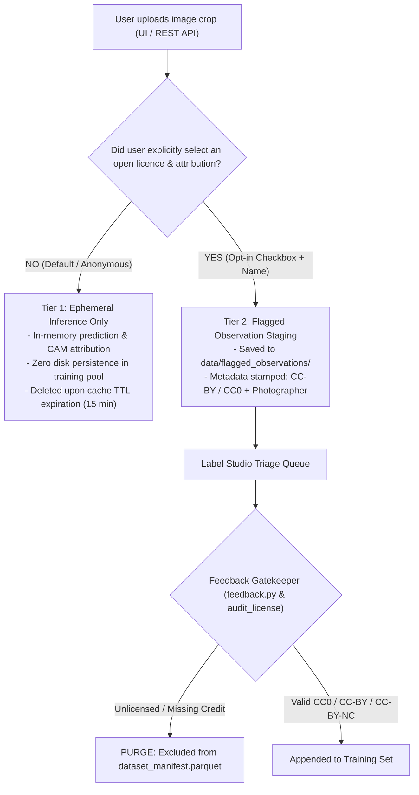

# Active Learning & Human-in-the-Loop Triage

In fine-grained biological identification, expert human verification is a finite, high-cost operational resource. When Split Conformal Prediction yields an empty set ($\mathcal{C}(x) = \emptyset$), exceeds cardinality thresholds ($|\mathcal{C}(x)| > 3$), or flags out-of-distribution inputs, TaxonVision escalates the specimen to human taxonomists.

To maximize model performance gains per review hour, the platform decouples component-verified uncertainty query scoring from future batch diversity specifications.

---

## 1. Verified Component Implementation

### Margin Uncertainty Sampling (`query.py`)

In [`src/taxon_vision/active_learning/query.py`](file:///home/benni/Documents/antigravity_workspace/taxon-vision-mlops/src/taxon_vision/active_learning/query.py), uncertainty is evaluated via multi-class margin sampling:

$$M(x) = \hat{\pi}_{(1)}(x) - \hat{\pi}_{(2)}(x)$$

$$\text{Uncertainty Score} = 1.0 - M(x) \in [0.0, 1.0]$$

Where $\hat{\pi}_{(1)}$ and $\hat{\pi}_{(2)}$ represent the top-2 predicted class probabilities. Observations with near-identical probabilities ($\hat{\pi}_{(1)} \approx \hat{\pi}_{(2)}$) yield uncertainty near $1.0$, indicating maximum boundary ambiguity. This module is standalone unit-tested in `tests/unit/test_active_learning.py`.

### In-Memory Binary Max-Heap (`triage_queue.py`)

The [`TriageQueue`](file:///home/benni/Documents/antigravity_workspace/taxon-vision-mlops/src/taxon_vision/active_learning/triage_queue.py) is implemented using Python's native `heapq` module, maintaining an $O(\log N)$ priority queue. To handle tie-breakers when two observations share identical uncertainty scores without comparing complex object dicts, a unique monotonically increasing counter is injected into the tuple: `(-priority, count, item)`.

* **Push Complexity:** $O(\log N)$ worst-case insertion time.
* **Pop Complexity:** $O(\log N)$ retrieval of the single most informative observation.
* **Algorithmic Validation:** Re-sorting standard lists on every insertion introduces an $O(N \log N)$ bottleneck that freezes active learning workers at scale. A binary heap ensures sub-millisecond priority scheduling.

### Flagged Specimen Storage (`service/storage.py`)

In the active runtime serving path (`/api/v1/predict`), whenever `is_ood` or `requires_human_review` is triggered, [`service/storage.py`](file:///home/benni/Documents/antigravity_workspace/taxon-vision-mlops/src/taxon_vision/service/storage.py) atomically persists:

1. **Feature Vector:** Normalized latent representation saved as `.npy` in `TAXON_FLAGGED_STORAGE_DIR`.
2. **Metadata Record:** Classification probabilities, conformal set, and OOD energy score serialized to `.json`.
3. **Audit Ledger:** Atomic append to `manifest.jsonl` tracking triage provenance.

---

## 2. Three-Tier Legal & Licensing Security for User Uploads

In real-world ecological deployments, observations flagged for human triage frequently originate from field biologists or public users uploading imagery through web interfaces or mobile REST endpoints. A common operational anti-pattern is relying on passive website disclaimers (e.g. *"By uploading images you grant us rights to train AI models"*).

### 2.1 The Jurisprudential Failure of Passive Disclaimers

Under European and German copyright doctrine (UrhG, BGB §§ 305 ff. on General Terms and Conditions), passive disclaimers fail to transfer valid copyright or exploitation rights:

* **Inalienability of Authorship:** Under German law, authorship (*Urheberschaft*) cannot be waived; only specific, voluntary exploitation rights (*Nutzungsrechte*) can be granted.
* **No Implicit Consent:** Mere upload for real-time inference does not constitute voluntary, informed consent to distribute photos to public third-party repositories or cloud annotation tools (DagsHub / Label Studio).
* **Third-Party Infringement:** Users routinely upload third-party screenshots or field guide photos they do not own; an uploader cannot license rights they do not possess.
* **TDM Limitations:** Statutory Text and Data Mining exceptions (EU DSM Directive Art. 4 / § 44b UrhG) cover internal model fitting, but **expressly forbid public redistribution** of photographic assets in open dataset releases or public Label Studio workspaces without a valid open license.

### 2.2 Three-Tier Ingestion Architecture

To achieve mathematical, reproducible, and legally watertight operation, TaxonVision enforces a three-tier lifecycle:

1. **Tier 1 (Ephemeral Inference by Default):** Unverified uploads are processed strictly in RAM for forward-pass classification and CAM visualization. Images expire from memory after `image_cache_ttl_seconds` (15 minutes) and are **never** written to training manifests.
2. **Tier 2 (Affirmative Opt-In Staging):** Only when a user explicitly checks an affirmative opt-in box (*"Contribute to open science under CC-BY 4.0"*) and provides an attribution name does `persist_flagged_observation` stage the crop to `data/flagged_observations/`.
3. **Tier 3 (Automated Gatekeeper Invariant):** The feedback merger (`src/taxon_vision/active_learning/feedback.py`) and license auditor (`audit_license.py`) act as a hard barrier: any annotation export record missing a valid Creative Commons code (`CC0`, `CC-BY`, `CC-BY-NC`) or lacking a photographer attribution string is dropped immediately with an audit warning.

---

## 3. Label Studio Triage Interface (`deploy/label_studio/project_config.xml`)

Human annotation tasks are declared declaratively via XML configuration in `deploy/label_studio/project_config.xml`:

* **Visual Inspection:** High-resolution zoomable image crop viewer with rotation controls.
* **Attribution Verification Pill:** Displays `$photographer_name`, `$license_code`, and `$observation_uuid` directly above the choices so domain experts can verify copyright credentials before tagging.
* **Canonical Taxonomy Choices:** Single-choice selection mapping the 10 catalog taxa from `config/taxa_catalog.yaml` alongside an explicit `"Out of Distribution"` category.

---

## 4. Feedback Ingestion Engine (`src/taxon_vision/active_learning/feedback.py`)

The feedback merger (`merge_feedback_to_manifest`) parses completed Label Studio JSON exports:

1. Maps taxonomy choices to integer `taxon_id`s.
2. Discards or isolates Out-of-Distribution classifications away from closed-set head updates.
3. Validates open-license codes against `PERMITTED_LICENSES = {"cc0", "cc-by", "cc-by-nc"}` and verifies non-empty photographer attribution.
4. Idempotently deduplicates against existing observation UUIDs in `data/manifests/dataset_manifest.parquet` before atomic rewrite.

---

## 5. Phase 2.5 & Phase 3 Roadmap Specifications

The following capabilities represent planned architectural extensions detailed in the Technical Strategy Report (currently zero runtime code in `src/`):

* **BADGE Gradient Acquisition:** Computing loss gradients with respect to linear classification weights ($g_x = (p - e_{\hat{y}}) \otimes z$) and sampling diverse batches via k-means++ in gradient space.
* **Persistent Parquet/DuckDB Queue:** Replacing the in-memory binary heap with an on-disk Parquet queue queried via DuckDB for cross-worker multi-node persistence.
* **Label Studio Bidirectional Sync:** Automated webhook integration synchronizing expert labeler corrections from Label Studio into retraining partitions.
