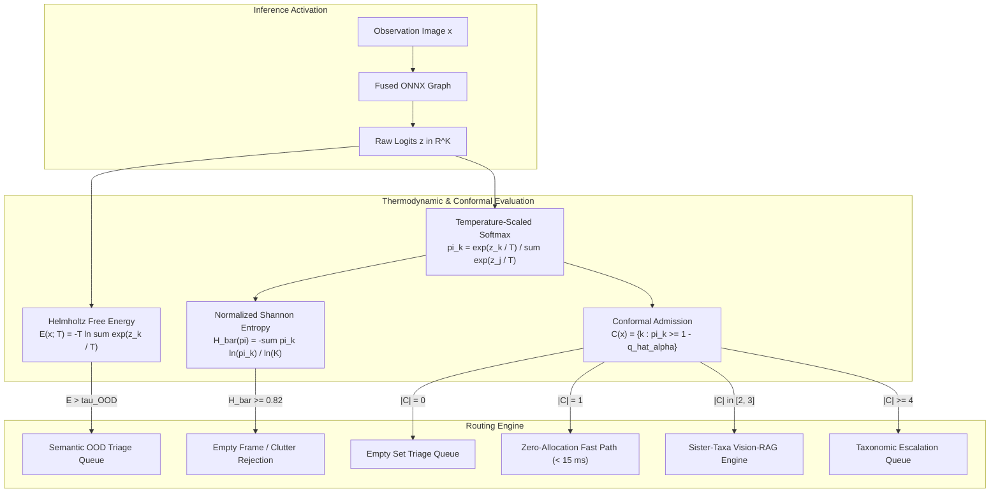

# Interactive Conformal & Thermodynamic OOD Simulator

Explore the epistemic decision mechanics governing TaxonVision-MLOps uncertainty bounds. Adjust the significance level $\alpha$, Helmholtz Free Energy cutoff $\tau_{\text{OOD}}$, and logit temperature $T$, or select real-world observation presets to observe real-time impacts on coverage guarantees, empirical quantiles, and human triage dispatch routes.

---

## 1. Live Epistemic Simulator

---

## 2. Interactive Presets & Diagnostic Scenarios

The simulator models an operational 5-class biological perimeter containing challenging insect taxa, non-biological anomalies, and corrupted camera-trap triggers:

* **Preset 1: Confident Inlier Specimen (*Danaus plexippus*):**
    * *Morphology:* Clean, focused photograph of a Monarch Butterfly with distinctive orange and black wing patterns.
    * *Network State:* Strong single logit activation ($z_1 = +5.2$), while competing classes remain negative.
    * *Epistemic Dynamics:* Helmholtz Free Energy is strongly negative ($E(x; T) \approx -5.21 \ll \tau_{\text{OOD}}$) and Normalized Shannon Entropy approaches zero ($\bar{H} \approx 0.038$).
    * *Operational Action:* Yields a singleton prediction set $\mathcal{C}(x) = \{\text{Danaus plexippus}\}$ admitted at $(1 - \hat{q}_\alpha)$. Handled via the sub-15ms zero-allocation fast path.

* **Preset 2: Sister-Taxa Morphological Mimicry (*Danaus* vs. *Limenitis*):**
    * *Morphology:* Batesian mimicry pair where Viceroy (*Limenitis archippus*) closely resembles Monarch (*Danaus plexippus*).
    * *Network State:* Two competing dominant logits ($z_1 = +4.2, z_2 = +4.0$), while unrelated taxa remain suppressed.
    * *Epistemic Dynamics:* Helmholtz Free Energy confirms in-distribution biological presence ($E \approx -4.81 \le \tau_{\text{OOD}}$), but entropy reflects epistemic ambiguity ($\bar{H} \approx 0.44$).
    * *Operational Action:* Both candidates satisfy the non-conformity threshold ($|\mathcal{C}(x)| = 2$). The system lazily invokes the Vision-RAG differential diagnosis pipeline.

* **Preset 3: Empty Camera-Trap Frame / Foliage Blur:**
    * *Morphology:* Wind-triggered sensor activation capturing blurry background grass or dark foliage without specimen pixels.
    * *Network State:* Uniformly suppressed, near-zero logits across all classes ($z \approx [-0.1, +0.05, -0.15, +0.1, -0.05]$).
    * *Epistemic Dynamics:* Softmax yields a near-uniform probability distribution ($\hat{\pi}_k \approx 1/K = 0.20$), driving Normalized Shannon Entropy to its maximum ($\bar{H} \to 1.0$).
    * *Operational Action:* Detected by the entropy rejection filter ($\bar{H} \ge 0.82$). Rebuffed as clutter, preventing unnecessary model inference and database writes.

* **Preset 4: Semantic OOD Vehicle / Mineral:**
    * *Morphology:* Field vehicle (e.g., Land Cruiser) or geological formation in the camera trap field of view.
    * *Network State:* Strongly negative logits across all biological taxa ($z \approx [-4.5, -4.8, -5.2, -4.9, -5.4]$).
    * *Epistemic Dynamics:* While shift-invariant softmax would normalize these negative activations into an arbitrary biological probability distribution, Helmholtz Free Energy remains high ($E(x; T) \approx +3.32 > \tau_{\text{OOD}} = -2.28$).
    * *Operational Action:* Diverted immediately to the human taxonomist triage queue. Softmax point predictions are discarded.

---

## 3. Mathematical Foundations & Decision Pipeline

### Finite-Sample Quantile Inflation

In Split Conformal Prediction, using the uncorrected asymptotic $(1 - \alpha)$ empirical quantile leads to under-coverage due to sample variance. For $N_{\text{cal}} = 169$ exchangeable calibration observations, the exact order statistic rank index $p$ is calculated as:

$$p = \frac{\lceil(N_{\text{cal}} + 1)(1 - \alpha)\rceil}{N_{\text{cal}}}$$

The true-class non-conformity score $s_i$ evaluates residual error on held-out calibration samples:

$$s_i = 1 - \hat{\pi}_{y_i}(x_i)$$

The empirical non-conformity threshold $\hat{q}_\alpha$ corresponds to the $p$-th order statistic:

$$\hat{q}_\alpha = \text{Quantile}\left(\{s_i\}_{i=1}^{N_{\text{cal}}}, \; p\right)$$

At test time, the multi-class prediction set $\mathcal{C}(x_{\text{test}})$ admits all taxa whose calibrated probabilities meet the threshold:

$$\mathcal{C}(x_{\text{test}}) = \left\{ k \in \{1, \dots, K\} : \hat{\pi}_k(x_{\text{test}}) \ge 1 - \hat{q}_\alpha \right\}$$

Under exchangeability, this guarantee mathematically holds:

$$\mathbb{P}\left( Y_{\text{test}} \in \mathcal{C}(X_{\text{test}}) \right) \ge 1 - \alpha$$

---

## 4. Thermodynamic Identity Verification

The simulator continuously verifies the statistical-mechanics identity linking Helmholtz Free Energy, Expected Internal Energy, and Shannon Entropy:

$$E(x; T) = -T \ln \sum_{k=1}^K \exp\left(\frac{z_k}{T}\right) = \underbrace{\sum_{k=1}^K \hat{\pi}_k(x)(-z_k)}_{U(x) \text{ (Internal Energy)}} - T \cdot \underbrace{\left(-\sum_{k=1}^K \hat{\pi}_k(x)\ln \hat{\pi}_k(x)\right)}_{H(\hat{\pi}) \text{ (Shannon Entropy)}}$$

As demonstrated in the interactive verification bar:

* When a specimen activates biological features with large positive logits, internal energy $U(x) \ll 0$, yielding a deeply negative free energy $E(x; T) \le \tau_{\text{OOD}}$.
* When non-biological objects enter the camera frame, $z_k \ll 0$ for all biological categories, driving $U(x) \gg 0$ and elevating free energy above $\tau_{\text{OOD}}$.
* When an image contains only diffuse background noise, maximum entropy $H(\hat{\pi}) \to \ln K$ drives Normalized Shannon Entropy $\bar{H}(\hat{\pi}) \to 1.0$.
