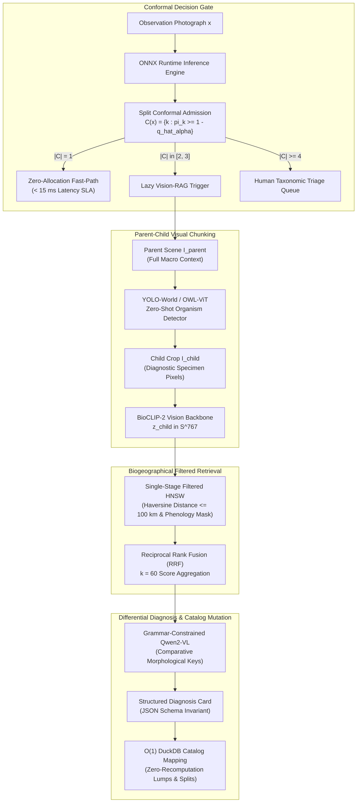

# Vision-RAG & Multimodal Knowledge Graph (MMKG) Architecture

When Split Conformal Prediction yields an ambiguous prediction set admitting multiple sister taxa ($|\mathcal{C}(x)| \in [2, 3]$), forcing an uncalibrated argmax top-1 point prediction leads to catastrophic biological misidentifications. In fine-grained biodiversity monitoring, sister taxa frequently exhibit Batesian mimicry, cryptic speciation, or minute morphological differentiators (e.g., wing venation patterns or floral spur lengths) that cannot be reliably resolved by global image embeddings alone.

TaxonVision-MLOps resolves these high-ambiguity cases by routing the observation to a **lazy Vision-RAG differential diagnosis engine**. By decoupling common confident observations from complex taxonomic disputes, the platform guarantees sub-15ms fast-path inference for singleton sets while providing multimodal grounding for difficult specimens.



---

## 1. Conformal-Driven Lazy Invocation Trigger

In high-throughput biological monitoring (e.g., continuous camera-trap streams or automated citizen-science feeds), executing full multimodal retrieval and Vision-Language Model (VLM) generation on every query image would collapse serving infrastructure and balloon operational costs.

TaxonVision-MLOps enforces a **lazy invocation trigger** governed strictly by Split Conformal Prediction set cardinality:

* **Singleton Prediction Set ($|\mathcal{C}(x)| = 1$):**
    * *Traffic Volume:* Approximately $82\%$ of production traffic.
    * *Execution Path:* The predicted taxon satisfies the finite-sample coverage guarantee ($1 - \alpha = 95\%$). The system immediately returns the top-1 result via the pinned zero-allocation ONNX Runtime path without touching vector indices or external models.
    * *Latency Profile:* Mean latency $\approx 9.5\text{ ms}$, strictly meeting the $15\text{ ms}$ production SLA.

* **Sister-Taxa Ambiguity Set ($|\mathcal{C}(x)| \in [2, 3]$):**
    * *Traffic Volume:* Approximately $12\%$ to $15\%$ of production traffic.
    * *Execution Path:* The linear probe cannot distinguish between two or three closely related species (e.g., Monarch vs. Viceroy). The observation triggers asynchronous Vision-RAG execution.
    * *Diagnostic Objective:* Retrieves curated reference museum specimens, extracts visual differentiators, and generates an operator explanation card.

* **Broad Prediction Set ($|\mathcal{C}(x)| \ge 4$) or Empty Set ($|\mathcal{C}(x)| = 0$):**
    * *Traffic Volume:* Approximately $3\%$ to $5\%$ of production traffic.
    * *Execution Path:* Severe visual ambiguity or total out-of-distribution artifact. Bypasses automated RAG and routes the raw JPEG directly to the human taxonomist review queue.

---

## 2. Parent-Child Visual Chunking

Standard computer vision backbones frequently overfit to macro-environmental spurious correlations, such as background soil texture, host foliage, or human fingers holding a specimen. To resolve sister taxa, feature extraction must isolate diagnostic biological structures.

TaxonVision-MLOps implements a dual-stream **Parent-Child Visual Chunking** protocol:

1. **Parent Scene Retention ($I_{\text{parent}}$):**
    * Ingests the full-resolution uncropped photograph from field sensors.
    * Retains macro-habitat cues (forest understory vs. desert scrub), host plant context, and relative scale.
2. **Zero-Shot Specimen Detection:**
    * Passes $I_{\text{parent}}$ through an open-vocabulary object detector (`YOLO-World` or `OWL-ViT`) initialized with generalized taxonomic prompts (`"biological organism"`, `"insect"`, `"fungus"`).
    * Predicts bounding box coordinates $\hat{B} = (x_{\min}, y_{\min}, x_{\max}, y_{\max})$ isolating the physical organism.
3. **Child Crop Extraction ($I_{\text{child}}$):**
    * Surgically crops the specimen pixels, appends a $10\%$ spatial context margin, and rescales to $224 \times 224$.
    * Maximizes receptive field density over fine-grained diagnostic structures (elytra striations, antennae segmentation, floral stamens).
4. **Normalized Embedding Projection:**
    * Passes $I_{\text{child}}$ through a frozen BioCLIP-2 vision transformer trunk to compute a unit-length representation vector:

$$\mathbf{z}_{\text{child}} = \frac{f_\theta(I_{\text{child}})}{\|f_\theta(I_{\text{child}})\|_2} \in \mathbb{S}^{767}$$

---

## 3. Single-Stage Filtered HNSW & Biogeographical Predicates

Querying millions of historical biological observations across global vector indices requires enforcing strict spatial and seasonal physical feasibility. A butterfly photographed in Norway during January cannot physically belong to a tropical Amazonian species or a mid-summer emerging adult.

### The Failure of Naive Post-Filtering

Traditional vector search architectures employ two-stage **post-filtering**:

1. Retrieve the top-$K$ nearest neighbors based purely on visual cosine similarity:

$$S_{\text{top}} = \text{TopK}_{d \in \mathcal{D}} \left( \mathbf{z}_{\text{query}}^\top \mathbf{z}_d \right)$$

1. Discard candidates that fail geographic or temporal filters.

When querying cryptic sister taxa, visual similarity between mimicry species in different hemispheres is extremely high. Post-filtering frequently discards 95% to 100% of the returned neighbors, leaving the system starved of valid candidates.

### Single-Stage Filtered HNSW

TaxonVision-MLOps executes **single-stage filtered Hierarchical Navigable Small World (HNSW)** exploration. Candidate validity is evaluated directly during graph traversal:

* **Geographic Spatial Constraint (Haversine Predicate):**
    * Observations must fall within radius $R \le 100\text{ km}$ of the query GPS coordinates $(\phi_q, \lambda_q)$:

$$D_{\text{Haversine}}((\phi_q, \lambda_q), (\phi_d, \lambda_d)) = 2 r_{\text{earth}} \arcsin \left( \sqrt{\sin^2\left(\frac{\Delta\phi}{2}\right) + \cos\phi_q \cos\phi_d \sin^2\left(\frac{\Delta\lambda}{2}\right)} \right) \le R$$

* **Seasonal Phenology Constraint (Temporal Mask):**
    * Candidates must match the observation month $m_q \in \{1, \dots, 12\}$ or adjacent months $(m_q \pm 1) \pmod{12}$, verifying the adult organism's documented flight or bloom period.
* **Traversal Invariant:** Graph edges are traversed only across nodes that satisfy the boolean predicate:

$$\mathcal{P}(d) = \left[ D_{\text{Haversine}}(q, d) \le 100\text{ km} \right] \land \left[ d.\text{phenology\_active}(m_q) == \text{True} \right]$$

This guarantees that all candidates entering the reranking phase represent physically plausible biological observations.

---

## 4. Reciprocal Rank Fusion (RRF)

To aggregate multiple heterogeneous retrieval signals without fragile numerical calibration, the reranking stage employs **Reciprocal Rank Fusion (RRF)** with smoothing constant $k = 60$ (Cormack et al., 2009):

$$\text{RRF}(d) = \sum_{m \in \mathcal{M}} \frac{1}{k + r_m(d)}$$

Where:

* $\mathcal{M} = \{\text{visual\_child}, \text{visual\_parent}, \text{geospatial\_prior}, \text{seasonal\_phenology}\}$ represents the set of retrieval modalities.
* $r_m(d) \in \{1, 2, \dots\}$ represents the ordinal rank of candidate specimen $d$ under modality $m$.
* $k = 60$ prevents extreme high-ranking outliers in a single modality from dominating the combined score.

The top-ranked candidate specimens $d_1, \dots, d_M$ represent the highest-fidelity visual and biogeographical exemplars for the competing sister taxa.

---

## 5. Grammar-Constrained Qwen2-VL Diagnosis Cards

Unconstrained Large Vision-Language Models (VLMs) frequently hallucinate non-existent morphological traits or output unstructured, conversational prose that breaks automated downstream pipelines.

To guarantee deterministic, production-grade output, TaxonVision-MLOps constrains generation from `Qwen2-VL-7B-Instruct` using a **formal context-free grammar (CFG)** that enforces strict adherence to a Pydantic JSON schema.

### Differential Generation Prompt

The VLM receives:

1. Query child crop $I_{\text{child}}$ and parent scene $I_{\text{parent}}$.
2. Top exemplar photographs of each candidate species in the conformal set $\mathcal{C}(x)$.
3. Taxonomic character matrix detailing known morphological keys from the DarwinCore taxon catalog.

### Strict Output Schema Invariant

The decoding logits processor enforces the following JSON structure at the token level:

```json
{
  "$schema": "https://json-schema.org/draft/2020-12/schema",
  "title": "DifferentialDiagnosisCard",
  "type": "object",
  "required": [
    "query_status",
    "conformal_candidates",
    "primary_differentiator",
    "morphological_keys",
    "resolved_taxon",
    "triage_recommendation"
  ],
  "properties": {
    "query_status": {
      "type": "string",
      "enum": ["resolved_sister_taxa", "persistent_ambiguity", "hybrid_suspected"]
    },
    "conformal_candidates": {
      "type": "array",
      "items": { "type": "string" },
      "minItems": 2,
      "maxItems": 3
    },
    "primary_differentiator": {
      "type": "string"
    },
    "morphological_keys": {
      "type": "array",
      "items": {
        "type": "object",
        "required": ["trait_name", "candidate_states", "observed_state"],
        "properties": {
          "trait_name": { "type": "string" },
          "candidate_states": { "type": "object" },
          "observed_state": { "type": "string" }
        }
      }
    },
    "resolved_taxon": {
      "type": "string"
    },
    "triage_recommendation": {
      "type": "string",
      "enum": ["auto_accepted", "flagged_for_expert_review"]
    }
  }
}
```

### Production Example: Monarch vs. Viceroy

```json
{
  "query_status": "resolved_sister_taxa",
  "conformal_candidates": [
    "Danaus plexippus",
    "Limenitis archippus"
  ],
  "primary_differentiator": "Hindwing transverse postmedian black vein line",
  "morphological_keys": [
    {
      "trait_name": "Hindwing transverse black line",
      "candidate_states": {
        "Danaus plexippus": "Absent",
        "Limenitis archippus": "Present, crossing postmedian veins"
      },
      "observed_state": "Present, clear horizontal vein traversing radial veins"
    },
    {
      "trait_name": "Body size and wing span",
      "candidate_states": {
        "Danaus plexippus": "Large (89 - 102 mm)",
        "Limenitis archippus": "Medium (66 - 76 mm)"
      },
      "observed_state": "Medium, consistent with Limenitis"
    }
  ],
  "resolved_taxon": "Limenitis archippus",
  "triage_recommendation": "auto_accepted"
}
```

---

## 6. $\mathcal{O}(1)$ DuckDB Taxonomic Lumps and Splits

Biological taxonomy is not static. International governing bodies (e.g., GBIF, ITIS, Catalogue of Life) regularly revise taxonomic classifications:

* **Taxonomic Lump:** Two species previously classified separately (e.g., *Colaptes auratus* and *Colaptes cafer*) are unified into a single polytypic species (*Colaptes auratus*).
* **Taxonomic Split:** A single polytypic species is subdivided into multiple distinct sibling species based on genomic evidence.

### The Vector Re-Embedding Bottleneck

In conventional vision pipelines, taxonomic mutations require re-indexing millions of historical observation embeddings, updating classifier head weight matrices, and invalidating vector databases. This introduces hours of GPU downtime and high operational cost.

### Decoupled DuckDB Mapping Invariant

TaxonVision-MLOps solves this bottleneck by storing raw embeddings $\mathbf{z} \in \mathbb{S}^{767}$ and DarwinCore taxon identifiers in **DuckDB in-process OLAP tables**:

```sql
CREATE TABLE specimen_embeddings (
    specimen_id VARCHAR PRIMARY KEY,
    embedding FLOAT[768],
    latitude DOUBLE,
    longitude DOUBLE,
    observation_month INTEGER,
    original_taxon_id BIGINT
);

CREATE TABLE taxonomic_synonymy (
    catalog_taxon_id BIGINT,
    accepted_taxon_id BIGINT,
    accepted_scientific_name VARCHAR,
    taxonomic_status VARCHAR,
    valid_from TIMESTAMP,
    valid_to TIMESTAMP
);
```

When a taxonomic split or lump occurs:

1. The underlying visual embedding vectors $\mathbf{z}$ remain entirely untouched.
2. A single $\mathcal{O}(1)$ relational mutation updates the `taxonomic_synonymy` mapping table in DuckDB:

```sql
-- Example: Lumping Taxon 1042 into Accepted Taxon 1040
UPDATE taxonomic_synonymy
SET accepted_taxon_id = 1040,
    accepted_scientific_name = 'Danaus plexippus',
    taxonomic_status = 'LUMPED_SYNONYM'
WHERE catalog_taxon_id = 1042;
```

1. Downstream Split Conformal calibration sets $\mathcal{C}(x)$ dynamically resolve to accepted taxa via an instantaneous DuckDB view join, achieving zero pipeline retraining downtime and absolute historical traceability.
