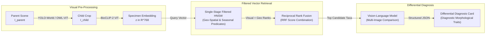

# Vision-RAG & Multimodal Knowledge Graph (MMKG) Architecture

When conformal prediction produces an ambiguous prediction set with multiple sister taxa ($|\mathcal{C}(x)| \in [2, 3]$), forcing an uncalibrated top-1 point prediction can lead to catastrophic misidentifications. TaxonVision-MLOps handles these high-ambiguity cases by routing the observation to a **lazy Vision-RAG differential diagnosis engine**.



---

## 1. Parent-Child Visual Chunking

Standard computer vision models often overfit to background environmental cues (soil color, host plant foliage, or photographer fingers). Our visual chunking pipeline decouples specimen morphology from macro-habitat noise:

* **Parent Scene Ingestion ($I_{\text{parent}}$):** Ingests full-resolution uncropped photograph from camera traps or mobile devices.
* **Zero-Shot Specimen Detection:** Evaluates an open-vocabulary detector (`YOLO-World` or `OWL-ViT`) using the generalized text prompt `"biological organism"`, generating bounding box $\hat{B}$.
* **Child Crop Extraction ($I_{\text{child}}$):** Crops specimen pixels and rescales to $224 \times 224$, maximizing the receptive field over diagnostic biological structures.
* **BioCLIP-2 Feature Encoding:** Passes $I_{\text{child}}$ through a frozen BioCLIP-2 transformer, yielding an $\ell_2$-normalized feature vector:

$$\mathbf{z}_{\text{child}} = \frac{f_\theta(I_{\text{child}})}{\|f_\theta(I_{\text{child}})\|_2} \in \mathbb{S}^{767}$$

---

## 2. Single-Stage Filtered HNSW & Biogeographical Predicates

Querying millions of organism photos requires enforcing physical spatial-temporal feasibility:

* **Hard Spatial Constraints:** Bounds search candidates to the observed geographic bounding box (e.g., GPS coordinates within 100 km).
* **Seasonal Constraints:** Filters out life stages or species absent during the observation month.
* **Single-Stage Filtered HNSW:** Unlike post-filtering (which retrieves top-k and then discards out-of-region matches, starving the result set), single-stage filtered HNSW evaluates boolean predicates directly during graph exploration.

---

## 3. Reciprocal Rank Fusion (RRF)

The retrieval engine combines visual cosine similarity with geographic prior probability using Reciprocal Rank Fusion with smoothing constant $k = 60$:

$$\text{RRF}(d) = \sum_{m \in \{\text{visual}, \text{geo}\}} \frac{1}{k + r_m(d)}$$

Where $r_m(d)$ represents the ordinal rank of candidate taxon $d$ under retrieval modality $m$.

---

## 4. VLM Differential Diagnosis Card Generation

The top candidate sister taxa from RRF retrieval are bundled alongside the query specimen image and passed to a multimodal Vision-Language Model. The model generates an operator diagnosis card highlighting subtle differentiating traits:

```json
{
  "query_status": "ambiguous_sister_taxa",
  "conformal_candidates": [
    "Danaus plexippus",
    "Limenitis archippus"
  ],
  "primary_differentiator": "Hindwing transverse postmedian black band",
  "diagnosis": "The query specimen exhibits the continuous horizontal black line across the hindwing veins characteristic of Viceroy (Limenitis archippus), distinguishing it from Monarch (Danaus plexippus).",
  "confidence_assessment": "High morphological fidelity to Viceroy."
}
```
