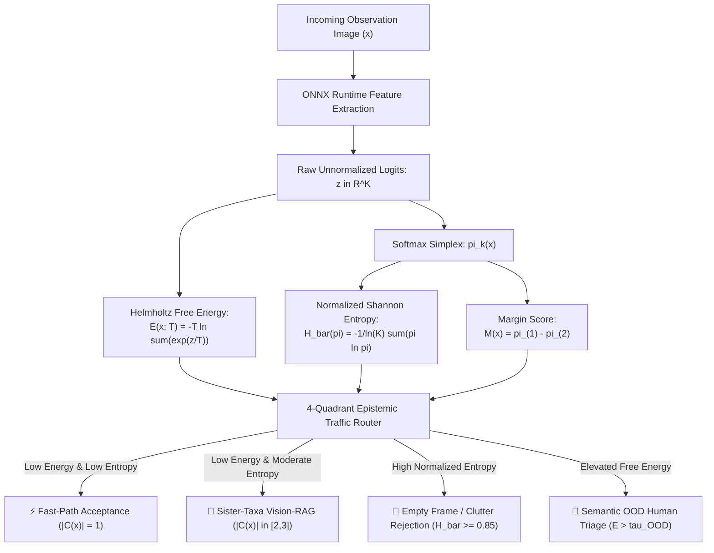

# Out-Of-Distribution & Empty Frame Detection

Autonomous biodiversity computer vision systems deployed on camera traps and citizen-science portals encounter two distinct failure modes: **semantic out-of-distribution (OOD) objects** (e.g., vehicles, hikers, asphalt, or camera lens caps) and **uninformative diffuse clutter** (e.g., wind-blown foliage, empty camera-trap backgrounds, or sensor noise).

TaxonVision-MLOps addresses both failure modes by linking **Helmholtz Free Energy** from statistical mechanics with **Normalized Shannon Entropy** from information theory.

---

## 1. Thermodynamic Derivation of Helmholtz Free Energy

In physics, the Helmholtz Free Energy $E$ of a thermodynamic system in canonical equilibrium at temperature $T$ balances expected internal energy $U$ against thermal entropy $H$:

$$E = U - T \cdot H$$

In machine learning, we treat the classification model's logit vector $\mathbf{z} \in \mathbb{R}^K$ as negative state energies ($\epsilon_k = -z_k$). We derive the exact identity below.

### Formal Mathematical Proof

By definition, the softmax probability assigned to class $k$ at temperature $T$ is:

$$\hat{\pi}_k(x; T) = \frac{\exp\left(\frac{z_k}{T}\right)}{\sum_{j=1}^K \exp\left(\frac{z_j}{T}\right)}$$

Taking the natural logarithm of both sides:

$$\ln \hat{\pi}_k(x; T) = \frac{z_k}{T} - \ln \sum_{j=1}^K \exp\left(\frac{z_j}{T}\right)$$

Multiplying both sides by $-T$:

$$-T \ln \hat{\pi}_k(x; T) = -z_k + T \ln \sum_{j=1}^K \exp\left(\frac{z_j}{T}\right)$$

Rearranging to isolate the log-sum-exp term:

$$-T \ln \sum_{j=1}^K \exp\left(\frac{z_j}{T}\right) = -z_k + T \ln \hat{\pi}_k(x; T)$$

Taking the expected value across the predicted distribution by multiplying each side by $\hat{\pi}_k(x; T)$ and summing over all $k \in \{1, \dots, K\}$:

$$\sum_{k=1}^K \hat{\pi}_k(x; T) \left[-T \ln \sum_{j=1}^K \exp\left(\frac{z_j}{T}\right)\right] = \sum_{k=1}^K \hat{\pi}_k(x; T)(-z_k) + T \sum_{k=1}^K \hat{\pi}_k(x; T) \ln \hat{\pi}_k(x; T)$$

Because the term $-T \ln \sum_{j=1}^K \exp(z_j / T)$ is a scalar independent of $k$, and the probabilities sum to unity ($\sum_{k=1}^K \hat{\pi}_k(x; T) = 1$):

$$-T \ln \sum_{j=1}^K \exp\left(\frac{z_j}{T}\right) = \sum_{k=1}^K \hat{\pi}_k(x; T)(-z_k) - T \left( -\sum_{k=1}^K \hat{\pi}_k(x; T) \ln \hat{\pi}_k(x; T) \right)$$

Identifying the terms:

* **Helmholtz Free Energy:** $E(x; T) \equiv -T \ln \sum_{k=1}^K \exp\left(\frac{z_k}{T}\right)$
* **Expected Internal Energy:** $U(x) \equiv \sum_{k=1}^K \hat{\pi}_k(x; T)(-z_k)$
* **Shannon Entropy:** $H(\hat{\pi}) \equiv -\sum_{k=1}^K \hat{\pi}_k(x; T) \ln \hat{\pi}_k(x; T)$

We arrive at the exact thermodynamic equivalence:

$$E(x; T) = U(x) - T \cdot H(\hat{\pi}) \quad \blacksquare$$

---

## 2. Shift-Invariant Softmax Failure on Novel Non-Biological Inputs

Softmax maps arbitrary vectors to the probability simplex, but it is strictly shift-invariant:

$$\operatorname{Softmax}(\mathbf{z} + c \cdot \mathbf{1}) = \operatorname{Softmax}(\mathbf{z}) \quad \forall c \in \mathbb{R}$$

### The Failure Mode

When an autonomous model is presented with an out-of-domain photograph (such as a car, asphalt, or geological mineral), the feature extractor produces small, uniformly negative activations across all biological taxa classes:

$$\mathbf{z}_{\text{car}} = [-14.2, -14.8, -15.1, -13.9, -14.6, -15.0, -14.3, -14.7, -15.2, -14.9]^T$$

Because $-13.9$ is slightly less negative than $-15.2$, standard softmax normalizes these tiny numbers into high confidence:

$$\hat{\pi}_4(x) = \frac{\exp(-13.9)}{\sum_{j=1}^{10} \exp(z_j)} \approx 0.38$$

The model appears confident in a single species simply because the background noise in one channel was marginally higher.

### The Helmholtz Free Energy Solution

Unlike softmax, Helmholtz Free Energy is directly sensitive to absolute logit magnitude:

* **Inlier Organism:** Produces strong positive logits (e.g., $z_{\text{max}} = 5.2$). The partition function $\sum e^{z_k} \gg 1$, yielding low free energy ($E(x; T) \le \tau_{\text{OOD}}$).
* **Semantic Outlier:** Universally negative logits produce a vanishing partition function $\sum e^{z_k} \ll 1$, driving $\ln \sum e^{z_k}$ to a large negative number and propelling $E(x; T) \gg \tau_{\text{OOD}}$.

In `src/taxon_vision/uncertainty/ood_detector.py`, observations exceeding $\tau_{\text{OOD}}$ are immediately flagged, preventing spurious classifications.

---

## 3. Normalized Shannon Entropy & Empty-Frame Clutter Rejection

While Helmholtz Free Energy detects semantic non-biological objects, empty camera-trap frames (e.g., wind-blown tree branches, nocturnal ground blur, or water surfaces) present a different failure mode: the image contains biological textures, but no identifiable animal or plant organism.

### Normalized Shannon Entropy

To make entropy comparable across taxonomies with varying class counts $K$, we normalize Shannon entropy by the maximum possible entropy of a discrete distribution over $K$ categories ($\ln K$):

$$\bar{H}(\hat{\pi}) = -\frac{1}{\ln K} \sum_{k=1}^K \hat{\pi}_k(x) \ln \hat{\pi}_k(x) \in [0, 1]$$

* **$\bar{H} \to 0$ (Deterministic Certainty):** The model assigns near $1.0$ probability to a single species.
* **$\bar{H} \to 1$ (Maximum Equivocation):** Softmax probabilities collapse to the uniform distribution $\mathcal{U}(1/K)$. In empty frames or blurry camera-trap photos, feature detectors match generic organic noise equally across all classes, driving $\bar{H} \ge 0.85$.

### Margin Sampling Interaction in Active Learning

In `src/taxon_vision/active_learning/query.py`, the query strategy computes the classification margin between the two highest softmax scores:

$$M(x) = \hat{\pi}_{(1)}(x) - \hat{\pi}_{(2)}(x)$$

* **Empty Frames:** $\bar{H}(\hat{\pi}) \ge 0.85$ and $M(x) \approx 0$ with all $\hat{\pi}_k \approx 0.10$. These uninformative frames are discarded automatically.
* **Sister-Taxa Boundary:** $\bar{H}(\hat{\pi}) \approx 0.30$ and $M(x) \approx 0$ with two dominant candidate classes ($\hat{\pi}_{(1)} \approx 0.48$, $\hat{\pi}_{(2)} \approx 0.46$). These represent morphologically ambiguous sister taxa and are prioritized for active learning query acquisition.

---

## 4. The 4-Quadrant Operational Decision Matrix

TaxonVision-MLOps combines Helmholtz Free Energy $E(x; T)$, Normalized Shannon Entropy $\bar{H}(\hat{\pi})$, and Conformal Prediction Set Size $|\mathcal{C}(x)|$ into an operational routing matrix:

| Quadrant | Epistemic Condition | Conformal Set Size $\vert\mathcal{C}(x)\vert$ | Operational Routing Decision | System Latency & Handling SLA |
| :--- | :--- | :--- | :--- | :--- |
| **Quadrant 1** | Inlier Specimen: $E \le \tau_{\text{OOD}}$, $\bar{H} < 0.40$ | $\vert\mathcal{C}(x)\vert = 1$ | **Fast-Path Automated Acceptance** | Single-species resolution returned in $< 15\text{ ms}$. |
| **Quadrant 2** | Sister-Taxa Mimicry: $E \le \tau_{\text{OOD}}$, $0.25 \le \bar{H} \le 0.70$ | $\vert\mathcal{C}(x)\vert \in [2, 3]$ | **Sister-Taxa Vision-RAG Engine** | Multimodal knowledge retrieval card emitted in $< 45\text{ ms}$. |
| **Quadrant 3** | Diffuse Clutter / Blank: $E \le \tau_{\text{OOD}}$, $\bar{H} \ge 0.85$ | $\vert\mathcal{C}(x)\vert \ge 4$ or $M(x) \approx 0$ | **Empty Frame / Clutter Rejection** | Automatically flagged as uninformative; rejected from training. |
| **Quadrant 4** | Semantic Outlier: $E > \tau_{\text{OOD}}$ | $\vert\mathcal{C}(x)\vert = 0$ or Non-Biological | **Semantic OOD Human Triage** | Dispatched to Label Studio expert verification queue. |
