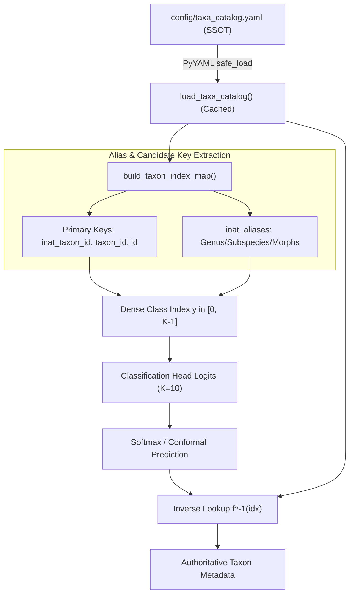

# Domain Entities & Taxonomy Perimeter

The domain layer of TaxonVision encapsulates biological classification standards, observation occurrences, and intellectual property compliance rules. Following Domain-Driven Design (DDD) principles, the entities in `src/taxon_vision/domain/` remain decoupled from deep learning framework execution, database storage mechanics, and HTTP transport layers.

This architectural boundary guarantees that whether observation records arrive through asynchronous API queries, AWS Open Data streaming, or batch manifest extraction, each biological entity undergoes uniform validation. For the end-to-end architecture and pipeline integration, see [System Overview](system-overview.md), [Data Ingestion and Versioning](../workflows/data-ingestion-and-versioning.md), [Uncertainty and Safety](../concepts/uncertainty-and-safety.md), and [Service and API](../operations/service-and-api.md).

---

## DarwinCore Domain Modeling

Biodiversity occurrence records adhere to the international **DarwinCore (DwC)** standard maintained by the Biodiversity Information Standards (TDWG). TaxonVision implements DarwinCore concepts using Pydantic v2 schemas located in `src/taxon_vision/domain/taxonomy.py` and `src/taxon_vision/domain/observation.py`.

### TaxonNode

The fundamental biological classification entity is `TaxonNode` (`src/taxon_vision/domain/taxonomy.py`), modeling nodes within a taxonomic phylogenetic tree using an adjacency list structure:

- **`taxon_id`** (`int`): Unique numeric taxonomic identifier assigned by iNaturalist or GBIF.
- **`scientific_name`** (`str`): Binomial (genus and species) or uninomial scientific name.
- **`common_name`** (`str`, default `""`): Vernacular English name.
- **`rank`** (`str`, default `"species"`): Hierarchical rank level (e.g., `kingdom`, `class`, `genus`, `species`).
- **`parent_id`** (`int | None`, default `None`): Pointer to the immediate ancestral taxon node in the adjacency hierarchy.

#### DarwinCore Standard Term Mapping

| Domain Entity Field | DarwinCore (DwC) Term | Standard Semantic Meaning |
|---|---|---|
| `TaxonNode.taxon_id` | `dwc:taxonID` | Unique identifier for the taxonomic taxon concept. |
| `TaxonNode.scientific_name` | `dwc:scientificName` | Full scientific name including binomial or higher taxon designation. |
| `TaxonNode.common_name` | `dwc:vernacularName` | Vernacular or colloquial English label for human readability. |
| `TaxonNode.rank` | `dwc:taxonRank` | Taxonomic rank of the most specific name in the taxon concept. |
| `TaxonNode.parent_id` | `dwc:parentNameUsageID` | Direct parent taxon identifier in the phylogenetic tree. |
| `ObservationRecord.observation_id` | `dwc:occurrenceID` / `dwc:catalogNumber` | Identifier of the specific organism observation occurrence. |
| `ObservationRecord.image_url` | `dwc:associatedMedia` | URI locator pointing to primary photographic media. |
| `ObservationRecord.latitude` | `dwc:decimalLatitude` | Geographic latitude in WGS84 decimal degrees ($[-90.0, 90.0]$). |
| `ObservationRecord.longitude` | `dwc:decimalLongitude` | Geographic longitude in WGS84 decimal degrees ($[-180.0, 180.0]$). |
| `ObservationRecord.observed_on` | `dwc:eventDate` | Date and time when the biological occurrence was recorded. |
| `ObservationRecord.quality_grade` | *Data Quality Protocol* | Community consensus verification gate (`"research"` grade). |

### TaxonomyCatalog Aggregate

The `TaxonomyCatalog` schema (`src/taxon_vision/domain/taxonomy.py`) acts as the aggregate root for the supported taxonomic perimeter:

- **`taxa`** (`list[TaxonNode]`): Complete list of admitted taxonomic nodes.
- **`get_by_id(taxon_id: int) -> TaxonNode | None`**: In-memory linear resolution searching the indexed list for a matching identifier.

Given a catalog $T$, the parental relationship $p: T \rightarrow T \cup \{\emptyset\}$ defines recursive lineage resolution:

$$L(t) = \begin{cases} \{t\} & \text{if } p(t) = \emptyset \\ \{t\} \cup L(p(t)) & \text{otherwise} \end{cases}$$

The taxonomic hierarchy enforces an acyclic directed tree invariant: no sequence of parent traversals may return to an ancestor previously encountered in the traversal path.

### ObservationRecord Entity

Occurrence records are represented by `ObservationRecord` (`src/taxon_vision/domain/observation.py`). This composite schema binds taxonomic classification, spatial-temporal context, and media licensing metadata:

- **`observation_id`** (`str`): Primary occurrence identifier from citizen science platforms (e.g., iNaturalist or GBIF).
- **`taxon`** (`TaxonNode`): Strongly-typed classification node associated with the sighting.
- **`attribution`** (`AttributionRecord`): Provenance and open licensing container.
- **`image_url`** (`str`): Direct HTTP/HTTPS locator for the primary observation image.
- **`latitude`** (`float | None`, constrained by `ge=-90.0, le=90.0`): Latitude coordinate; out-of-range values raise immediate validation errors.
- **`longitude`** (`float | None`, constrained by `ge=-180.0, le=180.0`): Longitude coordinate; out-of-range values raise validation errors.
- **`observed_on`** (`datetime | None`): Timestamp of the physical observation.
- **`quality_grade`** (`str`, default `"research"`): Verification quality tier. TaxonVision filters for `"research"` grade observations where community consensus confirms species identification.

---

## Domain Hierarchy & Licensing Architecture

The following diagram illustrates the relationship between DarwinCore biological domain entities, aggregate containers, and open licensing attribution structures.

<!-- openwiki: mermaid parse failed and this diagram was converted to a text fence so it does not break rendering. Fix the diagram source and restore the mermaid fence. Parser error: Heuristic: an unescaped angle bracket inside a label breaks rendering; rephrase the label. -->
```text
classDiagram
    class ObservationRecord {
        +string observation_id
        +TaxonNode taxon
        +AttributionRecord attribution
        +string image_url
        +float latitude
        +float longitude
        +datetime observed_on
        +string quality_grade
    }

    class TaxonNode {
        +int taxon_id
        +string scientific_name
        +string common_name
        +string rank
        +int parent_id
    }

    class TaxonomyCatalog {
        +list taxa
        +get_by_id(int taxon_id) TaxonNode
    }

    class AttributionRecord {
        +string photographer_name
        +OpenLicense license_code
        +string license_url
        +string observation_uuid
        +string source_portal
    }

    class OpenLicense {
        <<enumeration>>
        CC0
        CC_BY
        CC_BY_NC
        CC_BY_SA
        CC_BY_ND
        CC_BY_NC_SA
        CC_BY_NC_ND
    }

    ObservationRecord "1" --> "1" TaxonNode : classifies
    ObservationRecord "1" --> "1" AttributionRecord : tracks provenance
    TaxonomyCatalog "1" *-- "many" TaxonNode : aggregates
    AttributionRecord "1" --> "1" OpenLicense : mandates
```
*Domain entity relationships, taxonomic containment, and licensing attribution hierarchy.*

---

## Level 1 Perimeter: 10 Well-Represented Taxa

The Level 1 classification perimeter is defined authoritatively in `config/taxa_catalog.yaml`. It encompasses 10 distinct, ecologically well-represented taxa spanning three biological kingdoms (**Animalia**, **Plantae**, and **Fungi**) and five taxonomic classes (**Insecta**, **Aves**, **Mammalia**, **Magnoliopsida**, and **Agaricomycetes**).

| Internal ID | Scientific Name | Common Name | Kingdom | Class | Primary iNat Taxon ID | Configured Aliases (`inat_aliases`) |
|---|---|---|---|---|---|---|
| **1** | *Danaus plexippus* | Monarch Butterfly | Animalia | Insecta | `48662` | *None* |
| **2** | *Apis mellifera* | Western Honey Bee | Animalia | Insecta | `47219` | `47120` (*Apis* genus), `47119` (*Bombus*), `47114` (*Vespidae*) |
| **3** | *Turdus migratorius* | American Robin | Animalia | Aves | `12727` | `14704` (*Turdus* genus) |
| **4** | *Cyanocitta cristata* | Blue Jay | Animalia | Aves | `8229` | *None* |
| **5** | *Taraxacum officinale* | Common Dandelion | Plantae | Magnoliopsida | `47602` | *None* |
| **6** | *Helianthus annuus* | Common Sunflower | Plantae | Magnoliopsida | `57983` | `58737` (*Helianthus* variant/subspecies) |
| **7** | *Canis lupus* | Gray Wolf | Animalia | Mammalia | `47144` | `42048` (*Canis* genus) |
| **8** | *Vulpes vulpes* | Red Fox | Animalia | Mammalia | `42069` | `42054` (*Vulpes* genus) |
| **9** | *Amanita muscaria* | Fly Agaric | Fungi | Agaricomycetes | `48715` | *None* |
| **10** | *Boletus edulis* | King Bolete | Fungi | Agaricomycetes | `48701` | *None* |

---

## Catalog Resolution & Alias Mapping Logic

Citizen science platforms assign arbitrary, non-contiguous integer IDs to taxa (e.g., `48662` for Monarch Butterfly, `47219` for Western Honey Bee). Deep learning heads, softmax outputs, and loss functions (such as `CrossEntropyLoss` or `ClassBalancedLoss`) mathematically require zero-indexed, dense integer target labels bounded by $0 \le y < K$, where $K = 10$.

To bridge this gap without configuration drift, TaxonVision enforces a Single Source of Truth (SSOT) pattern derived directly from `config/taxa_catalog.yaml`.


*Catalog resolution, alias indexing, and inference mapping workflow.*

### Single Source of Truth & Caching

The catalog metadata is loaded via `load_taxa_catalog()` in `src/taxon_vision/service/inference.py`:
- Employs `@lru_cache(maxsize=1)` to cache the deserialized list of taxon dictionaries in memory.
- Eliminates repeated filesystem I/O and PyYAML parsing overhead during high-frequency prediction requests, ensuring sub-microsecond dictionary lookups.

### Alias Resolution Pipeline

During feature extraction and dataset preparation (`src/taxon_vision/pipelines/extract_features.py`), the function `build_taxon_index_map()` constructs the bidirectional mapping between external iNaturalist IDs and dense class indices:

1. **Sequential Ordinal Assignment**: The catalog list order defines the dense target label $idx \in [0, K-1]$.
2. **Primary Candidate Key Resolution**: For each entry, `_populate_taxon_indices` evaluates candidate identifier keys:
   - `"inat_taxon_id"`, `"inaturalist_taxon_id"`, `"taxon_id"`, and `"id"`.
   - Any populated integer is registered in the map: `mapping[int(val)] = idx`.
3. **Alias Mapping (`inat_aliases`)**:
   - In field observations, citizen scientists frequently record identifications at higher taxonomic ranks (e.g., genus level) or under variant identifiers before consensus is finalized.
   - Entries with configured `inat_aliases` map every alias identifier directly to the same ordinal class index:
     - Western Honey Bee (`idx = 1`): maps genus *Apis* (`47120`), bumblebee genus *Bombus* (`47119`), and wasp family *Vespidae* (`47114`).
     - American Robin (`idx = 2`): maps genus *Turdus* (`14704`).
     - Sunflower (`idx = 5`): maps variant subspecies (`58737`).
     - Gray Wolf (`idx = 6`): maps genus *Canis* (`42048`).
     - Red Fox (`idx = 7`): maps genus *Vulpes* (`42054`).
4. **Inverse Label Translation**:
   At inference time, the model head outputs logits of dimension $K=10$. The predicted class index $i = \operatorname*{argmax}(z)$ is converted back to domain metadata via `taxa_catalog[i]`, returning scientific name, common name, and DarwinCore attributes.

---

## Open Licensing Compliance & Attribution Rules

Training computer vision models on web-scraped citizen science imagery introduces substantial copyright and intellectual property risks. TaxonVision enforces strict licensing compliance at the ingestion perimeter via `src/taxon_vision/domain/license.py` and `src/taxon_vision/data/license_filter.py`.

### Permitted License Subset (`OpenLicense`)

The enumeration `OpenLicense` (`src/taxon_vision/domain/license.py`) defines standard Creative Commons variants:
- **`CC0`**: Creative Commons Zero (public domain dedication).
- **`CC_BY`**: Creative Commons Attribution.
- **`CC_BY_NC`**: Creative Commons Attribution-NonCommercial.
- **`CC_BY_SA`**: Creative Commons Attribution-ShareAlike.
- **`CC_BY_ND`**: Creative Commons Attribution-NoDerivatives.
- **`CC_BY_NC_SA`**: Creative Commons Attribution-NonCommercial-ShareAlike.
- **`CC_BY_NC_ND`**: Creative Commons Attribution-NonCommercial-NoDerivatives.

For model training dataset inclusion, `LicenseFilter.is_license_permitted()` admits only recognized open licenses (`CC0`, `CC-BY`, and `CC-BY-NC`). All proprietary designations (such as `"All Rights Reserved"`) and unapproved commercial-only restrictions are intercepted and rejected prior to storage or embedding generation.

### Attribution Preservation (`AttributionRecord`)

Under Creative Commons terms, downstream research use requires preserving creator attribution. Stripping photographer credits invalidates the open license terms. The `AttributionRecord` schema captures and immutably retains this provenance:
- **`photographer_name`** (`str`): Contributor username or legal name (defaults to `"Unknown Contributor"` if empty in raw metadata).
- **`license_code`** (`OpenLicense`): The specific Creative Commons tier.
- **`license_url`** (`str`): Link to the official legal code (e.g., `https://creativecommons.org/licenses/by/4.0/`).
- **`observation_uuid`** (`str`): Unique occurrence UUID or identifier linking back to the origin observation.
- **`source_portal`** (`str`, default `"iNaturalist"`): Provenance portal name.

### Rejection of Static Domain Scrapes

Direct web scraping or unverified hotlinking of raw `static.inaturalist.org` endpoints violates API terms of service and risks ingesting unverified or private image assets.

`LicenseFilter.is_static_domain_prohibited()` enforces this constraint:
- If `"static.inaturalist.org"` is present in the `image_url` string and `is_open_dataset_verified` is `False`, the asset is **strictly prohibited** and discarded.
- Ingestion is permitted only for assets verified against official registry manifests, such as the AWS Open Data Registry S3 mirror (`inaturalist-open-data.s3.amazonaws.com`) or vetted client responses flagged with `is_open_dataset_verified = True`.

### `LicenseFilter.process_record` Pipeline

The static method `LicenseFilter.process_record(raw: dict[str, Any]) -> AttributionRecord | None` executes the complete compliance check:

1. **Normalization**: Strips whitespace, converts strings to uppercase, and replaces underscores with hyphens (e.g., `"cc_by"` $\rightarrow$ `"CC-BY"`).
2. **License Validation**: Verifies that the normalized string exists within `OpenLicense` via `is_license_permitted()`.
3. **Domain Provenance Gate**: Calls `is_static_domain_prohibited()` to reject unverified static domain URIs.
4. **Attribution Packaging**: Instantiates a validated `AttributionRecord` with photographer credits, license URL, and observation UUID.
5. **Rejection Outcome**: If any check fails, returns `None`, dropping the record from ingestion pipelines.

### Telemetry & Compliance Auditing

License compliance is integrated into system telemetry (`src/taxon_vision/monitoring/telemetry.py`):
- `model_metadata_total[status="licensed_data"]`: Incremented for observations passing license validation.
- `model_retention_hours`: Tracks retention duration for licensed media subsets within training storage tiers.

---

## Integration with Hierarchical Uncertainty & Safety

The domain models provide the foundation for hierarchical uncertainty estimation. When the vision model outputs ambiguous logits, flat classification can produce unhelpful or misleading predictions.

Using the `TaxonomyCatalog` lineage graph, the conformal prediction module constructs a prediction set $\hat{C}(x)$ at confidence level $1 - \alpha$. When multiple candidates are retained, the system computes the **Lowest Common Ancestor (LCA)**:

$$\text{LCA}(\hat{C}(x)) = \operatorname*{argmax}_{t \in \bigcap_{c \in \hat{C}(x)} L(c)} |L(t)|$$

- If the prediction set contains related taxa within the same genus (e.g., Canis lupus and Canis aliases), the LCA resolves to the genus level.
- If uncertainty spans distant taxa (e.g., insects and birds), the LCA safely ascends to class or kingdom level.

This integration bridges neural network statistical uncertainty with biological reality, ensuring that automated systems fail safely and informatively. For full calibration formulas and conformal guarantee proofs, see [Uncertainty and Safety](../concepts/uncertainty-and-safety.md).
