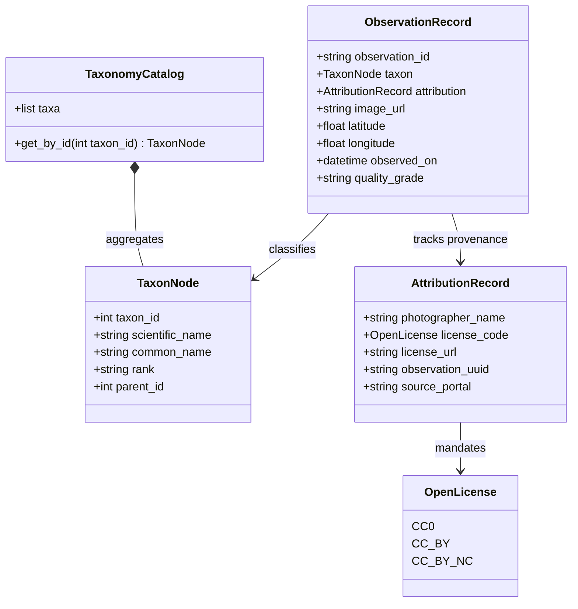
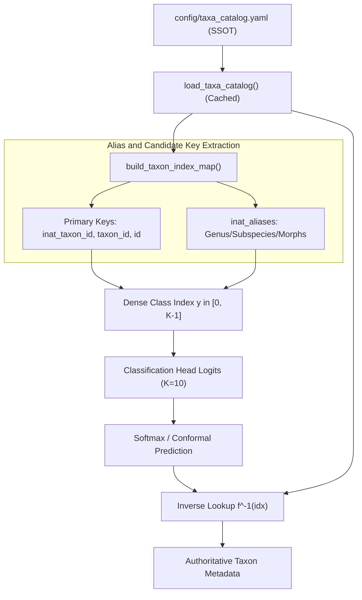

# Domain Entities & Taxonomy Perimeter

The domain layer of TaxonVision encapsulates biological classification standards, occurrence ingestion schemas, and intellectual property compliance rules. Following Domain-Driven Design (DDD) principles, the entities in `src/taxon_vision/domain/` remain decoupled from deep learning execution frameworks, database storage mechanics, and HTTP transport layers.

This architectural perimeter guarantees that whether occurrence records arrive via asynchronous iNaturalist API queries, AWS Open Data registry manifests, or batch Parquet extractions, every biological observation undergoes deterministic validation. For pipeline integration and operational workflows, see [System Overview](system-overview.md), [Data Ingestion and Versioning](../workflows/data-ingestion-and-versioning.md), [Test Strategy and Invariants](../testing/test-strategy-and-invariants.md), [Uncertainty and Safety](../concepts/uncertainty-and-safety.md), and [Service and API](../operations/service-and-api.md).

---

## Taxonomic Domain Representations & DarwinCore Schemas

Biodiversity occurrence records adhere to the international **DarwinCore (DwC)** standard maintained by the Biodiversity Information Standards (TDWG). TaxonVision implements DarwinCore concepts using Pydantic v2 schemas located in `src/taxon_vision/domain/taxonomy.py` and `src/taxon_vision/domain/observation.py`.

### Linnaean Taxonomic Hierarchy

Biological taxonomy organizes organisms into a nested, rank-based phylogenetic hierarchy:

$$\text{Kingdom} \rightarrow \text{Phylum} \rightarrow \text{Class} \rightarrow \text{Order} \rightarrow \text{Family} \rightarrow \text{Genus} \rightarrow \text{Species}$$

TaxonVision represents this hierarchy through strongly-typed domain schemas, linking external numeric identifiers (`dwc:taxonID`) to binomial scientific names (`dwc:scientificName`) and vernacular common names (`dwc:vernacularName`).

| Taxonomic Rank | DarwinCore Term | Semantic Role | TaxonVision Perimeter Examples |
|---|---|---|---|
| **Kingdom** | `dwc:kingdom` | High-level biological realm | Animalia, Plantae, Fungi |
| **Phylum** | `dwc:phylum` | Primary anatomical division | Arthropoda, Chordata, Tracheophyta, Basidiomycota |
| **Class** | `dwc:class` | Major taxonomic division | Insecta, Aves, Mammalia, Magnoliopsida, Agaricomycetes |
| **Order** | `dwc:order` | Organismal order grouping | Lepidoptera, Hymenoptera, Passeriformes, Asterales, Carnivora, Agaricales, Boletales |
| **Family** | `dwc:family` | Clade of related genera | Nymphalidae, Apidae, Vespidae, Turdidae, Corvidae, Asteraceae, Canidae, Amanitaceae, Boletaceae |
| **Genus** | `dwc:genus` | Binomial prefix group | *Danaus*, *Apis*, *Bombus*, *Turdus*, *Cyanocitta*, *Taraxacum*, *Helianthus*, *Canis*, *Vulpes*, *Amanita*, *Boletus* |
| **Species** | `dwc:specificEpithet` | Terminal organism binomial | *Danaus plexippus*, *Apis mellifera*, *Turdus migratorius*, *Cyanocitta cristata*, etc. |
| **Taxon ID** | `dwc:taxonID` | Unique numeric identifier | `48662` (Monarch), `47219` (Honey Bee), `12727` (Robin), `47144` (Wolf) |
| **Scientific Name**| `dwc:scientificName` | Complete Latin binomial | *"Danaus plexippus"*, *"Canis lupus"* |

### TaxonNode

The fundamental biological classification entity is `TaxonNode` (`src/taxon_vision/domain/taxonomy.py`), modeling nodes within a taxonomic phylogenetic tree using an adjacency list structure:

- **`taxon_id`** (`int`): Unique numeric taxonomic identifier assigned by iNaturalist or GBIF.
- **`scientific_name`** (`str`): Binomial (genus and species) or uninomial scientific name.
- **`common_name`** (`str`, default `""`): Vernacular English name.
- **`rank`** (`str`, default `"species"`): Hierarchical rank level (e.g., `"kingdom"`, `"class"`, `"genus"`, `"species"`).
- **`parent_id`** (`int | None`, default `None`): Pointer to the immediate ancestral taxon node in the adjacency hierarchy.

### DarwinCore Standard Term Mapping

The table below details how TaxonVision domain attributes map to canonical DarwinCore terms:

| Domain Entity Field | DarwinCore (DwC) Term | Standard Semantic Meaning |
|---|---|---|
| `TaxonNode.taxon_id` | `dwc:taxonID` | Unique identifier for the taxon concept. |
| `TaxonNode.scientific_name` | `dwc:scientificName` | Full scientific name including binomial or higher taxon designation. |
| `TaxonNode.common_name` | `dwc:vernacularName` | Vernacular or colloquial English label for human readability. |
| `TaxonNode.rank` | `dwc:taxonRank` | Taxonomic rank of the most specific name in the taxon concept. |
| `TaxonNode.parent_id` | `dwc:parentNameUsageID` | Direct parent taxon identifier in the phylogenetic tree. |
| `ObservationRecord.observation_id` | `dwc:occurrenceID` / `dwc:catalogNumber` | Identifier of the specific organism observation occurrence. |
| `ObservationRecord.image_url` | `dwc:associatedMedia` | URI locator pointing to primary photographic media. |
| `ObservationRecord.latitude` | `dwc:decimalLatitude` | Geographic latitude in WGS84 decimal degrees ($[-90.0, 90.0]$). |
| `ObservationRecord.longitude` | `dwc:decimalLongitude` | Geographic longitude in WGS84 decimal degrees ($[-180.0, 180.0]$). |
| `ObservationRecord.observed_on` | `dwc:eventDate` | Date and time when the biological occurrence was recorded. |
| `ObservationRecord.quality_grade` | *Data Quality Protocol* | Community consensus verification gate (`"research"` grade). |

### TaxonomyCatalog Aggregate

The `TaxonomyCatalog` schema (`src/taxon_vision/domain/taxonomy.py`) acts as the aggregate root for the supported taxonomic perimeter:

- **`taxa`** (`list[TaxonNode]`): Complete list of admitted taxonomic nodes.
- **`get_by_id(taxon_id: int) -> TaxonNode | None`**: In-memory linear resolution searching the indexed list for a matching identifier.

Given a catalog $T$, the parental relationship $p: T \rightarrow T \cup \{\emptyset\}$ defines recursive lineage resolution:

$$L(t) = \begin{cases} \{t\} & \text{if } p(t) = \emptyset \\ \{t\} \cup L(p(t)) & \text{otherwise} \end{cases}$$

The taxonomic hierarchy enforces an acyclic directed tree invariant: no sequence of parent traversals may return to an ancestor previously encountered in the traversal path.

### ObservationRecord Entity

Occurrence records are represented by `ObservationRecord` (`src/taxon_vision/domain/observation.py`). This composite schema binds taxonomic classification, spatial-temporal context, and media licensing metadata:

- **`observation_id`** (`str`): Primary occurrence identifier from citizen science platforms (e.g., iNaturalist or GBIF).
- **`taxon`** (`TaxonNode`): Strongly-typed classification node associated with the sighting.
- **`attribution`** (`AttributionRecord`): Provenance and open licensing container.
- **`image_url`** (`str`): Direct HTTP/HTTPS locator for the primary observation image.
- **`latitude`** (`float | None`, constrained by `ge=-90.0, le=90.0`): Latitude coordinate; out-of-range values raise immediate validation errors.
- **`longitude`** (`float | None`, constrained by `ge=-180.0, le=180.0`): Longitude coordinate; out-of-range values raise immediate validation errors.
- **`observed_on`** (`datetime | None`): Timestamp of the physical observation.
- **`quality_grade`** (`str`, default `"research"`): Verification quality tier. TaxonVision filters for `"research"` grade observations where community consensus confirms species identification.

---

## Domain Entity Hierarchies

The following diagram illustrates the relationship between DarwinCore biological domain entities, aggregate containers, and open licensing attribution structures.


*Domain entity relationships, taxonomic containment, and licensing attribution hierarchy.*

---

## Level 1 Perimeter: 10 Well-Represented Taxa

The Level 1 classification perimeter is defined authoritatively in `config/taxa_catalog.yaml`. It encompasses 10 distinct, ecologically well-represented taxa spanning three biological kingdoms (**Animalia**, **Plantae**, and **Fungi**) and five taxonomic classes (**Insecta**, **Aves**, **Mammalia**, **Magnoliopsida**, and **Agaricomycetes**).

| Internal ID | Scientific Name | Common Name | Kingdom | Phylum | Class | Primary iNat Taxon ID | Configured Aliases (`inat_aliases`) |
|---|---|---|---|---|---|---|---|
| **1** | *Danaus plexippus* | Monarch Butterfly | Animalia | Arthropoda | Insecta | `48662` | *None* |
| **2** | *Apis mellifera* | Western Honey Bee | Animalia | Arthropoda | Insecta | `47219` | `47120` (*Apis* genus), `47119` (*Bombus*), `47114` (*Vespidae*) |
| **3** | *Turdus migratorius* | American Robin | Animalia | Chordata | Aves | `12727` | `14704` (*Turdus* genus) |
| **4** | *Cyanocitta cristata* | Blue Jay | Animalia | Chordata | Aves | `8229` | *None* |
| **5** | *Taraxacum officinale* | Common Dandelion | Plantae | Tracheophyta | Magnoliopsida | `47602` | *None* |
| **6** | *Helianthus annuus* | Common Sunflower | Plantae | Tracheophyta | Magnoliopsida | `57983` | `58737` (*Helianthus* variant/subspecies) |
| **7** | *Canis lupus* | Gray Wolf | Animalia | Chordata | Mammalia | `47144` | `42048` (*Canis* genus) |
| **8** | *Vulpes vulpes* | Red Fox | Animalia | Chordata | Mammalia | `42069` | `42054` (*Vulpes* genus) |
| **9** | *Amanita muscaria* | Fly Agaric | Fungi | Basidiomycota | Agaricomycetes | `48715` | *None* |
| **10** | *Boletus edulis* | King Bolete | Fungi | Basidiomycota | Agaricomycetes | `48701` | *None* |

---

## Catalog Resolution & Alias Mapping Logic

Citizen science platforms assign arbitrary, non-contiguous integer IDs to taxa (e.g., `48662` for Monarch Butterfly, `47219` for Western Honey Bee). Deep learning heads, softmax outputs, and loss functions (such as `CrossEntropyLoss` or `ClassBalancedLoss`) mathematically require zero-indexed, dense integer target labels bounded by $0 \le y < K$, where $K = 10$.

To bridge this gap without configuration drift, TaxonVision enforces a Single Source of Truth (SSOT) pattern derived directly from `config/taxa_catalog.yaml`.


*Catalog resolution, alias indexing, and inference mapping workflow.*

### Single Source of Truth & Caching

The catalog metadata is loaded via `load_taxa_catalog()` in `src/taxon_vision/service/inference.py`:
- Employs `@lru_cache(maxsize=1)` to cache the deserialized list of taxon dictionaries in memory.
- Eliminates repeated filesystem I/O and PyYAML parsing overhead during high-frequency prediction requests, ensuring sub-microsecond dictionary lookups.

### Dynamic Class Mapping (`build_taxon_index_map`)

During feature extraction and dataset preparation (`src/taxon_vision/pipelines/extract_features.py`), the function `build_taxon_index_map()` (backed by `get_catalog_inat_taxon_map()` and `_populate_taxon_indices()`) constructs the bidirectional mapping between external iNaturalist IDs and dense class indices:

1. **Sequential Ordinal Assignment**: The catalog list order defines the dense target label $idx \in [0, K-1]$.
2. **Primary Candidate Key Resolution**: For each entry, `_populate_taxon_indices()` evaluates candidate identifier keys:
   - `"inat_taxon_id"`, `"inaturalist_taxon_id"`, `"taxon_id"`, and `"id"`.
   - Any populated integer is registered in the map: `mapping[int(val)] = idx`.
3. **Alias Mapping (`inat_aliases`)**:
   - In field observations, citizen scientists frequently record identifications at higher taxonomic ranks (e.g., genus level) or under variant identifiers before consensus is finalized.
   - Entries with configured `inat_aliases` map every alias identifier directly to the same ordinal class index:
     - Western Honey Bee (`idx = 1`): maps genus *Apis* (`47120`), bumblebee genus *Bombus* (`47119`), and wasp family *Vespidae* (`47114`).
     - American Robin (`idx = 2`): maps genus *Turdus* (`14704`).
     - Sunflower (`idx = 5`): maps variant subspecies (`58737`).
     - Gray Wolf (`idx = 6`): maps genus *Canis* (`42048`).
     - Red Fox (`idx = 7`): maps genus *Vulpes* (`42054`).
4. **Inverse Label Translation**:
   At inference time, the model head outputs logits of dimension $K=10$. The predicted class index $i = \operatorname*{argmax}(z)$ is converted back to domain metadata via `taxa_catalog[i]`, returning scientific name, common name, and DarwinCore attributes.

---

## Data Ingestion & API Contracts

Raw occurrence data is ingested through the asynchronous client `INatAPIClient` (`src/taxon_vision/data/inat_client.py`).

### Rate Limiting & Label Fidelity

The iNaturalist API v1 imposes a terms-of-use rate limit of 60 requests per minute with aggressive IP throttling. `INatAPIClient` enforces this contract:
- **Asynchronous Rate Limiting**: Uses `aiolimiter.AsyncLimiter(max_rate=60, time_period=60.0)` to enforce leaky-bucket spacing across asynchronous requests.
- **Label Fidelity Gating**: Dispatches queries with parameters `quality_grade=research` and `has[]=photos`. Mandating `"research"` grade guarantees that community taxonomists have reached consensus on organism identification before photographic evidence enters training pipelines.
- **Image URL Normalization**: Automatically replaces square thumbnail locators (`"square"`, 75x75 pixels) with medium-resolution locators (`"medium"`, 500px longest dimension), providing sufficient spatial resolution for neural feature extraction backbones.

---

## Open Licensing Compliance & Invariant Rules

Training vision foundation heads on citizen science imagery introduces substantial copyright and intellectual property risks. TaxonVision strictly enforces open licensing rules at the ingestion perimeter via `src/taxon_vision/domain/license.py` and `src/taxon_vision/data/license_filter.py`.

### Permitted License Subset & Rejection Invariants

The domain model restricts admitted media through `OpenLicense` and `ALLOWED_LICENSES`:

```python
ALLOWED_LICENSES: set[str] = {"cc0", "cc-by", "cc-by-nc"}

class OpenLicense(StrEnum):
    CC0 = "CC0"
    CC_BY = "CC-BY"
    CC_BY_NC = "CC-BY-NC"
```

The system strictly enforces the following licensing invariants:
1. **Permitted Subset**: Only Creative Commons Zero (`CC0`), Creative Commons Attribution (`CC-BY`), and Creative Commons Attribution-NonCommercial (`CC-BY-NC`) are admitted into training datasets.
2. **Rejection of Copyleft / ShareAlike**: Licenses carrying ShareAlike obligations (`CC-BY-SA`, `CC-BY-NC-SA`) are strictly rejected. Incorporating ShareAlike imagery would legally encumber trained weights and downstream derived representations with viral copyleft terms.
3. **Rejection of NoDerivatives**: Licenses carrying NoDerivatives constraints (`CC-BY-ND`, `CC-BY-NC-ND`) are strictly rejected. Neural feature transformations, crops, normalizations, and latent embeddings constitute derivative works under copyright law.
4. **Rejection of Proprietary Licenses**: All proprietary designations (such as `"All Rights Reserved"`, `"ALL_RIGHTS_RESERVED"`, and commercial-only variants) are intercepted and rejected prior to storage or feature extraction.

### SPDX Identifier Mappings

TaxonVision aligns internal domain license codes with the canonical **SPDX (Software Package Data Exchange)** License List:

| Internal Domain Code | `OpenLicense` Enum | Canonical SPDX Identifier | Permitted for Training? | Legal Implications & Constraints |
|---|---|---|---|---|
| `cc0` / `CC0` | `OpenLicense.CC0` | `CC0-1.0` | **Yes** | Public domain dedication; unrestricted commercial and non-commercial reuse, transformation, and weight training without mandatory attribution (attribution retained as provenance best practice). |
| `cc-by` / `CC-BY` | `OpenLicense.CC_BY` | `CC-BY-4.0` | **Yes** | Permissive open license; permits commercial and non-commercial adaptation and model training, strictly requiring creator attribution and license URI preservation. |
| `cc-by-nc` / `CC-BY-NC` | `OpenLicense.CC_BY_NC` | `CC-BY-NC-4.0` | **Yes** | Non-commercial open license; permits academic, educational, and open research adaptation and model training while restricting non-permissive commercial exploitation; requires creator attribution. |
| `cc-by-sa` / `CC-BY-SA` | *None* (rejected) | `CC-BY-SA-4.0` | **No** | Incompatible copyleft requirement forces derived model weights and datasets under copyleft terms. Discarded at ingestion. |
| `cc-by-nd` / `CC-BY-ND` | *None* (rejected) | `CC-BY-ND-4.0` | **No** | NoDerivatives constraint prohibits generation of modified representations, feature vectors, embeddings, or cropped tensors. Discarded at ingestion. |
| `cc-by-nc-sa` | *None* (rejected) | `CC-BY-NC-SA-4.0` | **No** | Non-commercial ShareAlike compound restriction; copyleft prevents model distribution flexibility. Discarded at ingestion. |
| `cc-by-nc-nd` | *None* (rejected) | `CC-BY-NC-ND-4.0` | **No** | Non-commercial NoDerivatives compound restriction; prohibits neural feature transformations. Discarded at ingestion. |
| `all_rights_reserved` | *None* (rejected) | *None* (Proprietary) | **No** | Full copyright reservation; completely inadmissible for dataset inclusion. Discarded at ingestion. |

### Creator Attribution Preservation (`AttributionRecord`)

Under Creative Commons terms, downstream research use requires preserving creator attribution. Stripping photographer credits invalidates the open license terms. The `AttributionRecord` schema (`src/taxon_vision/domain/license.py`) captures and immutably retains this provenance:
- **`photographer_name`** (`str`): Contributor username or legal name (defaults to `"Unknown Contributor"` if empty in raw metadata).
- **`license_code`** (`OpenLicense`): The specific Creative Commons tier (`CC0`, `CC-BY`, or `CC-BY-NC`).
- **`license_url`** (`str`): Link to the official legal code (e.g., `https://creativecommons.org/licenses/by/4.0/`).
- **`observation_uuid`** (`str`): Unique occurrence UUID or identifier linking back to the origin observation.
- **`source_portal`** (`str`, default `"iNaturalist"`): Provenance portal name.

### Static Domain Scrape Prohibition Invariant

Direct web scraping or unverified hotlinking of raw `static.inaturalist.org` endpoints violates API terms of service and risks ingesting unverified or private image assets.

`LicenseFilter.is_static_domain_prohibited()` enforces this constraint:
- If `"static.inaturalist.org"` is present in the `image_url` string and `is_open_dataset_verified` is `False`, the asset is **strictly prohibited** and discarded.
- Ingestion is permitted only for assets verified against official registry manifests, such as the AWS Open Data Registry S3 mirror (`inaturalist-open-data.s3.amazonaws.com`) or vetted client responses flagged with `is_open_dataset_verified = True`.

### License Verification States & Decision Flow

The following diagram illustrates the verification logic and compliance gate states executed for every candidate record:

<!-- openwiki: mermaid parse failed and this diagram was converted to a text fence so it does not break rendering. Fix the diagram source and restore the mermaid fence. Parser error: Heuristic: an unescaped angle bracket inside a label breaks rendering; rephrase the label. -->
```text
flowchart TD
    Raw["Candidate Observation Record"] --> StepNorm["Normalize license_code (strip, uppercase, hyphens)"]
    StepNorm --> Gate1{"Permitted in OpenLicense? (CC0, CC-BY, CC-BY-NC)"}
    Gate1 -- No: CC-BY-SA, CC-BY-ND, ARR, proprietary --> RejectLic["Rejection: Inadmissible License"]
    Gate1 -- Yes --> Gate2{"Static Domain Check: static.inaturalist.org?"}
    Gate2 -- Yes and unverified --> RejectDomain["Rejection: Prohibited Static Domain Scrape"]
    Gate2 -- No or verified open registry --> Gate3{"Photographer Attribution: length >= 3 chars?"}
    Gate3 -- No: empty or missing credit --> RejectAttr["Rejection: Incomplete Attribution"]
    Gate3 -- Yes --> Accept["Compliant: Construct AttributionRecord"]
    
    Accept --> Manifest["Parquet Manifest: dataset_manifest.parquet"]
    
    RejectLic --> Violations["Audit Aggregator: _AuditReportStats"]
    RejectDomain --> Violations
    RejectAttr --> Violations
    Violations --> Report["JSON Audit Report: reports/license_audit.json"]
```
*License verification decision flow and compliance auditing pipeline.*

---

## License Auditing Pipeline & Report Generation

The license verification architecture is operationalized as an executable pipeline in `src/taxon_vision/pipelines/audit_license.py`.

### Execution Modes

The pipeline operates in two distinct modes:

1. **Gatekeeper Mode (`--gatekeeper`)**:
   - Reads candidate records from `data/manifests/raw_manifest.parquet` or JSON test fixtures.
   - Evaluates each record with `verify_observation_compliance()` and `LicenseFilter.process_record()`.
   - Admitted records are serialized to `data/manifests/dataset_manifest.parquet` with verified schema fields:
     `{"observation_uuid", "taxon_id", "image_url", "photographer_name", "license_code", "license_url"}`.
   - Emits an authoritative compliance report to `reports/license_audit.json`.
   - Fails with exit code 1 if zero observations satisfy compliance filtering.
2. **Audit Mode (Default Read-Only)**:
   - Scans existing manifest files to audit ongoing compliance.
   - Emits error messages to `sys.stderr` detailing specific violations (e.g., invalid license codes, unverified static domain URIs, or photographer strings shorter than 3 characters).
   - Generates the summary report and returns exit code 0 if all records comply, or exit code 1 if violations are detected.

### Licensing Report Format (`reports/license_audit.json`)

The audit report summarizes dataset integrity and compliance metrics:

```json
{
  "status": "PASSED",
  "manifest": "data/manifests/raw_manifest.parquet",
  "total_observations": 2000,
  "verified_observations": 1646,
  "violations": 354,
  "allowed_licenses": [
    "cc-by",
    "cc-by-nc",
    "cc0"
  ]
}
```

- **`status`**: `"PASSED"` or `"FAILED"`. In gatekeeper mode, passes when compliant records are produced; in audit mode, passes only when violations equal zero.
- **`manifest`**: Relative path to the evaluated candidate manifest.
- **`total_observations`**: Total count of input observation records.
- **`verified_observations`**: Total count of admitted, legally compliant records.
- **`violations`**: Count of rejected records violating license, domain provenance, or attribution rules.
- **`allowed_licenses`**: Sorted list of admitted license codes (`["cc-by", "cc-by-nc", "cc0"]`).

### Telemetry Integration

License compliance is monitored continuously in production telemetry (`src/taxon_vision/monitoring/telemetry.py`):
- `model_metadata_total[status="licensed_data"]`: Incremented for observations passing license validation.
- `model_retention_hours`: Tracks retention duration for licensed media subsets within training storage tiers.

---

## Integration with Hierarchical Uncertainty & Safety

The domain models provide the foundation for hierarchical uncertainty estimation. When the vision model outputs ambiguous logits, flat classification can produce unhelpful or misleading predictions.

Using the `TaxonomyCatalog` lineage graph, the conformal prediction module constructs a prediction set $\hat{C}(x)$ at confidence level $1 - \alpha$. When multiple candidates are retained, the system computes the **Lowest Common Ancestor (LCA)**:

$$\text{LCA}(\hat{C}(x)) = \operatorname*{argmax}_{t \in \bigcap_{c \in \hat{C}(x)} L(c)} |L(t)|$$

- If the prediction set contains related taxa within the same genus (e.g., *Canis lupus* and *Canis* aliases), the LCA resolves to the genus level.
- If uncertainty spans distant taxa (e.g., insects and birds), the LCA safely ascends to class or kingdom level.

This integration bridges neural network statistical uncertainty with biological reality, ensuring that automated systems fail safely and informatively. For full calibration formulas and conformal guarantee proofs, see [Uncertainty and Safety](../concepts/uncertainty-and-safety.md).
