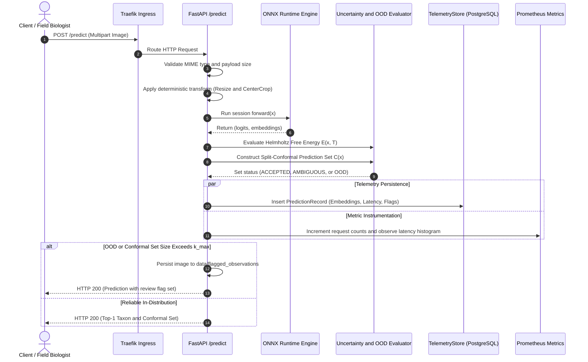
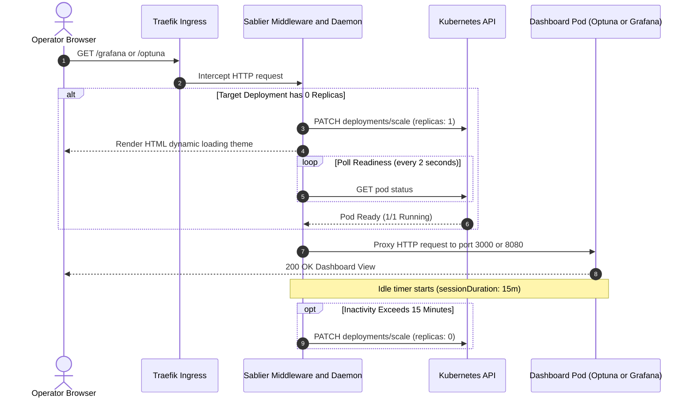

# System Architecture & Design

TaxonVision is an automated machine learning operations (MLOps) platform engineered for high-throughput biological species classification from photographic occurrences. Operating under strict reliability, biodiversity safety, and latency constraints, the system augments deep vision foundation representations with statistical conformal prediction sets and Helmholtz free-energy Out-of-Distribution (OOD) detection.

This document details the high-level system topology, subsystem boundaries, the single source of truth (SSOT) configuration hierarchy, the decoupled dual-pipeline training pattern, and the containerized deployment architecture. For related domain entities, operational runbooks, and workflow procedures, see [Domain Entities & Taxonomy Perimeter](domain-and-taxa.md), [Deployment & Observability](../operations/deployment-and-observability.md), [Service & API](../operations/service-and-api.md), [Quickstart](../quickstart.md), [Data Ingestion & Versioning](../workflows/data-ingestion-and-versioning.md), [Inference & Optimization](../workflows/inference-and-optimization.md), and [Model Training & Tracking](../workflows/model-training-and-tracking.md).

---

## Architectural Principles & Component Topology

TaxonVision's architecture is structured around five foundational engineering principles:

1. **Decoupled Representation and Head Learning (Dual-Pipeline Pattern)**: Heavy foundation model forward passes are executed offline to cache dense representation matrices, isolating computationally expensive vision backbones from rapid iterative classifier head tuning.
2. **Single Source of Truth (SSOT) Configuration**: System defaults are declared strictly in declarative YAML files (`config/default_config.yaml` and `config/taxa_catalog.yaml`), layered with pipeline parameters, calibration artifacts, and environment variables, and strictly validated at runtime via Pydantic Settings models.
3. **Rigorous Uncertainty Guarantees**: Predictions are bounded by finite-sample distribution-free conformal coverage guarantees ($1 - \alpha$), flagging ambiguous classifications for human expert triage.
4. **Hardware-Aware Cloud-Native Deployment**: Kubernetes pod topologies leverage virtualized GPU time-slicing, Sablier lazy-scaling, and INT8 post-training quantization (PTQ) to maximize hardware resource utilization on single-GPU nodes.
5. **End-to-End Data and Model Lineage**: Data versioning (DVC), experiment tracking (MLflow / DagsHub), and container artifact distribution (GHCR) maintain reproducible audit trails across every model release.

### High-Level System Topology

```mermaid
flowchart TD
    subgraph S_CFG["Configuration Layer (SSOT)"]
        YML["config/default_config.yaml"]
        CAT["config/taxa_catalog.yaml"]
        PAR["params.yaml (Canonical Hyperparameters)"]
        CAL["config/conformal_config.yaml"]
        ENV["Environment Overrides (TAXON_*)"]
        PYD["taxon_vision.config.loader get_settings (Pydantic Settings)"]
        
        YML --> PYD
        CAT --> PYD
        PAR --> PYD
        CAL --> PYD
        ENV --> PYD
    end

    subgraph S_PIPE["Dual-Pipeline Architecture (DVC DAG)"]
        subgraph S_P1["Pipeline 1: Offline Feature Extraction"]
            INAT["iNaturalist Open Data"]
            ING["ingest and audit_license stages"]
            MAN["data/manifests/dataset_manifest.parquet"]
            EXT["extract_features stage"]
            BB["Frozen Vision Backbone (DINOv3, BioCLIP, MobileNetV4)"]
            EMB["data/embeddings/*.pt (Train, Val, Cal, Test Splits)"]
            
            INAT --> ING
            ING --> MAN
            MAN --> EXT
            BB --> EXT
            EXT --> EMB
        end

        subgraph S_P2["Pipeline 2: Classification Head Training and Optimization"]
            TRN["train stage (taxon_vision.models.training)"]
            OPT["Hyperparameter Optimization (Optuna)"]
            CBL["Class-Balanced Loss (Effective Sample Weighting)"]
            MLF["MLflow Experiment Tracking (Metrics and Checkpoints)"]
            HCK["models/checkpoints/head.pt (Trained Head)"]
            
            EMB --> TRN
            OPT --> TRN
            CBL --> TRN
            TRN --> MLF
            TRN --> HCK
        end
        
        subgraph S_EXP["Export, Quantization and Calibration"]
            ONX["export stage (export_to_onnx)"]
            QNT["quantizer (Static INT8 PTQ Calibration)"]
            QMOD["models/checkpoints/model_int8.onnx (Dual Output)"]
            CALIB["calibrate stage (Conformal and OOD Quantiles)"]
            
            BB --> ONX
            HCK --> ONX
            ONX --> QNT
            QNT --> QMOD
            QMOD --> CALIB
            EMB --> CALIB
            CALIB --> CAL
        end
    end

    subgraph S_DEPLOY["Deployment and Runtime Topology"]
        subgraph S_K8S["Kubernetes Cluster (taxon-vision Namespace)"]
            TRF["Traefik Ingress Controller"]
            SAB["Sablier Scale-to-Zero Daemon"]
            SVC["Kubernetes Service (taxon-vision-serving)"]
            DEP["Deployment: taxon-vision-serving (2 Replicas, Non-Root 10001)"]
            VOL["Checkpoints Volume (hostPath Read-Only Mount)"]
            GPU["NVIDIA Device Plugin (4 Virtual GPU Slices)"]
            DB["PostgreSQL (Telemetry and Optuna DB)"]
            UI_DASH["On-Demand UIs (Grafana, Optuna, Evidently)"]
            
            TRF --> SVC
            TRF -.-> SAB
            SAB -.-> UI_DASH
            SVC --> DEP
            VOL --> DEP
            GPU -.-> DEP
            DEP --> DB
        end

        subgraph S_FASTAPI["FastAPI Serving Application"]
            API_PRED["/predict (Classification, Conformal and OOD Energy)"]
            API_EXPL["/explain (Grad-CAM Attribution)"]
            API_TRN["/train and /retrain (Head Retraining)"]
            API_HLTH["/health and /health/ready (Probes and Prometheus Metrics)"]
            API_UI["/views (HTMX and Jinja2 Field Triage Dashboard)"]
            
            DEP --> API_PRED
            DEP --> API_EXPL
            DEP --> API_TRN
            DEP --> API_HLTH
            DEP --> API_UI
        end
        
        QMOD -.-> DEP
    end

    PYD -.-> S_PIPE
    PYD -.-> S_FASTAPI
```


High-level system topology illustrating configuration layering, decoupled dual-pipeline training DAG, INT8 ONNX export, and Kubernetes serving with Sablier scale-to-zero.

---

## Subsystem Boundaries & End-to-End Data Flow

The TaxonVision platform enforces explicit architectural boundaries across seven key subsystems:

```
[iNaturalist API / S3 Bucket]
             │
             ▼ (HTTP streaming / Parquet manifests)
┌─────────────────────────────────────────────────────────┐
│ 1. DATASET STREAMING (S3ImageStreamer)                  │
└────────────────────────────┬────────────────────────────┘
                             │ (PIL RGB Observations)
                             ▼
┌─────────────────────────────────────────────────────────┐
│ 2. FEATURE EXTRACTION (Deterministic Transforms + Timm) │
└────────────────────────────┬────────────────────────────┘
                             │ (4-Way Partitioned Embedding Tensors: data/embeddings/*.pt)
                             ▼
┌─────────────────────────────────────────────────────────┐
│ 3. CLASSIFICATION HEAD TRAINING (ClassBalancedLoss)     │
└────────────────────────────┬────────────────────────────┘
                             │ (Trained Head Weights: models/checkpoints/head.pt)
                             ▼
┌─────────────────────────────────────────────────────────┐
│ 4. ONNX EXPORT & QUANTIZATION (_ONNXDualOutputModule)   │
└────────────────────────────┬────────────────────────────┘
                             │ (model_int8.onnx: Logits + Penultimate Embeddings)
                             ▼
┌─────────────────────────────────────────────────────────┐
│ 5. HTTP SERVING & SAFETY (FastAPI + Conformal + OOD)    │
└────────────────────────────┬────────────────────────────┘
                             │ (PredictionRecord: Latency, Flags, Embeddings)
                             ▼
┌─────────────────────────────────────────────────────────┐
│ 6. TELEMETRY PERSISTENCE (PostgreSQL Connection Pool)   │
└─────────────────────────────────────────────────────────┘
```

1. **Configuration Loading Subsystem (`src/taxon_vision/config/loader.py`, `schemas.py`)**: Resolves workspace paths, parses declarative YAML files, applies hierarchical overrides, and populates strongly typed Pydantic models cached in memory.
2. **Dataset Streaming Subsystem (`src/taxon_vision/data/s3_streamer.py`)**: Interacts with the public iNaturalist AWS S3 open data repository. Governed by `StreamingConfig`, it uses connection pooling (`httpx.Client`), exponential backoff retries, and worker concurrency limits to stream observations without storing hundreds of gigabytes of raw JPEG files on ephemeral worker disks.
3. **Backbone Feature Extraction Subsystem (`src/taxon_vision/pipelines/extract_features.py`)**: Streams decoded images through frozen foundation vision backbones (instantiated via `src/taxon_vision/models/factory.py`) using deterministic evaluation preprocessing (`get_evaluation_transform`). Outputs are partitioned into 4 stratified splits (train, validation, calibration, test) and saved as discrete PyTorch tensor files (`train_embeddings.pt`, `val_embeddings.pt`, `cal_embeddings.pt`, `test_embeddings.pt`).
4. **Classification Head Subsystem (`src/taxon_vision/models/head.py`, `models/training/runner.py`)**: Operates strictly on pre-computed feature embeddings. Employs `ClassBalancedLoss` (`src/taxon_vision/models/loss.py`) to counter biodiversity class imbalance, Optuna for Bayesian hyperparameter search, and MLflow for metric tracking and checkpoint promotion (`models/checkpoints/head.pt`).
5. **ONNX Export Subsystem (`src/taxon_vision/inference/onnx_exporter.py`, `quantizer.py`)**: Fuses the frozen vision backbone with the trained linear classification head inside `_ONNXDualOutputModule`. Serializes the unified computational graph to ONNX opset 17 with dynamic batch axes, generating both class logits and dense feature activations. Static Post-Training Quantization (PTQ) calibrates signed 8-bit integer weights (`QInt8` / `QUInt8`), saving `models/checkpoints/model_int8.onnx`.
6. **HTTP Serving & Uncertainty Gating Subsystem (`src/taxon_vision/service/api.py`, `inference.py`)**: Exposes OpenAPI REST endpoints, Prometheus telemetry metrics, and Jinja2/HTMX dashboard views via FastAPI. Routes inference to `ONNXInferenceEngine` (or fallback `TaxonClassifier`), evaluating split-conformal prediction sets ($C(x)$) and Helmholtz free-energy Out-of-Distribution scores ($E(x; T)$).
7. **Telemetry Persistence Subsystem (`src/taxon_vision/service/telemetry_store.py`)**: Buffers production inference telemetry—including pre-normalised penultimate feature representations, top-1 predictions, conformal set sizes, and energy scores—into a relational PostgreSQL database via a thread-safe connection pool (`psycopg_pool.ConnectionPool`). Decouples real-time serving latency from background Wasserstein-1 and Maximum Mean Discrepancy (MMD) distribution drift detection.

---

## Single Source of Truth (SSOT) Configuration Hierarchy

Configuration drift between YAML files, runtime scripts, and deployment manifests is prevented by TaxonVision's centralized configuration engine in `src/taxon_vision/config/loader.py` and schema definitions in `src/taxon_vision/config/schemas.py`. Declarative YAML files serve as the authoritative single source of truth, while typed Pydantic models validate and expose settings at runtime.

### Configuration Layering & Precedence

Application settings are loaded and merged by `get_settings()` (`src/taxon_vision/config/loader.py`) using a strict precedence order:

1. **Base Declarative Configuration**: Loaded from `config/default_config.yaml`. Defines base default values across all subsystems (`service`, `model`, `training`, `ingestion`, `streaming`, `optuna`, `mlflow`, `conformal`, `ood`, `telemetry`, `drift`, `evaluation`, `promotion`).
2. **DVC Pipeline Parameters Layer**: If canonical root `params.yaml` exists (or `config/params.yaml`), its values are layered over the base configuration using recursive dictionary merging (`_deep_merge`).
3. **Statistical Conformal Calibration Layer**: If `config/conformal_config.yaml` exists, its `calibration` block is mapped and layered onto the `conformal` configuration block (`_load_conformal_override`).
4. **Custom YAML Overrides**: If a custom YAML file path is passed explicitly to `get_settings(config_path=...)` or specified via the `TAXON_CONFIG_PATH` environment variable, its contents are overlaid on the merged dictionary (`_resolve_custom_override`).
5. **Targeted Direct Environment Overrides**: Specific environment flags used for test isolation, database connections, and tracking (`TAXON_ALLOW_UNTRAINED_FALLBACK`, `TAXON_FLAGGED_STORAGE_DIR`, `TAXON_OPTUNA_STORAGE_URI`, `TAXON_MLFLOW_TRACKING_URI`, `TAXON_TELEMETRY_DATABASE_URL`, and `TAXON_TELEMETRY_ALLOW_IN_MEMORY_FALLBACK`) are applied directly into subsystem sub-dictionaries (`_apply_direct_env_overrides`).
6. **Dynamic Environment Variable Overrides**: Environment variables prefixed with `TAXON_` and separated by double underscores (`__`) take final precedence during Pydantic Settings parsing (for example, `TAXON_SERVICE__PORT=8000` overrides `service.port`, and `TAXON_MODEL__IMAGE_SIZE=336` overrides `model.image_size`).

```
Base YAML (default_config.yaml)
  └──> params.yaml (DVC hyperparameters)
        └──> conformal_config.yaml (Calibrated quantiles)
              └──> Custom YAML (TAXON_CONFIG_PATH)
                    └──> Direct Env Overrides (TAXON_ALLOW_UNTRAINED_FALLBACK, etc.)
                          └──> Dynamic Env Overrides (TAXON_<SECTION>__<KEY>)
```

To prevent redundant file I/O and repetitive schema validation during high-throughput inference requests, `get_settings()` is wrapped with `@lru_cache(maxsize=1)`, caching the initialized `Settings` instance in process memory. Cache clearing is supported via `reset_settings()`.

### Pydantic Validation Schemas

All configuration parameters are governed by strongly typed Pydantic v2 schemas declared in `src/taxon_vision/config/schemas.py`:

| Schema Model | Primary Attributes & Type Constraints | Functional Domain |
|---|---|---|
| **`ServiceConfig`** | `name: str`, `version: str`, `port: int` ($0 < \text{port} < 65536$), `host: str`, `max_image_upload_bytes: int` ($> 0$), `allowed_mime_types: list[str]`, `image_cache_max_items: int`, `image_cache_ttl_seconds: float`, `ui_top_k_candidates: int`, `redis_url: str \| None` | FastAPI HTTP server bindings, payload limits, MIME validation, and dashboard image caching. |
| **`ModelConfig`** | `default_extractor: str`, `fallback_extractor: str`, `available_extractors: list[str]`, `image_size: int` ($> 0$), `channels: int` (3), `mean: list[float]`, `std: list[float]`, `onnx_model_path: str`, `head_checkpoint_path: str`, `taxa_catalog_path: str`, `eval_resize_ratio: float` ($> 1.0$), `inference_backend: Literal["auto", "onnx", "torch"]`, `quantization_mode: Literal["auto", "static", "dynamic"]`, `calibration_dir: str`, `calibration_samples: int`, `allow_untrained_fallback: bool`, `prefer_onnx_runtime: bool`, `onnx_opset_version: int`, `temperature: float` ($> 0.0$), `ood_temperature: float`, `ood_energy_threshold: float`, `flagged_storage_dir: str`, `backbone_registry: dict[str, str]` | Vision backbone architectures, image dimensions, normalization constants, ONNX export configurations, and OOD detection thresholds. |
| **`TrainingConfig`** | `epochs: int` ($> 0$), `batch_size: int` ($> 0$), `learning_rate: float` ($> 0.0$), `weight_decay: float` ($\ge 0.0$), `cb_beta: float` ($0 < \beta < 1$), `dropout: float`, `val_split: float` ($0.0 \le v < 1.0$), `cal_split: float`, `test_split: float`, `random_seed: int`, `extractor: str`, `tune: bool` | Mini-batch sizing, optimizer hyperparameters, PRNG seeds, and split ratios for classification head training. |
| **`IngestionConfig`** | `taxa_to_fetch: list[int]`, `per_page: int` ($> 0$) | iNaturalist API query parameters and taxon identifier target list. |
| **`StreamingConfig`** | `http_max_retries: int`, `http_backoff_factor: float`, `http_max_connections: int`, `http_keepalive_connections: int`, `http_timeout_seconds: float`, `min_extraction_success_ratio: float` | AWS S3 HTTP streaming connection limits, timeout ceilings, and retry policies. |
| **`OptunaConfig`** | `optuna_storage_uri: str`, `optuna_study_prefix: str`, `n_trials: int`, `epochs: int`, `min_resource: int`, `reduction_factor: int` | Hyperparameter search study names, trial allocations, and database persistence URI. |
| **`MLflowConfig`** | `tracking_uri: str`, `fallback_sqlite_uri: str`, `dagshub_uri: str`, `experiment_name: str`, `drift_experiment_name: str`, `model_registry_name: str`, `onnx_registry_name: str`, `health_check_timeout_seconds: float` | DagsHub/local MLflow tracking server URIs and registered model names. |
| **`ConformalConfig`** | `alpha: float` ($0 < \alpha < 1$), `q_hat: float` ($0 < q < 1$), `k_max: int` ($> 0$), `quantile_threshold: float`, `nominal_coverage: float`, `method: str`, `empty_set_action: str`, `min_confidence: float` ($0.0 \le c \le 1.0$), `min_confidence_threshold: float`, `ood_tpr: float` | Conformal uncertainty calibration, prediction set size bounds ($k_{\max}$), and human triage thresholds. |
| **`OODConfig`** | `energy_threshold: float`, `entropy_threshold: float` | Free energy and predictive entropy thresholds for out-of-distribution observation routing. |
| **`TelemetryConfig`** | `database_url: str`, `pool_min_size: int`, `pool_max_size: int`, `timeout_seconds: float`, `allow_in_memory_fallback: bool`, `fallback_buffer_size: int` | PostgreSQL telemetry persistence, connection pool bounds, and in-memory fallback ring buffers. |
| **`DriftConfig`** | `window_size: int`, `min_samples: int`, `tau_w1: float`, `mmd_max_samples: int`, `mmd_permutations: int`, `alpha: float`, `reference_embeddings_path: str` | Sliding window parameters and statistical hypothesis thresholds for distribution drift detection. |
| **`PromotionConfig`**| `quantization_drop_tol: float`, `coverage_tolerance: float`, `latency_slo_ms: float`, `min_telemetry_samples: int`, `drift_alpha: float` | Production promotion gates governing accuracy retention, conformal coverage, latency, and drift. |
| **`Settings`** | Aggregates all above sub-models; configured with `SettingsConfigDict(env_prefix="TAXON_", env_nested_delimiter="__", extra="ignore")`. | Root application settings singleton. |

### Taxa Catalog Single Source of Truth

The catalog file `config/taxa_catalog.yaml` defines the authoritative taxonomic perimeter for the system (scientific names, vernacular common names, higher taxonomic ranks, primary iNaturalist taxon IDs, and taxonomic aliases).

To prevent configuration drift between catalog definitions and pipeline code, modules never hardcode integer label mappings. Instead, dynamic mapping generators such as `get_catalog_inat_taxon_map()` in `src/taxon_vision/pipelines/extract_features.py` inspect `config/taxa_catalog.yaml` at runtime:

```python
# Dynamically constructed mapping from config/taxa_catalog.yaml (SSOT)
DEFAULT_INAT_TAXON_MAP: dict[int, int] = get_catalog_inat_taxon_map()
```

Each primary taxon identifier, internal catalog ID, and taxonomic alias (such as ancestral genera or related species) is mapped to a dense ordinal class index in $[0, K-1]$, where $K$ is the number of catalogued taxa.

---

## Dual-Pipeline Architecture

Modern deep vision foundation backbones (such as DINOv3 ViT-Small, BioCLIP-2, and MobileNetV4) contain tens to hundreds of millions of parameters. Performing full end-to-end backpropagation through these architectures during rapid iteration or active learning loops is computationally prohibitive and prone to catastrophic forgetting on small datasets.

TaxonVision resolves this bottleneck through the **Dual-Pipeline Pattern**, decoupling heavy feature extraction from rapid linear classifier head training.

### Pipeline 1: Offline Representation Extraction & Caching

The feature extraction pipeline (`taxon_vision.pipelines.extract_features`) processes raw observation images and converts them into dense representation vectors:

1. **Manifest Parsing**: Reads the observation manifest (`data/manifests/dataset_manifest.parquet`) containing observation identifiers, S3/HTTP image URLs, and taxon IDs.
2. **Deterministic Evaluation Transform**: Raw images are preprocessed via `get_evaluation_transform()`. Stochastic augmentations are omitted during caching so that cached representations capture the canonical visual signal. The transform performs:
    * Bilinear resizing of the shorter edge to `resize_size = round(image_size * eval_resize_ratio)` (e.g., $256 \times 256$ for $224 \times 224$ crops).
    * Exact square center cropping to `(image_size, image_size)`.
    * Conversion to float32 tensors scaled to $[0.0, 1.0]$.
    * Channel-wise normalization using ImageNet statistics (`mean=[0.485, 0.456, 0.406]`, `std=[0.229, 0.224, 0.225]`).
3. **Forward Representation Pass**: Tensors are streamed in mini-batches through a frozen backbone (`create_feature_extractor`) instantiated without classification heads. The backbone operates with disabled gradient computation (`torch.no_grad()`) on CPU or CUDA hardware.
4. **Stratified Partitioning & Storage**: Extracted representations are mapped to dense class indices, partitioned into 4 stratified splits (train 70%, val 10%, calibration 10%, test 10%) preserving class frequencies, and persisted to disk under `data/embeddings/` (`train_embeddings.pt`, `val_embeddings.pt`, `cal_embeddings.pt`, `test_embeddings.pt`).

The resulting embedding files store `embeddings`, `labels`, `samples_per_class`, and `feature_dim`.

### Pipeline 2: Rapid Linear Head Training & Optimization

The classification head training pipeline (`taxon_vision.pipelines.train`, backed by `taxon_vision.models.training.runner` and `embeddings.py`) loads the serialized embeddings and trains a linear classification head (`TaxonClassifierHead`):

1. **In-Memory Training Loop**: Because the backbone is frozen and representations are pre-computed, mini-batch forward and backward passes execute directly on memory-resident embedding tensors ($N \times D$, where $D=1280$ for MobileNetV4 or $D=768$ for ViT-S/BioCLIP). A full 30-epoch training run completes in seconds on commodity hardware.
2. **Class-Balanced Loss**: Biological observation distributions suffer from severe power-law class imbalance. Training utilizes `ClassBalancedLoss` (`src/taxon_vision/models/loss.py`), which weights cross-entropy or focal loss dynamically by the effective number of samples $E_n = (1 - \beta^n) / (1 - \beta)$, preventing majority species from dominating gradient updates.
3. **Automated Hyperparameter Tuning**: An integrated Optuna engine (`tune_hyperparameters`) searches learning rate, weight decay, label smoothing, and dropout schedules over objective validation metrics.
4. **Experiment Tracking**: Training metrics (Macro F1, Macro PR-AUC, Top-1 Accuracy, training loss) and confusion matrices are logged to remote DagsHub/local MLflow tracking servers (`mlflow_run_scope`).
5. **Checkpoint Promotion**: If validation macro F1 exceeds the incumbent baseline, the pipeline writes the trained head weights to `models/checkpoints/head.pt` and invalidates the runtime memory cache.

### Serialization, Dual-Output Graph, & INT8 Quantization

Once head weights are established, the full model graph is serialized for low-latency serving:

1. **Unified Classifier Composition**: `TaxonClassifier` (`src/taxon_vision/models/head.py`) pairs the pre-trained vision backbone with the trained linear head into a single PyTorch `nn.Module`.
2. **Dual-Output Graph Wrapper**: During ONNX export (`src/taxon_vision/inference/onnx_exporter.py`), the model is wrapped in `_ONNXDualOutputModule`. When executed, the graph produces two output tensors:
   - `logits`: Dimension $(B, K)$ for species classification and conformal calibration.
   - `embeddings`: Dimension $(B, D)$ for Helmholtz free-energy OOD detection, data drift analysis, and active learning query sampling. These represent pre-normalised penultimate feature activation vectors, preventing unit-norm collapse during downstream drift evaluation.
3. **Static INT8 Post-Training Quantization (PTQ)**: `src/taxon_vision/inference/quantizer.py` passes representative calibration images (`data/sample`) through the ONNX graph using ONNX Runtime's static calibration tooling (`TaxonCalibrationDataReader`). Convolution and matrix multiplication weights and activations are quantized to signed 8-bit integers (`QInt8` / `QUInt8`), reducing memory footprint by $\sim 75\%$ and yielding sub-20ms CPU inference latencies. The quantized artifact is saved to `models/checkpoints/model_int8.onnx`.

### Canonical 8-Stage DVC Pipeline DAG

Model and data lifecycle automation is governed by the 8 canonical DVC pipeline stages declared in `dvc.yaml`:

1. `ingestion`: Downloads raw observations from iNaturalist via `taxon_vision.pipelines.ingest` and outputs `data/manifests/raw_manifest.parquet`.
2. `audit_license`: Validates open licenses (CC0, CC-BY, CC-BY-NC) via `taxon_vision.pipelines.audit_license` and produces `data/manifests/dataset_manifest.parquet` and `reports/license_audit.json`.
3. `extract_features`: Streams images from S3 via `taxon_vision.pipelines.extract_features` into 4 stratified embedding files under `data/embeddings/`.
4. `data_drift`: Measures feature representation shift between current embeddings and reference baselines (`reports/data_drift.json`).
5. `train`: Executes classification head training with Class-Balanced Loss via `taxon_vision.pipelines.train` and outputs `models/checkpoints/head.pt` and `reports/train_metrics.json`.
6. `export`: Exports the unified dual-output PyTorch module to INT8 ONNX via `taxon_vision.pipelines.export_onnx` and outputs `models/checkpoints/model_int8.onnx`.
7. `calibrate`: Calibrates conformal non-conformity quantiles ($\hat{q}$) and Helmholtz OOD thresholds via `taxon_vision.pipelines.calibrate` and outputs `config/conformal_config.yaml`.
8. `eval`: Evaluates accuracy, latency SLAs, and conformal coverage bounds via `taxon_vision.pipelines.evaluate` and outputs `reports/pareto_evaluation.json`.

---

## Service Architecture & Serving Engine

The TaxonVision runtime microservice is composed as a unified FastAPI ASGI application in `src/taxon_vision/service/api.py`.

### Route Handlers & Operational Surfaces

The application mounts modular route handlers:

- **`/health` & `/health/ready`** (`src/taxon_vision/service/routes/health.py`): Kubernetes liveness and readiness probes. Readiness strictly verifies that model artifacts (`model_int8.onnx` or `head.pt`) exist, load successfully, and match the class perimeter of `config/taxa_catalog.yaml`. Exposes Prometheus telemetry metrics (`/metrics`).
- **`/predict` & `/api/v1/predict`** (`src/taxon_vision/service/routes/predict.py`): Accepts multipart image uploads, validates payload size against `max_image_upload_bytes` and MIME type against `allowed_mime_types`, executes forward inference, computes conformal prediction sets, evaluates OOD energy, records telemetry, and returns JSON predictions.
- **`/explain`** (`src/taxon_vision/service/routes/explain.py`): Generates Class Activation Maps (CAM) highlighting the visual evidence and image regions that guided classification.
- **`/train` & `/retrain`** (`src/taxon_vision/service/routes/train.py`, `retrain.py`): Triggers asynchronous background head retraining and reports execution status.
- **`/drift`** (`src/taxon_vision/service/routes/drift.py`): Reports real-time embedding Wasserstein-1 and MMD drift metrics from inference telemetry.
- **`/views`** (`src/taxon_vision/service/routes/views.py`): Server-rendered Jinja2/HTMX dashboard views for field biologists to inspect predictions, triage flagged observations, and review uncertain sets.

### Inference Backend Resolution

Inference execution is coordinated by `src/taxon_vision/service/inference.py`:

- **ONNX Runtime Engine (`ONNXInferenceEngine`)**: Statically loaded and cached via `get_onnx_engine()`. Activated when `inference_backend` is `"onnx"` or `"auto"` (and the quantized ONNX artifact exists). Avoids PyTorch runtime overhead on the hot serving path.
- **PyTorch Fallback Classifier (`TaxonClassifier`)**: Cached via `get_classifier()`. Activated when `inference_backend` is `"torch"` or when running in test environments where `allow_untrained_fallback` is enabled.
- **Artifact Validation**: Both engines validate that model output dimensions strictly equal the number of species defined in `load_taxa_catalog()`. If an artifact is missing or mismatched, `ModelNotReadyError` is raised, causing `/health/ready` to return HTTP 503.

### Uncertainty & OOD Safety Pipeline

Every prediction request passes through two statistical reliability gates before results are returned:

1. **Helmholtz Free-Energy OOD Detection**:
   Using logits $f_k(x)$ and temperature $T_{\text{ood}}$, free energy is calculated:
   $$E(x; T) = -T \cdot \log \sum_{k=1}^K \exp\left(\frac{f_k(x)}{T}\right)$$
   If $E(x; T) > \tau_{\text{energy}}$ (where $\tau_{\text{energy}}$ defaults to $-2.40$), the observation is flagged as out-of-distribution (e.g., an uncatalogued organism or non-biological noise) and persisted to `data/flagged_observations` for active learning triage.
2. **Split-Conformal Prediction Sets**:
   Given non-conformity calibration score quantile $\hat{q}$, the conformal engine constructs prediction set:
   $$C(x) = \left\{ k \in \{1, \dots, K\} \mid 1 - \text{Softmax}(f(x) / T)_k \le \hat{q} \right\}$$
   Guaranteeing marginal coverage $P(Y \in C(X)) \ge 1 - \alpha$. If the set size $|C(x)| > k_{\max}$ (default 3) or if the set is empty, the observation is automatically routed to human expert triage (`requires_review = True`).

### Runtime Request & Telemetry Lifecycle


Runtime prediction request lifecycle showing ONNX dual-output forward execution, statistical uncertainty gating, and asynchronous telemetry recording.

---

## Cloud-Native Deployment Topology & Infrastructure

TaxonVision is packaged as a cloud-native container image (`ghcr.io/foersben/taxon-vision-mlops:latest`) and deployed to a bare-metal or managed Kubernetes cluster.

### Kubernetes Workload Specification

The primary serving workload is configured in `deploy/k8s/api-deployment.yaml`:

- **Namespace**: `taxon-vision`.
- **Workload Name**: `taxon-vision-serving`.
- **Replicas & Rollout Strategy**: 2 replicas governed by a `RollingUpdate` strategy (`maxSurge: 1`, `maxUnavailable: 0`), guaranteeing zero-downtime rolling deployments during model updates.
- **Security Context**: Enforces least-privilege security by executing as an unprivileged non-root user (`runAsNonRoot: true`, `runAsUser: 10001`, `runAsGroup: 10001`).
- **Resource Allocations**:
  - CPU requests: `200m`; limits: `2`.
  - Memory requests: `512Mi`; limits: `1536Mi`.
  - GPU allocation: `nvidia.com/gpu: "1"` (virtual time-sliced GPU partition).
- **Storage Mounts**:
  - Read-only `hostPath` volume mounts host checkpoints (`/var/lib/taxon-vision/checkpoints`) into the container at `/app/models/checkpoints`.
  - Read-write `hostPath` volume mounts `/var/lib/taxon-vision/flagged_observations` into `/app/data/flagged_observations`.
- **Health Probes**:
  - Liveness probe: HTTP GET `/health` on port 8000 (initial delay 15s, period 20s, timeout 3s, failure threshold 3).
  - Readiness probe: HTTP GET `/health/ready` on port 8000 (initial delay 5s, period 5s, timeout 3s, failure threshold 2).
- **Service Exposure**: A Kubernetes `ClusterIP` service (`taxon-vision-serving`) exposes port 8000, fronted by the Traefik Ingress Controller.

### Hardware-Aware GPU Time-Slicing

On edge nodes and bare-metal environments equipped with consumer or prosumer GPUs (such as an NVIDIA RTX 5070 Ti with 16 GB VRAM), hardware Multi-Instance GPU (MIG) partitioning is unsupported. Under standard Kubernetes scheduling, a single pod requesting `nvidia.com/gpu: 1` places an exclusive lock on the entire card, causing all other workloads (such as CI runners and background batch training jobs) to stall in a `Pending` state.

To overcome this constraint, TaxonVision deploys an NVIDIA Device Plugin time-slicing configuration (`deploy/k8s/nvidia-time-slicing-config.yaml`):

```yaml
apiVersion: v1
kind: ConfigMap
metadata:
  name: nvidia-device-plugin-config
  namespace: kube-system
data:
  config.yaml: |
    version: v1
    sharing:
      timeSlicing:
        resources:
          - name: nvidia.com/gpu
            replicas: 4
```

This configuration multiplexes the single physical GPU into **4 virtual GPU slices**. The NVIDIA driver multiplexes GPU compute cycles via fast hardware context switching, while process memory isolation is enforced at the application layer:
- The Web API serving pods run lightweight INT8 ONNX Runtime models consuming $< 500\text{ MB}$ of memory.
- Batch training and feature extraction processes restrict allocation via PyTorch memory capping (`torch.cuda.set_per_process_memory_fraction`, configured via `configure_cuda_memory_budget()` in `src/taxon_vision/models/training/runner.py`), reserving sufficient VRAM for real-time serving.

### Sablier Lazy-Scaling Architecture

On dedicated bare-metal infrastructure, keeping memory-intensive human inspection dashboards running 24/7 wastes substantial CPU and RAM resources. To optimize utilization, TaxonVision separates workloads into **permanently warm services** and **scale-to-zero on-demand services**:

1. **Always-Warm Services**: Core inference microservices (`taxon-vision-serving`), relational persistence (`postgres`), Prometheus telemetry scrapers, and the Sablier daemon run continuously with permanent pod allocations.
2. **Lazy-Scaled Inspection Services**: Auxiliary human review interfaces—specifically Optuna Dashboard (`/optuna`, port 8080), Grafana (`/grafana`, port 3000), and Evidently UI (`/evidently`, port 8000)—are configured with 0 baseline replicas.

Lazy-scaling is orchestrated via the **Sablier** daemon (`deploy/k8s/sablier-scaler.yaml`) and Traefik Ingress middlewares (`deploy/k8s/traefik-ingress.yaml`, `deploy/k8s/traefik-sablier-config.yaml`):


Sablier lazy-scaling flow showing request interception, on-demand replica activation with auto-refresh loading screen, and automatic idle scale-to-zero.

When an operator navigates to `/optuna`, `/grafana`, or `/evidently`:
1. Traefik's `sablier` plugin intercepts the incoming HTTP request and queries the Sablier cluster daemon (`http://sablier.taxon-vision.svc.cluster.local:10000`).
2. If the destination deployment has 0 running replicas, Sablier immediately invokes the Kubernetes API (`sablier-cluster-role` permissions) to patch the deployment's scale subresource to `replicas: 1`.
3. Sablier returns a stylish, auto-refreshing loading web page (`theme: "hacker-terminal"` with a 2-second refresh polling interval) to the browser.
4. Once the pod passes its Kubernetes readiness probes, Sablier transparently proxies the operator's browser session directly to the container.
5. A session timer (`sessionDuration: "15m"`) runs during user activity. If no HTTP requests are detected for 15 minutes, Sablier scales the deployment back down to `replicas: 0`, completely reclaiming cluster CPU and RAM.

### CI/CD Pipeline & RBAC Isolation

Continuous integration, verification testing, and automated retraining runs are orchestrated via Jenkins and DVC:

- **Jenkins CI Agent RBAC**: Defined in `deploy/k8s/jenkins-agent-rbac.yaml`. Grants the `jenkins-agent` service account scoped Role and RoleBinding permissions in the `jenkins-ci` namespace (`pods`, `pods/exec`, `pods/log`, `events`) and deployment management permissions in the `taxon-vision` namespace (`deployments`, `services`, `traefik.io` resources) without requiring cluster-admin privileges.
- **Pipeline Lineage & Reproducibility**: The 8-stage DVC DAG ensures reproducible step execution, tracking data manifest hashes, feature embedding splits, trained checkpoints, and pareto evaluation reports across Git commits.

---

## Related Documentation & Cross-References

- **[Domain Entities & Taxonomy Perimeter](domain-and-taxa.md)**: DarwinCore taxonomic entities, 10-taxa perimeter definition, alias resolution rules, and open licensing compliance.
- **[Deployment & Observability](../operations/deployment-and-observability.md)**: Production Kubernetes deployment, Prometheus metrics, and operational monitoring.
- **[Service & API](../operations/service-and-api.md)**: OpenAPI endpoints, request and response schemas, and interactive HTMX dashboards.
- **[Quickstart](../quickstart.md)**: Developer setup, Pixi environment configuration, and local execution commands.
- **[Data Ingestion & Versioning](../workflows/data-ingestion-and-versioning.md)**: Manifest generation, license auditing, and S3 streaming.
- **[Inference & Optimization](../workflows/inference-and-optimization.md)**: ONNX graph export, dual-output embeddings, and static INT8 post-training quantization.
- **[Model Training & Tracking](../workflows/model-training-and-tracking.md)**: Linear head tuning, Optuna hyperparameter optimization, and MLflow experiment tracking.
