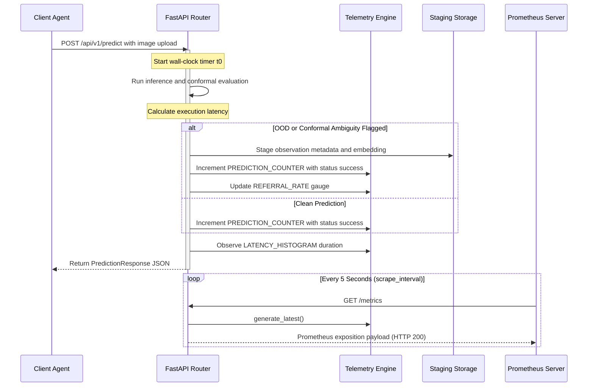

# Deployment, Scheduling & Observability

TaxonVision provides high-throughput biological species classification under strict reliability, calibration, and safety constraints. Operating this system requires a resilient, multi-tiered infrastructure stack capable of scheduling heterogeneous workloads (interactive REST API services, CI automation runners, and batch retraining pipelines) across shared hardware accelerators, continuously monitoring inference accuracy and latency, and detecting domain drift in real-time.

This document details the production Kubernetes topology, NVIDIA GPU time-slicing configurations for consumer/prosumer accelerators, Prometheus telemetry instrumentation, Wasserstein-1 embedding drift detection, and operational deployment verification runbooks. For related operational surfaces, see [Service & API](service-and-api.md), [System Architecture & Design](../architecture/system-overview.md), and [Test Strategy & Invariants](../testing/test-strategy-and-invariants.md).

---

## Kubernetes Deployment Topology

The core inference service is deployed to a Kubernetes cluster (such as a bare-metal `k3s` environment) in the dedicated `taxon-vision` namespace. The architecture consists of a stateless API Deployment, a NodePort routing Service, and cross-namespace Role-Based Access Control (RBAC) bindings that govern continuous integration and automated deployment agents.

<!-- openwiki: mermaid parse failed and this diagram was converted to a text fence so it does not break rendering. Fix the diagram source and restore the mermaid fence. Parser error: Heuristic: an unescaped angle bracket inside a label breaks rendering; rephrase the label. -->
```text
flowchart TD
    subgraph S_EXT["External Traffic & Ingress"]
        CLIENT["Client / Field Biologist"]
        PROM["Prometheus Server<br/>(Scrape: 5s)"]
    end

    subgraph S_K8S["Kubernetes Cluster (Namespace: taxon-vision)"]
        SVC["Service: taxon-vision-api<br/>(NodePort: 30080 -> Port: 8000)"]
        
        subgraph S_DEPLOY["Deployment: taxon-vision-api (replicas: 2)"]
            POD1["Pod: taxon-vision-api-xxxx-1<br/>UID: 10001 (Non-Root)<br/>Requests: 200m CPU, 512Mi RAM<br/>Limits: 2 CPU, 2Gi RAM, 1 GPU Slice"]
            POD2["Pod: taxon-vision-api-xxxx-2<br/>UID: 10001 (Non-Root)<br/>Requests: 200m CPU, 512Mi RAM<br/>Limits: 2 CPU, 2Gi RAM, 1 GPU Slice"]
        end

        HP["HostPath Volume (ReadOnly)<br/>/home/benni/taxon-vision-mlops/models/checkpoints<br/>Mount: /app/models/checkpoints"]
    end

    subgraph S_CI["Namespace: jenkins-ci"]
        SA["ServiceAccount: jenkins-agent"]
        ROLE["Role: jenkins-deployer-role<br/>(Deployments, Services, Pods)"]
        SA -.->|Bound via RoleBinding| ROLE
        ROLE -.->|Deploys & Updates| S_DEPLOY
    end

    CLIENT -->|HTTP :30080| SVC
    PROM -->|GET /metrics| SVC
    SVC --> POD1
    SVC --> POD2
    HP --> POD1
    HP --> POD2
```
*Kubernetes deployment topology showing load balancing across non-root API pods, hostPath checkpoint mounting, Prometheus metrics scraping, and cross-namespace CI deployment RBAC.*

### API Deployment Specification

The declarative manifest `deploy/k8s/api-deployment.yaml` specifies the `taxon-vision-api` Deployment. Key structural attributes include:

* **Replication & Rolling Strategy**: Configured with `replicas: 2` under a `RollingUpdate` strategy (`maxSurge: 1`, `maxUnavailable: 0`). This ensures zero-downtime updates: a new pod must achieve readiness before an old pod is terminated.
* **Security Hardening**: Pods execute under a hardened container security context:
  ```yaml
  securityContext:
    runAsNonRoot: true
    runAsUser: 10001
    runAsGroup: 10001
  ```
* **Resource Allocation**:
    * Requests: `cpu: "200m"`, `memory: "512Mi"`
    * Limits: `cpu: "2"`, `memory: "2Gi"`
    * Virtual GPU Slice: When NVIDIA time-slicing is activated, limits may request `nvidia.com/gpu: "1"` to access a virtualized time-slice of the host GPU.
* **Storage & Checkpoint Mounting**: Model weights, classifier heads, and calibration artifacts are mounted read-only from the host via a `hostPath` volume:
    * Host Path: `/home/benni/taxon-vision-mlops/models/checkpoints`
    * Container Mount: `/app/models/checkpoints` (`readOnly: true`, `type: DirectoryOrCreate`)
* **Health and Readiness Probing**:
    * **Liveness Probe**: Queries `GET /health` on port 8000 (`initialDelaySeconds: 15`, `periodSeconds: 20`, `timeoutSeconds: 3`, `failureThreshold: 3`). A pure memory check returning `{"status": "healthy"}` without touching disk or GPU inference.
    * **Readiness Probe**: Queries `GET /health/ready` on port 8000 (`initialDelaySeconds: 5`, `periodSeconds: 5`, `timeoutSeconds: 3`, `failureThreshold: 2`). Invokes `check_readiness()` in `src/taxon_vision/service/inference.py` to confirm the taxa catalog is non-empty and the classifier checkpoint is loaded and operational. Traffic is only routed to the pod once this probe returns HTTP 200.

### Service Definition

Traffic is exposed outside the pod overlay network via the `taxon-vision-api` Service defined in `deploy/k8s/api-deployment.yaml`:

* **Type**: `NodePort`
* **Port Mapping**: Service port `8000` routes to container targetPort `8000`.
* **NodePort Assignment**: Static node port `30080` allows direct ingress on bare-metal node IPs (`http://<node-ip>:30080`).

### Cross-Namespace CI/CD RBAC

Automated deployment pipelines running in Jenkins are governed by RBAC declarations in `deploy/k8s/jenkins-agent-rbac.yaml`. To enforce least privilege while enabling CI runners to deploy application updates, permissions are partitioned across two namespaces:

1. **Namespace `jenkins-ci`**:
    * `ServiceAccount`: `jenkins-agent`
    * `Role`: `jenkins-agent-role` allows `pods`, `pods/exec`, and `pods/log` manipulation (verbs: `create`, `delete`, `get`, `list`, `patch`, `update`, `watch`) and `events` reading within `jenkins-ci`.
    * `RoleBinding`: `jenkins-agent-binding` binds `jenkins-agent` to `jenkins-agent-role`.
2. **Namespace `taxon-vision`**:
    * `Role`: `jenkins-deployer-role` grants deployment management capabilities over `apps/deployments` and core `services`, `pods`, `pods/log`, and `events`.
    * `RoleBinding`: `jenkins-deployer-binding` binds the cross-namespace subject `ServiceAccount: jenkins-agent` (in `jenkins-ci`) to `jenkins-deployer-role` (in `taxon-vision`).

This setup allows Jenkins build agents to roll out new container images to the production API deployment without holding cluster-admin privileges.

---

## NVIDIA GPU Time-Slicing Configuration

In resource-constrained environments (such as bare-metal edge nodes or developer workstations like `hive-mind` at `192.168.178.30`), high-end consumer or prosumer GPUs (such as an NVIDIA RTX 5070 Ti with 16 GB VRAM) lack hardware-level Multi-Instance GPU (MIG) partitioning - a feature reserved exclusively for enterprise GPUs (e.g. A100, H100).

### The Scheduling Bottleneck

Without device virtualization, requesting `nvidia.com/gpu: 1` places an exclusive lock on the physical PCI device. A single long-running pod (such as an interactive API service or a batch training run) starves all subsequent pods, forcing CI test jobs and auxiliary services to languish in a permanent `Pending` state.

<!-- openwiki: mermaid parse failed and this diagram was converted to a text fence so it does not break rendering. Fix the diagram source and restore the mermaid fence. Parser error: Heuristic: an unescaped angle bracket inside a label breaks rendering; rephrase the label. -->
```text
flowchart TD
    subgraph S_HW["Physical Hardware"]
        GPU["Physical NVIDIA RTX 5070 Ti<br/>(16 GB GDDR7 VRAM)"]
    end

    subgraph S_PLUGIN["NVIDIA Device Plugin (kube-system)"]
        CM["ConfigMap: nvidia-device-plugin-config<br/>timeSlicing.resources[0].replicas: 4"]
        DS["NVIDIA Device Plugin DaemonSet"]
        CM --> DS
        GPU --> DS
    end

    subgraph S_SLICES["Virtual GPU Slices (nvidia.com/gpu: 4)"]
        V1["Slice 1: taxon-vision-api Pod 1<br/>(INT8 ONNX Inference)"]
        V2["Slice 2: taxon-vision-api Pod 2<br/>(INT8 ONNX Inference)"]
        V3["Slice 3: Jenkins CI Runner<br/>(PyTest & Coverage)"]
        V4["Slice 4: Batch Retraining Job<br/>(torch.cuda memory fraction clamped)"]
    end

    DS --> V1
    DS --> V2
    DS --> V3
    DS --> V4
```
*Multiplexing a single physical GPU across 4 virtual slices via NVIDIA Device Plugin time-slicing and software memory clamping.*

### Time-Slicing Specification

TaxonVision leverages the NVIDIA Kubernetes Device Plugin time-slicing mechanism declared in `deploy/k8s/nvidia-time-slicing-config.yaml`. The configuration publishes 4 virtual GPU slices for a single physical device:

```yaml
apiVersion: v1
kind: ConfigMap
metadata:
  name: nvidia-device-plugin-config
  namespace: kube-system
  labels:
    app.kubernetes.io/name: nvidia-device-plugin
    app.kubernetes.io/part-of: taxon-vision-mlops
data:
  config.yaml: |
    version: v1
    sharing:
      timeSlicing:
        resources:
          - name: nvidia.com/gpu
            replicas: 4
```

### Compute Multiplexing vs. Memory Isolation

Time-slicing multiplexes compute execution cycles at the NVIDIA driver layer using hardware context switching. However, **time-slicing does not enforce hardware VRAM memory isolation**. All 4 virtual slices share the unified 16 GB physical address space. If one process allocates 14 GB, other pods will encounter CUDA Out-Of-Memory (OOM) errors.

To guarantee operational stability across the multiplexed cluster, memory isolation is enforced at the software layer:

1. **Web API Inference Pods**: Run lightweight INT8 quantized ONNX models or frozen backbone embeddings with small memory footprints (< 1.5 GB VRAM).
2. **Batch Training Pods**: Explicitly constrain GPU memory growth in PyTorch via:
   ```python
   import torch
   # Limit process allocation to a safe fraction (e.g., 40% of 16 GB ~ 6.4 GB)
   torch.cuda.set_per_process_memory_fraction(0.40, device=0)
   ```
3. **CI Runner Pods**: Run test suites against synthetic tensors and small batch sizes to prevent memory contention during automated builds.

### Applying Time-Slicing Configuration

To apply the configuration to the Kubernetes cluster:

```bash
# 1. Apply the ConfigMap to kube-system
kubectl apply -f deploy/k8s/nvidia-time-slicing-config.yaml

# 2. Configure the NVIDIA Device Plugin DaemonSet to read the ConfigMap
kubectl set env daemonset/nvidia-device-plugin-daemonset -n kube-system \
  CONFIG_FILE=/etc/nvidia-container-runtime/config.yaml || true

# 3. Verify node advertises 4 virtual GPUs
kubectl get node hive-mind -o jsonpath='{.status.allocatable.nvidia\.com/gpu}'
# Expected output: 4
```

---

## Prometheus Telemetry & Metrics Instrumentation

Production observability is handled via native Prometheus telemetry instrumentation implemented in `src/taxon_vision/monitoring/telemetry.py` and exposed via `GET /metrics` in `src/taxon_vision/service/routes/health.py`.


*Telemetry flow during inference prediction, referral triage staging, and Prometheus metric scraping.*

### Core Metrics Inventory

All metrics are automatically registered in the global Prometheus registry upon import:

| Metric Identifier | Prometheus Type | Labels | Description & Operational Purpose |
|---|---|---|---|
| `taxon_predictions_total` | `Counter` | `status` | Total prediction calls evaluated. Tracks throughput and routing outcomes: `success` (valid prediction), `invalid_input` (empty or corrupted upload), `unavailable` (missing model artifact/503), or `error` (unhandled exception). |
| `taxon_inference_latency_seconds` | `Histogram` | None | End-to-end inference execution duration in seconds. Measures preprocessing, neural network forward pass, and conformal evaluation to verify SLO compliance. |
| `taxon_human_referrals_active` | `Gauge` | None | Count of active observations deferred to human taxonomic experts. Monitors epistemic uncertainty triage load and active learning staging backlog. |

### Metric Implementation Details

In `src/taxon_vision/monitoring/telemetry.py`:

```python
from prometheus_client import Counter, Gauge, Histogram

PREDICTION_COUNTER = Counter("taxon_predictions_total", "Total species predictions evaluated", ["status"])
LATENCY_HISTOGRAM = Histogram("taxon_inference_latency_seconds", "Inference duration in seconds")
REFERRAL_RATE = Gauge("taxon_human_referrals_active", "Number of observations routed to human review")
```

In `src/taxon_vision/service/routes/predict.py`, the endpoint instruments predictions:

* **Success Path**: When classification succeeds, `PREDICTION_COUNTER.labels(status="success").inc()` is recorded. If flagged as Out-of-Distribution (`is_ood`) or requiring human review (`requires_human_review`), metadata and feature vectors are staged via `persist_flagged_observation()`.
* **Invalid Payload Path**: Empty files or payloads exceeding `max_image_upload_bytes` trigger `PREDICTION_COUNTER.labels(status="invalid_input").inc()` and return HTTP 422 or HTTP 413.
* **Failure Paths**: Unready models trigger `PREDICTION_COUNTER.labels(status="unavailable").inc()` (HTTP 503), and runtime inference crashes trigger `PREDICTION_COUNTER.labels(status="error").inc()` (HTTP 503).

### Scrape Configuration

Prometheus scrapes the API server using the configuration declared in `config/prometheus.yaml`:

```yaml
global:
  scrape_interval: 5s

scrape_configs:
  - job_name: 'fastapi-app'
    metrics_path: '/metrics'
    static_configs:
      - targets: ['host.docker.internal:8000']
```

The scraper polls `GET /metrics` every 5 seconds. The route handler in `src/taxon_vision/service/routes/health.py` calls `generate_latest()` from the `prometheus_client` library and returns standard exposition text with `CONTENT_TYPE_LATEST` (`text/plain; version=0.0.4; charset=utf-8`).

### Recommended PromQL Queries & Alerting Rules

Operations teams can configure alerts in Alertmanager or Grafana using the following PromQL expressions:

* **Inference Error Rate**: Alert if non-success responses exceed 1% over 5 minutes:
  ```promql
  sum(rate(taxon_predictions_total{status!="success"}[5m]))
  /
  sum(rate(taxon_predictions_total[5m])) > 0.01
  ```
* **95th Percentile Latency SLO**: Alert if p95 latency exceeds 250 milliseconds:
  ```promql
  histogram_quantile(0.95, sum(rate(taxon_inference_latency_seconds_bucket[5m])) by (le)) > 0.25
  ```
* **Expert Review Backlog Spike**: Alert if referrals grow rapidly:
  ```promql
  delta(taxon_human_referrals_active[15m]) > 50
  ```

---

## Embedding Drift Detection via Wasserstein-1 Distance

Continuous ecological classification models face severe non-stationary conditions: seasonal visual changes (e.g. spring flowering vs. winter defoliation), geographic variations, differing camera sensor optics, and taxonomic frequency shifts. Detecting representation drift is critical to trigger model fine-tuning before performance degrades.

### Curse of Dimensionality & 1D Norm Projection

Traditional high-dimensional drift detectors (such as Maximum Mean Discrepancy (MMD) or multi-dimensional Kolmogorov-Smirnov tests across 768 or 1024 embedding dimensions) suffer from the curse of dimensionality, require quadratic sample complexity $O(N^2 \cdot D)$, and incur prohibitive compute latency in production.

TaxonVision's drift engine in `src/taxon_vision/monitoring/drift.py` addresses this by projecting high-dimensional feature embeddings $z \in \mathbb{R}^D$ onto their L2 Euclidean norms:

$$r = \|z\|_2 = \sqrt{\sum_{d=1}^D z_d^2}$$

The 1D Wasserstein-1 (earth mover's) distance between the reference distribution $P_{\text{ref}}$ and the current production observation window $P_{\text{curr}}$ is approximated by the absolute difference between their empirical mean norms:

$$W_1(P_{\text{ref}}, P_{\text{curr}}) \approx \left| \mathbb{E}\left[\|z_{\text{ref}}\|_2\right] - \mathbb{E}\left[\|z_{\text{curr}}\|_2\right] \right| = \left| \frac{1}{N_{\text{ref}}} \sum_{i=1}^{N_{\text{ref}}} \|z_{\text{ref}, i}\|_2 - \frac{1}{N_{\text{curr}}} \sum_{j=1}^{N_{\text{curr}}} \|z_{\text{curr}, j}\|_2 \right|$$

<!-- openwiki: mermaid parse failed and this diagram was converted to a text fence so it does not break rendering. Fix the diagram source and restore the mermaid fence. Parser error: Heuristic: an unescaped angle bracket inside a label breaks rendering; rephrase the label. -->
```text
flowchart LR
    subgraph S_IN["High-Dimensional Embeddings (D = 768 or 1024)"]
        REF["Reference Embeddings Batch<br/>(N_ref, D)"]
        CURR["Current Production Batch<br/>(N_curr, D)"]
    end

    subgraph S_NORM["L2 Norm Projection (np.linalg.norm)"]
        N_REF["ref_norm = L2 norm of z_ref<br/>Shape: (N_ref,)"]
        N_CURR["curr_norm = L2 norm of z_curr<br/>Shape: (N_curr,)"]
    end

    subgraph S_W1["Wasserstein-1 Approximation"]
        DIFF["Absolute Difference of Norm Means<br/>abs(mean(ref_norm) - mean(curr_norm))"]
        ALERT{"Drift Score exceeds Threshold?"}
    end

    REF --> N_REF
    CURR --> N_CURR
    N_REF --> DIFF
    N_CURR --> DIFF
    DIFF --> ALERT
    ALERT -->|Yes| WARN["Emit Drift Alert and Stage for Retraining"]
    ALERT -->|No| OK["Feature Distribution Stable"]
```
*1D Wasserstein norm projection pipeline for rapid linear-time drift detection.*

### Implementation & Complexity

The implementation in `src/taxon_vision/monitoring/drift.py` is concise and vectorized:

```python
import numpy as np

def compute_wasserstein_drift(reference_embeddings: np.ndarray, current_embeddings: np.ndarray) -> float:
    """Compute 1D Wasserstein distance approximation on representation embedding norms."""
    ref_norm = np.linalg.norm(reference_embeddings, axis=-1)
    curr_norm = np.linalg.norm(current_embeddings, axis=-1)
    return float(np.abs(np.mean(ref_norm) - np.mean(curr_norm)))
```

* **Computational Complexity**: Strictly $O(N \cdot D)$, where $N = \max(N_{\text{ref}}, N_{\text{curr}})$ and $D$ is feature dimensionality.
* **Sensitivity**: Visual domain degradation (loss of focus, sensor noise, extreme overexposure) or severe concept shifts manifest as systematic expansions or contractions of the embedding manifold radius $\|z\|_2$.
* **Retraining Gate**: In continuous monitoring jobs, when the estimated drift exceeds a calibrated tolerance threshold (e.g. $> 0.15$), the pipeline automatically alerts MLOps engineers and queues the staged observations for active learning re-calibration.

---

## Operational Verification Runbooks

To guarantee reproducible, deterministic validation of Kubernetes deployments before opening public ingress, TaxonVision provides the automated verification script `scripts/verify_deployment.sh`.

### Verification Script: `scripts/verify_deployment.sh`

The verification script executes a 5-step operational gate against the target cluster:

```bash
#!/usr/bin/env bash
# Usage: ./scripts/verify_deployment.sh [NAMESPACE]
./scripts/verify_deployment.sh taxon-vision
```

The script performs the following validation steps:

1. **Step 1/5: Deployment Rollout Status**:
   Waits for rollout completion with a 60-second timeout:
   ```bash
   kubectl rollout status deployment/taxon-vision-api -n taxon-vision --timeout=60s
   ```
2. **Step 2/5: Pod State Inspection**:
   Lists pod status, restart counts, and node placements:
   ```bash
   kubectl get pods -n taxon-vision -l app.kubernetes.io/name=taxon-vision-api -o wide
   ```
3. **Step 3/5: Resolving Service Endpoint**:
   Extracts ClusterIP and service port via `jsonpath`:
   ```bash
   CLUSTER_IP=$(kubectl get svc taxon-vision-api -n taxon-vision -o jsonpath='{.spec.clusterIP}')
   PORT=$(kubectl get svc taxon-vision-api -n taxon-vision -o jsonpath='{.spec.ports[0].port}')
   TARGET_URL="http://${CLUSTER_IP}:${PORT}"
   ```
4. **Step 4/5: Probing HTTP Health & Readiness**:
   Issues curl requests to verify both endpoints return HTTP 200 OK:
   ```bash
   curl -s -o /dev/null -w "%{http_code}" "${TARGET_URL}/health"
   curl -s -o /dev/null -w "%{http_code}" "${TARGET_URL}/health/ready"
   ```
   If either probe returns non-200, the verification script exits with an error.
5. **Step 5/5: Live Prediction Inference & Telemetry Scrape**:
   Executes a test multipart prediction request and validates that the Prometheus metrics endpoint exposes `taxon_predictions_total`:
   ```bash
   curl -s -X POST "${TARGET_URL}/api/v1/predict" -F 'file=@/dev/null;filename=probe.jpg;type=image/jpeg'
   curl -s "${TARGET_URL}/metrics" | grep -c "taxon_predictions_total"
   ```

When all five steps succeed, the script outputs `DEPLOYMENT VERIFICATION PASSED: TaxonVision is operational!`.

---

## Troubleshooting Procedures

The table below outlines common operational failure modes, root cause diagnoses, and remediation runbooks:

| Symptom / Failure | Root Cause | Diagnostic Command | Remediation Runbook |
|---|---|---|---|
| **Pod in `CrashLoopBackOff` or Readiness Probe 503** | Model checkpoint or taxa catalog missing on hostPath mount. | `kubectl logs deployment/taxon-vision-api -n taxon-vision` and `kubectl describe pod <pod_id>` | 1. Inspect host directory `/home/benni/taxon-vision-mlops/models/checkpoints`.<br/>2. Ensure valid checkpoint file (`.pt` or `.onnx`) and `taxa_catalog.yaml` exist.<br/>3. Check read permissions for non-root UID 10001. |
| **Pods Stuck in `Pending` with `0/1 nodes available: Insufficient nvidia.com/gpu`** | NVIDIA device plugin not running or time-slicing ConfigMap missing. | `kubectl get pods -n kube-system -l name=nvidia-device-plugin-ds` and `kubectl describe node` | 1. Apply `deploy/k8s/nvidia-time-slicing-config.yaml`.<br/>2. Restart the NVIDIA device plugin daemonset: `kubectl rollout restart daemonset/nvidia-device-plugin-daemonset -n kube-system`.<br/>3. Verify `nvidia.com/gpu: 4` under allocatable node resources. |
| **CUDA OOM / Process Crashing during Retraining** | Shared time-slicing compute exceeded physical 16 GB VRAM limit. | `dmesg -T \| grep -i oom` and `nvidia-smi` | 1. Batch jobs must clamp PyTorch memory via `torch.cuda.set_per_process_memory_fraction()`.<br/>2. Reduce training batch size.<br/>3. Ensure inference services use INT8 ONNX execution. |
| **Prometheus `UP == 0` / Scrape Target Down** | Network isolation, bad port mapping, or container crash. | `kubectl get ep taxon-vision-api -n taxon-vision` and `curl -v http://<node-ip>:30080/metrics` | 1. Confirm pods are ready (`kubectl get pods -n taxon-vision`).<br/>2. Verify endpoint resolution in Kubernetes.<br/>3. Ensure port 8000 (NodePort 30080) is accessible from the Prometheus network. |
| **High Wasserstein Drift Score (`> 0.20`)** | Domain shift in camera sensors, extreme seasonal variations, or corrupted inputs. | Run offline drift diagnostic script on staged embeddings in `/app/models/checkpoints/flagged`. | 1. Inspect flagged images staged via `persist_flagged_observation`.<br/>2. If valid biological shift, trigger retraining with updated dataset.<br/>3. If sensor corruption, adjust ingestion quality filters. |
