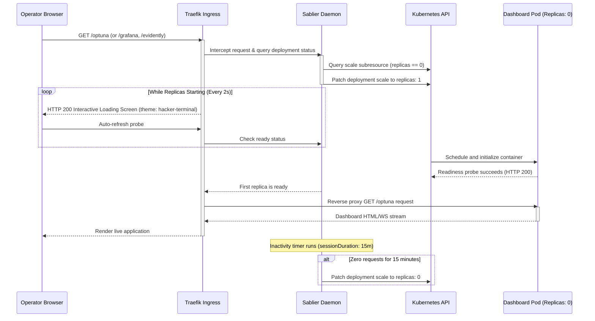
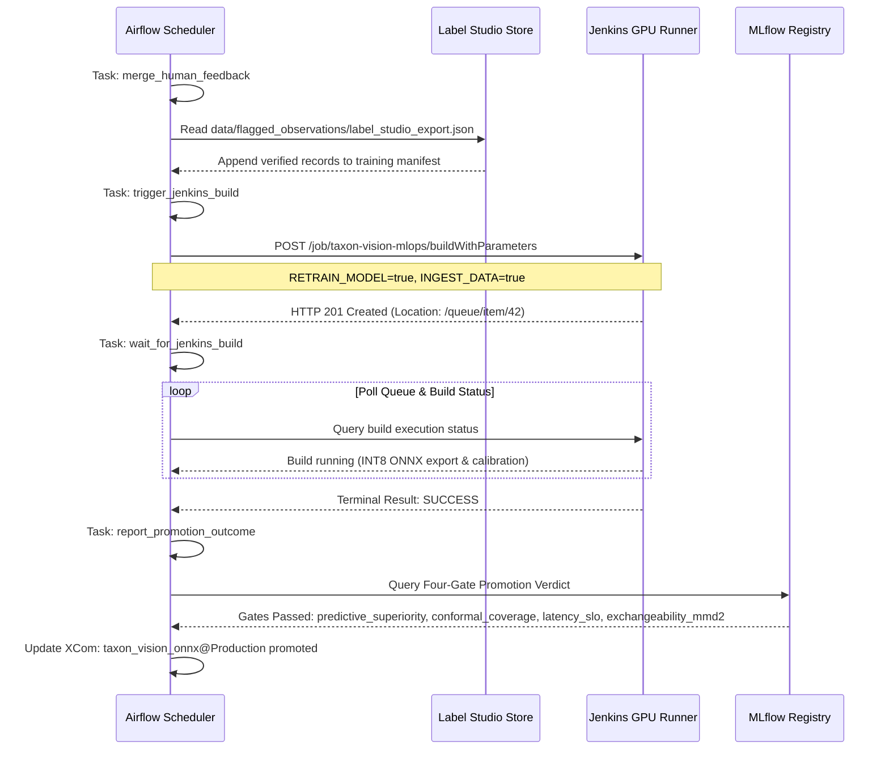

# Deployment, Scheduling & Observability

TaxonVision provides high-throughput biological species classification under strict reliability, calibration, and safety constraints. Operating this system requires a resilient, multi-tiered infrastructure stack capable of scheduling heterogeneous workloads (interactive REST API services, CI automation runners, scale-to-zero inspection consoles, and batch retraining pipelines) across shared hardware accelerators, continuously monitoring inference latency and calibration drift, and orchestrating automated retraining when ecological domain shifts occur.

This document details container packaging, multi-service Docker Compose orchestration, bare-metal Kubernetes deployment manifests, NVIDIA GPU time-slicing, Sablier lazy-scaling for idle workloads, Prometheus telemetry instrumentation, two-tier Wasserstein-1 and MMD² representation drift detection, scheduled Airflow monitoring DAGs, and operational deployment verification runbooks. For related operational surfaces, see [Service & API](service-and-api.md), [System Architecture & Design](../architecture/system-overview.md), [Model Training & Tracking](../workflows/model-training-and-tracking.md), and [Test Strategy & Invariants](../testing/test-strategy-and-invariants.md).

---

## Container Packaging & Multi-Service Orchestration

TaxonVision supports two primary operational runtimes: a self-contained local/edge developer environment orchestrated via Docker Compose, and a resilient, multi-node bare-metal production topology managed through Kubernetes manifests.

### Container Packaging (`deploy/docker/Dockerfile`)

Production containers are packaged using Pixi and hardened for non-root execution:

* **Base Layer**: Built on `ghcr.io/prefix-dev/pixi:latest` as an unprivileged runtime runner.
* **Security Context**: Dedicated non-root user `appuser` and group `appgroup` (`UID: 10001`, `GID: 10001`). All application source files, configuration manifests, and storage directories (`models/checkpoints`, `data/sample`, `data/flagged_observations`, `reports`) are owned by `10001:10001`.
* **Deterministic Environments**: Pixi installs the frozen CPU-safe inference and runtime environment directly from `pixi.lock` via `pixi install --frozen -e ci`. This locks binary dependencies and Python wheels without requiring dynamic package resolution.
* **Container Healthcheck**: Configured with an integrated readiness healthcheck:
  ```dockerfile
  HEALTHCHECK --interval=15s --timeout=3s --start-period=10s --retries=3 \
    CMD pixi run --frozen -e ci python -c "import urllib.request; urllib.request.urlopen('http://127.0.0.1:8000/health/ready')" || exit 1
  ```
* **Process Entrypoint**: Dispatches the ASGI server via `pixi run --frozen -e ci uvicorn taxon_vision.service.api:app --host 0.0.0.0 --port 8000`.

### Multi-Service Docker Compose (`docker-compose.yml`)

The root `docker-compose.yml` orchestrates the complete end-to-end MLOps microservice ecosystem for local workstations and staging nodes:

<!-- openwiki: mermaid parse failed and this diagram was converted to a text fence so it does not break rendering. Fix the diagram source and restore the mermaid fence. Parser error: Heuristic: an unescaped angle bracket inside a label breaks rendering; rephrase the label. -->
```text
flowchart TD
    subgraph S_EDGE["Edge Reverse Proxy"]
        TRAEFIK["Traefik v3.1<br/>Port: 80, 8081, 9100"]
    end

    subgraph S_APPS["Core Serving & Visualisation"]
        APP["FastAPI App: taxon_vision_app<br/>Port: 8000"]
        OPTUNA["Optuna Dashboard<br/>Port: 8080"]
        GRAFANA["Grafana Telemetry<br/>Port: 3000"]
        MLFLOW["MLflow Tracking Server 3.16<br/>Port: 5000"]
    end

    subgraph S_ORCH["Airflow 3.0 Orchestration"]
        AF_API["Airflow API Server<br/>Port: 8090"]
        AF_SCHED["Airflow Scheduler"]
        AF_DAG["Airflow DAG Processor"]
    end

    subgraph S_STORE["Persistence & Metrics Infrastructure"]
        POSTGRES["PostgreSQL 16 Alpine<br/>Port: 5432"]
        SEAWEED["SeaweedFS S3 Storage<br/>Port: 8333, 9333, 8888"]
        PROM["Prometheus Server<br/>Port: 9090"]
    end

    TRAEFIK -->|PathPrefix: /| APP
    TRAEFIK -->|Metrics Scrape| PROM
    APP --> POSTGRES
    APP --> SEAWEED
    APP --> MLFLOW
    OPTUNA --> POSTGRES
    MLFLOW --> POSTGRES
    MLFLOW --> SEAWEED
    GRAFANA --> PROM
    PROM --> APP
    AF_SCHED --> POSTGRES
    AF_API --> POSTGRES
    AF_DAG --> POSTGRES
    AF_SCHED -->|HTTP /api/v1/drift/evaluate| APP
```
*Multi-service Docker Compose topology illustrating Traefik edge ingress, Airflow orchestration, and shared storage layers.*

1. **`traefik` (`traefik:v3.1`)**: Reverse proxy and ingress controller exposing public HTTP on port `80`, an administrative dashboard on port `8081`, and native Prometheus gateway metrics on port `9100`.
2. **`app` (`deploy/docker/Dockerfile`)**: Core FastAPI inference microservice and Jinja2/HTMX dashboard serving on port `8000`.
3. **`seaweedfs` (`chrislusf/seaweedfs:latest`)**: High-performance S3-compatible local object store providing S3 APIs on port `8333`, master UI on port `9333`, and filer UI on port `8888`.
4. **`optuna-dashboard` (`ghcr.io/optuna/optuna-dashboard:latest`)**: Interactive Bayesian hyperparameter optimization visualizer on port `8080`, reading trial metadata from PostgreSQL.
5. **`prometheus` (`prom/prometheus:latest`)**: Real-time time-series scraper collecting metrics every 5 seconds on port `9090`.
6. **`grafana` (`grafana/grafana:latest`)**: Metric dashboard console on port `3000` with pre-provisioned Prometheus datasources.
7. **`mlflow-server` (`ghcr.io/mlflow/mlflow:v3.16.0`)**: Experiment tracking registry on port `5000`, persisting metadata to PostgreSQL and raw run artifacts to SeaweedFS bucket `s3://mlflow-artifacts`.
8. **`postgres` (`postgres:16-alpine`)**: Shared relational storage partitioned across databases for Airflow, MLflow, Optuna, and runtime prediction telemetry.
9. **`airflow` (Airflow 3.0.0)**: Comprising `airflow-init`, `airflow-apiserver` (port `8090`), `airflow-scheduler`, and `airflow-dag-processor` running under `LocalExecutor`.
10. **`pipeline-runner`**: Profile-triggered container (`profiles: ["pipeline"]`) executing batch DVC reproduction workflows (`pixi run ... dvc repro`).

---

## Kubernetes Deployment Topology

In production environments, TaxonVision runs within a bare-metal Kubernetes cluster (such as lightweight `k3s`) under the dedicated `taxon-vision` namespace.

<!-- openwiki: mermaid parse failed and this diagram was converted to a text fence so it does not break rendering. Fix the diagram source and restore the mermaid fence. Parser error: Heuristic: an unescaped angle bracket inside a label breaks rendering; rephrase the label. -->
```text
flowchart TD
    subgraph S_EXT["External Traffic & Ingress"]
        CLIENT["Client / Field Biologist"]
        PROM_EXT["Prometheus Server<br/>Scrape Interval: 10s"]
    end

    subgraph S_ING["Ingress Routing (Traefik v3)"]
        ING["Traefik IngressRoute: taxon-vision-ingress"]
        MID_OPT["Middleware: sablier-optuna"]
        MID_GRAF["Middleware: sablier-grafana"]
        MID_EVID["Middleware: sablier-evidently"]
    end

    subgraph S_K8S["Namespace: taxon-vision"]
        SVC_SERV["Service: taxon-vision-serving<br/>NodePort: 30080 to Port: 8000"]
        DEPLOY_SERV["Deployment: taxon-vision-serving<br/>Replicas: 2 (Always Warm)<br/>UID: 10001 (Non-Root)<br/>Requests: 200m CPU, 512Mi RAM, 1 GPU Slice"]

        SABLIER["Deployment: sablier (Port: 10000)<br/>ClusterRole: sablier-cluster-role"]

        DASH_OPT["Deployment: optuna-dashboard<br/>Replicas: 0 (Scale-to-Zero)"]
        DASH_GRAF["Deployment: grafana<br/>Replicas: 0 (Scale-to-Zero)"]
        DASH_EVID["Deployment: evidently-ui<br/>Replicas: 0 (Scale-to-Zero)"]

        VOL_CP["HostPath: /var/lib/taxon-vision/checkpoints<br/>Mount: /app/models/checkpoints (ReadOnly)"]
        VOL_FLAG["HostPath: /var/lib/taxon-vision/flagged_observations<br/>Mount: /app/data/flagged_observations"]
    end

    subgraph S_CI["Namespace: jenkins-ci"]
        SA_JENKINS["ServiceAccount: jenkins-agent"]
        ROLE_DEPLOY["Role: jenkins-deployer-role<br/>Deployments, Services, IngressRoutes"]
        SA_JENKINS -.->|Cross-Namespace Binding| ROLE_DEPLOY
        ROLE_DEPLOY -.->|Rolls out Updates| DEPLOY_SERV
    end

    CLIENT -->|HTTP Port 80| ING
    ING -->|PathPrefix: /| SVC_SERV
    ING -->|PathPrefix: /optuna| MID_OPT --> DASH_OPT
    ING -->|PathPrefix: /grafana| MID_GRAF --> DASH_GRAF
    ING -->|PathPrefix: /evidently| MID_EVID --> DASH_EVID

    MID_OPT -.->|Queries Status & Scales| SABLIER
    MID_GRAF -.->|Queries Status & Scales| SABLIER
    MID_EVID -.->|Queries Status & Scales| SABLIER
    SABLIER -.->|k8s API: patch scale replicas=1| DASH_OPT
    SABLIER -.->|k8s API: patch scale replicas=1| DASH_GRAF
    SABLIER -.->|k8s API: patch scale replicas=1| DASH_EVID

    SVC_SERV --> DEPLOY_SERV
    VOL_CP --> DEPLOY_SERV
    VOL_FLAG --> DEPLOY_SERV
    PROM_EXT -->|GET /metrics via NodePort 30080| SVC_SERV
```
*Kubernetes deployment architecture illustrating warm serving pods, Sablier lazy-scaling of inspection consoles, hostPath volumes, and Jenkins CI deployment RBAC.*

### Serving Deployment Specification (`deploy/k8s/api-deployment.yaml`)

The `taxon-vision-serving` Deployment manages stateless visual classification workers:

* **Replication & Rolling Update**: Runs `replicas: 2` with `strategy.type: RollingUpdate` (`maxSurge: 1`, `maxUnavailable: 0`). A newly deployed pod must reach readiness before an active pod is terminated, ensuring uninterrupted serving.
* **Security & Non-Root Execution**: Hardened against container breakouts:
  ```yaml
  securityContext:
    runAsNonRoot: true
    runAsUser: 10001
    runAsGroup: 10001
  ```
* **Resource Limits & Requests**: Requests `cpu: "200m"`, `memory: "512Mi"`, `nvidia.com/gpu: "1"` and sets limits to `cpu: "2"`, `memory: "1536Mi"`, `nvidia.com/gpu: "1"`.
* **Graceful Teardown**: Enforces a `preStop` lifecycle hook executing `sleep 5` to allow active keep-alive HTTP sockets and reverse proxy routing tables to drain before SIGTERM handling.
* **HostPath Volumes**:
  * `checkpoints-volume`: Mounts `/var/lib/taxon-vision/checkpoints` as `readOnly: true` at `/app/models/checkpoints`.
  * `flagged-observations-volume`: Mounts `/var/lib/taxon-vision/flagged_observations` as read-write at `/app/data/flagged_observations` for offline active learning triage.
* **Decoupled Probing**:
  * **Liveness Probe**: `GET /health` (`initialDelaySeconds: 15`, `periodSeconds: 20`, `timeoutSeconds: 3`, `failureThreshold: 3`). Pure memory check returning `{"status": "healthy"}` without hitting model forward passes.
  * **Readiness Probe**: `GET /health/ready` (`initialDelaySeconds: 5`, `periodSeconds: 5`, `timeoutSeconds: 3`, `failureThreshold: 2`). Evaluates `check_readiness()` in `src/taxon_vision/service/inference.py` to confirm the taxa catalog contains species definitions and the model classifier is loaded and warm. Traffic is rejected (HTTP 503) until ready.

### NodePort Service Definition

The `taxon-vision-serving` Service exposes container port 8000 externally via NodePort 30080:

* **Service Port**: Port `8000` routes directly to `targetPort: 8000`.
* **NodePort**: Static port `30080` allows direct access from edge gateways or CI runners (`http://<node-ip>:30080`).

### Cross-Namespace Jenkins CI RBAC (`deploy/k8s/jenkins-agent-rbac.yaml`)

Continuous integration agents executing model verification and image rollouts are governed by strict least-privilege RBAC:

1. **Namespace `jenkins-ci`**:
   * `ServiceAccount`: `jenkins-agent`
   * `Role`: `jenkins-agent-role` allows pod manipulation (`pods`, `pods/exec`, `pods/log`) and event reading within `jenkins-ci`.
2. **Namespace `taxon-vision`**:
   * `Role`: `jenkins-deployer-role` allows deployment management over `apps/deployments`, core resources (`services`, `pods`, `pods/log`, `events`, `configmaps`, `secrets`, `persistentvolumeclaims`), and Traefik custom resources (`traefik.io/ingressroutes`, `traefikservices`, `middlewares`).
   * `RoleBinding`: `jenkins-deployer-binding` binds `ServiceAccount: jenkins-agent` in `jenkins-ci` to `jenkins-deployer-role` in `taxon-vision`.

### NVIDIA GPU Time-Slicing (`deploy/k8s/nvidia-time-slicing-config.yaml`)

Consumer or prosumer accelerators (such as an NVIDIA RTX 5070 Ti with 16 GB VRAM) lack hardware-level Multi-Instance GPU (MIG) partitioning. Requesting `nvidia.com/gpu: 1` would normally lock the entire physical adapter.

The NVIDIA Device Plugin time-slicing ConfigMap multiplexes the physical device into 4 virtual slices:

```yaml
apiVersion: v1
kind: ConfigMap
metadata:
  name: nvidia-device-plugin-config
  namespace: kube-system
data:
  config.yaml: |
    version: v1
    sharing:
      timeSlicing:
        resources:
          - name: nvidia.com/gpu
            replicas: 4
```

Because driver-level time-slicing does not isolate VRAM, memory isolation is enforced in software:
* Serving pods use quantized INT8 ONNX backbones (< 1.5 GB VRAM).
* Retraining jobs constrain process growth via `torch.cuda.set_per_process_memory_fraction(0.40, device=0)`.

---

## Sablier Lazy-Scaling & Scale-to-Zero Architecture

To preserve CPU and memory budgets on dedicated silicon during idle periods, TaxonVision partitions workloads into **always-warm core services** and **on-demand scale-to-zero dashboards**.

### Workload Partitioning

| Workload | Scaling Strategy | Idle Replicas | Inactivity Timeout | Justification |
|---|---|---|---|---|
| `taxon-vision-serving` | Always Warm | 2 | N/A | Sub-50ms inference SLO for continuous field observation streams. |
| `prometheus` | Always Warm | 1 | N/A | Continuous telemetry scraping and SLA calculation. |
| `postgres` / `seaweedfs` | Always Warm | 1 | N/A | Foundational storage and database backends. |
| `sablier` | Always Warm | 1 | N/A | Controller daemon managing scale events. |
| `optuna-dashboard` | Scale-to-Zero | 0 | 15 minutes | Human-inspected Bayesian HPO dashboard; idle between hyperparameter tuning runs. |
| `grafana` | Scale-to-Zero | 0 | 20 minutes | Operational telemetry dashboard; accessed periodically by on-call engineers. |
| `evidently-ui` | Scale-to-Zero | 0 | 15 minutes | Diagnostic distribution drift inspection UI; consulted only upon drift alerts. |

### Sablier Daemon & RBAC (`deploy/k8s/sablier-scaler.yaml`)

The Sablier scaler runs as a cluster deployment in `taxon-vision`:
* **Image**: `ghcr.io/sablierapp/sablier:latest` listening on port `10000`.
* **Arguments**: Configured with `--provider.name=kubernetes`, `--provider.kubernetes.ready-on-first-replica`, and `--sessions.default-duration=15m`.
* **RBAC Authorisation**: Bound to `ClusterRole: sablier-cluster-role`, which grants `get`, `list`, `watch`, `update`, and `patch` verbs on `apps/deployments`, `apps/deployments/scale`, `apps/statefulsets`, and `postgresql.cnpg.io/clusters`.

### Traefik Ingress Integration (`deploy/k8s/traefik-ingress.yaml`)

Traefik v3 integrates with Sablier via the Traefik Sablier plugin (`deploy/k8s/traefik-sablier-config.yaml`). Each on-demand dashboard has a corresponding `Middleware` definition:

```yaml
apiVersion: traefik.io/v1alpha1
kind: Middleware
metadata:
  name: sablier-optuna
  namespace: taxon-vision
spec:
  plugin:
    sablier:
      sablierUrl: http://sablier.taxon-vision.svc.cluster.local:10000
      names: "deployment_taxon-vision_optuna-dashboard_1"
      sessionDuration: "15m"
      dynamic:
        displayName: "Optuna Bayesian Dashboard"
        theme: "hacker-terminal"
        refreshFrequency: "2s"
```

Similar middlewares are declared for `sablier-grafana` (theme: `ghost`, session: `20m`) and `sablier-evidently` (theme: `shuffle`, session: `15m`).

### Scale-from-Zero Request Lifecycle


*Sablier scale-from-zero lifecycle showing request interception, temporary loading screen generation, pod awakening, and automatic idle teardown.*

---

## Prometheus Telemetry & Metrics Instrumentation

TaxonVision integrates native Prometheus metrics to monitor inference latency distributions, prediction throughput, out-of-distribution referral rates, and statistical drift indicators.

<!-- openwiki: mermaid parse failed and this diagram was converted to a text fence so it does not break rendering. Fix the diagram source and restore the mermaid fence. Parser error: Heuristic: an unescaped angle bracket inside a label breaks rendering; rephrase the label. -->
```text
flowchart TD
    subgraph S_API["FastAPI Inference Service (taxon-vision-serving)"]
        ROUTE_PRED["POST /api/v1/predict"]
        ROUTE_DRIFT["POST /api/v1/drift/evaluate"]
        ROUTE_METRICS["GET /metrics"]
        
        COLL_CORE["In-Memory Metrics Registry<br/>taxon_predictions_total<br/>taxon_inference_latency_seconds<br/>taxon_human_referrals_active"]
        COLL_DRIFT["Custom DriftMetricsCollector<br/>(30-Second TTL Cache)"]
    end

    subgraph S_STORE["Persistent Telemetry Store"]
        DB_TEL["PostgreSQL Telemetry Tables<br/>prediction_records<br/>drift_run_records"]
    end

    subgraph S_SCRAPE["Prometheus Server (Scrape: 5s / 10s)"]
        PROM_SRV["Prometheus TSDB"]
    end

    subgraph S_ALERT["Monitoring & Alerting"]
        GRAF_DASH["Grafana Dashboards"]
        ALERT_ENG["Alertmanager / PagerDuty Rules"]
        AF_DAG["Airflow Hourly Drift Monitor"]
    end

    ROUTE_PRED -->|Observe Latency & Increment Counts| COLL_CORE
    ROUTE_PRED -->|Async Background Task| DB_TEL
    ROUTE_DRIFT -->|Persist Evaluation Outcome| DB_TEL
    
    COLL_DRIFT -->|Read Cached/Latest Drift Run| DB_TEL
    ROUTE_METRICS --> COLL_CORE
    ROUTE_METRICS --> COLL_DRIFT

    PROM_SRV -->|Poll /metrics| ROUTE_METRICS
    GRAF_DASH -->|PromQL Queries| PROM_SRV
    ALERT_ENG -->|PromQL Alert Thresholds| PROM_SRV
    AF_DAG -->|Hourly POST /api/v1/drift/evaluate| ROUTE_DRIFT
```
*End-to-end telemetry flow from request routing to database persistence, Prometheus exposition, and alerting dashboards.*

### Core Telemetry Metrics

Metrics are declared in `src/taxon_vision/monitoring/telemetry.py` and exposed via `GET /metrics` in `src/taxon_vision/service/routes/health.py`:

| Metric Identifier | Prometheus Type | Labels | Description & Operational Purpose |
|---|---|---|---|
| `taxon_predictions_total` | `Counter` | `status` | Total prediction calls evaluated. Status labels: `success` (valid prediction), `invalid_input` (corrupt/empty image), `unavailable` (uninitialized classifier/503), or `error` (runtime crash). |
| `taxon_inference_latency_seconds` | `Histogram` | None | End-to-end request duration from payload ingress through neural forward pass and conformal calibration. |
| `taxon_human_referrals_active` | `Gauge` | None | Count of observations deferred to human taxonomists due to conformal set ambiguity or high OOD energy. |
| `taxon_telemetry_write_failures_total` | `Counter` | None | Total database write failures encountered when persisting asynchronous prediction telemetry. |
| `taxon_retrain_triggers_total` | `Counter` | `source`, `outcome` | Count of model retraining triggers dispatched by source (`prediction_drift_monitor`, `grafana_relay`) and outcome. |

### Dynamic Persistent Drift Collector (`DriftMetricsCollector`)

In multi-worker ASGI deployments (e.g. Uvicorn with multiple worker processes), in-memory Prometheus Gauges are isolated per process, causing oscillations across scrape cycles.

`DriftMetricsCollector` solves this by decoupling drift metrics from worker process memory:
* Maintains a thread-locked in-memory cache with a 30-second TTL (`_cache_ttl_seconds = 30.0`).
* On scrape (`collect()`), queries `store.latest_drift_run()` from PostgreSQL only if the cache has expired, avoiding database lock contention.
* Exposes five gauge families:
  * `taxon_drift_w1_distance`: Observed 1D Wasserstein-1 distance on embedding norms.
  * `taxon_drift_w1_threshold`: Calibrated alert threshold $\tau_{w1}$.
  * `taxon_drift_mmd2_p_value`: Multivariate MMD² permutation test p-value.
  * `taxon_drift_detected`: Binary indicator flag (`1.0` if drift detected, `0.0` otherwise).
  * `taxon_drift_last_run_timestamp_seconds`: UTC UNIX timestamp of the latest drift run execution.

### Scrape Configuration & Grafana Datasource

* **Local Scrape (`config/prometheus.yaml`)**:
  ```yaml
  global:
    scrape_interval: 5s
  scrape_configs:
    - job_name: 'fastapi-app'
      metrics_path: '/metrics'
      static_configs:
        - targets: ['app:8000', 'host.docker.internal:8000']
    - job_name: 'traefik'
      metrics_path: '/metrics'
      static_configs:
        - targets: ['traefik:9100', 'host.docker.internal:9100']
  ```
* **Kubernetes Scrape (`deploy/k8s/monitoring-prometheus-grafana.yaml`)**:
  Configured with `scrape_interval: 10s` targeting `taxon-vision-serving:8000`. Grafana datasources are auto-provisioned via ConfigMap to proxy `http://prometheus:9090`.

### Recommended PromQL Alerting Rules

Operations teams configure Grafana and Alertmanager alerts using the following rules:

* **Inference Error Rate (> 1% over 5m)**:
  ```promql
  sum(rate(taxon_predictions_total{status!="success"}[5m]))
  /
  sum(rate(taxon_predictions_total[5m])) > 0.01
  ```
* **Inference Latency SLO Breach (p95 > 250ms)**:
  ```promql
  histogram_quantile(0.95, sum(rate(taxon_inference_latency_seconds_bucket[5m])) by (le)) > 0.25
  ```
* **Active Learning Referral Spike (> 50 in 15m)**:
  ```promql
  delta(taxon_human_referrals_active[15m]) > 50
  ```
* **Active Distribution Drift Detected**:
  ```promql
  taxon_drift_detected == 1.0
  ```

---

## Statistical Drift Detection Pipelines

Ecological visual classification models face non-stationary domain conditions: seasonal phenological changes (flowering vs. defoliation), regional illumination variations, differing sensor optics, and shifts in relative species abundance. TaxonVision employs a two-tier statistical drift framework combined with PCA projections and Kolmogorov-Smirnov hypothesis testing.

### The Unnormalized Embedding Invariant

A critical invariant in `src/taxon_vision/monitoring/drift.py` is that **embedding vectors must remain unnormalized pre-activations**:
$$\|z\|_2 = \sqrt{\sum_{d=1}^D z_d^2}$$
If embeddings are unit-normalized ($\|z\|_2 = 1.0$) prior to drift testing, all vector norms collapse identically to $1.0$, rendering norm-based Wasserstein-1 testing completely blind to domain shift ($|1.0 - 1.0| = 0.0$). ONNX exports and feature extraction pipelines therefore preserve raw feature norms, leaving unit-normalization to downstream cosine vector indexers (e.g. LanceDB) at the ingestion boundary.

### Two-Tier Drift Architecture

<!-- openwiki: mermaid parse failed and this diagram was converted to a text fence so it does not break rendering. Fix the diagram source and restore the mermaid fence. Parser error: Heuristic: an unescaped angle bracket inside a label breaks rendering; rephrase the label. -->
```text
flowchart TD
    subgraph S_INPUT["Input Representations"]
        REF["Reference Embeddings (N_ref, D)<br/>Cached from cal_embeddings.pt"]
        CURR["Live Production Window (N_curr, D)<br/>Queried from TelemetryStore"]
    end

    subgraph S_TIER1["Tier 1: 1D Wasserstein-1 Distance (Fast)"]
        NORM_REF["ref_norm = np.linalg.norm(ref, axis=-1)"]
        NORM_CURR["curr_norm = np.linalg.norm(curr, axis=-1)"]
        W1["wasserstein_distance(ref_norm, curr_norm)<br/>Exact empirical CDF integration<br/>Complexity: O(N * D + N log N)"]
        CHECK_W1{"W1 > tau_w1<br/>(e.g., > 0.15)?"}
    end

    subgraph S_TIER2["Tier 2: Multivariate RBF MMD² Permutation Test"]
        SUB["Subsample to max_samples (e.g. 500)"]
        MED["Median Heuristic Bandwidth: sigma = sqrt(0.5 * median(D_ij^2))"]
        GRAM["Gram Kernel Matrix: K = exp(-D^2 / (2 * sigma^2))"]
        PERM["Monte Carlo Permutations (n=200)<br/>Finite-sample empirical p-value"]
        CHECK_MMD{"p_value < alpha<br/>(e.g., < 0.01)?"}
    end

    subgraph S_EVID["Tabular Projection & Kolmogorov-Smirnov Audit"]
        PCA_PROJ["8-Component PCA Projection + L2 Norm Column"]
        EVID_REP["Evidently 0.7 DataDriftPreset<br/>Two-Sample Kolmogorov-Smirnov Tests<br/>Render HTML Report (reports/drift_report.html)"]
    end

    subgraph S_VERDICT["Composite Drift Verdict"]
        DECISION{"Drift Detected?<br/>(W1 > tau_w1 OR p_value < alpha)"}
        ALERT["Log to MLflow (taxon-vision-drift)<br/>Persist DriftRunRecord in PostgreSQL<br/>Trigger Automated Retraining DAG"]
        STABLE["Feature Manifold Stable<br/>No Action Required"]
    end

    REF --> NORM_REF
    CURR --> NORM_CURR
    NORM_REF --> W1
    NORM_CURR --> W1
    W1 --> CHECK_W1

    REF --> SUB
    CURR --> SUB
    SUB --> MED --> GRAM --> PERM --> CHECK_MMD

    REF --> PCA_PROJ
    CURR --> PCA_PROJ
    PCA_PROJ --> EVID_REP

    CHECK_W1 --> DECISION
    CHECK_MMD --> DECISION
    DECISION -->|Yes| ALERT
    DECISION -->|No| STABLE
```
*Two-tier statistical drift evaluation pipeline combining 1D Wasserstein-1 norm distance, multivariate RBF MMD² permutations, and Kolmogorov-Smirnov PCA diagnostics.*

1. **Tier 1: 1D Wasserstein-1 on Embedding Norms (`compute_wasserstein_drift`)**:
   Projects high-dimensional vectors to 1D Euclidean norms and computes the exact Kantorovich-Rubinstein distance between empirical CDFs via `scipy.stats.wasserstein_distance`:
   $$W_1(P_{\text{ref}}, P_{\text{curr}}) = \int_{-\infty}^{\infty} |F_{\text{ref}}(u) - F_{\text{curr}}(u)| \, du$$
   Complexity is $O(N \cdot D + N \log N)$. Breaches of the calibrated threshold $\tau_{w1}$ (default: $0.15$) trigger drift alerts.
2. **Tier 2: Multivariate RBF MMD² with Permutation Testing (`compute_mmd2_permutation`)**:
   Evaluates Maximum Mean Discrepancy squared in a Reproducing Kernel Hilbert Space (RKHS) using an RBF kernel. Bandwidth $\sigma$ is selected using the median heuristic over off-diagonal pairwise squared distances. Permutation testing (200 random shuffles) produces an exact, finite-sample p-value without requiring asymptotic normality assumptions. A p-value below significance level $\alpha$ (default: $0.01$) indicates significant angular or covariance manifold shift.
3. **Tabular Projection & Kolmogorov-Smirnov Reporting (`generate_evidently_drift_report`)**:
   To diagnose individual coordinate shifts, embeddings are projected onto an 8-component PCA basis alongside their Euclidean norm ($[\|z\|_2, \text{pca}_0, \dots, \text{pca}_7]$). Evidently 0.7's `DataDriftPreset` executes two-sample **Kolmogorov-Smirnov (KS) tests** (`scipy.stats.ks_2samp`) across each continuous feature column, generating an interactive HTML diagnostic report (`reports/drift_report.html`).
4. **Offline Training Data Drift Audit (`src/taxon_vision/pipelines/data_drift.py`)**:
   Stage 3.5 in the training pipeline executes this audit comparing historical reference embeddings (`reference_train_embeddings.pt`) with newly extracted training features (`train_embeddings.pt`) prior to model head fine-tuning.

### Microservice Endpoints (`src/taxon_vision/service/routes/drift.py`)

* **`POST /api/v1/drift/evaluate`**: Protected by bearer token authentication (`TAXON_INTERNAL_API_TOKEN`). Offloads CPU-intensive matrix operations to AnyIO worker threads via `anyio.to_thread.run_sync(evaluate_recent_drift)`. Returns `DriftEvaluationResponse`.
* **`GET /api/v1/drift/latest`**: Queries the latest `DriftRunRecord` from PostgreSQL without recomputing statistics, enabling real-time dashboard rendering.

---

## Airflow Orchestration & Automated Retraining Triggers

TaxonVision coordinates continuous monitoring and automated retraining through Airflow DAGs located in `airflow/dags/`.

### Hourly Drift Monitor DAG (`airflow/dags/prediction_drift_monitor.py`)

<!-- openwiki: mermaid parse failed and this diagram was converted to a text fence so it does not break rendering. Fix the diagram source and restore the mermaid fence. Parser error: Heuristic: an unescaped angle bracket inside a label breaks rendering; rephrase the label. -->
```text
flowchart TD
    START(["Start Hourly Execution (@hourly)"]) --> EVAL["Task: evaluate_live_drift<br/>Dispatches HTTP POST to /api/v1/drift/evaluate<br/>via HttpHook(http_conn_id='taxon_app')"]
    EVAL --> SHORT{"Task: is_drift_detected<br/>ShortCircuitOperator<br/>verdict['drift_detected'] == True?"}
    SHORT -->|Yes| TRIG["Task: trigger_retraining<br/>TriggerDagRunOperator<br/>trigger_dag_id='model_retraining'"]
    SHORT -->|No| SKIP(["Skip Retraining: Manifold Stable"])
    TRIG --> RETRAIN(["Dispatch model_retraining DAG"])
```
*Control flow of the hourly Airflow prediction drift monitor short-circuiting on stable distributions.*

* **Schedule**: Configured with `schedule="@hourly"`, `max_active_runs=1`, `catchup=False`, and 2 retries with a 5-minute backoff.
* **Execution**:
  1. `evaluate_live_drift`: Obtains connection credentials for `taxon_app`, constructs an authenticated Bearer token header, and executes a POST request against `/api/v1/drift/evaluate` with a 300-second timeout.
  2. `is_drift_detected`: Decorated with `@task.short_circuit`. Reads the response verdict payload; if `drift_detected` is `False`, execution terminates immediately.
  3. `trigger_retraining`: Dispatches a `TriggerDagRunOperator` targeting DAG `model_retraining` with configuration `{"trigger_source": "prediction_drift_monitor"}`.

### Retraining Orchestrator DAG (`airflow/dags/model_retraining.py`)

When distribution drift or Grafana threshold alerts trigger retraining, the event-driven `model_retraining` DAG (`schedule=None`, `max_active_runs=1`) executes the following stages:


*Retraining workflow orchestrating human feedback merging, Jenkins GPU training execution, and MLflow promotion gating.*

1. **`merge_human_feedback`**: Scans `data/flagged_observations/label_studio_export.json` for verified human labels from epistemic triage queues and merges them into the DVC dataset manifest via `merge_feedback_to_manifest()`.
2. **`trigger_jenkins_build`**: Uses `HttpHook(http_conn_id="jenkins")` to dispatch a parameterized build request to Jenkins (`/job/taxon-vision-mlops/buildWithParameters?RETRAIN_MODEL=true&INGEST_DATA=...`).
3. **`wait_for_jenkins_build`**: Polls the Jenkins build queue and console log with bounded exponential backoff until completion.
4. **`report_promotion_outcome`**: Inspects the resulting MLflow run metadata and extracts the Four-Gate Promotion Verdict (`predictive_superiority`, `conformal_coverage`, `latency_slo`, `exchangeability_mmd2`), recording the new production model alias in Airflow XCom.

---

## Operational Verification Runbooks

To guarantee deterministic, zero-defect rollouts before admitting user traffic, deployments are validated via `scripts/ci/verify_deployment.sh`.

### Verification Script: `scripts/ci/verify_deployment.sh`

The verification gate executes a 5-step validation sequence against the specified namespace:

```bash
#!/usr/bin/env bash
./scripts/ci/verify_deployment.sh taxon-vision
```

The script evaluates:

1. **Step 1/5: Rollout Completion Status**:
   Waits for deployment rollout to complete within 60 seconds:
   ```bash
   kubectl rollout status deployment/taxon-vision-serving -n taxon-vision --timeout=60s
   ```
2. **Step 2/5: Pod State Inspection**:
   Inspects pod restart counts, phase readiness, and node placements across labels `app.kubernetes.io/name=taxon-vision-serving`.
3. **Step 3/5: Dynamic Endpoint Discovery**:
   Discovers the target endpoint via a 3-tier fallback resolution mechanism:
   * **Tier 1 (Direct ClusterIP)**: Resolves `.spec.clusterIP` and attempts an HTTP connect with a 1-second timeout.
   * **Tier 2 (LAN NodePort)**: If ClusterIP is unreachable (developer workstation mode), resolves the node internal IP and NodePort `30080`.
   * **Tier 3 (Ephemeral Port-Forward)**: If LAN ingress is blocked, launches a background `kubectl port-forward` to `127.0.0.1:18000` with an automatic exit trap (`trap cleanup EXIT INT TERM`).
4. **Step 4/5: Probing HTTP Health & Readiness**:
   Validates that both liveness and readiness probes respond with HTTP 200 OK:
   ```bash
   curl -s -o /dev/null -w "%{http_code}" "${TARGET_URL}/health"
   curl -s -o /dev/null -w "%{http_code}" "${TARGET_URL}/health/ready"
   ```
5. **Step 5/5: Live Prediction Inference & Telemetry Verification**:
   Submits a multipart test image upload and verifies that Prometheus metrics expose `taxon_predictions_total`:
   ```bash
   curl -s -X POST "${TARGET_URL}/api/v1/predict" -F 'file=@/dev/null;filename=probe.jpg;type=image/jpeg'
   curl -s "${TARGET_URL}/metrics" | grep -c "taxon_predictions_total"
   ```
   Prunes any failed or evicted pods from historical rollouts and asserts `DEPLOYMENT VERIFICATION PASSED`.

---

## Troubleshooting Procedures

| Symptom / Failure | Root Cause | Diagnostic Command | Remediation Runbook |
|---|---|---|---|
| **Pod in `CrashLoopBackOff` or Readiness Probe HTTP 503** | Missing model weights or invalid `taxa_catalog.yaml` in hostPath volume. | `kubectl logs deployment/taxon-vision-serving -n taxon-vision` and `kubectl describe pod <pod_id>` | 1. Verify hostPath mount `/var/lib/taxon-vision/checkpoints` on the node.<br/>2. Ensure `best_model.onnx` or `model.pt` exists with read permissions for UID 10001.<br/>3. Ensure `taxa_catalog.yaml` is populated. |
| **Pods Stuck in `Pending` with `Insufficient nvidia.com/gpu`** | NVIDIA Device Plugin not scheduled or time-slicing ConfigMap missing. | `kubectl get nodes -o jsonpath='{.items[0].status.allocatable}'` | 1. Apply `deploy/k8s/nvidia-time-slicing-config.yaml`.<br/>2. Restart NVIDIA daemonset: `kubectl rollout restart ds/nvidia-device-plugin -n kube-system`.<br/>3. Verify allocatable `nvidia.com/gpu: 4`. |
| **CUDA OOM / Process Crashes during Retraining** | Shared GPU time-slicing exceeded physical 16 GB VRAM limit. | `dmesg -T \| grep -i oom` and `nvidia-smi` | 1. Ensure retraining scripts clamp memory via `torch.cuda.set_per_process_memory_fraction(0.40)`.<br/>2. Lower batch size in `params.yaml`.<br/>3. Ensure serving pods run INT8 ONNX models. |
| **Dashboard Ingress Returns 504 Gateway Timeout** | Sablier failed to scale deployment from 0 within proxy timeout. | `kubectl logs deployment/sablier -n taxon-vision` and `kubectl get pods -n taxon-vision` | 1. Confirm Sablier has `ClusterRoleBinding` permissions on `deployments/scale`.<br/>2. Check image pull latency or node resource exhaustion for the target dashboard.<br/>3. Increase Traefik timeout in `deploy/k8s/traefik-ingress.yaml`. |
| **Prometheus Metrics `UP == 0` / Scrape Target Down** | Network isolation, bad NodePort routing, or container crash. | `kubectl get ep taxon-vision-serving -n taxon-vision` | 1. Verify pod readiness status (`/health/ready`).<br/>2. Test local endpoint: `curl -v http://localhost:8000/metrics`.<br/>3. Verify firewall permits traffic on NodePort 30080. |
| **Distribution Drift Alert (`taxon_drift_detected == 1.0`)** | Environmental concept drift (seasonal changes, illumination, sensor noise). | Inspect `reports/drift_report.html` and query `GET /api/v1/drift/latest`. | 1. Review PCA and Kolmogorov-Smirnov feature drift in Evidently report.<br/>2. Inspect flagged observations in `/var/lib/taxon-vision/flagged_observations`.<br/>3. If biological shift, trigger Airflow `model_retraining` DAG. |
